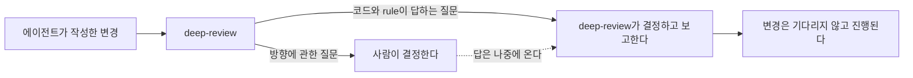
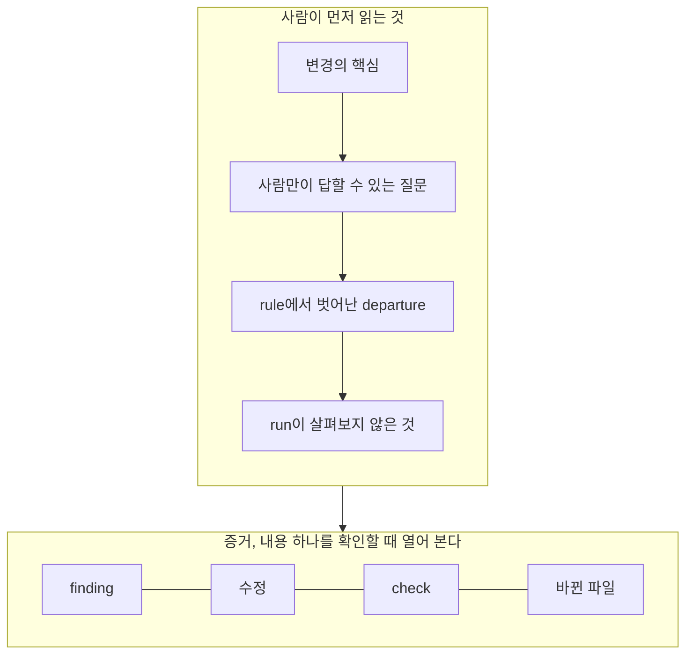
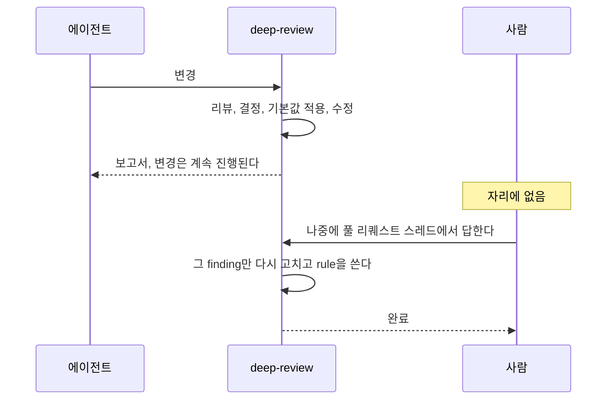
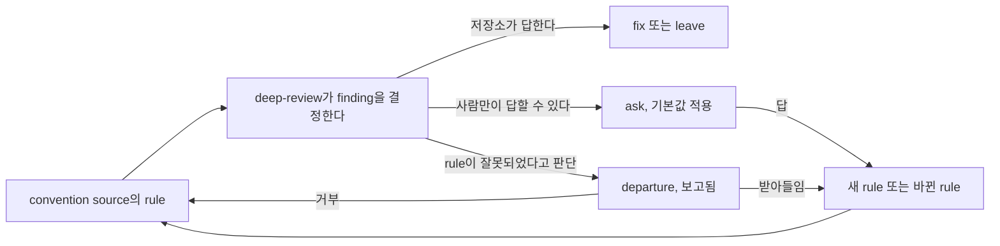

# deep-review: 비전과 설계 원칙

이 문서는 `2026-10-11-vision.md`를 한국어로 옮긴 것입니다. 두 문서가 다를 때는 영어 문서가 기준입니다.

deep-review는 저장소의 변경 하나를 리뷰하고, 요청이 있으면 그 변경을 고칩니다. 동작 방식은 `README.md`가 설명합니다. 이 문서는 deep-review가 왜 존재하고 무엇이 되어야 하는지를 설명합니다.

상태: 이 문서는 2026-10-11 시점의 생각을 적은 것입니다. 이 문서는 수정하지 않습니다. 비전이나 원칙이 바뀌면 새 날짜가 붙은 다음 문서가 이 문서를 대체합니다. `docs/changes/` 아래에 있는 변경 제안(change proposal)은 각각 가장 최근 문서에 비추어 검토합니다. 이 문서가 사용하는 용어는 맨 끝에 정의합니다.

## 비전

**에이전트가 코드를 쓰고, 개발은 에이전트의 속도로 진행됩니다. 변경은 사람을 기다리지 않습니다. 사람은 개발의 방향을 계속 결정합니다.**

이 문서에서 "사람"은 저장소와 그 방향을 책임지는 메인테이너를 가리킵니다. 비전은 두 부분으로 이루어집니다. 하나는 사람 없이 빠르게 진행되는 것이고, 다른 하나는 사람이 방향을 통제하는 것입니다. 방향에 관한 질문만 사람에게 간다면 이 두 부분은 충돌하지 않습니다. 방향에 관한 질문은 다음 중 하나입니다.

- 저장소가 정해 두지 않은 경우에 변경은 어떻게 동작해야 하는가?
- 어떤 rule이 유지되고 어떤 rule이 잘못되었는가?
- 프로젝트는 무엇을 위한 것인가?

그 밖의 모든 질문은 deep-review가 결정하고, 그 결정을 보고합니다. finding을 사람에게 읽게 하는 리뷰는, 코드가 답할 수 있는 질문에 사람의 판단을 씁니다. 그러면 처리량이 낮아집니다. 방향에 관한 질문을 스스로 결정하고 사람에게 알리지 않는 리뷰는 사람에게서 판단을 빼앗습니다. 그러면 방향에 대한 통제가 약해집니다. deep-review는 처리량과 통제를 모두 지키는 리뷰입니다.

그림 1. 방향에 관한 질문만 사람에게 가고, 변경은 그 답을 기다리지 않습니다.

## 문제와 전제

이 문서는 하나의 전제 위에 서 있습니다. 그 전제는 하나의 문제에 답합니다.

문제는 다음과 같습니다. 에이전트가 코드의 대부분을 씁니다. 그러면 diff를 읽는 사람은, 변경이 병합되기 전까지 거치는 단계 가운데 가장 느리고 가장 신뢰하기 어려운 단계가 됩니다. 에이전트가 쓴 풀 리퀘스트를 하나하나 읽는 리뷰어는 병목이 됩니다. 풀 리퀘스트를 빠르게 훑어보기만 하는 리뷰어는 게이트가 아닙니다. 그래서 리뷰는 변경이 통과하는 유일한 게이트가 됩니다. 따라서 리뷰는 다음 질문에 답해야 합니다. 아무도 diff를 읽지 않을 때, 변경을 받아들여도 된다는 근거는 무엇인가?

전제는 다음과 같습니다. 리뷰가 다음 세 가지 성질을 갖추면, 변경을 읽지 않은 사람도 그 변경을 받아들일 수 있습니다.

- 모든 verdict에는 증거가 있습니다. 사람은 지금 당장 그 내용을 확인하지 않아도 됩니다. 나중에 언제든 확인할 수 있고, 기록은 남아 있습니다.
- deep-review는 수정을 하기 전에 모든 decision을 기록합니다. 사람은 deep-review가 무엇을 왜 결정했는지 볼 수 있습니다. decision은 수정의 부수 효과가 아니라 기록이므로, 사람은 decision을 되돌릴 수 있습니다.
- deep-review는 가장 중요한 정보를 맨 앞에 둡니다. 변경의 핵심, 사람만이 답할 수 있는 질문, rule에서 벗어난 departure가 그것입니다. 이것만 읽어도 변경이 무엇인지, 무엇을 결정해야 하는지, deep-review가 어디서 저장소의 rule을 어겼는지 알 수 있습니다.

아래의 원칙들은 이 세 성질을 지킵니다. 또한 사람이 보아야 할 것을 이 세 가지로 한정합니다.

## 설계 원칙

각 원칙은 세 부분으로 이루어집니다. 변경 제안을 판단하는 기준이 되는 문장 하나, 그 원칙의 이유, 그리고 그 원칙이 실제로 뜻하는 바입니다. 원칙은 deep-review가 어떠해야 하는지를 서술하며, 지금 어떠한지를 서술하지 않습니다. 무엇이 구현되었는지는 변경 제안이 말합니다. 원칙이 무언가를 허용하지 않을 때는 그렇다고 명시합니다.

원칙은 세 묶음으로 나뉩니다. 첫째 묶음은 기록을 지키며, 전제의 첫 두 성질에 해당합니다. 둘째 묶음은 무엇이 어떤 형태로 사람에게 전달되고 무엇이 사람에게서 돌아오는지를 말하며, 전제의 셋째 성질에 해당합니다. 셋째 묶음은 우리가 deep-review 자체를 어떻게 만드는지를 말합니다.

### 기록

#### 1. 신뢰가 아니라 증거

**증거가 없는 verdict는 verdict가 아닙니다.**

diff를 읽지 않는 사람은 finding 뒤에 있는 기록을 근거로 그 finding을 받아들입니다. 따라서 사람은 나중에 그 기록을 확인할 수 있어야 합니다. finding은 항상 verdict의 증거와 함께 기록됩니다. verifier가 검사하지 않은 finding에는 그렇다고 표시합니다. 이 원칙은 증거를 대신하는 요약을 허용하지 않습니다. 모델이 확신한다는 것 외에 증거가 없는 verdict도 허용하지 않습니다.

#### 2. 행동보다 기록이 먼저입니다

**deep-review는 수정을 하기 전에 모든 decision을 기록합니다.**

실제로 한 일이, 무엇을 왜 결정했는지에 대한 기록을 덮어써서는 안 됩니다. deep-review는 fixer가 파일을 바꾸기 전에 finding 하나를 전체로 보고, 근거를 들어 결정합니다. 기록은 추가만 가능합니다. 이 원칙은 decision에 없는 선택을 하는 fixer를 허용하지 않습니다. 먼저 수정하고 나중에 설명하는 단계도 허용하지 않습니다.

#### 3. rule은 틀릴 수 있고, departure는 보고됩니다

**deep-review는 잘못되었다고 판단한 rule에서 벗어납니다. 명시된 사실에 근거해서 벗어나고, 그 departure를 보고합니다.**

요구사항, 기존 코드, 테스트는 틀릴 수 있습니다. 리뷰를 해 본 사람이라면 누구나 압니다. deep-review는 rule에서 벗어나기 전에 그 rule이 왜 있는지를 먼저 확인합니다. 선호가 아니라 사실에 근거해서 벗어납니다. decision과 보고서에 그 rule, rule의 출처, 벗어난 이유를 적습니다. 그러면 사람에게는 세 가지 선택지가 있습니다. departure를 받아들이면 rule이 바뀝니다. departure를 거부하면 수정은 다시 rule을 따릅니다. 아무것도 하지 않으면 departure가 그대로 남습니다. 이 원칙은 rule의 취지에 어긋나는 줄 알면서 그 rule을 그대로 따르고 아무 말도 하지 않는 것을 허용하지 않습니다. 보고서에 나타나지 않는 departure도 허용하지 않습니다.

### 사람에게 전달되는 것

#### 4. deep-review는 결정하고, 사람은 답하고 rule을 씁니다

**코드와 rule이 답할 수 있는 질문에는 deep-review가 모두 답합니다. 사람만이 답할 수 있는 질문은 한 번만 묻고, 다시 묻지 않습니다.**

사람은 finding을 하나하나 읽지 않습니다. 사람은 질문에 답하고 rule을 씁니다. ask는 다음 요소로 이루어집니다.

- 선택지들
- 각 선택지의 비용
- 각 선택지를 택했을 때 convention source에 적힐 rule
- deep-review가 적용한 선택지

deep-review는 되돌리기 가장 쉬운 선택지를 적용합니다. deep-review는 답을 기록하고, 그 답은 원칙 9에서 설명하듯 convention source의 rule이 됩니다. 그러면 다음 리뷰부터는 그 질문을 사람에게 묻지 않고 결정합니다. 이 원칙은 저장소가 이미 답하는 질문에 대해 finding을 사람에게 넘기는 것을 허용하지 않습니다. 같은 질문을 두 번 하는 것도 허용하지 않습니다.

#### 5. 핵심, 질문, departure가 사람에게 갑니다

**보고서는 사람이 알아야 하고 결정해야 하는 것으로 시작합니다. 나머지는 증거입니다.**

보고서는 가장 중요한 정보로 시작하며, 순서는 다음과 같습니다.

- 변경의 핵심: 무엇을 하는지, 왜 하는지
- 사람만이 답할 수 있는 질문
- rule에서 벗어난 departure
- run이 살펴보지 않은 것

finding, 수정, check, 바뀐 파일은 그 뒤에 옵니다. 이것들은 앞부분을 뒷받침하는 증거입니다. 사람은 특정 내용을 확인할 때만 이 부분을 열어 보며, 처음부터 끝까지 읽지 않습니다. 이 원칙은 finding 개수로 평가되는 보고서를 허용하지 않습니다. 질문 하나를 찾으려고 위에서 아래까지 읽어야 하는 보고서도 허용하지 않습니다.

그림 2. 보고서는 두 층으로 이루어집니다. 사람이 읽는 부분과, 그것을 뒷받침하는 증거입니다.

#### 6. 맥락이 적어도 이해하기 쉽게

**핵심, 질문, departure는 맥락이 적은 사람에게도 가장 이해하기 쉽고 결정하기 쉬운 형태로 제시됩니다.**

사람은 diff를 읽지 않았고, 에이전트가 어떻게 작업했는지 지켜보지도 않았습니다. 그 부분의 코드를 오랫동안 만지지 않은 경우도 많습니다. 그래서 원칙 5가 말하는 정보는 맥락이 적고 코드를 잘 모르는 사람에게도 분명해야 합니다. 그렇지 않으면 사람은 결정하기 위해 코드를 읽어야 하고, 게이트는 다시 느린 단계로 돌아갑니다. 따라서 변경의 핵심은 무엇을 왜 하는지를 몇 문장으로 말하며, 읽는 사람이 따로 찾아봐야 하는 내용을 넣지 않습니다. 질문은 선택지들과 각 선택지의 비용, deep-review가 적용한 선택지를 밝힙니다. 그러면 사람은 질문만 보고도 결정할 수 있습니다. departure는 rule, 그 rule에 반하는 사실, 수정이 rule 대신 택한 방법을 밝힙니다. finding 하나에 대한 수정은 커밋 하나가 되며, 커밋 메시지는 이유를 적습니다. 더 깊이 보려는 사람을 위해, 보고서에 적힌 각 내용에서 증거까지는 한 단계만 거치면 됩니다. 이 원칙은 코드를 읽어야만 답할 수 있는 질문을 허용하지 않습니다. 파일과 줄 번호만으로 rule을 가리키는 departure도 허용하지 않습니다. 무엇이 바뀌었는지만 적고 왜 바뀌었는지는 적지 않는 메시지도 허용하지 않습니다.

#### 7. 아무것도 사람을 기다리지 않습니다

**run은 사람이 없어도 끝까지 진행됩니다. 답은 나중에 옵니다. 답은 해당 finding만 다시 고칩니다.**

ask는 run을 멈추지 않습니다. deep-review는 기본값을 적용하고 보고서까지 계속 진행합니다. 답은 나중에 풀 리퀘스트 스레드나 터미널에서 옵니다. 답은 해당 finding만 fixer에게 다시 보내며, 변경 전체를 보내지 않습니다. 풀 리퀘스트는 사람이 답하는 자리입니다. 이 원칙은 run을 막는 질문을 허용하지 않습니다. 리뷰가 승인을 기다리는 모드도 허용하지 않습니다. 답 하나를 받는 대가로 리뷰 전체를 다시 하는 것도 허용하지 않습니다.

그림 3. run은 사람이 없어도 완료됩니다. 답은 나중에 오고, 해당 finding만 바꿉니다.

#### 8. 살펴보지 않은 것과, 사람이 보아야 할 때를 말합니다

**유일한 게이트인 리뷰는 자신이 게이트 역할을 하지 못하는 곳을 밝혀야 합니다.**

deep-review는 실행되지 않은 angle, 범위 밖의 파일, 실행할 수 없었던 check를 밝힙니다. 또한 사람이 보아야 할 때를 밝힙니다. finding으로 드러나지 않은 방향 질문이 변경 안에 숨어 있을 수 있기 때문입니다. 사람이 본다고 해서 변경이 막히지는 않습니다. 각 경우는 보고서가 판정할 수 있는 조건입니다.

- rule에서 벗어난 departure
- verdict가 `PLAUSIBLE`에 그친 수정
- 공개 인터페이스에 대한 변경
- 많은 파일에 영향을 주는 변경

이 원칙은 어디까지 살펴보았는지 밝히지 않는 보고서를 허용하지 않습니다. 조건을 밝히지 않은 "검토해 주세요"도 허용하지 않습니다.

#### 9. rule은 답에서 만들어집니다

**모든 답과 사람이 검토한 모든 departure는 rule이 됩니다. 그래서 deep-review는 run을 거듭할수록 더 정확해집니다.**

convention source에 적힌 rule은, 사람이 같은 질문을 한 번만 결정하고 다시 결정하지 않게 해 주는 수단입니다. rule이 만들어지는 경로는 두 가지입니다. 첫째는 ask에 대한 답입니다. ask에는 선택지마다 rule 문구가 이미 붙어 있으므로, 답을 고르면 그 문구가 convention source에 rule로 적힙니다. 둘째는 departure가 문제를 제기한 rule을 사람이 검토하는 것입니다. 사람이 departure를 받아들이면 rule이 바뀌고, 거부하면 rule이 유지됩니다. 이 과정은 계속 이어집니다. 사람이 따로 시간을 내어 rule을 쓸 때만이 아니라, run이 있을 때마다 일어납니다. 답에 rule 문구가 딸려 있는 경우에는 deep-review가 rule을 직접 쓰고, 사람은 확인만 합니다. rule이 하나 늘 때마다 다음 run에서는 질문이 하나 줄거나 다음 보고서에서는 departure가 하나 줄어듭니다. 그래서 run을 거듭할수록 deep-review는 덜 묻고, 덜 벗어나고, 더 많은 것을 스스로 결정합니다. 이 원칙은 한 번 쓰고 버려지는 답을 허용하지 않습니다. 사람이 손으로 써야만 만들어지는 rule도 허용하지 않습니다.

그림 4. 답과 사람이 검토한 departure는 rule이 되므로, run마다 지난 run보다 많은 rule에서 시작합니다.

### deep-review를 만드는 방법

#### 10. 답은 레이블입니다

**rubric은 사람들이 실제로 결정한 것에 비추어 측정합니다.**

run에서 나온 답, 받아들여진 departure, 거부된 departure가 정답 레이블입니다. 사람이 손으로 쓴 레이블은 그 근사치에 지나지 않습니다. 여러 run에 걸쳐 ledger는 코퍼스가 되고, rubric에 가한 변경은 이 코퍼스에 비추어 측정합니다. 이 원칙은 출력이 그럴듯해 보이는지로 평가되는 rubric을 허용하지 않습니다. ledger 밖에 보관되는 측정도 허용하지 않습니다.

#### 11. 사람 없이 복구합니다

**멈춰서 사람의 개입을 기다리는 run은 사람을 다시 루프 안에 넣습니다.**

run이 보고서를 내기 전에 멈추는 경우마다 어떤 조치를 취해야 하는지 밝힙니다. 실제 run이 blocker를 보여 주면 deep-review가 스스로 해결하도록 만듭니다. 실제 run은 그런 blocker를 보여 주었습니다. 모델 제공자의 사용량 한도, deep-review와 함께 멈춘 check, run 도중에 바뀐 워크트리가 그 예입니다. 복구 기능은 실제 run에서 필요가 드러났을 때 만들며, 미리 만들지 않습니다. 개념 증명은 일어나지 않은 실패에 대비한 복구를 만들었고, 실제로 일어난 실패는 놓쳤습니다. 이 원칙은 문서화된 조치가 없는 blocker를 허용하지 않습니다. 어떤 run도 보여 주지 않은 실패에 대비한 복구 경로도 허용하지 않습니다.

#### 12. 실제 run이 게이트입니다

**deep-review에 대한 변경은 실제 저장소에서 실제 run을 한 번 돌려 보고 받아들입니다. 오프라인 픽스처만으로는 받아들이지 않습니다.**

개념 증명은 오프라인 테스트 파일 92개를 통과했지만 실제 run은 매번 막혔습니다. 결함은 대부분 픽스처가 다루지 않는 경계에 있었습니다. 지금은 deep-review가 deep-review를 바꾸는 풀 리퀘스트를 직접 리뷰하고 고칩니다. 이 원칙은 테스트 스위트만 믿고 릴리스하는 것을 허용하지 않습니다. 쉽다는 이유로 고른 저장소를 게이트로 삼는 것도 허용하지 않습니다.

## 이 비전이 향하는 곳

이 비전 아래에서 리뷰는 세 곳에서 실행됩니다.

1. 변경을 작성한 에이전트의 작업 루프 안에서, 에이전트가 작업을 마쳤다고 선언하기 전에 실행됩니다.
2. 풀 리퀘스트의 필수 check로 실행됩니다.
3. 에이전트가 보낸 여러 풀 리퀘스트 가운데 사람이 볼 것을 고르는 분류 단계로 실행됩니다.

각 경우에 run 한 번의 비용은, 에이전트가 쓰는 풀 리퀘스트 수를 감당할 만큼 낮아야 합니다. 여기서 두 가지가 따라옵니다. 첫째, deep-review는 같은 변경의 두 번째 리비전을 지난 run의 verdict에서 출발해서, 바뀐 부분에 대해서만 리뷰합니다. 리비전마다 전체 run을 돌리는 방식은 규모를 감당하지 못합니다. 둘째, angle 하나는 변경을 그 변경의 요청에 비추어 읽습니다. 요청이란 풀 리퀘스트 본문, 이슈, 변경 제안을 말합니다. 이 angle은 각 요구사항이 코드와 테스트에 반영되었는지를 묻습니다. 다른 angle들은 코드를 읽습니다. 에이전트가 다른 문제를 풀었다거나, 범위를 줄이고도 말하지 않았다는 사실은 코드만으로는 드러나지 않습니다.

## 목표가 아닌 것

- **범용 에이전트.** deep-review는 변경 하나를 리뷰합니다. 요청이 있으면 그 변경을 고칩니다. 다른 작업은 맡지 않습니다.
- **대화형 인터페이스.** 사람은 풀 리퀘스트 스레드나 명령으로 deep-review에 답합니다. 답은 ledger에 기록됩니다. 채팅은 답하는 자리가 아닙니다. 채팅의 기록은 채팅 자체뿐이기 때문입니다.
- **더 긴 보고서.** 사람에게 부족한 것은 finding이나 글의 양이 아닙니다. deep-review가 다른 리뷰와 다른 점은 증거와 기록입니다. 보고서는 사람이 얼마나 적게 읽어도 되는지로 평가합니다.

## 이 문서를 사용하는 방법

- deep-review에 대한 변경은 각각 별도의 변경 제안으로 들어옵니다. 변경 제안은 가장 최근 문서에 비추어 검토합니다. 변경 제안은 무엇을 제외했고 무엇을 거부했는지 밝힙니다.
- 다음 중 하나에 해당하는 변경 제안은 비전에 반합니다.
  - 사람이 읽어야 하는 양을 늘립니다.
  - 핵심, 질문, departure를 더 많은 맥락이 있어야 이해할 수 있는 형태로 제시합니다.
  - 질문이 run을 막게 합니다.
  - 변경의 핵심, 질문, departure를 숨깁니다.
  - 답이나 사람이 검토한 departure를 rule로 만들지 않고 한 번 쓰고 버립니다.
  - 방향 질문을 deep-review 안에서 결정하고 ask나 departure로 기록하지 않습니다. 그런 변경 제안은 사람이 지켜야 할 판단을 희생해서 처리량을 얻습니다.
- 변경 제안 안에서 두 원칙이 충돌하면, 변경 제안은 그 충돌과 따르지 않은 원칙을 밝힙니다. 그러면 다음 문서가 그 원칙을 바꿀 수 있습니다. 읽는 사람이 추측할 필요가 없습니다.

## 용어

- **run**: 변경 하나에 대한 리뷰 한 번을 가리킵니다.
- **angle**: 변경을 읽는 관점 하나를 가리킵니다. 정확성이나 관례가 그 예입니다.
- **verifier**: 결함일 가능성이 있는 항목을 검사하고 verdict를 내리는 모델입니다.
- **verdict**: 결함일 가능성이 있는 항목을 검증한 결과이며, 증거가 함께 붙습니다. `CONFIRMED`, 증거가 결정적이지 않을 때의 `PLAUSIBLE`, 기각 중 하나입니다.
- **finding**: 리뷰가 보고하는 결함 하나입니다. verifier가 검사한 경우에는 verdict가 함께 붙습니다.
- **decision**: deep-review가 finding에 대해 내리는 결정입니다. `fix`, 이유를 명시한 `leave`, 사람에게 묻는 `ask` 중 하나입니다.
- **ask**: 사람에게 던지는 질문입니다. 선택지들과, deep-review가 지금 적용하는 기본값을 함께 담습니다.
- **rule**: 코드가 어떠해야 하는지를 저장소가 명시한 진술입니다. **convention source**는 rule을 명시한 파일이며, `AGENTS.md`가 그 예입니다.
- **departure**: rule에 반하는 decision입니다. 명시된 사실에 근거하며, rule에 반했다는 점을 밝힙니다.
- **fixer**: `fix` decision을 적용하는 모델입니다.
- **check**: 수정이 통과해야 하는 저장소의 명령입니다. 빌드, 타입 검사, 린트, 테스트가 있습니다.
- **blocker**: run이 보고서를 내기 전에 멈추게 하는 조건입니다.
- **ledger**: run이 수행하고 결정한 모든 것을 추가만 가능한 형태로 기록한 것입니다.
- **rubric**: 모델에게 등급을 매기는 방법을 알려 주는 프롬프트의 일부입니다.
