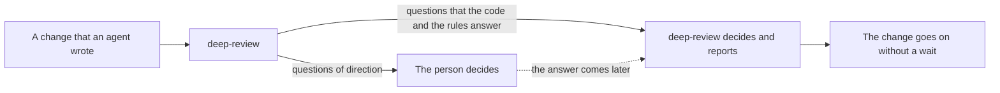
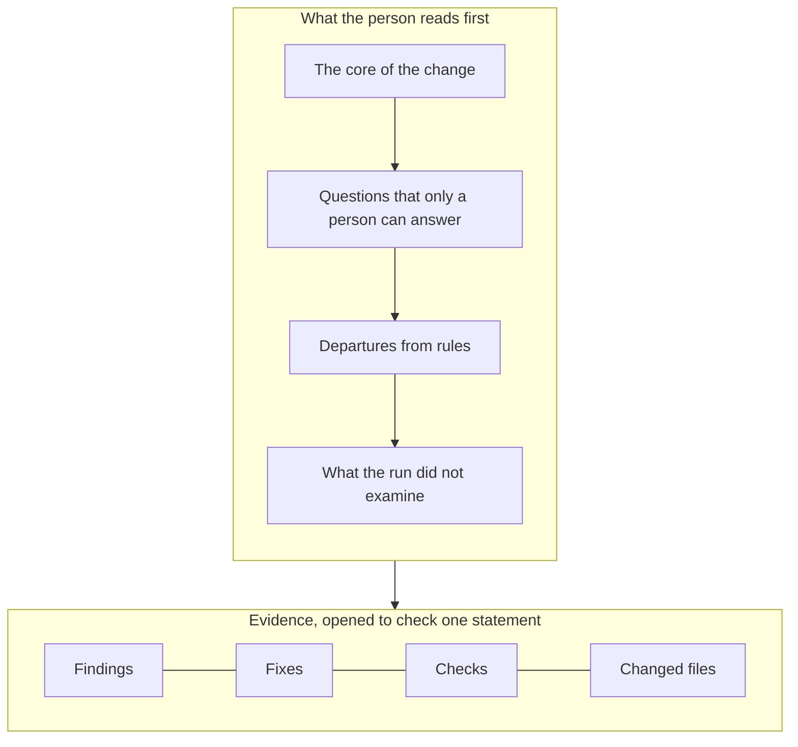
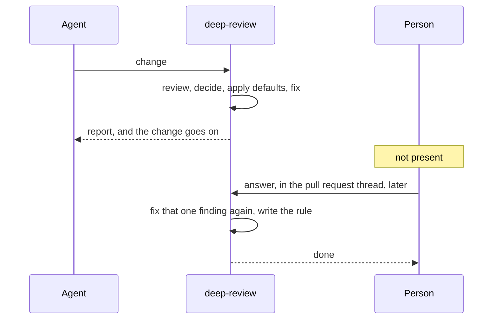
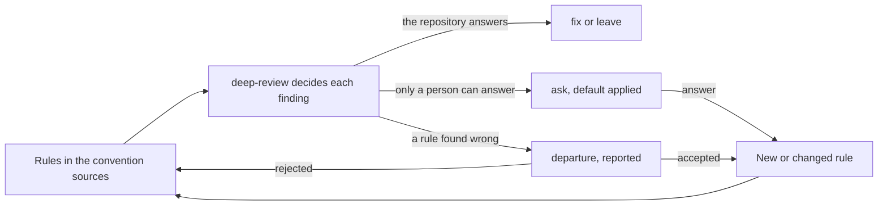

# deep-review: vision and design principles

deep-review reviews one change to a repository and, on request, fixes it. `README.md` says how it works. This note says why it exists and what it must become.

Status: This note gives the thinking of 2026-10-11. We do not edit this note. When the vision or a principle changes, a later note with its own date replaces this one. We compare each change proposal in `docs/changes/` with the latest note. The terms that this note uses are defined at the end.

## Vision

**Agents write the code, and the development moves at their speed. A change does not wait for a person. The person continues to decide the direction of the development.**

"The person" in this note is the maintainer who owns the repository and its direction. The vision has 2 parts: speed without a person in the loop, and control of the direction by the person. The 2 parts do not conflict when only the questions of direction go to the person. A question of direction is one of these:

- Which behavior must a change have when the repository does not say?
- Which rule stays, and which rule is wrong?
- What is the purpose of the project?

deep-review decides all other questions and reports its decisions. A review that gives a finding to a person to read uses the judgment of the person on a question that the code can answer. This decreases the throughput. A review that decides a question of direction and does not tell the person removes the judgment of the person. This decreases the control of the direction. deep-review is a review that keeps both the throughput and the control.

Figure 1. Only the questions of direction reach the person, and the change does not wait for the answer.

## The problem and the premise

This note rests on one premise. The premise answers one problem.

The problem: agents write most of the code. Then a person who reads the diff is the slowest step before a change is merged, and the least reliable step. A reviewer who reads each pull request that an agent wrote is the bottleneck. A reviewer who only looks quickly at each pull request is not a gate. The review becomes the one gate that a change goes through. So the review must answer this question: what makes a change acceptable when no person reads its diff?

The premise: 3 properties of the review make a change acceptable to a person who did not read it.

- Each verdict has evidence. The person does not have to check a statement now. The person can check it later, at any point, and the record is there.
- deep-review records each decision before it makes an edit. The person can see what deep-review decided and why. The person can reverse a decision, because the decision is a record and not a side effect of an edit.
- deep-review puts the most important information first: the core of the change, the questions that only a person can answer, and the departures from rules. A person who reads only this knows what the change is, what to decide, and where deep-review went against the repository.

The principles below keep these 3 properties. The principles also make these properties the only things that a person must look at.

## Design principles

Each principle has 3 parts: one sentence to compare a proposal with, the reason for the principle, and what the principle means in practice. A principle describes deep-review as it must be, not as it is. The change proposals say what is built. When a principle does not permit something, the principle says so.

The principles are in 3 groups. The first group keeps the record: the first 2 properties of the premise. The second group says what reaches the person, how, and what comes back: the third property. The third group says how we build deep-review itself.

### The record

#### 1. Evidence, not trust

**A verdict without evidence is not a verdict.**

A person who does not read the diff accepts a finding because of the record behind it. Thus a person must be able to check the record later. deep-review keeps a finding only with the evidence of its verdict next to it. It marks a finding that no verifier examined. This principle does not permit a summary that replaces its evidence. It does not permit a verdict in which the evidence is the confidence of the model.

#### 2. Record before action

**deep-review records each decision before it makes an edit.**

What was done must never overwrite what was decided and why. deep-review decides each finding as a whole, with its grounds, before a fixer changes a file. The record is append-only. This principle does not permit a fixer that makes a choice that the decision did not make. It does not permit a step that edits first and explains later.

#### 3. Rules can be wrong, and a departure is reported

**deep-review departs from a rule that it finds wrong. It does so on a stated fact, and it reports the departure.**

Requirements, existing code, and tests can be wrong. A person who reviews knows this. Before deep-review departs from a rule, it finds the reason for the rule. It departs on a fact, never on a preference. It names the rule, its source, and the reason in the decision and in the report. Then the person has 3 choices. The person accepts the departure, and the rule changes. The person rejects the departure, and the fix follows the rule again. Or the person does nothing, and the departure stays. This principle does not permit deep-review to obey a rule against the reason for the rule and say nothing. It does not permit a departure that the report does not show.

### What reaches the person

#### 4. deep-review decides; the person answers and writes rules

**deep-review answers each question that the code and the rules can answer. A question that only a person can answer is asked one time, and not again.**

The person does not read each finding. The person answers questions and writes rules. An ask has these parts:

- the options
- the cost of each option
- the rule that a convention source would state for each option
- the option that deep-review applied.

deep-review applies the option that is the easiest to reverse. deep-review records the answer, and the answer becomes a rule in a convention source, as principle 9 says. Then the next review decides the question alone. This principle does not permit deep-review to hold a finding for the person when the repository already answers the question. It does not permit the same question 2 times.

#### 5. The core, the questions, and the departures go to the person

**The report starts with what a person must know and decide. The rest is evidence.**

A report starts with the most important information, in this order:

- the core of the change: what it does, and why
- the questions that only a person can answer
- the departures from rules
- what the run did not examine.

The findings, the fixes, the checks, and the changed files come after. They are the evidence for the first part. A person opens them to check a statement, and does not read them from the start to the end. This principle does not permit a report that we judge by the number of its findings. It does not permit a report that a person must read from the top to the bottom to find the one question in it.

Figure 2. The report has 2 layers: what the person reads, and the evidence behind it.

#### 6. Easy to understand, with little context

**The core, the questions, and the departures come in the form that is the easiest to understand and to decide on, with little context.**

The person did not read the diff and did not follow the work of the agent. Often the person has not touched this part of the code for a long time. So the information of principle 5 must be clear to a person with little context and little knowledge of the code. If it is not, the person must read the code to decide, and the gate goes back to the slow step. Thus the core of the change says what it does and why, in a few sentences, with no reference that the reader must look up. A question names its options, the cost of each option, and the option that deep-review applied. The person can then decide from the question alone. A departure names the rule, the fact against it, and what the fix did instead. Each fix of a finding is one commit, with a message that says why. The evidence for each statement is one step away from the statement, for the person who wants to go deeper. This principle does not permit a question that the person can answer only after a read of the code. It does not permit a departure that names a rule by a file and a line only. It does not permit a message that says what changed and not why.

#### 7. Nothing waits for a person

**A run completes when no person is present. Answers come later. An answer fixes again only the finding that it answers.**

An ask never stops the run. deep-review applies the default and continues to the report. An answer comes later, from a pull request thread or from a terminal. The answer sends only its finding back through a fixer, never the full change. The pull request is the surface on which a person answers. This principle does not permit a question that blocks. It does not permit a mode in which the review waits for approval. It does not permit a full review again as the cost of an answer.

Figure 3. The run completes with no person present. The answer comes later and changes only its own finding.

#### 8. Say what was not examined, and when a person must look

**A review that is the only gate must say where it is not a gate.**

deep-review names the angles that did not run, the files out of scope, and the checks that it could not run. deep-review also names when a person must look, because the change can hold a question of direction that no finding raised. The look does not block the change. Each case is a condition that the report can test:

- a departure from a rule
- a fix whose verdict is only `PLAUSIBLE`
- a change to a public interface
- a change that has an effect on many files.

This principle does not permit a report that says nothing about its coverage. It does not permit a "please review" that names no condition.

#### 9. The rules grow from the answers

**Each answer, and each departure that a person reviewed, becomes a rule. So deep-review becomes more accurate with every run.**

A rule in a convention source is how the person decides a question one time and never again. Rules grow from 2 sources. The first source is an answer to an ask. The ask already gave the rule text for each option, so the answer is written to a convention source as that rule. The second source is a review of a rule that a departure challenged. The person accepts the departure, and the rule changes; or the person rejects it, and the rule stays. This process is continuous. It happens on every run, and not only when a person sits down to write rules. Where the answer gives the rule text, deep-review writes the rule itself, and the person only confirms it. Each new rule removes a question from the next run, or a departure from the next report. So over runs deep-review asks less, departs less, and decides more on its own. This principle does not permit an answer that is used one time and then lost. It does not permit a rule that only a person can write by hand.

Figure 4. Answers and reviewed departures become rules, so each run starts with more rules than the last.

### How deep-review is built

#### 10. Answers are labels

**We measure the rubrics against what people decided.**

The answers, the accepted departures, and the rejected departures of a run are the true labels. A set of labels that a person wrote by hand is only an approximation of them. Across runs, the ledger is the corpus, and we measure a change to a rubric against this corpus. This principle does not permit a rubric that we judge by the look of its output. It does not permit a measurement that we keep outside the ledger.

#### 11. Recovery without a person

**A run that stops and waits for a hand puts a person back in the loop.**

Each way in which a run stops before its report names the action to take. When a real run shows a blocker, deep-review learns to clear it alone. Real runs have shown such blockers. Examples are a usage limit of a model provider, a check that stopped with deep-review, and a worktree that changed during the run. We build recovery when a run shows the need, not before. The proof of concept built recovery for failures that did not occur, and it missed the failures that did occur. This principle does not permit a blocker without a documented action. It does not permit a recovery path for a failure that no run has shown.

#### 12. A real run is the gate

**One real run on a real repository accepts a change to deep-review. Offline fixtures alone do not.**

The proof of concept passed 92 offline test files while each real run blocked. Most defects were at a boundary that the fixtures did not cross. Now deep-review reviews and fixes each pull request that changes deep-review. This principle does not permit a release on the test suite alone. It does not permit a gate on a repository that we selected because it is easy.

## Where this leads

Under this vision, a review runs in 3 places:

1. In the loop of the author agent, before the agent says that it is done.
2. As the required check on a pull request.
3. As the triage that selects which pull requests from agents a person looks at.

In each place, the cost of a run must be low enough for the number of pull requests that agents write. Two things follow. First, deep-review reviews a second revision of a change from the verdicts of the last run, over only what changed. A full run on each revision does not scale. Second, one angle reads the change against the request for it: the pull request body, the issue, or the change proposal. It asks if each requirement reaches code and a test. The other angles read code. Code alone does not show that an agent solved a different problem, or made the scope smaller and did not say so.

## Non-goals

- **A general agent.** deep-review reviews one change. On request, it fixes the change. It does not take other tasks.
- **A conversational interface.** A person answers deep-review in a pull request thread or with a command. The answer goes on the ledger. A chat is not the place to answer, because the only record of a chat is the chat.
- **A longer report.** More findings and more text are not what the person lacks. The difference of deep-review is evidence and record. We judge a report by how little of it a person must read.

## How to use this document

- Each change to deep-review enters as its own change proposal. We compare the proposal with the latest of these notes. The proposal says what it leaves out and what it rejected.
- A proposal is against the vision if it does one of these:
  - It increases what the person must read.
  - It presents the core, a question, or a departure in a form that needs more context to understand.
  - It makes a question block a run.
  - It hides the core of the change, a question, or a departure.
  - It uses an answer or a reviewed departure one time instead of making a rule from it.
  - It decides a question of direction inside deep-review and does not record an ask or a departure. Such a proposal buys throughput with the judgment that the person must keep.
- When 2 principles conflict in a proposal, the proposal names the conflict and the principle that it did not follow. Then the next note can change the principle. The reader does not have to guess.

## Terms

- **Run**: one review of one change.
- **Angle**: one point of view from which the change is read, such as correctness or conventions.
- **Verifier**: the model that examines a possible defect and gives its verdict.
- **Verdict**: the result of verification of a possible defect, with its evidence: `CONFIRMED`, `PLAUSIBLE` when the evidence is not conclusive, or refuted.
- **Finding**: one defect that the review reports, with its verdict when a verifier examined it.
- **Decision**: what deep-review decides about a finding: `fix`, `leave` with a stated reason, or `ask` the person.
- **Ask**: a question for the person, with its options and a default that deep-review applies now.
- **Rule**: a statement in the repository about how its code must be. A **convention source** is a file that states rules, such as `AGENTS.md`.
- **Departure**: a decision that goes against a rule, on a stated fact, and says so.
- **Fixer**: the model that applies a `fix` decision.
- **Check**: a command of the repository that a fix must pass: build, typecheck, lint, or test.
- **Blocker**: a condition that stops a run before its report.
- **Ledger**: the append-only record of everything that a run did and decided.
- **Rubric**: the part of a prompt that tells a model how to grade.
