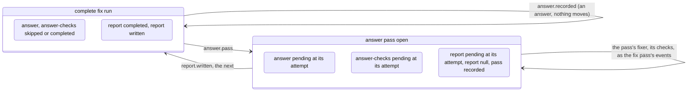
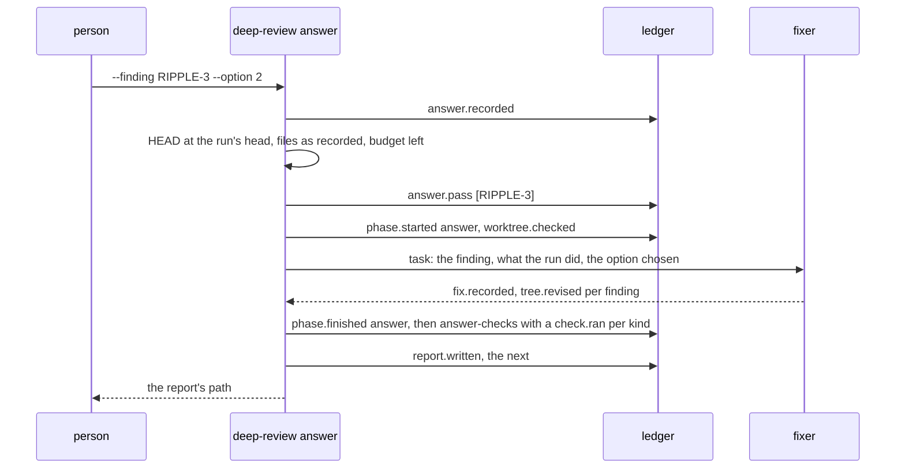

# Technical Design: Answers

Product part: [2026-10-11-answers.requirements.md](2026-10-11-answers.requirements.md).

## Summary

Two new events and two new phases. `answer.recorded@1` puts a person's
answer on a complete run's ledger and changes nothing else; the fold
keeps every answer by finding, the last one standing. `answer.pass@1`,
on a complete fix run, names the answered findings a pass applies and
opens the two phases `answer` and `answer-checks`, which sit between
`repair-checks` and `report` and are skipped at every configuration,
and opens the report phase again, as `fix.pinned@1` does for the fix
pass. The `answer` phase runs one `fixer` unit over the pass's findings,
with the repair's ownership and no claims, and records its answer and
revisions through the fix pass's own machinery; `answer-checks` runs the
planned checks once per attempt. The routing rule, `routeOfDecision`,
takes the standing answer, so a continuation of a read-only run routes
a finding whose answer owes an edit to a fixer and the fixer's task
carries the answer. The run's head, which the worktree check and
`commit` compare `HEAD` with, becomes the last commit the engine made
for the run when it made one, and `commit` builds a later series from
there. The command line gains `deep-review answer`. The phase list is
frozen in the events, so nine kinds gain a version; the registry gains
two kinds, which is one new golden fixture.

The answer is a discriminated union with three kinds, `option` on an
ask and `accept` or `reject` on a departure (PD2 of the requirements).
Everything that reads an answer, the reducer, the route, the pass
guard, the fixer's task and the report line, branches on the kind
(TD9). Whether an answer owes an edit is one field of the fold,
`appliedBy`, set when the answer is recorded and when a fixer applies
it. The fixer that applies an answer is told what the person decided
and what the run did, and nothing about writing a rule (PD3).

## Non-Goals

- No change to `decisions.recorded@1`, to the decider's task, schema or
  prompt fragments, or to the ask's shape (PD10 of the requirements).
- No step that writes a rule into the repository, no instruction to the
  fixer about one, and no reader of one (PD3). The fixer's task neither
  asks for nor forbids amending a statement of the behavior.
- No new role and no policy entry: the pass's worker runs as `fixer`,
  under the role entry the run pinned, as the repair does (TD2).
- No change to `review.configured`, `fix.pinned`, `fixes.planned`,
  `fixes.replanned`, `files.claimed` or `claims.lost`; their reducers
  gain guards or read the standing answers, their schemas are untouched.
- No change to the fix phases' rounds, claims, clustering or batching:
  the pass is outside them (TD3).
- No refactor of `commit` beyond what a later series needs (TD5).

## Context

Verified at `bc484ec` on `razorbill`, with no uncommitted change.

- **Decisions.** `decisions.recorded@1` (`src/checkpoint/events.ts`)
  holds one `RecordedDecision` per ranked finding; an `ask` carries
  `options[]` with `option`, `cost`, `rule` and `edits`, and the indexes
  `recommended` and `applied`; a `fix` may carry a `departure` with
  `rule`, `source` and `reason`. The fold holds them as
  `ReviewState.decisions` in the ranking's order
  (`src/checkpoint/review-fold.ts`).
- **Routing.** `routeOfDecision` in `src/checkpoint/fix-state.ts` is the
  one rule: `fix` to `fixer`, `leave` to `held`, `ask` by
  `appliedOptionOf(ask).edits`. `planFixes` (`src/review/fixes.ts`)
  routes by it, the `fixesPlanned` reducer (`src/checkpoint/fix-fold.ts`)
  holds a recorded plan to it, and `nothingToFix` in
  `src/review/controller.ts` refuses a continuation by it.
- **Phases.** `phases` in `src/review/vocabulary.ts` lists sixteen;
  `editingPhases` is `fixes` and `repair`, `checkPhases` the three check
  phases. `phase.started`, `phase.finished`, `worktree.checked`,
  `attempt.failed`, `worker.lost` and `report.written` carry a phase
  from `phaseSchemaV4`; `tree.revised@1` carries one from
  `phaseSchemaV2`, `fix.recorded@1` and `unit.unattempted@1` from
  `editingPhaseSchemaV2`, `check.ran@1` from `checkPhaseSchemaV2`.
  `test/checkpoint/events-vocabulary.test.ts` holds the newest frozen
  vocabulary equal to today's.
- **Phase status.** `configure` marks phases `skipped` by the
  configuration; `phaseStarted` refuses a skipped or completed phase;
  `fixPinned` is "the one reducer that moves a phase out of `skipped`
  or `completed`" (TD7 of fix pass continuation), reopening the fix
  phases, the report and, when needed, the survey, and keeping the
  first report as `continuedFrom`.
- **The planner.** `unitsOf` (`src/review/steps.ts`) gives a phase's
  units; `degradationOf` says whether a unit out of attempts degrades or
  blocks; `dueCheck` picks a check phase's next check by `lastRun(fix,
  phase, kind)`, which is by phase, not by attempt; `nextStep` degrades
  an editing phase at the run budget instead of blocking it.
- **Editing units.** `fixAnswerEvents` (`src/review/fix-events.ts`)
  turns a fixer's or the repair's answer into `fix.recorded` and one
  `tree.revised` per snapshot; `unitIds` and `ownedFiles` branch on
  `repair`, which owns `fixesRevisedPaths` and claims nothing;
  `settleOf`, `othersHeld`, `claimedFiles` and `answerLookup` give the
  repair nothing to settle or hold. `fixerTaskOf` and `repairTaskOf`
  (`src/review/phases.ts`) build the tasks; `fixerTask` in
  `src/review/tasks.ts` prints each finding with `decidedLines`.
- **The head.** `findDrift` (`src/review/drift.ts`) compares `HEAD` with
  `state.scope.head`; `refuse` and `build` in `src/review/commit.ts`
  require `HEAD` at the scope's head, build from it, and the
  `commitsCreated` reducer refuses a second `commits.created` and
  requires `from` at the scope's head and every revision committed;
  `whyNotCommittable` refuses a run whose commits exist. `baseOf` in
  `fix-events.ts` reads a path the expected tree does not name from the
  scope's head.
- **Report.** `decisionsSection` (`src/review/decision-report.ts`)
  prints the questions as `- [ ]` items with their options numbered
  from 1; `fateOf` in `src/review/fix-report.ts` reads a finding's last
  fixer answer through `lastAnswerOf`, which walks the fixes-phase
  batches; `renderReport` places `continuedLine` after the roles
  digest.
- **Roles.** `roles/manifest.json` declares `auditor` (fragments
  `auditor-brief.md`, `step3-verdicts.md`) and `answer` (the fixer's
  seven fragments); neither is in `reviewRoles` or `roles/policy.json`.
  `rolesDigest` (`src/review/policy.ts`) hashes every assembled role, so
  removing one changes the digest. `fixer-apply.md` says "Every defer is
  provisional: a later adversarial pass re-opens it with a stricter,
  fix-biased bar", and `fixer-brief.md` says to report "`deferred` with
  that evidence for the audit".
- **Command line.** `src/cli.ts` dispatches `review`, `status`,
  `abandon`, `commit`, `snapshot` and `claim`; `commit` shows the shape
  of a command that chooses a run under the start lock and the run's
  lock and appends under them.

## Design

### Command line (R1, R2, R3)

```
deep-review answer --finding <id> (--option <n> | --accept | --reject) [--note <text>]
                   [--record-only] [--run <id>] [--budget-usd <usd>] [--roles <dir>] [--repo <dir>]
```

- `--option` takes a whole number from 1, the report's numbering, and
  is recorded as the index from 0. Exactly one of `--option`,
  `--accept`, `--reject` is required; a second is a usage error, as is
  `--note` longer than 2000 UTF-16 code units, the unit the ledger's
  schema counts (an emoji counts as two), or holding only blanks (a
  note is null when none is given, never empty). The parser builds one
  `Answer` value from the flags (`answerOf` in `src/cli.ts`) and the
  rest of the command takes it (TD9).
- `answer` in `src/cli.ts` locates the checkpoint, opens it, and calls
  `answerRun` in a new module `src/review/answer.ts`, whose shape is
  `commitRun`'s: under the start lock choose the run, under its lock
  fold again and validate, append, and return what the command prints.
  `answerRun` also opens the pass, under the same lock (below). The
  command then, when it opened one, calls `runReview` with the run's
  pinned runtime, executable and arguments, `scope: { named: false,
  request: () => throw }`, `fix: noCheckFlags`, the flags from
  `--budget-usd` and `--roles`, and the usual io; `openRun` finds the
  run active and resumes it. `fix` is the empty set of check flags,
  not null, so a resumed fix run whose checks are planned logs nothing
  about `--fix` being absent. It exits 0 with the report's path as the
  last line of stdout, or 2 on a blocker or refusal, as `review` does.
- Exit 0 lines on stdout before the report path: `answer recorded: run
  <id>, <finding> <option n | accepted | rejected>`, or `answer already
  recorded: ...` when the same answer was given again to apply it
  (below); on a read-only run `the run only reviewed; run review --fix
  to apply the answer with the fixes`; with `--record-only`, `recorded
  only; the next deep-review answer on this run without --record-only
  applies it` (`review` does not apply it: it resumes active runs only,
  and a run answered with `--record-only` stays complete, PD11); when
  no answer is owed, `the tree already holds this answer; nothing to
  apply`, and no pass opens. Before the pass runs, stderr says `run
  <id>: answer pass over <ids>`.

### Choosing and validating the run (R2, R3)

`chooseAnswerRun(checkpoint, runId, worktree, log)`: with `--run`, the
run folded (an unreadable one fails as `fold` fails it); without, the
readable runs filtered to `reviewStatus(run) === 'complete'`,
`sameDirectory(run.worktree, worktree)` and
`run.review.phases.decision.status !== 'skipped'`, the one with the
highest `lastSequence`, else `ReviewRefusedError('no complete run of
this worktree has decisions to answer; name one with --run <id>')`.
Under the run's lock the run is folded again and `whyNotAnswerable`
refuses, in this order: not complete (`active`, `blocked`, with "resume
or abandon it first", or `abandoned`); another worktree; decision
phase skipped; no decisions (empty ranking). Then the finding:
`review.decisions.find(id)` or a refusal listing the ids answerable,
those decided `ask` or `fix` with a departure; `--option` on a
non-ask, or `--accept`/`--reject` on a fix without a departure or on
a leave, refused naming the decision; `--option n` with `n` above
`options.length` refused naming the count; an answer equal to the
standing one (`standingAnswer(review, id)`) refused as already given,
except on a run that fixes, without `--record-only`, while that
answer still owes an edit: it is then not recorded again, and the
command goes on to open the pass. That is how an answer whose pass was
refused for the tree or the budget is applied once the cause is gone,
and both refusals say so. The check of what a decision admits is one
function, `admits(decision, answer)`, switching on the answer's kind.

### The events (R1, R5, R9)

In `src/checkpoint/events.ts`:

```ts
// A further kind widens this union and is answer.recorded@2: an older
// engine must refuse a kind it does not know, as the strict union does.
const answerSchemaV1 = z.discriminatedUnion('kind', [
  z.strictObject({ kind: z.literal('option'), option: z.number().int().min(0) }),
  z.strictObject({ kind: z.literal('accept') }),
  z.strictObject({ kind: z.literal('reject') }),
]);
export const answerRecordedV1 = z.strictObject({
  id: candidateIdSchema,
  answer: answerSchemaV1,
  note: z.string().min(1).max(2000).nullable(),
});
export const answerPassV1 = z.strictObject({
  ids: z.array(candidateIdSchema).min(1),
}).refine(ids unique);
```

The phase vocabulary: `reviewVocabularyV6 = { phases: [...eighteen] }`,
with `answer` and `answer-checks` after `repair-checks`;
`phaseSchemaV6`, `editingPhaseSchemaV6` (`fixes`, `repair`, `answer`)
and `checkPhaseSchemaV6` (the three and `answer-checks`). New versions
over them, each the previous version's shape with the wider enum:

| Kind | Today | New |
|---|---|---|
| `phase.started` | 4 | 5 |
| `phase.finished` | 5 | 6 |
| `worktree.checked` | 4 | 5 |
| `attempt.failed` | 5 | 6 |
| `worker.lost` | 4 | 5 |
| `report.written` | 4 | 5 |
| `tree.revised` | 1 | 2 |
| `fix.recorded` | 1 | 2 |
| `check.ran` | 1 | 2 |

`unit.unattempted` keeps version 1: the `answer` phase never records
one (below). The exported types move to the new versions so the
controller cannot write an older one, as the decision step did. The
registry gains `answer.recorded` and `answer.pass`.

### The fold (R9)

`src/review/vocabulary.ts`: `phases` gains the two; `answerPhases =
['answer', 'answer-checks']`; `editingPhases` gains `answer`,
`checkPhases` gains `answer-checks`; `singleUnitKey` is unchanged, the
pass unit's key being its own (below). Every exhaustive switch over
phases gains its cases: `taskFor` and `contributionEvent`, `unitsOf`
and `degradationOf`, `outputSchemaOf`, the golden script's record, and
the fix-report's check columns.

`ReviewState` gains:

```ts
readonly answers: readonly RecordedAnswer[];      // every answer, in ledger order
readonly answerPasses: readonly AnswerPass[];     // every pass, in ledger order
```

with `RecordedAnswer = AnswerRecorded & { at: string; appliedBy: {
phase: EditingPhase; key: string } | 'tree' | null }` and `AnswerPass =
{ ids: readonly string[]; at: string; reportBefore: ReportWritten;
openedAt: { answer: number; checks: number } }`, `openedAt` being the
attempts of `answer` and `answer-checks` when the pass opened them, so
a pass's own attempts and checks are told from an earlier pass's. The
types and the questions asked of them, `standingAnswer(review, id)`
(the last answer for the id), `owedAnswers`, `sameAnswer`, `passKey`,
`currentPass`, `passOf` and `answerWords`, live in a new
`src/checkpoint/answer-state.ts`, as the survey's live in
`survey-state.ts`, so `fix-state.ts` and the review modules read them
without importing the reducers. `appliedBy` says whether the answer
owes an edit: `'tree'` when the tree already holds what the answer
says, set by the `answerRecorded` reducer through `treeHolds(review,
decision, answer)`; a `{ phase, key }` when a `fix.recorded` of the
`fixes` phase (the continuation path) or of the `answer` phase answers
the finding `applied` or `already-applied` after it, set by the
`fixRecorded` reducer on the standing answer of each such finding
(`withApplied`); `null` while an edit is owed. A fixer that answers the
finding `deferred` or `blocked` made no edit, so its answer stays owed
and the next pass applies it (R5's "an edit no fixer has made yet").
The report, `status`, the route and the `answerPass` guard read this
one field. `treeHolds` is: when an earlier answer for the id was
applied, whether the new answer equals it; otherwise, by the kind, an
`option` equal to the ask's `applied` when that option makes no edit or
the finding's last fixes-phase answer applied it or found it applied
(a read-only run whose default edits has not applied it), `accept`
when the finding's last fixes-phase answer applied it or found it
applied (the fix was made, and the tree holds it), `reject` never.
`FixState.commits` becomes `readonly CommitsCreated[]`.

`configure` adds the two answer phases to `skipped` for every
configuration version; `skipReason` says `no answer pass has opened
it`, since an answer recorded with `--record-only` opens none either.

Reducers in a new `src/checkpoint/answer-fold.ts`, registered beside
the review's and the fix pass's:

- `answerRecorded`: `requireReview`; `current.status === 'active'`;
  `review.report !== null` (`records an answer while its report is not
  written`); `review.decisions !== null` and the id among them; the
  answer admitted by the decision through `admits` (`option` on an
  `ask` with the index in range; `accept` and `reject` on a `fix` whose
  `departure` is not null); not equal to the standing answer. Appends
  to `answers` with `appliedBy` set to `'tree'` or `null` by
  `treeHolds`.
- `answerPass`: `requireFix`; `current.status === 'active'`;
  `review.report !== null`; each id has a standing answer whose
  `appliedBy` is null. Effect, the one
  reducer besides `fixPinned` that moves a phase out of `skipped` or
  `completed`: `answer` and `answer-checks` become `pending` keeping
  their attempt, `report` becomes `pending` keeping its attempt, the
  pass is appended with `reportBefore: review.report`, and `report`
  becomes null, so `isResumable`, `reviewStatus`, `nextStep` and
  `limitsChanged` see an active run again.



Figure 1. An answer records a fact; a pass reopens three phases, and the run is complete again after its next report.

- `fixRecorded`, `treeRevised`, `unitUnattempted`: the ids a unit
  answers for come from one function, `unitIdsOf(review, phase, key)`
  in `src/checkpoint/fix-state.ts`, which the fold and
  `fix-events.ts`'s `unitIds` (which throws where it returns null) both
  call, in place of the two functions of that name each kept before. It
  gains the `answer` case: the ids of the pass whose unit key matches
  (`passKey(n)` is `pass-<n>`, `n` the pass's position from 1, which
  the batch key schema does not admit, so no fixes-phase reducer
  mistakes it); null for any other key. `ownedFiles` takes the review
  state for the same reason, since an answer pass's files come from the
  ranking and the candidates. `fixesPlanned`'s route check uses
  `routeOf(decision, standingAnswer(review, id))` (below).
- `checkRan`: a kind runs once in its phase, and in `answer-checks`
  once per pass: the runs counted are those past the attempt the
  current pass opened the phase at (`checksFloor`, TD7).
- `commitsCreated`: `from` must equal `runHead(current)` (below); the
  revisions expected are those at indexes from `committedRevisions(fix)`
  on, plus `change` first only when `fix.commits` is empty and the mode
  is `worktree`; `to` is the last commit's sha; the event is appended to
  `commits`. A second series with no uncommitted revision is refused.
- `phaseStarted`: unchanged. The guard that `baseline-checks` needs
  planned checks is joined by none for `answer-checks`: a pass is only
  opened on a fix run, whose checks are planned.

### Routing with answers (R4)

`routeOf(decision: RoutedDecision, answer: RecordedAnswer | null)` in
`src/checkpoint/fix-state.ts`: with no answer, or one whose `appliedBy`
is `'tree'`, `routeOfDecision` as today; with one that owes an edit,
`fixer`, whatever the decision's kind (PD6, TD4). `routeOfDecision`
stays as the unanswered rule and `routeOf` wraps it. `planFixes` takes
`standingAnswers: ReadonlyMap<string, RecordedAnswer>` beside the
decisions; `fixPlanOf` passes them from the fold; `nothingToFix` in the
controller routes by `routeOf` with the run's standing answers. On a
read-only run an answer naming an editing default owes an edit and
routes to a fixer, which is where the decision routed it anyway; the
fixer is told the answer, applies the default as it would have, and
`fixRecorded` marks the answer applied by that batch. An accepted
departure on a read-only run is not yet held either, routes to the
fixer that makes the fix, which is where its `fix` routed it, and is
marked applied by that batch the same way; a rejected one routes to a
fixer told to follow the rule.

A read-only run's `fix.pinned` is unchanged: the answers are already
on the ledger and the plan reads them when the fixes phase plans.

### The pass's unit (R5)

- `unitsOf('answer')`: one unit `{ phase: 'answer', key: passKey(n),
  role: 'fixer' }` for the current pass, the last of `answerPasses`,
  none when there is no pass; the phase cannot run without one, since
  only `answer.pass` opens it.
- `degradationOf` returns null for `answer`: two failures block with
  `worker-failed` through `workerFailedBlocker`. The budget rule in
  `nextStep` degrades an editing phase instead of blocking; a named set
  `budgetDegradingPhases = ['fixes', 'repair']` replaces
  `isEditingPhase` there, so the `answer` phase blocks at the budget as
  a reading phase does, before a launch, and never records
  `unit.unattempted`.
- `ownedFiles(review, 'answer', key)`: `fixesRevisedPaths` widened to every
  revision of every phase (`revisedPaths(fix)`), and the located files
  of the pass's findings' candidates, sorted and deduplicated; the task
  says any other file may be edited. `settleOf`, `othersHeld`,
  `othersHeldInRound`, `claimedFiles` and `answerLookup` treat `answer`
  as they treat `repair`: nothing to settle, nothing held, nothing
  claimed, the plain worktree lookup. `attemptRevisionEvents` for an
  `answer` attempt reads the pass's ids and the same ownership.
- `invocationFor` gives the unit edit access and a scratch, as every
  editing unit, and no shared claims directory, as the repair.
- `lastAnswerOf(fix, id)` reads the answer passes' recorded answers,
  the later pass first, before the fixes-phase batches, and returns the
  phase and the unit key with the finding (`{ phase, key, finding }`,
  where it returned `{ batch, finding }`), so the report and the
  second-round planner see the pass's answer as the finding's last;
  `planSecondRound` is unaffected, since it runs before any pass.
- `dueCheck(review, 'answer-checks')`: the checks are due when the
  current pass recorded a revision, by its fixer's answer or an
  attempt of it; a check is due when it has no run past the attempt the
  current pass opened `answer-checks` at, `lastRun(fix, phase, kind,
  checksFloor(review, phase))`, the floor 0 for the other three check
  phases, which count every attempt as before (TD7). `repairTargets`
  reads `checks` and `baseline-checks` only and is unchanged.
- `trailer` in `commit.ts` names a pass's revision `Deep-review: run
  <id>, answer to <finding> (<angle>, <verdict>)`; `revisionMessageOf`
  treats `answer` as an editing phase, which it is.



Figure 2. One answer on a fix run: recorded first, applied by one fixer, checked, reported.

### The fixer's task (R4, R5, R7)

`FixerTaskFinding` gains `answered: AnsweredFinding | null`:

```ts
type AnsweredFinding = {
  readonly note: string | null;
  /** What the run did with the finding before the answer: the last fixer answer and the files of its revisions, or null when no fixer saw it. */
  readonly before: { readonly status: string; readonly note: string; readonly files: readonly string[] } | null;
} & (
  /** For an option: its index, and its text, the rule the decider wrote for it and whether it edits, from the ask. */
  | { readonly kind: 'option'; readonly option: number; readonly chosen: { readonly option: string; readonly rule: string; readonly edits: boolean } }
  /** For a rejection: the departure it rejects, from the fix's decision. */
  | { readonly kind: 'reject'; readonly departure: Departure }
  | { readonly kind: 'accept' }
);
```

`answeredFor` builds it once, by the standing answer's kind, so an
option without its text or a rejection without its departure cannot be
written (TD9). `decidedLines` prints after the decision, by the
answer's kind: for an option, `answered by the author: option <n>,
"<option>", for which the decider wrote the rule "<rule>". Note:
<note>` and, from `before`, `the run applied the default: <status>,
<note>, in <files>` or `no fixer saw it`; for
`reject`, `the author rejected the departure: follow the rule "<rule>"
as <source> states it, and restore what the fix changed in that
statement`; for `accept`, `the author accepted the departure`. One
paragraph, `answeredRule`, follows `decidedRule` when any finding is
answered: make the tree hold what the author decided, undoing the
default's edit where it made one and making the edit the answer calls
for within the finding's files and whatever else it needs; say in the
message's body which question was answered and how. It says nothing
about stating a rule: the engine neither asks the fixer to write one
nor tells it not to (PD3). The rule text is given as what the option
means, as the report gives it to the person, and the task does not say
what to do with it.

`fixerTaskOf` fills `answered` from the standing answer, when it owes
an edit, for every finding of a fixes-phase batch (the continuation
path) and for every finding of a pass (`answeredFor`). A new
`answerTaskOf(unit, review, editing, evidence)` builds the pass's task
through `fixerTask` with `kind: 'answer-pass'`, a member of the
`FixerTaskInput` union beside a fixes-phase batch's `kind: 'batch'`,
which alone carries the cluster, the round, the earlier batches, the
claims and the claim command: `batch: passKey(n)`, the pass's findings
in rank order, `owned: ownedFiles(...)`, the planned checks, the
snapshot command, `mayHoldWork` when the `answer` phase is past the attempt
after the one the pass opened it at or the pass's unit failed (an
earlier pass's revisions are the run's recorded work, not an
unfinished attempt's), and `unfinished` from the pass's attempt
revisions. `fixerTask` heads a pass's task `Answer pass <key>` in place
of the cluster and batch, prints the claim block only for a fixes-phase
batch, switching on the kind, and for the pass says `Files
you own: every file the run revised, and the files these findings are
located in`, then `You may edit any other file of the repository when
the answer needs it; report every file you edit or create under the
finding it served`, as the repair task says.
A unit of a run configured before the decision step never reaches here:
such a run has no decisions and nothing to answer.

### The run's head (R6, R8)

`runHead(state)` in `src/checkpoint/fix-state.ts`, not in
`src/review/tree.ts`, since the `commitsCreated` reducer needs it too
and the checkpoint modules import nothing of the review's:
`state.review?.fix?.commits.at(-1)?.to ?? state.scope.head`.
`findDrift` passes it to `headMoved`; `scopeMismatch` keeps comparing
with the scope's head, since it is only asked of a read-only run, which
has no commits; `refuse` in `commit.ts` requires `HEAD` at it and
`build` reads the tree and parents from it. `baseOf` in `fix-events.ts` keeps
the scope's head: a commit the engine made changes only paths the
expected tree names, so a path outside it holds at the run's head what
it held at the scope's.

Before a pass is opened, `answerRun` checks, under the run's lock after
appending the answer, in this order, each a `ReviewRefusedError` with
exit 2 that leaves the answer recorded: the spend against the budget in
force (`budgetSpendOf`, `limitsInForce`, as `continuationOf` does),
`run <id> spent ... so no fixer could launch; the answer is recorded;
run deep-review answer again with the same answer and --budget-usd
above <spent> to apply it`; the runtime pinned, which the command takes
from the configuration and so cannot differ; `findDrift(run, worktree,
match)` empty, else `the tree is not where run <id> left it:
<driftList>; the answer is recorded; restore the tree and run
deep-review answer again with the same answer to apply it, or apply it
by hand: <each owed answer: the option's text, or the rejected
departure's rule and source>; a review of the changed tree is a new run
and does not carry this answer`. The same answer given again is how
the pass is opened then (Choosing and validating the run). Then every
check the resume that runs the pass makes: no other run of the
checkpoint resumable, as `findActiveRun` counts them, else `run <id> is
active, and the answer pass would resume run <id> beside it; the answer
is recorded; ...`; and, last since it spawns the executable, the run
held to what it pinned, the roles digest, the flags and the executable
qualifying, by `requirePinned` in `controller.ts`, which runs
`resumePinned` with the way out `apply the answer by hand; the answer is
recorded, and run <id> stays complete with its report`. The pass is
never opened on a run its resume would refuse: `answer.pass` clears the
report, and a run left active with none is one `commit` and `answer`
both refuse, which an engine upgrade that edits a role prompt would
cause on every earlier run. `answerRun` is async for the preflight.

`commit`: `whyNotCommittable` refuses a run with no revision past
`committedRevisions(fix)`, the count of revisions the series so far
cover, in place of refusing a run with commits; one `seriesOf(run)`
gives the series to build, its head, whether it commits the change and
its revisions with their indexes; `refuse` compares the revised paths
of the uncommitted revisions only, and in worktree mode the change's
paths only for the first series, requires `--change-message` for the
first series in worktree mode and refuses it for a later one, and
names the last commit made for the run when `HEAD` is not at it;
`build` starts the tree builder at `runHead`, commits the change first
only for the first series, and commits the uncommitted revisions in
order; the `commits.created` payload is unchanged in shape. `chooseRun`
picks by `lastSequence` among committable runs as today.

### Report and status (R10)

- `decisionsSection`: each question's item is `- [x]` when a standing
  answer exists, with `Answered: option <n> on <at>; applied by the
  <fix pass | answer pass of <at>> | the option the tree held | not yet
  applied` and the note after the `Grounds` line, and `- [ ]` with
  `` Answer with: `deep-review answer --finding <id> --option <1..n>` ``
  otherwise; each departure gains a line, `Reviewed: accepted |
  rejected on <at>; applied ... | the departure the tree held | the
  rule-following fix the tree held | not yet applied` or `` Review
  with: `deep-review answer --finding <id> --accept` or `--reject` ``,
  the tree holding an acceptance's departure, and a rejection's fix
  that follows the rule only when an earlier rejection was applied
  (`treeHolds`). A paragraph after the section's first,
  printed once when any question or departure exists, says that an
  answer is recorded and applied to this run, by an answer pass on a
  run that fixed and by `review --fix` on one that only reviewed, and
  that nothing yet carries it to the next review, which may ask again;
  the questions' paragraph drops its claim that the next review settles
  the question alone. Whether and by what an answer was applied is the
  standing answer's `appliedBy`.
- The header, after `continuedLine`: `Answers: <n> recorded, <m>
  applied` when any; and after a pass `Answered: the last pass on
  <at>, after the report at <path>`, the path from `evidencePath` of
  the last pass's `reportBefore`.
- Fixes: `fateOf` reads `lastAnswerOf`, which now sees the pass, so a
  finding a pass worked, held by its route or not, has the pass's
  status as its fate, with `Answer pass: <key>, opened on <at>; patch
  <n>` in place of the cluster line; the section's first sentence names
  the answer passes after the fix pass once there are any, and says
  which patches are committed once a series was built, as the header's
  Fix pass line does; the Checks table gains an `After answers` column
  once `answer-checks` ran, and says `After answers: not run, since no
  answer pass changed a file` when a pass ran none; the patch series is
  every revision, as before. The report of a run nobody answered renders
  as it did.
- `describeRun` prints `Answers: <n> recorded (<ids and answers>), <m>
  applied; passes: <k>, the last on <at>` (or `no pass`) and `Commits:`
  per series; a check's line names `answer-checks` once the run had a
  pass; `--json` carries `answers`, `answerPasses` (each with its
  report before as a path) and `commits` as a list.

### Roles (R11)

`roles/manifest.json` loses `auditor` and `answer`; `auditor-brief.md`
and `step3-verdicts.md` are deleted. `fixer-apply.md`'s sentence on the
later adversarial pass and `fixer-brief.md`'s "for the audit" are
replaced by text that says a defer is reported to the person, who
decides it; each change is its own commit, the deletions first. The
role count in `README.md` and the tests that pin the manifest's roles
and fragments move with them.

### Skills, README, build (R12)

Both skill texts gain a step after the report: the Decisions section
names the questions and departures with the command that answers each;
when the user answers one, run `node "<root>/engine/main.mjs" answer
--finding <id> --option <n>` (or `--accept`, `--reject`), with `--note`
for what the user said beyond the choice, as a background command as
`review` is run; exit 0 prints the answer recorded and, on a run that
fixed and owed an edit, the new report's path as the last line, which
is shown as a report's path is; on a run that only reviewed it says
`review --fix` applies the answer, which the skill then offers; when
nothing is owed it says so and the skill tells the user; exit 2 shows
stderr verbatim and stops. The two files change in one commit of their
own, and `dist/` is rebuilt in the series' last commit. `README.md`
gains an Answers section after the fix pass, says that an answer is
applied to its run and recorded and that nothing yet carries it to the
next review, and names this proposal.

### Golden fixture (R9)

`npm run golden -- --output test/fixtures/checkpoints/schema-1-11`
after `scripts/golden-checkpoint.ts` gains an eleventh run: a fix run
to its report, `commits.created`, `answer.recorded` on an ask,
`answer.pass`, the pass's fixer with one revision, `answer-checks`,
a second report, and a second `commits.created` from the first
series' last commit. `test/checkpoint/golden.test.ts` asserts the
answer, the pass, the two reports and the two series; the ten older
fixtures fold as before, their answer phases skipped.

## Technical Decisions

- **TD1: Two events, the fact and the pass.** One event with both
  effects, keyed on whether the run fixes, was rejected: an answer on a
  read-only run must not move a phase, an answer with `--record-only`
  must not either, and a pass over three answers recorded in three
  invocations would have to be the third answer's side effect. The pass
  event names what it applies, so the ledger says which answers a
  worker was given.
- **TD2: The pass's worker is a `fixer`.** A new role needs a policy
  entry, a manifest entry and a pinned role on every configuration,
  which a run configured before this change lacks, so it could never be
  answered. The repair already runs as `fixer` with its own task; the
  pass does the same (TD5 of fix pass continuation: task text, not a
  new role).
- **TD3: New phases, not a third round of the fixes phase.** Reopening
  `fixes` and `checks` with a round 3 was rejected: `roundOf`,
  `claimsOfRound`, `planOfRound` and the claims directories are typed
  and built for two rounds, and the pass needs none of them. Hosting
  the pass's unit in the `repair` phase, which already owns every
  revised file and claims nothing, was rejected: every reader that
  branches on `phase === 'repair'` (the trailer, the Checks columns,
  `repairTargets`, the report's fates) would need a second branch on the
  unit's key, and the phase's name would lie. Two phases cost nine
  event versions, each a one-line schema over a wider enum, which the
  frozen-vocabulary test exists to force.
- **TD4: An answer routes to `fixer` only when it owes an edit.**
  Routing every answered finding to a fixer was rejected: with no rule
  the engine asks for (PD3), an answer that names what the tree holds
  has nothing for a fixer to do, and launching one to report
  `already-applied` is a launch that edits nothing. The owed edit
  is one field, `appliedBy`, set when the answer is recorded, so the
  route, the pass guard and the report agree by construction.
- **TD5: `commit` grows a later series rather than a second command.**
  A `deep-review commit --answers` was rejected: the run's revisions are
  one list, a series is the uncommitted tail of it, and the reducer
  that holds a series to the run's head holds both the first and a
  later one with one rule.
- **TD6: The pass is refused for drift before it opens, not blocked
  after.** Letting the first worktree check of the `answer` phase block
  with `drift` was rejected: the blocker's action is to restore the
  tree, which is right mid-run and wrong for a person who edited after
  the commit and wants the rule carried; the refusal names the rule
  text instead (R6), and the run stays complete.
- **TD7: `answer-checks` runs counted by pass.** The `answer-checks`
  phase runs once per pass, so a check's run for an earlier pass must
  not count as this pass's; `dueCheck` and the `checkRan` reducer count
  the runs past the attempt the current pass opened the phase at
  (`checksFloor`, from `AnswerPass.openedAt`). Counting by attempt for
  every check phase, as first designed, was dropped while writing it: a
  checks phase re-entered after a block would run again the checks its
  earlier attempt ran, and the reducer refuses a second run of a kind in
  a phase, so the other three keep counting every attempt.
- **TD8: The budget blocks the pass before a launch.** The fix pass
  degrades at the budget so its edits reach a report (R19 of the fix
  pass); the pass has one unit and nothing after it but the checks, so
  a block before its first launch loses nothing, and the refusal before
  the pass already names `--budget-usd`. A block on its retry, at the
  budget or after a second failure, is not free: the failed attempt's
  edits are recorded as revisions and the pass cleared the report, so
  they stay unreported until the run is resumed with `--budget-usd`, or
  abandoned. The block is kept; whether such a pass should still reach
  a report, or be withdrawable, is left to the author.
- **TD9: The answer is a discriminated union, and every reader switches
  on the kind.** An `option: number | null` beside an `accept: boolean
  | null` was rejected: the readers would branch on which is set, and
  an impossible combination would be representable. With a kind, a
  question's answer and a departure's are one event and one command
  (PD2), each reader is one exhaustive switch (`admits`, `treeHolds`,
  `decidedLines`, the report line), and a further kind, if one comes,
  is one more member in `answer.recorded@2` and one more case in each,
  which the compiler finds; the ledger's rule that a wider payload is a
  new version keeps an older engine from misreading it.

## Open Questions

- How the recorded answers become rules the next decider reads, and
  where (PD3 of the requirements): a later element, designed on the
  answers this one records.
- Whether answers need a free-text form (PD8). Decided by use.

## Test Strategy

- **R1, R2, R3** (`test/review/answer.test.ts`, new;
  `test/cli.test.ts`): the command's usage errors (no finding, no
  answer flag, two answer flags, `--option 0`, a long note); the run
  chosen with and without `--run`; each refusal of `whyNotAnswerable`
  and of the finding, by message, including `--option` on a departure
  and `--accept` on an ask; the event appended with the index from 0;
  a second equal answer refused; a different one recorded as the
  standing answer; an answer naming the held option, and an accepted
  departure on a fix run, each recorded with `appliedBy: 'tree'` and no
  pass opened.
- **R4** (`test/review/fix-pass.test.ts`, `test/review/fixes.test.ts`,
  `test/review/tasks.test.ts`, `test/review/phases.test.ts`): a
  read-only run answered with a non-default option on a code-keeping
  ask continues with that finding routed to a fixer; the same run
  answered with the code-keeping default routes it `held`; answered
  with an editing default routes it to a fixer and the batch marks the
  answer applied; a rejected departure routes to a fixer and an
  accepted one to the fix's own fixer, each marked applied by the
  batch; `planFixes` with answers; the fixer task's answered lines for
  an option, a reject and an accept; `nothingToFix` counts an owed
  answer and not a held one; a continuation that does not qualify logs
  that the answers do not carry.
- **R5** (`fix-pass.test.ts`, `test/review/steps.test.ts`,
  `test/review/fix-steps.test.ts`): a whole fix run on the fakes to its
  report, then `answer` to a second report: one fixer launched, its
  revision recorded for the answered finding, the checks run once more,
  the report's path last on stdout; two answers in two invocations
  with `--record-only` then one pass over both; an answer confirming
  the default alongside one owing an edit, the pass naming only the
  second; the pass's unit blocks on two failures and a second
  invocation of `review` completes it; the budget blocks before a
  launch; an interrupted pass resumed by `review`; a second pass after
  the first's report; a later answer that returns a finding to the
  default after a pass applied another option owes an edit.
- **R6** (`answer.test.ts`, `fix-pass.test.ts`): `HEAD` moved and a
  file changed each refuse the pass naming the moved paths and what
  the answer says, the answer recorded, the run complete; a committed
  run whose `HEAD` is the series' last commit passes the check.
- **R7**: the task text (`tasks.test.ts`) for each kind, and that it
  neither asks for nor forbids a rule; the gate's reading of what each
  fixer did, by hand.
- **R8** (`test/review/commit.test.ts`, `test/checkpoint/fix-fold.test.ts`):
  `commit` after a pass builds the uncommitted revisions from the
  series' last commit, in worktree mode without a second change commit;
  `whyNotCommittable` on a committed run with and without a pass; the
  reducer refuses `from` at the scope's head once a series exists and a
  series with nothing uncommitted; `chooseRun` picks the answered run.
- **R9** (`test/checkpoint/events-vocabulary.test.ts`,
  `test/checkpoint/answer-fold.test.ts` new, `review-fold.test.ts`,
  `golden.test.ts`): the frozen vocabulary V6 equal to today's; each of
  the nine kinds refuses `answer` at its old version and accepts it at
  the new; the answer schema's three kinds and a fourth refused; the
  reducers' refusals by message: before the report, on an abandoned
  run, on a leave, on a fix without a departure, an option on a
  departure, out of range, equal to the standing answer, a pass on a
  read-only run, a pass naming an unanswered or held or applied id;
  `treeHolds` in each of its cases, including an accept after an
  applied reject owing an edit; the
  pass's effect on the phases and the report; `configure` skips the two
  phases at every version; the eleventh fixture and the ten older ones;
  the replay corpus's recorded runs fold.
- **R10** (`test/review/report.test.ts`, `test/review/fix-report.test.ts`,
  `test/review/status.test.ts`): the
  checked and unchecked items with their commands, the header lines,
  the Checks column, the fate of an answered finding, `status` text and
  JSON; the committed report snapshots unchanged for a run never
  answered.
- **R11** (`test/roles/*.test.ts`): the manifest's roles and fragments,
  and the fixer prompt's text.
- **R12**: `npm run build` and `npm run verify` after the skill commit;
  the README section read.
- **R13**: the gate, by hand, on Claude Code and then on Codex from a
  fresh clone, each recorded in Verification with its reports, workers,
  wall time and spend (USD on Claude Code, tokens on Codex), and for
  the Codex cycle the sandbox pinned and the count of `EPERM` results,
  which the sandbox choice's R10 reads.
- **The suite**: `npm run check` at the head of the series, and
  `npm run verify` at the head that is pushed.

## Verification

### Implementation

The element was built in #47 (`76c8361` to `05b2780`) on the proposal
of #46. A `review --fix` of `main` to `05b2780`, run by the engine of
`main` since the element's own engine was under review, gave 28
commits, proposed as #50 on top of #47 (`2a6d171` to `e75e2a2`); the
last is the repair's rebuild of `dist/`. At `e75e2a2`, `npm run verify`
passed and continuous integration passed on Linux, macOS and Windows.
With the R13 amendment on top, `npm run check` passed: 2030 tests in
306 suites, 2011 passing, 19 skipped as the platform asks, none
failing.

### The gate

R13, as amended on 2026-10-13, ran on open-source changes of j178/prek,
a Rust project whose `AGENTS.md` states its rules, each reviewed from
its base to its head with `--merge-base` in a fresh local clone, with
nothing sent to the project. The engine was this branch's build at
`e75e2a2`, copied out of the worktree. Claude Code 2.1.296 ran with
the strong model opus and the fast model sonnet; codex-cli 0.160.0 ran
under the Windows sandbox the policy ships, `none`. Every fix run was
given the project's own checks: lint `cargo fmt --all --check &&
cargo clippy --workspace --all-targets --all-features --locked -- -D
warnings`, and the integration tests the change touches as the test
check; the survey chose build and typecheck. Two things were set up by
hand before the runs, outside them: a `python3` ahead of the Windows
Store alias on `PATH`, since the project's tests run hooks that call
it, and a Git identity in each clone (observation 3).

| | Claude Code, prek #2724 | Codex, prek #2844 |
|---|---|---|
| The change | Combine and cache Git repository path queries, 11 files | Refactor pre-push parsing and document its limits, 4 files |
| Read-only decisions | 10 fix, 0 leave, 1 ask, no departure | 5 fix, 5 leave, 2 ask, 1 departure |
| Answer before `--fix` | SWEEP-1 option 2, the recommended, not the default | SWEEP-3 option 2, the recommended, not the default |
| Fix pass | 4 batches, one not attempted (observation 1); 9 commits | 2 batches; 6 commits |
| Answer after `commit` | SWEEP-1 option 1, the default, which owes undoing option 2 | SWEEP-1's departure rejected |
| The answer pass | one fixer, 26 s, 0.29 USD; it removed exactly the CI step and the test comment option 2 had added | one fixer, 263 s; it restored the rule the fix departed from (the first unknown commit's parent as the push base) in 4 files |
| After the pass | answer checks passed; one commit as a second series | answer checks passed; one commit as a second series |
| At the head | fmt, clippy and the tests passed, rerun by hand | fmt, clippy and the tests passed, rerun by hand |
| Workers, spend | 35, 16.80 USD | 24, no cost reported |

Table 1. The two cycles of the gate. On Codex no fixer or repair
result held `spawn EPERM`.

The cycles needed three changes on Codex. On prek #2724 the Codex
review asked nothing and made no departure (11 fix, 10 leave), so its
fix pass ran with no answer: 6 batches with a second round, the checks
passing before and after, 10 commits, no `EPERM`. It is the first fix
run on Codex since the decision step, with claims and the second
round. On prek #2766 the Codex review also asked nothing (9 fix, 3
leave) and was not continued. prek #2844 asked, and carried both paths.

The cost of an answer, the first metric, was 0.29 USD of fixer on
Claude Code, under the 5 USD target; Codex reports no cost. The
overturn rate is not measured here: the gate's answers were chosen by
R13's script, not by a person.

Observations, each from a gate run:

1. On Claude Code the batch `c1-2` was refused twice by the structural
   check of R11 of commit series integrity, both times for a blocked
   finding with no files that carried a commit message. Its findings
   were left not attempted: the blocked one never reached the second
   round, which could have given it the file it needed, and two
   findings with edits were committed under messages the engine
   composed. A retry's task does not say why the earlier answer was
   refused. The same refusal came three times in the review of this
   element's own change, each recovered on the retry.
2. Codex asked no question on two of the three changes, and on prek
   #2724 left 10 findings where Claude Code left none. Three runs are
   too few to say why; the decider's outputs were not compared.
3. `deep-review commit` in a clone with no Git identity stopped with
   exit 1 and a stack trace from `git commit-tree`, not with exit 2 and
   an action, so principle 11's rule that every stop names its action
   does not hold there.
4. The test check named only the test files the change touched, and a
   fixer on Codex added a new test file the check did not run. It
   passed when run by hand. The narrow check was the operator's
   choice, made because the project's full suite needs toolchains of
   many languages.
5. The decider on Claude Code hit the session limit of the account and
   blocked the read-only run in decision (#40); running the same
   command again resumed it and paid for no finished worker twice.

## Risks & Migration

- Compatibility: an engine built before this change meets
  `answer.recorded@1` on an answered run and passes the run over with
  the unreadable-runs line, in every worktree, until it is replaced;
  the same engine reads every other run as before. Accepted, as for
  the continuation (its TD9). No ledger DDL changes, so the schema stays
  1 and the fixture serial advances to 11.
- The fold's `commits` changes type from one record to a list; every
  reader (`status`, `whyNotCommittable`, the report) is updated in the
  same commit, and a ledger with one series folds to a list of one.
- The run's head is read by the drift check and by `commit` from one
  function; a reader that still compares with the scope's head would
  call a committed run drifted. The grep for `scope.head` and
  `scope!.head` at the end of the series is part of the self-review.
- Rollback: an answered run on the ledger is read by every later
  engine; reverting the change would make such runs unreadable to the
  reverted engine, by the same rule. The ledger is append-only; there
  is no migration either way.
