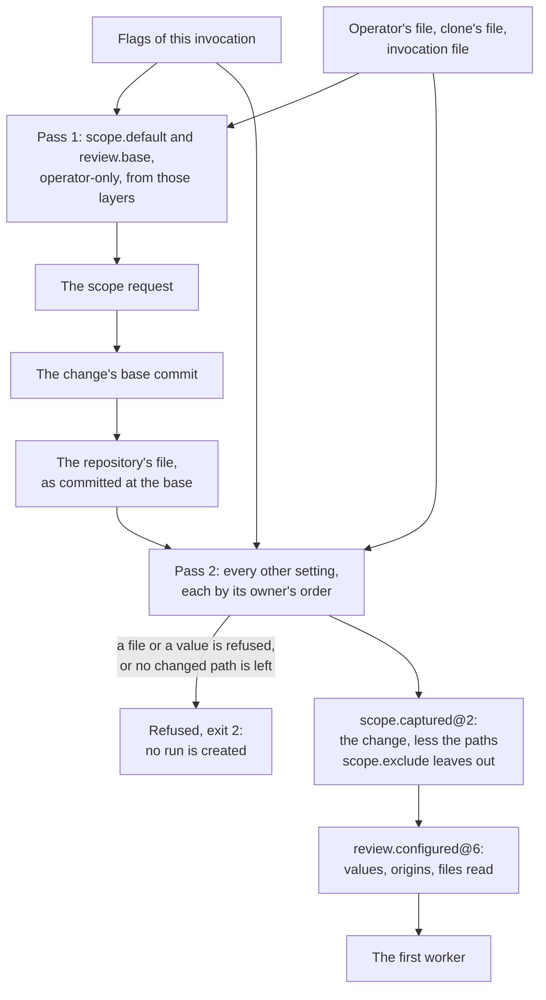

# Technical Design: Configuration

Product part: [2026-10-16-configuration.requirements.md](2026-10-16-configuration.requirements.md).

## Summary

A registry declares each setting one time: its name, its owner, the schema of its value and its default. A loader reads up to four TOML files into layers. It checks each file against the registry for what its layer can set. It reads the repository's file through git, from the base commit of the change.

A resolver puts the layers in the order of the owner of each setting. It returns each value with the layer that it came from. It also returns the files that it read, the repository values that the run will not follow, and the settings that it ignored.

Resolution has two passes, because the engine reads the repository's file at the base of the change, and two settings choose that base. The first pass resolves `scope.default` and `review.base`, which the repository's file cannot set. With them, it finds the scope request and its base commit. The second pass reads the repository's file at that commit and resolves all other settings.

The controller resolves before it creates a new run. `scope.captured@2` records the change without the paths that `scope.exclude` leaves out. Then `review.configured@6` records the result. The pathspec of git excludes these paths from each list of the change and from the patch. `checks.planned@3` records a check that a setting settled, with its layer.

The report and `status` show that record. `deep-review config` runs the same loader and resolver without a run. The skills stop their choice of the scope, and they leave it to the engine.

## Non-Goals

### No change to the role policy file

`roles/policy.json` keeps its schema, and it stays where the engine keeps the settings of its roles. The defaults layer reads the values that the file holds for the settings of R12. Thus nothing about the file changes for the developers who tune it (TD5).

### No variable for each setting in the environment

`--config` and `--set` give a CI job what it needs, without a third syntax. Also, a variable goes where nobody looks. A variable that a process gets by accident can change a review that nobody asked for.

### No writes into a file that exists

`config init` writes a new file only. An edit of TOML in place that keeps its comments needs a parser that keeps them. A person, or the agent of a person, edits a file as well as the engine can.

### No settings beyond R12

The proposal does not build constraints, the managed file or profiles. "Room for the rest of the catalog" below shows where each one goes. Thus the proposal chooses the format and the record with them in view.

## Context

All the items below are true at `dac2ccd`, with no uncommitted changes.

### The settings today

`readPolicy` in `src/review/policy.ts` reads `roles/policy.json`, and `policyFileSchema` checks it. The file holds the tier, effort, per-worker budget and timeout of each role. It also holds the per-check timeout (`checks.timeoutMs`), the fixer batch size, `survey.userRules` and the concurrency. For each runtime, it holds the two models, the default run budget and, for Codex, the Windows sandbox.

`resolvePolicy` puts the `PolicyFlags` of the command over the file, for one runtime and platform. The engine finds the file under the roles root, and `--roles <dir>` replaces that root with all role prompts. Nothing else configures a run. The engine reads no file in the repository or the home directory for it. It reads `process.env` only to start workers and run checks.

### The command line

`src/cli.ts` parses the arguments with `parseArgs` of `node:util`. `scopeRequestOf` makes the request from the scope flags, or returns null when the command has none. `review` then refuses with "a new run needs its scope". `fixRequestOf` takes `--check` and `--no-check`, and only with `--fix`. The last line of stdout is the path of the report in the evidence store.

### The scope

`resolveScopeRequest` in `src/scope/capture.ts` calls `chooseMode`, which sets the base commit. For a range, the base is `from`, or its merge base with HEAD. For `--ref`, it is the ref. For a dirty tree, it is HEAD. For a clean tree, it is the first parent of HEAD, or the empty tree.

`git status` resolves a request with no ref and no range. Thus the engine already applies the rule of the skills for "no instruction" to an empty request. Only the command line refuses it.

`listChanges` gives the `--path` values to git as pathspecs. `requirePathsMatched` refuses a path with no change. If a change has more than `maxScopeFiles` changed paths, the capture refuses it.

### When a run is configured

`openRun` in `src/review/controller.ts` runs under the start lock. It resumes an active run (`resumePinned`). Or it continues a finished read-only run into the fix pass (`continuationOf`, which appends `fix.pinned@1`). Or it resolves the policy for a new run, qualifies the runtime, and returns what `review.configured@5` records. The engine captures the scope after it creates the run (`captureScope`).

### The events

`review.configured@5` holds the runtime, the executable, the version, the models, the roles and their digest, the concurrency and the run budget. It also holds if the run fixes, the check timeout, the batch size, the user rules setting and the Codex sandbox. `limits.changed@1` records a concurrency or a budget that an invocation changed. `checks.planned@2` gives the command of each kind with its origin: `flag`, `survey` or `none`. `scope.captured@1` holds the mode, the request, the base, the head, the files and the patch.

### Environments

`src/runtime/environment.ts` treats all spellings that Windows reads as one variable, such as `Path` and `PATH`, when it pins variables for workers. `checkEnvironment` in `src/review/checks/run.ts` makes the environment of a check in the same way.

### The checkpoint

`locateCheckpoint` in `src/checkpoint/locate.ts` puts the checkpoint at `<git common dir>/deep-review-checkpoint`. This name is different from `deep-review`, the directory of the legacy skills.

### The skills

`skill/claude/skills/deep-review/SKILL.md` and `skill/codex/SKILL.md` are two files. They are equal, except for their invocation name, the path of the engine, the budget sentence, the Codex sandbox paragraph and the wait instruction. Step 1 of each file holds the default scope rule in prose.

### The hosts

These facts come from the documentation of each host and, for Codex, from its source at `rust-v0.160.0`.

In Claude Code, the `userConfig` of a plugin holds values for each user only, with no project scope. In Codex, the configuration of a user can only turn a skill on or off.

In Codex, a skill takes no arguments, and the text after `$deep-review` goes to the model as ordinary text. When a command runs for more than 10 seconds, it returns to the model. The model must then poll it, for not more than 300 seconds each time. `codex exec` stops the command when the turn ends.

### Dependencies

`zod` is the only runtime dependency, and esbuild puts it into the bundle in `dist/`.

## Design

### The settings registry (R3, R12)

A new module, `src/config/settings.ts`, declares each setting one time, as `src/checkpoint/events.ts` declares each event kind. Each declaration has the fields in the table below.

| Field | Meaning |
|---|---|
| `name` | the dotted name, as the files and `--set` write it |
| `owner` | `repository-first`, `operator-first` or `operator-only` |
| `value` | the zod schema of a value |
| `default` | the value with no layer, or where to read it (the role policy, for the settings it holds today) |
| `flag` | the dedicated flag that sets it, if any |
| `describe` | one sentence, which `config explain` and `config init` print |

The settings of R12 are its entries. `runtimes.<name>.*` has one entry for each runtime that the registry knows, `claude` and `codex`. `checks.<kind>` has one entry for each check kind. Thus the registry lists each name that a file can use, and no pattern matches a name.

The registry gives the schema of each layer, and nobody writes these schemas by hand. The repository's file can set the repository-first and operator-first settings. Each other layer can set all settings. A test checks the schemas against the owners, so that a new setting cannot open a layer by mistake.

### The files and how the engine reads each (R2, R4, R5)

| Layer | Path | Read |
|---|---|---|
| repository | `.deep-review/config.toml` | `git cat-file blob <base>:.deep-review/config.toml`, after `git ls-tree` says the path is a blob at `<base>`; none for the empty tree |
| operator | `%APPDATA%\deep-review\config.toml` on Windows; `$XDG_CONFIG_HOME/deep-review/config.toml` when that variable holds an absolute path, else `~/.config/deep-review/config.toml` | from disk |
| clone | `<git common dir>/deep-review.toml` | from disk |
| invocation | the path `--config` names, relative to the working directory | from disk |

The engine refuses a file that is larger than 64 KiB. It decodes the bytes as UTF-8, as TOML specifies, and a TOML 1.0 parser parses them (TD3). The loader flattens the parsed tables to dotted names. Thus `[runtimes.claude]` with `strong = "opus"` becomes `runtimes.claude.strong`. A table that is not a prefix in the registry, or a name that the registry does not hold, is unknown.

Then the loader checks the file in four steps, and each refusal names the file and the setting. First, `schema` must be in the file, with the value `1`. A larger number shows that the file is for a newer engine, and the refusal says to update the engine.

Second, each name must be known. The repository's file and the invocation file refuse an unknown name. The operator's file and the clone's file ignore it, with a line on stderr. Third, the layer of the file must have permission to set the setting, as the schema of the layer shows. Fourth, the value must parse under the schema of the setting.

The loader collects each failure, and one refusal lists them all, as `parsePolicy` does today. The refusal is a `ReviewRefusedError`. Thus the command exits with 2 and gives the action on stderr, before the engine creates a run.

The two passes of the resolution run only when the engine creates or continues a run. They run inside `openRun`, under the start lock. A refusal releases the lock on its way out, as each refusal does today. A resume reads no file that it can refuse on. A `--set` with a bad form is a usage error when the command line parses, before the engine reads anything.

`--no-repository-config` skips the layer of the repository, and the run records this (R5, PD6).

The engine reads the repository's file from git, never from the working tree (TD6). The full list of the changed paths, before an exclusion, decides if the change edits the file. Thus a pattern that leaves out `.deep-review/` cannot hide the edit.

### Resolution in two passes (R3, R8, R9, R13)

The order of the layers for each owner is the table of R3. For each setting, the resolver goes through that order from the top. It takes the first layer that sets the setting. A list is one value, so a higher list replaces a lower list completely.

The repository's file can set a repository-first setting, and a higher layer can replace it with a different value. Then the result lists the setting as "not followed". It gives the two values and the layer that won.

The flag layer comes from the dedicated flags and from `--set`, as the table below shows.

| Flag | Setting |
|---|---|
| `--budget-usd` | `budget.usd` |
| `--concurrency` | `run.concurrency` |
| `--strong-model`, `--fast-model` | `runtimes.<runtime>.strong`, `.fast` |
| `--executable`, each `--executable-arg` | `runtimes.<runtime>.executable`, `.args` |
| `--codex-windows-sandbox` | `runtimes.codex.windows_sandbox` |
| `--check <kind>=<command>`, `--no-check <kind>` | `checks.<kind>` |
| `--base <rev>` | `review.base` |
| `--set <name>=<value>` | `<name>` |

Two flags for one setting are a usage error. These can be a dedicated flag and `--set`, or `--set` two times. `--set` splits its argument at the first `=`. The parser reads the value as the right side of a TOML key-value line. If this fails, the raw text is a string. Thus `--set checks.test=npm test` and `--set 'scope.exclude=["dist/**"]'` both mean what they say (TD9).

#### Pass 1

The first pass resolves the two operator-only settings that choose the change. It reads them from the operator's file, the clone's file, the invocation file and the flags. If the command has a scope flag, the flags name the request as they do today. If not, `scope.default` names it.

`worktree` and `last-commit` act as their flags. `auto` gives the empty request, which `chooseMode` resolves by `git status` as it does today. `branch` acts as `--branch`.

`--branch` is the range from `review.base` to `HEAD`, with `mergeBase: true`. If `review.base` has no value, its value is the branch that `git symbolic-ref refs/remotes/origin/HEAD` names, as `origin/<branch>`. If that ref does not exist, the command refuses, and it names the setting and `--base`. `--base` with a scope that is not the branch is a usage error. The base commit comes from `chooseMode`, through `scopeBase`. This is a new function that the change takes out of `chooseMode`, and it lists no paths.

#### Pass 2

The second pass reads the repository's file at that commit, and it resolves all other settings. Its result is a `ResolvedSettings` value. This value holds the value and the layer of each setting. It holds the files that the engine read, each with its layer, path and content hash, and the commit of the repository's file.

The value also holds the state of the repository's file: `read`, `absent` or `skipped`, and if the change edits the file. And it holds the settings that the run will not follow, and the settings that it ignored. `config show` prints this value, and a new run records it.

### Where resolution goes in a run (R1, R4, R6)

Figure 1. A new run resolves its settings in two passes before it exists. It captures its scope, and then it records its settings, both before the first worker.

#### A new run

Pass 1 runs inside `ScopeSource.request`, the lazy callback that the command line gives the controller today. Thus the callback returns a request where it threw an error before. Only a run that needs a scope reads the operator's files for it.

In `openRun`, where it calls `resolvePolicy` today, the controller runs pass 2. It changes the result into the current `ResolvedPolicy` fields, with the values of the policy file as the defaults layer. It also changes it into the new block of `review.configured@6`. Then it lists the paths of the change with the exclusions, names only, as `resolveScopeRequest` does for a continuation. If no path is left, it refuses the change before it creates the run (R10).

`captureScope` takes the request with the excluded patterns. It refuses with "run the command again" if the base that it computes is not the commit where the engine read the repository's file. This shows that HEAD moved between the start lock and the capture.

The run appends `scope.captured@2` first and `review.configured@6` after it, as it appends the two events today. The fold refuses a configuration before the scope, and this rule is older than this change. Both events are on the ledger before the first worker, which is what R6 asks.

#### A resumed run

A resumed run reads `review.configured` and ignores the files. It resolves them again only to compare them. If the current value of a recorded setting is different, the engine names it on stderr as not applied (R6). A setting the run recorded from a flag is compared only with a flag given now, since a resume keeps it without the flag typed again. The run records the path its executable setting resolved to, so the engine resolves the setting again and compares the paths; a setting it cannot resolve now is named with the reason, and the resume goes on with the pinned path. If the engine cannot read a file now, it names it on stderr too. This does not stop the resume, because the run does not use the file. The concurrency and the budget keep the rule of today through `limits.changed@1`: a flag, or else the recorded value.

#### A continuation into the fix pass

A continuation runs pass 2 again. It reads the repository's file at the recorded base of the run, which gives the same repository values. It also reads the current operator files and flags, because the check flags of a continuation are its own today.

`fix.pinned@2` records the fix side: the check commands, `tools.path` and the check timeout, each with its layer. It also records the files that the continuation read and the state of the repository's file. And it records the repository values that it did not follow, and the settings that it ignored. The report and `status` name these beside the lines of `review.configured@6`, and a resume compares the files of the continuation.

#### An answer pass

An answer pass uses the record of the run, and it reads no file.

#### A run recorded before this change

Such a run has no settings block. Its values read as the defaults layer and the flags that it got. `status` says that the run is older than settings (R17).

### Paths left out (R10)

`scope.exclude` holds not more than 64 patterns. Each pattern is a relative path pattern in the glob pathspec syntax of git. In this syntax, `*` matches inside one directory, and `**` matches across directories. A pattern cannot start with `:`, and it cannot have a `..` segment or a NUL.

Each pattern becomes `:(exclude,glob)<pattern>` in each git call that lists or diffs the change: `diffNameStatus`, `untrackedEntries` and `buildPatch`. With no `--path`, git reads a pathspec of exclusions only as an exclusion from the full tree. Thus one matcher, the matcher of git, decides what the list holds and what the patch holds (TD8).

The paths left out are the full list of the change, less the list with exclusions. The capture makes the two lists. For the full list, it sets rename detection off, so that the two sides of a rename are two paths. It records the difference in `scope.captured@2` as `excluded`: not more than 2000 paths, with their count.

`requirePathsMatched` checks each `--path` against the full list first, as today, and then against the list with exclusions. If a path has changes only in the first list, the check refuses it, and it names `scope.exclude` and its patterns. `maxScopeFiles` applies to the paths that are left. Thus `dist/` left out also keeps a large rebuild under the limit.

If no path is left, the engine refuses the change before it creates the run. If the exclusion left out all paths, as for a commit that only rebuilds `dist/`, the refusal names the setting and its patterns. If the change was empty from the start, the refusal says so.

Today, the engine does not refuse an empty change. `resolveScopeRequest` returns a range from `HEAD` to `HEAD` with no changed path, and the run starts workers on nothing. The exclusion makes this case frequent, so this change closes it for both cases.

A rename across the boundary, from `dist/a.js` to `src/a.js`, shows in git as an addition of `src/a.js` after the exclusion removes the old path. The patch holds the full new file, so the review treats the moved code as new. `dist/a.js` is one of the paths left out. This was checked by hand with git 2.55, and a test of the capture keeps it.

### Checks and tools from settings (R11)

`checks.<kind>` goes into the survey where the check flags go today. A kind with a command or `false` is one of the `settled` kinds of the survey task. Thus the surveyor chooses only the `unsettled` kinds, and `resolveChecks` takes the setting where it takes a flag.

`checks.planned@3` records, for each kind, a command with its origin. The origin is `setting` with the layer of the setting, and `flag` is one of these layers. The other origins are `survey` and `none`. The fold reads the `flag` of version 2 as `setting` with the layer `flag`. A run that resumes before it plans its checks resolves `checks.<kind>` from its record. Thus nobody types the flags again.

A `--check`, a `--no-check` or a `--set checks.<kind>` of a later invocation still settles its kind. It settles the kind for that invocation, over the record, until the run plans its checks. The actions of the survey's blockers ask for these flags, and the run must follow them. The ledger does not record such a flag, so the fold checks a check of the layer `flag` against nothing. It checks each other setting's check against the record.

`checks.timeout_minutes` becomes the check timeout in milliseconds, which `review.configured` records for a fix run today.

`tools.path` is operator-only, and the engine makes each entry absolute at configuration. A relative entry is relative to the root of the worktree. An entry cannot hold the `PATH` delimiter of the platform the engine runs on (`:` on POSIX, `;` on Windows), since `PATH` has no escape for it and the entry would split into several.

`workerEnvironment` and `checkEnvironment` put the directories first on `PATH`. For this, they use the helpers of `src/runtime/environment.ts`, which know all the spellings of the variable. Thus `Path` and `PATH` on Windows stay one variable (TD10). The engine keeps a directory that does not exist, and it names the directory on stderr, because a tool can create it. An example is a virtual environment that a check builds.

The fixers run the engine's `snapshot` and `claim` commands as `node` on their `PATH`. A command line with a quoted path is different in bash and in PowerShell. Thus a directory of `tools.path` that holds an older `node` runs these commands under that `node`, and they need Node 26. Before a fix run or a continuation exists, the engine asks the version of each `node` in `tools.path` that is not its own. It refuses the run if the version is older than 26, and it names the directory and the setting. The engine probes only `node.exe` on Windows and `node` elsewhere, in the directories that exist at that moment. It does not probe a shim that a fixer's shell also resolves, such as `node.cmd`, `node.bat`, `node.ps1` or an extensionless `node` on Windows. Nor does it probe a directory created later or a `node` swapped in after the probe.

### The record (R6, R17)

Four events get a new version, as the table below shows.

| Event | Version | What is new |
|---|---|---|
| `review.configured` | 6 | version 5's payload, and `settings`: the files read; the repository's state; the value of each recorded setting that has no field of version 5 (`review.base`, `scope.default`, `scope.exclude`, `checks.<kind>`, `tools.path`); the layer of every recorded setting; the settings not followed; the settings ignored |
| `scope.captured` | 2 | the request's `exclude`, and `excluded` with its count |
| `checks.planned` | 3 | the origin `setting` with its layer |
| `fix.pinned` | 2 | version 1's payload, the fix side's settings with their layers, and the files, the repository's state, the values not followed and the settings ignored of the continuation |

The settings that version 5 records today keep their fields: the models, the concurrency, the run budget, the check timeout, the user rules setting, the Codex sandbox, and the executable and its arguments. The block gives only their layer, so the event holds no value two times. One function, `settingOf(configuration, name)`, reads a recorded setting from either place. The report, `status` and `config show` all use it. It takes the block's value and layer from `recordedSetting` in `src/checkpoint/settings-state.ts`, which reads the fix side of a continuation first for the settings that side records. The fold checks a plan of checks against the same function, and the controller builds the check settings of a run from it, so the three agree on what a run recorded.

Each recorded setting belongs to the version that added it. The schemas of the block name exactly the settings that this version records, and they refuse all other names. A later recorded setting is a new version of `review.configured`. Thus an engine that does not know a setting passes over a run that recorded it. Pull request #39 made the engine pass over each event that it cannot read in the same way. It never resumes a run under a setting that it ignores (TD4).

A new golden fixture, `schema-1-12`, goes into a commit with `npm run golden`. The older fixtures must still open and fold.

### The report and `status` (R7)

The header gets one new line, `Settings:`. It names each file that the run read, with its layer and the commit of the repository's file. It adds "repository's file skipped by `--no-repository-config`" or "edited by this change: the edit applies to later changes" when one of them is true.

`limitations()` gets lines from the record. It names the patterns of `scope.exclude`, the count of the paths that they left out, and the paths themselves, up to 50. It names each check kind that did not run, with the setting or the flag that said so.

It names each setting that the run did not follow, in the form "`checks.test`: the repository's `npm test`, this run's `npm run test:fast` from the clone's file". It names each ignored setting. A run with no file and no flag beyond the scope adds only the header line. `status` prints the same lines from the same functions.

### The `config` command (R14)

#### `config show`

`config show` takes the scope flags, `--runtime`, `--json` and the setting flags. It runs the two passes as `review` does, but without the start lock. It prints each setting with its value and layer. Then it prints the files, the state of the repository's file, the settings that the run will not follow, and the ignored settings. `--json` prints the `ResolvedSettings` value.

With no scope flag and no `scope.default`, it shows `auto` and the base that `git status` gives. It works outside a run, so the skills use it when the user asks how deep-review is configured.

#### `config explain`

`config explain [<setting>]` prints the registry: the owner, the default and the sentence of each setting. If the command names one setting, it prints only that setting.

#### `config validate`

`config validate [<file>] [--layer <layer>]` checks one file as that layer reads it. With no file, it checks the `.deep-review/config.toml` of the working tree as the repository's layer. Thus the author of a policy can check a file before the commit.

#### `config init`

`config init` with `--repository`, `--operator` or `--clone` writes the file of that layer. The file has `schema = 1`. It has each setting that the layer can set as a comment, at its default, with its sentence. The command refuses if the file exists.

### Skills and README (R15)

#### Step 1 of both skills

Step 1 of both skills changes. The skill gives a scope flag only when the user names a scope. It gives `--branch` when the user names their branch, and `--base <rev>` when the user names what the branch starts from. If not, it gives no scope flag. The change deletes the prose rule about `git status`, because `auto` applies it.

#### Questions about the configuration

A new paragraph tells the skill what to do when the user asks how deep-review is configured, or why a run reviewed what it did. The skill runs `config show` with the same scope words and relays what it prints. When the user asks to change a preference, the skill names the file that `config show` lists for that layer. It writes the repository's file only as a change that the user asks for, as for each other edit.

#### The wait in Codex

The Codex skill says to poll the command until it exits, and not to end the turn while it runs. The reason is that `codex exec` stops a command that runs when its turn ends.

#### One text for two skills

A test in `test/skills.test.ts` reads both skill texts. It removes the lines that each runtime must word in its own way, which the test names. It keeps the other lines equal. Thus a change to one text that forgets the other text fails the check (TD11).

#### README

A "Configuration" section after "The repository survey" describes the four files, and the owners with the table of R3. It also describes the read at the base and its reason. And it describes `--branch`, `--set`, `--config` and `config show`. The `.deep-review/config.toml` of this repository is the example.

### Room for the rest of the catalog

The proposal builds none of the items below. Each has a place, so that a later addition changes a list and not the rules.

#### A new setting

A new setting is an entry in the registry and the code that uses it. A new recorded setting also needs a new version of `review.configured`, for the reason that TD4 gives. The catalog report names the owner of each candidate already.

#### Constraints

The constraints are B2, B6, C6, C8, C9, C11 and E2 of the catalog. They come as a `[limits]` table in the repository's file and in a managed file. The managed file is at `%ProgramData%\deep-review\managed.toml`, `/Library/Application Support/deep-review/managed.toml` or `/etc/deep-review/managed.toml`.

Constraints apply after pass 2. If a flag gives a value outside a constraint, the engine refuses the run. If a file gives it, the engine replaces it with the limit and lists it as not followed. The constraints of the managed file are limits on all layers, and the repository's file is one of them. A file that has `[limits]` says `schema = 2`. Thus an engine without constraints refuses it, and it does not ignore a limit.

#### Profiles

Profiles, the B8 of the catalog, come as `[profiles.<name>]` tables in the repository's file, the operator's file and the clone's file, under `schema = 2`. `--profile <name>` or `profile = "<name>"` chooses one. The values of a profile go just below the layer that chose it. A built-in profile other than the values of today ships only with a replay measurement of what it finds.

#### Presentation settings

Presentation settings are F2, F3 and F6 to F13 of the catalog. They add a field to the registry that says that the engine reads a setting at each invocation and does not record it. The readable report (F6) and the first part of the report at the end of a run (F9) go elsewhere. They belong with the change that reorders the report, as principle 5 of the vision note asks. A `report` command that shows a finished run again from its ledger is where `report.formats` can act.

## Technical Decisions

### TD1: One registry declares each setting

The design rejects a model where each module reads its own names from the parsed file. With it, two modules can read one name differently, and `config explain` has nothing to print. The registry also gives the schema of each layer.

### TD2: Two passes, with the settings that choose the change operator-only

The design rejects one alternative: a read of `scope.default` and `review.base` from the repository's file at the tip of the default branch. The other settings then come from the base. It works, but it reads one file at two commits for two purposes. Also, a change on the default branch can still move the bases of later changes. The design also rejects a read of them at HEAD, because then the change under review chooses its own base.

### TD3: `smol-toml`

The parser is `smol-toml`. `package-lock.json` pins it, and esbuild puts it into the bundle. It parses TOML 1.0 with no dependency of its own. It keeps no comments, and `config init` does not need them. The design rejects `@iarna/toml`, because it follows TOML 0.5 and nobody maintains it now. It also rejects a parser of our own, because the edge cases of TOML are a test suite that we must write first.

### TD4: Recorded in `review.configured@6`, with a new version for each later setting

The design rejects a new event kind, `settings.resolved`. `review.configured` is already "the policy as resolved for the run, written once before the first worker", and two events must then agree. It also rejects a `values` map that is open to each registered name. An older engine reads such a map and ignores a setting that it does not know. If that setting is a future list of paths that no fixer can edit, the older engine resumes the run without the protection.

### TD5: `roles/policy.json` keeps its schema and gives the defaults

The design rejects a TOML file in the engine for the defaults that the operator sees. With it, the engine has two files of defaults, and `--roles` replaces something different. For each setting of R12 that the policy holds, the registry names the field that gives its default.

### TD6: The engine reads the repository's file with git at the base

The design rejects a read from the working tree, also for `--worktree`, whose base is HEAD. With such a read, an uncommitted edit configures the review of the same edit.

### TD7: The clone's file is `<git common dir>/deep-review.toml`

The design rejects `<git common dir>/deep-review/`, because it is the directory of the legacy skills. It also rejects a file inside `deep-review-checkpoint`. When an operator removes the checkpoint to clear old runs, the preferences of the operator go with it.

### TD8: git's pathspec excludes, in each list and in the patch

The design rejects a glob matcher in JavaScript, such as `path.matchesGlob`, beside the matcher of git for the patch. Two matchers have their own syntax and their own edge cases, so they can disagree about a path. Then the list and the patch are different.

### TD9: A `--set` value is TOML, or else a string

The design rejects a value that is always a string, because a string cannot give a list or `false`. It also rejects a value that is always TOML. With it, `--set checks.test=npm test` is an error, and a person does not expect that.

### TD10: `tools.path` gets to each worker and each check

The design rejects `tools.path` for checks only. With it, a fixer that runs the tests before it answers sees a different `PATH` from the check that judges it. The surveyor that looks for a tool does too.

The preflight of the runtime's executable runs with the same `PATH` as the workers, `tools.path` first. A runtime CLI that finds its interpreter on `PATH`, as an npm script does, is then qualified under the interpreter its workers use. A new run and a continuation qualify it with the `tools.path` they resolve, and a resume or an answer pass with the one the run recorded.

### TD11: The two skills stay two files, and a test keeps them equal

The design rejects skills that the build makes from fragments, as it makes the role prompts. The role prompts chose fragments with no markers inside a text. But the two skills are different inside sentences, such as the path of the engine in each command. Fragments for such text are a few words long.

## Test Strategy

### R1: No file, no change

For each runtime and platform, a unit test resolves with no file and no new flag. It expects the values that `resolvePolicy` gives at the base of this change. A controller test uses the test runtime and no file. It expects the fields of version 5 without change, each layer `default` or `flag`, and the same planned checks as before.

### R2: Four files

Tests resolve the path of the operator's file under `APPDATA`, under an absolute and a relative `XDG_CONFIG_HOME`, and under `~/.config`. The engine ignores the relative `XDG_CONFIG_HOME`. Another test shows that two worktrees of one clone share the clone's file.

### R3: One owner for each setting, and its order

A table-driven test of the resolver covers each owner and each pair of layers. For each pair, it checks the winner and the "not followed" entry. It also covers a list that a higher list replaces completely. It covers the operator's file that fills a gap in a repository-first setting and loses to the value of the repository. And it covers the repository's file that sets an operator-only setting, which refuses. A further test checks the schemas of the layers against the owners.

### R4: The engine reads the repository's file at the base

Git fixtures hold the file at the base, and a different file at HEAD and in the working tree, for each mode. The test expects the values of the base. Other cases cover `--last-commit` on a root commit and a range with `--merge-base`. One more case finds the edit when `scope.exclude` leaves out `.deep-review/`.

### R5: A file that the engine cannot read refuses the run

The cases cover invalid TOML, no `schema`, `schema = 2` and a wrong type. They also cover an unknown name in each layer, which refuses or is ignored as R5 says. One case expects all problems in one refusal. Another case expects that the run records `--no-repository-config`.

### R6: Recorded before the first worker

A resumed run with each file changed records nothing new, and it names each recorded setting that it did not apply. The budget and the concurrency change only by flag. A continuation records `fix.pinned@2` with the flags of the continuation. An answer pass reads the record.

### R7: The report and `status` say where a setting acted

Snapshots of the report and of `status` cover a run with no file, a run with exclusions and a dropped check. They also cover a setting that the run did not follow, an ignored setting, a skipped file, and a file that the change edits.

### R8: `--branch`

Tests cover `--branch` with `origin/HEAD` set, and without it, where the command refuses and names the setting. They also cover `--base` over it. The request that `--branch` makes is equal to the request of `--from --to --merge-base`.

### R9: The default scope is the engine's

A test covers each value of `scope.default`. On a dirty tree and on a clean tree, `auto` gives the modes of today.

### R10: Paths left out

Capture tests leave out tracked, untracked, deleted and renamed paths, and they expect a patch with no excluded file. Other cases refuse a `--path` with changes only under an excluded pattern. They count `maxScopeFiles` after the exclusion, and they refuse a pattern with a `:` at the start or a `..`. The engine refuses the empty change, and the change that the exclusion empties, before a run exists.

### R11: Checks and tools from settings

The surveyor gets no question about a kind that a setting settles. A run that resumes before it plans its checks needs no flag. `tools.path` comes first on `PATH` for a check and for a worker. On Windows, the variable keeps the name `Path` that the system uses. The loader refuses `tools.path` in the repository's file, and a relative entry resolves against the root of the worktree.

### R12: The settings that this proposal builds

Tests check the default of each setting from the policy file, and the setting of each dedicated flag. They also check that a dedicated flag and `--set` for one setting refuse.

### R13: The overrides of one run

Tests give `--set` a number, `false`, a list, a bare string, and a value with an `=` in it. Another test gives `--config` as its own layer.

### R14: The configuration, shown without a run

Tests check `config show` as text and as JSON on a fixture repository. `config explain` lists each entry of the registry. Tests check `config validate` on a good file and a bad file for each layer. They check `config init` for each layer, and its refusal for a file that exists. The file that `config init` writes passes `config validate`.

### R15: The skills

The skill test fails when a shared line of one text changes. Another test checks the words of step 1 against the scope flags that it names.

### R16: The gate

Verification records the two real runs.

### R17: Older runs still open

`npm run golden -- --output test/fixtures/checkpoints/schema-1-12` writes the new fixture. Each older fixture opens and folds. A configuration of version 5 reads through `settingOf` as defaults and flags.

`npm run check` and `npm run verify` run at the head of the series.

## Verification

No check ran yet.

## Risks & Migration

### Ledger

Four event kinds get a new version. A newer engine reads each older run (R17). An older engine passes over a new run (#39), which is what TD4 intends.

### The policy file and `--roles`

A roles directory that `--roles` gives still replaces the defaults that it holds. A developer who gives an older roles directory gets the defaults of that directory, as today.

### The operator's file is named by its absolute path

The ledger and the report name the operator's file by its absolute path. Thus they hold the path of the home directory. The path of the executable of the runtime, and the user-level rules files, put it there today.

### A shallow clone

A shallow clone without the base commit cannot read the repository's file. It cannot capture the scope either, and the error comes from the capture.

### A new dependency

`smol-toml` goes into the bundle that the plugin and the skill ship. The lock file pins it, and people review it as they review each dependency. The one call of the loader can change to another parser.

### Order of the work

Before the gate, a small change puts `.deep-review/config.toml` on `main`. The engine on `main` ignores the file until this change merges, so the early commit changes no run. In this change, the registry, the loader and the resolver come first, with their tests. Then come the events and the fixture, the scope and the checks, and the report and `config`. Then come the skills, with their new words in a commit of their own. `dist/` comes last.
