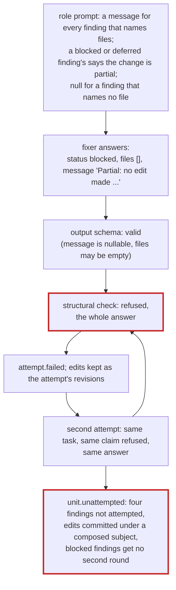
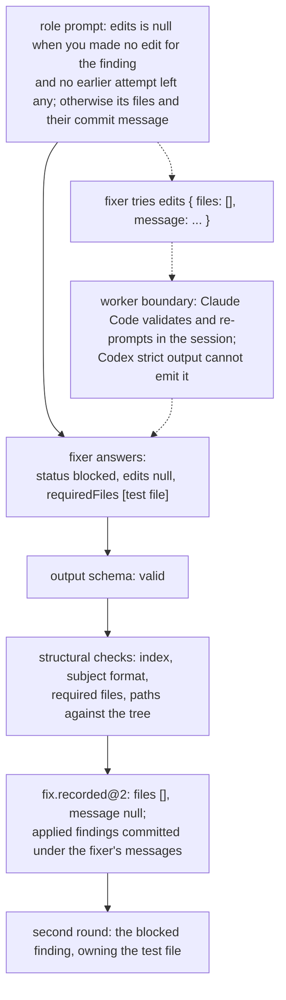

# Change Proposal: One edits field in the fixer's answer

## Summary

A fixer's answer names, for each finding, the files it edited and the
commit message those edits take. Today these are two fields, `files`
and a nullable `message`, and the rule that they go together (R11 of
commit series integrity: a finding with files has a message, one
without has none) lives in the role prompt and in a structural check
the engine runs after the worker has returned. When the check fails,
the whole answer is refused, the attempt is lost, and a fresh worker is
given the same task. This has happened in every fix run since the
current prompt wording landed, eight times across three runs, and once
it ended a batch of four findings after two attempts that together ran
1250 seconds and cost 1.69 USD (issue #54).

After the change the two fields are one: `edits`, either null or an
object holding at least one file and the message. The rule does not
change; it becomes the shape of the answer, so an answer that breaks it
cannot be written. Both runtimes enforce the output schema at the
worker's boundary, Claude Code by validating and re-prompting inside the
session and Codex by strict structured output, so a slip costs the
worker a turn instead of costing the run an attempt. The structural
check for the pairing is deleted. The ledger event the answer is
recorded as, `fix.recorded@2`, keeps its `files` and `message` fields
and is filled from `edits`, so no event changes and every older run
reads as before.

## Problem

A fix run gives each cluster of findings to a fixer, a model session
that edits the files the cluster owns and returns one answer for the
batch of findings it was given. Before the first edit for a finding the
fixer runs a claim command for each file outside its own that the
finding needs; a claim another cluster holds is refused, and the fixer
reports the finding `blocked`, naming the file in `requiredFiles` and
making no edit for it. A blocked finding whose required files other
clusters held gets a second round once the first round has settled,
with those files as its own.

The engine validates the answer against the fixer's output schema
(`fixerOutputSchema` in `src/review/schemas.ts`) and then applies the
structural checks the schema cannot express (`checkFixerAnswer` there,
and the path checks in `src/review/fix-answer.ts`). A structural check
that fails refuses the whole answer: the attempt is recorded as failed,
the edits it snapshotted are kept as that attempt's revisions (R20 of
the fix pass), and the batch is run again by a fresh worker with the
same task, told only that the tree may hold earlier work. After two
failures the batch is settled as not attempted (`maxAttempts` in
`src/review/steps.ts`).

One of those checks is the pairing of `files` and `message`:

> Finding [n] has a commit message and names no file; a finding with no
> edits carries none

Figure 1. How batch c1-1 of the run on PR #53 ended. The check runs
after the worker has returned, so the answer it refuses is already
paid for.

What the ledger of this repository's checkpoint shows, read on
2026-10-16:

| Fact | Value |
|---|---|
| Structural refusals of a fixer answer, every run | 9, all of them the files and message pairing (1 under the earlier rule that tied the message to the applied status, 8 under R11) |
| Structural refusals of a fixer answer for any other reason | 0 |
| Fix runs since the current wording (commit 8338df8, 2026-10-09) reached the installed engine | 3 runs on 2026-10-11, 2026-10-12 and 2026-10-15; every one tripped it, 8 refusals against 37 accepted answers |
| Fix runs before that wording | 7 runs with blocked findings and no refusal |
| Blocked findings with no edits, across every stored fixer answer | 63, of which 12 carried a message |
| Batches ended by it | 1 (c1-1 of run 2a9f735c), 4 findings |

Every refused finding has the same shape, read from the run's artifact
store: `status: "blocked"`, `files: []`, `requiredFiles` naming a file
another cluster owned, a `validation` line quoting the refused claim,
and a `message` whose body begins with "Partial: no edit made". The
fixer did what the claim rule asks and reported it wrong.

The wording is the proximate cause. `roles/fragments/fixer-report.md`
says of `message` that "a blocked or deferred finding's says the change
is partial and what it waits for", a clause that reads, without the
"for every finding that names files" scope before it, as an instruction
for every blocked finding; `fixer-apply.md` and the claim block of the
task (`src/review/tasks.ts`) repeat "with a message that says the change
is partial". The refused bodies reproduce that clause word for word.

But the wording has been fixed twice already. Commit 8338df8 wrote the
current rule to close #26 and #9; commit ae9520b (2026-10-10) closed a
second path to the same refusal, a retry told to give a message for an
earlier attempt's edits while `files` was defined as its own. Each fix
closed the path it saw, and a third path opened. A rule that relates two
fields of the answer has to be read across both by the model every
time, and the engine learns that it was not only after the worker's
work is done.

The cost is not the retry alone. The retry receives the same task and
meets the same refused claim, so it writes the same answer; the failure
is deterministic for any batch that holds a blocked finding, and two
failures settle the batch as not attempted. Then the applied findings'
edits are committed under the subject the engine composes for an
unfinished attempt ("chore: keep the edits an unfinished attempt made
for DUPLICATION-4"), which is the outcome #9 was closed to prevent, and
the blocked findings get no second round, because the second round is
planned from recorded answers (`planSecondRound` in
`src/review/fixes.ts` passes over a finding whose batch has none). On
the run of PR #53, that was REMOVALS-1 and FOOTGUNS-1, both blocked on
one test file, both of which would have been planned into the second
round with that file as their own; across every run in the ledger, the
58 findings that reached a second round ended applied or already
applied, none blocked.

## Goals

- A fixer cannot return a finding whose files and message disagree,
  on either runtime, whatever the prompt says.
- A fixer that tries to is corrected inside its own session, at the
  cost of a turn, not of the attempt.
- A batch holding a blocked finding that was refused before any edit
  completes on its first attempt, so its applied findings are committed
  under the fixer's own messages and its blocked findings reach the
  second round.
- The ledger, its event kinds and its fixtures do not change.
- The prompt describes one field, so no sentence about the message has
  to be read against a sentence about the files.

## Non-Goals

- No change to R11 itself. A finding with edits still carries the
  message its commit takes, whatever its status, and a blocked or
  deferred finding with edits still says the change is partial. Only
  where the rule is enforced moves.
- No normalization in the engine. The engine does not drop a message or
  invent one; after the change there is no answer to normalize.
- No change to the retry policy: an attempt that fails for another
  reason (a timeout, a usage limit, a path outside the repository) is
  still retried once as the same batch with the same task, and the
  batch is settled after two failures. See D6.
- No continuation of a worker's session by the engine. The runtime
  adapters can resume a session (R9 of the runtime adapter), and the
  engine does not use it here. See D3.
- No third round, and no change to how clusters are formed or to the
  rate at which findings are blocked. A finding blocked in the second
  round stays blocked, as R21 of the fix pass says.
- No change to the subject format check (one line, no trailing period),
  which stays a structural check. See D8.
- No change to `deep-review commit`, the patch series or the report,
  which read the recorded `files` and `message` as before.

## Requirements

Figure 2. The same batch after the change. A wrong shape is caught
where the worker can still correct it.

- R1: `fixerOutputSchema` replaces the per-finding `message` and
  `files` fields with one field, `edits`, which is either null or a
  strict object `{ files, message }` where `files` holds one to two
  hundred reported paths and `message` is `{ subject (1..72), body
  (0..2000) }`, neither nullable. The repair worker, which returns the
  same schema with the failing checks as its findings, takes the change
  with it. The compiled JSON Schema passes the portability rules of
  `compileOutputSchema` (every object closed, every property required,
  the nullable field as `anyOf` with `null`), as checked on 2026-10-16
  against the current `src/runtime/contract.ts`.
- R2: `checkFixerAnswer` no longer holds the two pairing branches, "names
  files and has no commit message" and "has a commit message and names
  no file". It keeps the index checks, the subject format check, now
  read from `edits.message`, and the rule that only a blocked finding
  names required files.
- R3: Every reader of a finding's files in the answer (`resolveFixerAnswer`
  and `requireOwnedReported` in `src/review/fix-answer.ts`, the late
  claim and the revisions in `src/review/fix-events.ts`) reads
  `edits.files`, an absent `edits` counting as no file. What they decide
  does not change: a required file the cluster owns or claimed is still
  refused, a named file another cluster holds is still a violation, and
  an owned or claimed file whose bytes changed and that no finding
  names still refuses the answer.
- R4: `fix.recorded@2` and `FixedFinding` keep `files` and `message`.
  `fixAnswerEvents` fills them as `edits?.files ?? []` and
  `edits?.message ?? null`. No event kind, version or schema changes,
  the ledger DDL does not change, and no golden fixture is added. The
  invariant the fold and the report rely on, a message exactly where
  there are files, holds for every answer recorded after the change by
  construction, and for every answer recorded before it as the check
  then held it.
- R5: The prompts describe one field. `roles/fragments/fixer-report.md`
  replaces the `files` and `message` bullets with one `edits` bullet:
  null for a finding you made no edit for and no earlier attempt left
  edits for; otherwise the files you edited or created for it, or that
  hold an earlier attempt's edits for it, and their commit message, a
  subject of at most 72 characters with no trailing period and a body
  that says why, in the style the repository's `git log` shows, a
  blocked or deferred finding's saying the change is partial and what it
  waits for. `roles/fragments/fixer-apply.md`'s claim paragraph says a
  refusal that comes after you edited leaves those edits in place, listed
  under the finding's `edits` with a message that says the change is
  partial. In `src/review/tasks.ts`, `answerFields`, `earlierWork` and
  `claimBlock` say the same in the task's words, and the rule "every
  file you own whose bytes you changed must appear in some finding's
  `edits`" replaces the one that names `files`. (Amended 2026-10-16,
  during the implementation: two more sentences named `files` as a
  field of its own and would have asked for files with no message.
  `earlierWork`'s first sentence, which asked a finding found already
  resolved for "the files that hold its fix", now asks for `edits`
  naming them when an earlier attempt made the fix and null otherwise;
  and `roles/fragments/fixer-documentation.md`, which asked a
  documentation fixer for facts already correct "with their `files`",
  now asks for `edits` null unless an earlier attempt's edits hold
  them. Either was the #54 refusal waiting for a fixer to read it
  literally.)
- R6: The role prompt change and the schema change are one commit,
  since the prompt names the field the schema defines and the tests pin
  both; the series ends with the commit that rebuilds `dist/`. The hash
  of every role assembled from `fixer-report.md` or `fixer-apply.md`
  (`fixer` and `documentation` in `roles/manifest.json`) changes, and a
  run after the change records the new hash in `review.configured`.
- R7: R11 of `2026-10-09-commit-series-integrity.requirements.md` gains a
  line "Revised 2026-10-16" that says the pairing is the shape of the
  answer and no longer a structural check, pointing here; the output
  schema listing under "Output schema and structural checks (R5)" of
  `2026-10-01-fix-pass.design.md` gains a note that `message` and
  `files` became `edits`, pointing here; and `README.md`, which
  describes the fixer's answer, says a finding it edited carries the
  files and their commit message.
- R8: The test runtime (`test/helpers/fake-runtime.ts`) answers in the
  new shape, with a way to answer a shape the schema refuses, so the
  tests that today give a fixer "that breaks the rule" exercise the
  schema refusal instead of the deleted check.

## Decisions

- **D1: Change the shape, not the wording again.** (2026-10-16.) The
  issue's first options were to tighten the prompt or to normalize in
  the engine. The wording has been fixed in 8338df8 and ae9520b and the
  refusal came back by a third path; across every stored answer, one
  blocked finding in five that made no edit carried a message. The
  prompt will say the rule more simply after this change, because there
  is one field to describe, but the guarantee comes from the schema and
  does not depend on the model reading two bullets against each other.
  Carried out in R1 and R5.

- **D2: No normalization in the engine.** Dropping the message of a
  finding with no files would be safe, since no commit exists to carry
  it, and it was the issue's cheapest option. Rejected: it keeps a shape
  in which the worker can say two things at once and has the engine
  decide which one it meant, silently, and the next drift of the wording
  lands in the same place. Once the shape holds one field there is
  nothing to normalize. PD10 of commit series integrity rejected
  dropping the message for the finding that has edits; this decision
  rejects it for the one that has none, for a different reason.

- **D3: The schema, not a structural check, because of where each is
  enforced.** A structural check runs after the worker has returned and
  can only refuse. The output schema is handed to the runtime: Claude
  Code validates the answer against it when the session ends and
  re-prompts the same session on a mismatch, and Codex's strict
  structured output constrains what the model can emit. A rule the
  schema can express is therefore corrected inside the session, which is
  what the issue's third option, repairing in the same session, asked
  for, without a resume path in the engine. The runtime adapter's
  design settled that a resumed session honours the schema too, so
  nothing here depends on the session being fresh.

- **D4: The pairing follows the files, as R11 says, not the status.**
  PD10 of commit series integrity rejected "a schema that forbids the
  message per status", because a blocked or deferred finding with edits
  needs its message. This schema forbids nothing per status: a blocked
  finding with edits gives `edits` with its files and a partial
  message, exactly as today, and a blocked finding without gives null.
  #26 and #9 stay closed.

- **D5: The ledger keeps `files` and `message`.** A new version of
  `fix.recorded` with an `edits` field was considered and rejected: the
  recorded shape is read by the fold, the report, the patch series and
  the commit, none of which gains anything from the nesting, and a new
  version costs a reducer, a golden fixture and a reader of both shapes
  for no change in what is recorded. The worker's answer and the
  ledger's record are different contracts; the mapping is five lines at
  the one place the answer is recorded.

- **D6: The retry policy does not change.** Telling a retry why the
  earlier attempt was refused, or resuming the refused session, would
  help any structural refusal. The ledger shows no fixer answer ever
  refused by a structural check other than this pairing, and the
  failures that remain after this change, timeouts and a provider's
  usage limit, are not ones a better-informed retry mends. Principle 11
  of the vision note builds recovery when a run shows the need; this
  decision is to be revisited when a run shows a fixer refused for
  another reason.

- **D7: `files` holds at least one path in the schema.** With
  `minItems: 1`, an `edits` object with no files is unwritable, so the
  answer cannot carry a message without a file in any form. Should the
  Codex strict output refuse `minItems` (Verification), the fallback is
  `minItems: 0` in the schema and a structural check that refuses an
  `edits` with an empty `files`, which leaves a far narrower hole than
  today: the model would have to write an empty list inside the object
  it chose to give, instead of leaving a nullable field filled.

- **D8: The subject format stays a structural check.** "One line with
  no trailing period" is a `pattern` with a lookahead or a negated
  class, and the portability rules refuse lookarounds; a negated class
  would be portable but says less than the error message does. The
  check has never refused a fixer answer, so it earns no change.

## Risks

- Risk: the number of re-prompts Claude Code allows for a schema
  mismatch is not documented; a worker that exhausts it ends with
  `error_max_structured_output_retries` and no structured output, which
  the engine records as a failed attempt. Accepted: the correction is to
  move a field to null, and a model that could not do that in a few
  turns would not have passed the structural check either.
- Risk: Codex's strict structured output may refuse `minItems`.
  Covered by the smoke run in Verification and the fallback of D7.
- Risk: the fixer and documentation role hashes change, so a comparison
  of runs by role prompt (principle 10 of the vision note, the ledger as
  the corpus) has a boundary at this change. Accepted: every prompt
  change has one, and the change is recorded in `review.configured`.
- Risk: a fixer answers `edits: null` for a finding it did edit.
  Unchanged: `requireOwnedReported` refuses an answer that leaves out an
  owned or claimed file whose bytes changed, as it does today for an
  empty `files`.
- Risk: a fixer gives a partial message to a blocked finding with edits
  that does not say what it waits for. Unchanged: the message's content
  is the model's, and the report shows the subject beside the status.

## Verification

What ran, on 2026-10-16, on Windows 11 with Node 26.10.0:

- **The reproducing test failed first.** `refuses the answer of #54: a
  blocked finding with no files and a message` in
  `test/review/schemas.test.ts` parses the shape of c1-1's refused
  finding (`status: "blocked"`, no files, `requiredFiles` naming the
  test file, a message whose body begins "Partial: no edit made").
  Against the schema before the change it failed with `true !== false`:
  the schema accepted the answer, and only the structural check refused
  it. After the change it passes, refused by the schema.
- **R1.** The same file checks that the compiled `edits` property is
  `anyOf` a closed object and `null`, that the object requires `files`
  and `message`, that `files` carries `minItems: 1`, that the message
  inside it is not nullable, and that no `files` or `message` sits
  beside `edits`. For every status it refuses `edits` with a message
  and no files, with files and a null message, with files and no
  message, with a message and no `files` field, with an unknown field,
  and an answer that leaves `edits` out.
- **R2.** The tests of the two deleted branches are gone, replaced by
  the schema refusals above; the subject format tests read the message
  from `edits` and pass; the required-files test is unchanged.
- **R3 and R4.** `test/review/fix-answer.test.ts` checks that a finding's
  `edits` is read as its resolved files and their message, and null as
  no file and a null message, in the flat shape the ledger records.
  `test/review/fix-pass.test.ts` runs the shape of c1-1 end to end: a
  batch of an applied finding and a finding blocked on another
  cluster's file with `edits` null completes on its first attempt with
  no `attempt.failed`, records the blocked finding with `files: []` and
  `message: null`, plans it into the second round, and `deep-review
  commit` commits the applied finding under the fixer's own subject. A
  second test answers with a message and no files through the test
  runtime's `malformed` seam (R8) and sees the attempt fail with "The
  answer does not match the output schema", not a structural check,
  and the retry's answer recorded. The test of a claim refused after a
  first edit (R11) passes unchanged in what it asserts.
- **R5.** `test/review/tasks.test.ts` and `test/roles/repository.test.ts`
  pin the new sentences of the task and of both fixer roles, including
  the two the implementation added (R5's amendment), and assert that no
  sentence says "names files", "names no file" or describes `files` or
  `message` as a field of its own.
- **R6.** `npm run roles` before and after: only `fixer` (15434 to 15320
  bytes, `1d25bdcc...` to `41942875...`) and `documentation` (`72adeb0c...`
  to `4a8e63cc...`) change.
- **R7.** The two documents and `README.md` say it.
- **Both runtimes, and D7.** `npm run smoke` with the smoke's schema
  temporarily holding the fixer's own `edits` field
  (`fixerOutputSchema.shape.findings.element.shape.edits`, so `minItems:
  1` inside a nullable object), the read-only workers asked for `edits`
  null and the editor for `edits` naming `edit.txt`. Every worker
  completed with structured output; the temporary change was then
  reverted.

  | Runtime | Step | Session | Seconds | `edits` returned |
  |---|---|---|---|---|
  | claude 2.1.300, haiku | first | 541c8fd0-dddf-48fb-9918-1daa8168535c | 6.3 | null |
  | claude 2.1.300, haiku | continuation | the same, resumed | 6.1 | null |
  | claude 2.1.300, haiku | editor | bde567ce-d9f1-4268-9c5c-58b8c8d1358a | 13.3 | `edit.txt` and a message |
  | codex-cli 0.160.0, gpt-6-astra | first | 01a14060-adb3-7392-ab12-223a1b6357db | 12.6 | null |
  | codex-cli 0.160.0, gpt-6-astra | continuation | the same, resumed | 11.1 | null |
  | codex-cli 0.160.0, gpt-6-astra | editor | 01a14061-0b8e-7a11-8fb0-9203a2c85c50 | 13.4 | `edit.txt` and a message |

  Codex's strict structured output accepts `minItems` there, so the
  fallback of D7 is not needed.
- **The suite.** `npm run check` passes (2035 tests, 2016 passed, 19
  skipped on this platform, none failed); `npm run build` and `npm run
  verify` for the rebuilt bundles under `dist/`.

Not yet run: the fix run of the engine on this change's own pull
request (principle 12). What it must show is below.

What the change set out to verify:

- **The reproducing test fails first.** A test in
  `test/review/schemas.test.ts` that parses the refused answer of #54's
  c1-1, a blocked finding with no files and a message, must fail against
  the schema before the change (today the schema accepts it and the
  structural check refuses it) and show the schema refusing it after.
- **R1.** `test/review/schemas.test.ts`: the compiled schema is closed
  and passes `compileOutputSchema`; `edits` null and `edits` with one
  file and a message parse; `edits` with no files, with files and no
  message, or with a message and no files is refused by the schema.
- **R2.** The tests of the deleted branches are removed; the subject
  format test reads `edits.message`; the required-files test is
  unchanged.
- **R3 and R4.** `test/review/fix-pass.test.ts`: a batch holding a
  blocked finding answered with `edits` null and an applied finding
  completes on its first attempt, the applied finding is committed under
  the fixer's message, the recorded answer holds `files: []` and
  `message: null` for the blocked one, and the blocked finding is
  planned into the second round. The test of a claim refused after a
  first edit (R11) answers with `edits` holding the files and a partial
  message and passes unchanged in what it asserts.
- **R5.** `test/review/tasks.test.ts` and `test/roles/repository.test.ts`
  pin the new sentences.
- **R6.** `npm run roles` shows the new fixer and documentation prompts;
  `review.configured` of a run after the change carries a new roles
  hash.
- **R7.** The two documents say it.
- **Both runtimes.** `npm run smoke` on Claude Code and on Codex with
  the new schema returns structured output, and on Codex with
  `minItems: 1` in it (D7).
- **The suite.** `npm run check`; `npm run build` and `npm run verify`
  for the rebuilt bundles under `dist/`. A fix run of the engine on this
  change's own pull request (principle 12), whose ledger shows no
  attempt refused for the pairing.
