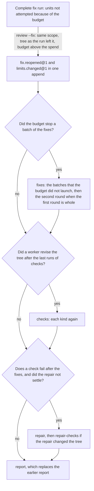

# Technical Design: Resumable runs

Product part: [2026-10-18-resumable-runs.requirements.md](2026-10-18-resumable-runs.requirements.md).

## Summary

The design has one test and nine mechanisms. The test (R2) runs a fix run on the fakes in a child process. It stops the engine at a chosen point in a chosen way. Then it runs the same command again and compares the result with a run that had no stop. A preload in the child process stops the engine, so the engine has no hook for the test. The mechanisms close each point that the test or a run showed:

| Mechanism | What it does | Requirements |
|---|---|---|
| Old and current runs of a check | A run of a check is old when a worker revised the tree after it. A phase that starts again after a stop runs again each kind whose last run of a cut attempt did not pass, and `check.ran@3` names the run that it replaces. | R3, R11, R15 |
| The start of a check | `check.started@1` records each start. After a check that a kill cut short, at once or at the next start of the phase, the engine writes back the files that it changed, after `tree.restored@1` records what was there. | R7 |
| A cut child | A check or a worker whose process ended with a kill mark is cut. A cut check has no result and runs again, and a cut worker is an interruption of its unit. | R4 |
| Attempts after a stop | A phase that starts again after a stop gives its units fresh attempts. | R5 |
| One append for the end of a worker | The end of a worker and its contribution are one append. | R6 |
| A guard for each child | A small guard process ends the tree of its child when the engine ends. | R8 |
| A prepared series of commits | `commit` appends `commits.prepared@1` before it moves the branch, and the next command completes or drops the series. | R9 |
| A bounded lost attempt | The revision of a lost attempt holds only its snapshots, its owned files and its claimed files. | R10 |
| A reopened fix pass | `fix.reopened@1` reopens a complete fix run that the budget stopped. | R11, R12, R13 |
| A usage limit | The Claude adapter knows the words of a usage limit. `attempt.failed@7` records the failure as a fault of the environment in any phase, and the phase blocks at once. | R14 |

This design calls the continuation of R11 a reopened fix pass. It is apart from the continuation of a read-only run into the fix pass, which `fix.pinned` records.

## Non-Goals

### No native job object and no detector of stops

Node gives no way to create a Windows job object, and the engine cannot see its own `TerminateProcess`. The guard (R8) does the work of a job object. The kill mark (R4) is the part of a detector that the engine can see: how its child ended.

### No write back of a file outside the files that the run expects

After a cut check, the engine writes back only the files that the run expects (R7). A tracked file outside them, which the cut check changed, stays a stray file, as today. The rerun of the check then records it in its revision.

### No sleep detection

A timeout can count the time that the machine slept (W9 in Context). No run showed this in this engine, so the design does not detect a sleep. An Open Question says what to measure.

### No change to the continuation into the fix pass, to #44, or to the answer pass at the budget

`fix.pinned` is appended after the start lock is released (#44), and this design does not change it. The new event `fix.reopened` avoids that order (TD8). The answer pass keeps its block at the budget (TD8 of answers).

## Context

All paths and symbols were verified at `97ecac0`.

### How the engine ends

`releaseOnExit` in `src/review/lock.ts` listens for SIGINT, SIGTERM, SIGHUP and SIGQUIT on POSIX, and for SIGINT, SIGBREAK and SIGHUP on Windows. It releases the lock and exits with 128 plus the number of the signal. The exit listener of `LiveProcesses` in `src/runtime/process.ts` then kills the process tree of each live worker and check: `taskkill /T /F` on Windows, and a SIGKILL of the process group on POSIX. A SIGKILL, a `TerminateProcess` or a crash of Node itself runs no listener, as the comment in `process.ts` says.

On POSIX, each child is detached, so it leads its own process group and lives after a SIGKILL of the engine. On Windows, libuv puts each child in a job object that ends it with the engine, but the descendants of the child leave that job. A test on Windows used a parent that started four children through `cmd.exe`, as `runCheck` does, and logged the end of each child. `taskkill /T /F` on the parent, three times, left no logged end, so a plain tree kill reaches each process before the parent can record anything.

The ledger of run `8dbe23ad` gives the times of #25, in UTC. The killed typecheck ended at 11:06:37.203 with exit code 143. The engine recorded it at 11:06:37.215. The resumed engine made its first record at 11:06:37.542. Thus the first engine stopped less than 0.34 seconds after the check ended. The stop of that run was a person's stop through the session that ran the engine, and it reached the check first.

A second test on Windows, on 2026-10-18, started a check as `runCheck` does and ended it in five ways. A check that failed by itself, `taskkill /F` on its process and `taskkill /T /F` on its shell each gave exit code 1. The `kill` of Git Bash on its process or on its shell gave 143. Thus the 143 of run `8dbe23ad` is the mark of the `kill` of Git Bash, and a kill with `taskkill` looks like a real failure.

### What a run appends, and what it does outside the ledger

The launcher in `src/runtime/launcher.ts` appends `worker.launched` before it spawns a worker, and `worker.finished` after the worker ends. The controller's `record` in `src/review/controller.ts` then appends the contribution of the worker in a second append (`contributionOf` in `src/review/phases.ts`). At the next start, `recordLostWorkers` records each worker that the ledger shows in flight as lost, with the edits of a lost fixer.

A check has no record of its start. `runDueCheck` in `controller.ts` takes a manifest of the tracked files (`prepareCheckManifest` in `src/review/snapshot.ts`) and runs the check. Then it appends `check.ran@2` with the revision of the check in one append.

`commit` in `src/review/commit.ts` builds the commits, moves the branch with `update-ref`, runs `git reset -q`, and appends `commits.created@1`. `refuse` in that file refuses a `HEAD` that is not the head of the run (`runHead` in `src/checkpoint/fix-state.ts`).

### Checks and their runs

`dueCheck` in `src/review/steps.ts` returns the first kind, in the order of the kinds, that has no run in the phase past `checksFloor`. Once `build` did not pass, the controller records each later kind as skipped. `checks` runs only after a revision of the fixes, and `repair-checks` runs when the repair has a target, even when the repair did not run. The reducer `checkRan` in `src/checkpoint/fix-fold.ts` refuses a second run of a kind past the floor. `checksFloor` in `fix-state.ts` gives the attempt at which the current answer pass opened `answer-checks`, and 0 for the other phases.

`failedAtBaseline` and `repairTargets` in `fix-state.ts`, the fixer's task in `phases.ts`, and `status` read the last run. The Checks table in `src/review/fix-report.ts` shows the last run of each kind in each phase. It has its own `failedAtBaseline`, which reads the first baseline run with `find` and counts `not-started` as a failure.

### Units and their attempts

A unit has two attempts (`maxAttempts` in `steps.ts`). `interrupted` treats a failure with the cause `lost` or `environment` as an interruption. Thus a unit with such a failure blocks with `worker-failed` and does not degrade. `phaseStarted` in `src/checkpoint/review-fold.ts` gives the units fresh attempts when a phase starts again after a block, not after a stop. `attempt.failed@6` has a `fault`, `unit` or `environment`, and the reducer accepts `environment` only in the fixes phase, for a lost claims directory.

`workerVerdict` in `launcher.ts` takes a worker that ended with a signal or an exit code other than 0 as failed. The Claude adapter in `src/runtime/claude.ts` takes a result with `is_error` true as failed. Its comment says that a usage limit arrives that way and counts against the unit (#40). On run `e21b026d`, the words were `You've hit your session limit · resets 12:10pm (Asia/Seoul)`.

### The edits of a lost attempt

`attemptRevisionEvents` in `src/review/fix-events.ts` builds the revisions of a lost or failed attempt. Its paths are the paths that the snapshots name and each path that git reports as changed (`changedPaths`). It leaves out the files of other clusters, strays, leftovers and ignored files. Thus a change of a person to a file of the change, made while the engine was stopped, goes into the revision of the attempt.

### The scope of a command

`scopeRequestOf` in `src/cli.ts` gives the mode and the request that a command names. It refuses `--last-commit` on a tree with uncommitted changes and `--worktree` on a clean tree, with exit code 1. Its request is `{ paths }` for `--last-commit`, `--worktree` and no scope flag alike, so only its mode tells them apart. `--branch` gives a range from `review.base` to `HEAD` from their merge base.

`resolveScopeRequest` in `src/scope/capture.ts` resolves a request with no ref and no range by the state of the tree. Thus the edits of a fix run change what the same request resolves to. `scopeMismatch` in `src/scope/compare.ts` compares that resolution, so a fix run whose edits changed the tree does not match its own request.

### The budget, complete runs, and older engines

The spend can reach the run budget in the fixes or the repair. Then `budgetDegradations` in `steps.ts` names each unit that did not settle and has no worker in flight. The controller records each one as `unit.unattempted@1` with the cause `budget`, and the run goes on to its report. The planner plans the second round once each batch of the first round settled, answered or not attempted. On run `0d63437e`, the engine planned the second round and recorded its three batches as not attempted 8 milliseconds later. `repair-checks` then ran the failed build again on the same tree, for a repair that did not run.

A complete run is not resumable (`isResumable` in `controller.ts`), and `continuable` takes only a finished read-only run. The reducer of `limits.changed` refuses new limits after the report. The run budget in force is the flag of the invocation or the pinned budget (`limitsInForce`), so each resume names `--budget-usd` again. `pinFix` and `answerPass` move a phase out of `completed`, `degraded` or `skipped`, and each keeps the report that it replaces. `committedWords` in `fix-report.ts` calls each revision after a committed series a revision of an answer pass.

`listRuns` in `src/checkpoint/checkpoint.ts` passes over a run with an event kind or version that the engine does not declare. Each other failure of the fold throws, `InvalidHistoryError` too, and stops `review`, `status`, `abandon`, `answer` and `commit` in each worktree (`readableRuns` in `src/review/runs.ts`). Thus a reducer that accepts more at the same version stops each older engine.

### The ways that no run showed

A search of the code found these nine ways in which a stop can leave work undone or a record false. W3 was tested on Windows, and the other rows are from the code. Runs showed #25, #48 and #40, which the Problem of the product part gives.

| Way | What the stop leaves, and what the next command does | Requirement |
|---|---|---|
| W1 | A worker that a stop kills before the engine is `attempt.failed` with the fault `unit`. The unit has one attempt left, and a second failure degrades it. | R4, R5 |
| W2 | On POSIX, after a SIGKILL, detached workers and checks continue. The resume records them as lost and reads their edits while they edit. | R8 |
| W3 | On Windows, after a `TerminateProcess` of the engine alone, its direct children stop, but their descendants continue. Late writes become drift or strays. | R8 |
| W4 | A check that writes files and that the engine did not record leaves a part of its writes. The next start of the phase blocks on drift. | R7 |
| W5 | A hard kill after `worker.finished` and before its contribution leaves a finished worker with no answer. The unit runs again, and the edits of a fixer are in no revision. | R6 |
| W6 | A kill after `commit` moved the branch and before `commits.created` leaves commits that the ledger does not hold. `commit` and `answer` then refuse. | R9 |
| W7 | An active run whose worktree a person removed refuses each review in another worktree. | Not handled: a person's change |
| W8 | A person edits the tree while the engine is down. The revision of a lost fixer takes the edits as its own, and `commit` commits them. | R10 |
| W9 | The timeout of a worker or a check can count the time that the machine slept. The engine then kills it at the wake and records a timeout. | R7 for a check, which runs again after a first timeout. Not handled for a worker: no run showed it |

## Design

### The contract test (R1, R2)

A helper in `test/helpers/` runs `src/cli.ts review --fix` in a child process, on a repository that the helper makes, with the fake runtimes and the fake checks. It loads a preload with `--import`. The preload wraps `Checkpoint.prototype.append`, counts the appends, and stops the process after the append that the test names. For a point while a child runs, the fakes write a file when they start, and the helper stops the engine when that file appears.

The run holds each case that a way needs. The first attempt of one unit fails, so that a stop can meet a unit at its last attempt. One fake check rewrites a file that the run expects, as a formatter does, before it writes the file that marks its start. A stop at that check thus cuts a check after its first write.

The helper stops the engine in four ways. For a handled signal, the preload emits SIGINT in the process, which runs the path of `releaseOnExit` on each platform. For a hard kill of the engine alone, the helper calls `process.kill` with SIGKILL on the engine's pid, which is `TerminateProcess` on Windows. For a hard kill of the tree, it runs `taskkill /T /F` on Windows and a SIGKILL of the process group on POSIX.

For a kill of a child before the engine, the fake writes its pid in the file that marks its start. The helper ends that pid with a kill mark: SIGTERM on POSIX, and the `kill` of Git Bash on Windows, which the suite finds from `git --exec-path`. 100 milliseconds later, it kills the engine alone as above.

This is the order of run `8dbe23ad`, and only this way can show #25 and W1. On that run, the engine recorded the end of each check 12 to 19 milliseconds after the check ended. The phase finished 5 milliseconds after its last record. A gap of 100 milliseconds thus lets the engine of today make the failure final, and it is less than the gap of that run.

The helper then runs the same command again with no preload, until the run writes its report or blocks. It checks R1 against a run of the same repository with no stop, in four parts.

First, the second command exits as the run with no stop exits, with no added flag. Second, no worker that settled before the stop is launched again. The next command launches one more time each unit that was in flight when the engine ended.

Third, nothing is false. Each current run of a check has the outcome of the run with no stop. A failure of a worker that the stop killed costs its unit nothing: the unit does not degrade, and it gets its two attempts again at the next command. No revision holds a file that its unit did not touch.

Fourth, the report equals the report of the run with no stop after a normalization. The normalization removes times, durations, paths of the evidence, run ids, and the lines of R15.

The suite runs a fixed set of points. They are the first and the last append of each phase, and the launch and the end of a worker and of a check. They are also the record of a revision, the write of the report, and `commit` before and after it moves the branch. A script, `npm run resume-test`, runs each append of the run in each of the first three ways. It runs each child of the run in the fourth way. CI runs the suite on three systems, and the gate runs the script.

### Old and current runs of a check (R3, R11)

A run of a check checks the tree of its time. A revision by a worker after the run makes the run old: a fixer, the repair or an answer pass. A revision by a check does not, because a check that writes files records its own writes as part of its run. The fold keeps the ledger order of each run and each revision, so each reader can tell an old run from a current one.

Each checks phase uses this rule as follows:

| Phase | When it runs each kind again in a later attempt |
|---|---|
| `baseline-checks` | Never for an old run, because no edit comes before it. Only R3 below. |
| `checks` | In a reopened run, when its last runs are old. |
| `repair-checks` | In a reopened run, when a revision of the repair came after its last runs. |
| `answer-checks` | As today: once for each answer pass that revised the tree (`checksFloor`). |

A phase that runs each kind again moves its floor to its attempt at the last `fix.reopened`, so the reducer accepts the new runs. `checks` still runs only after a revision of the fixes, and `repair-checks` now runs only after a revision of the repair. The Checks table marks a column whose runs are old with "(an earlier tree)", and its notes name the edit that came after. Thus the "After answers" column of a run that reopened after an answer pass says that a later fix changed the tree.

R3 is a separate rule, for a stop in the middle of a phase. The fold keeps the last finished attempt of each checks phase. A cut attempt is an attempt after it, with no `phase.finished`.

`dueCheck` returns the first kind, in the order of the kinds, with a command and one of two states. The kind has no current run, or its last current run did not pass and is from a cut attempt. The skip rule reads the last current run of `build`. Thus a `build` that runs again runs first, and the kinds after it read its new outcome. A run from a completed attempt never runs again by R3.

Each reader reads the last current run: `dueCheck`, the reducer, `failedAtBaseline`, `repairTargets`, the fixer's task, the Checks table and `status`. The own `failedAtBaseline` of the Checks table goes. The table then reads the last baseline run, and it keeps its mark for `not-started` as today. The notes under the table read the current runs, so a phase with no current run says why it did not run.

### The record of a check: `check.started@1` and `check.ran@3` (R3, R7, R15)

`runDueCheck` appends `check.started@1` with the phase, the attempt, the kind and the command before it starts the check. The reducer refuses a start of a kind that is not due. `check.ran@3` is `check.ran@2` with one more field, `replaces`. It is null for the first current run of a kind. Else it holds the attempt and the outcome of the run that it replaces.

The reducer folds version 3 with three rules. With `replaces` null, the kind has no current run in the phase. With `replaces` set, the last current run of the kind has that attempt and that outcome. That outcome is not `passed`, and that attempt is a cut attempt. And a version 3 run has a start of the same kind in the same attempt, with no run after that start. Versions 1 and 2 keep their rule: the kind has no current run, and no start is necessary.

Before a rerun, `runDueCheck` logs `check typecheck (baseline-checks): running again; attempt 1 failed in 4.4 s before the phase started again`. Each new fix run has `check.started@1`, so an older engine passes over each new fix run (R16).

### A check that a stop cut (R7)

A cut check is a `check.started` with no `check.ran` after it in the same attempt, or a `check.ran` with the outcome `cut`. When a checks phase starts again, the planner first looks for a cut check in the earlier attempt. Sometimes one exists, and the start check of the tree finds drift only in files that the run expects. The planner then returns a new step, `restore-tree`, instead of the block. Drift of `HEAD` or of a file outside the run's files still blocks, as today.

In the same attempt, after a run that ended cut or timed out, the planner compares the files that the run expects. When one differs, it returns `restore-tree` before its next step: the rerun of the check, or the next kind after a second timeout.

`dueCheck` also returns a kind whose last current run is its first timeout in the attempt, so the kind runs again. A second timeout of the kind in the attempt is its result, as the readers take a timeout today.

For `restore-tree`, the controller freezes the bytes of each drifted file as evidence, or records that the file is absent. It then appends `tree.restored@1`, with the phase, the attempt, the cut check, and each file with its frozen bytes and its expected state. Then it writes the expected bytes, and it checks the tree again.

A stop between the append and the writes is safe, because the next start finds the record and writes again. The log names each file and where its earlier bytes are. Then R3 runs the cut check again, because it has no current run.

### The outcome `cut` (R4)

`endedByKill` in `src/runtime/process.ts` holds the one list of kill marks: a signal, or the exit code 129, 130, 131, 137, 143 or 3221225786. `checkOutcomeOf` gives `cut` for a check that exited with a mark, and `check.ran@3` permits that outcome. A check that the engine killed at its timeout stays `timeout`, because its process result is `killed`, not `exited`. Under the guard of R8, the exit code and the signal come from the result file of the guard. A guard with no result file is a mark too.

`dueCheck` treats a cut run as no run. Thus the kind is due again, and a phase does not finish while a kind is cut. `runDueCheck` records the second cut of a kind in one attempt as `failed`, with an error that names both marks. It records no revision for a run that ended cut or timed out, because `checkRevision` runs only for the other outcomes. The write back of R7 then comes before the next step.

No reader of the last current run then sees `cut` as a result: `failedAtBaseline`, `repairTargets`, the task of a fixer and the Checks table. The log says `check typecheck (baseline-checks): cut by exit code 143, a kill mark; it runs again`.

For a worker, `workerVerdict` in `src/runtime/launcher.ts` reads the mark right after its checks for a worker that did not start or ran past its timeout. It gives such a worker the outcome `failed`, so `worker.finished` does not change, and the receipt gets the cause `cut`. `contributionOf` then records `attempt.failed@7` with the fault `cut`, a third fault of that version. The fold counts it as an interruption, as a lost worker. It uses an attempt, and `exhaustedOutcome` blocks a unit with a cut among its failures and never degrades it.

The planner launches a unit with an attempt left again at once, as after each failure. A cut does not block the phase at once, as the limit of R14 does.

### Attempts after a stop (R5)

`phaseStarted` gives the units of a phase fresh attempts when the phase was `running`, as it does when the phase was `blocked`. A phase is `running` at a start only when an earlier engine stopped while the phase ran. A unit keeps each answer that it gave, and a degraded unit stays degraded. The event does not change, so this is not a new version. An older engine that folds the same ledger only keeps more failures, and it refuses nothing.

### The end of a worker and its contribution in one append (R6)

The launcher no longer appends `worker.finished`. It returns the payload of the finish with the receipt. The controller's `record` appends the finish and the contribution in one append. When the contribution cannot be built because of a fault of the engine, `record` appends the finish alone and throws, as today's two appends end. Each other user of the launcher appends the finish itself, through one function that the launcher exports. A worker that the ledger shows as launched and not finished is lost at the next start, as today.

### Each child ends with the engine (R8)

`runProcess` starts each worker and each check through a guard: `node <engine entry> guard`, with the command, its directory, its environment and its files in a file that the engine writes. On Windows, the guard is detached, so it leaves the job object of libuv. On POSIX, it leads the process group of the child, as the child does today.

The guard starts the child and waits for it. It holds a pipe from the engine on its standard input. When the pipe closes before the child ends, the engine ended, so the guard kills the child's tree: `taskkill /T /F` on Windows, a SIGKILL of the group on POSIX. Then it exits.

When the child ends, the guard writes the child's exit code and signal to a result file in its directory. Then it exits with the child's exit code. The engine reads the end of the child from that file, not from the exit of the guard. A guard that ends with no result file, when the engine did not kill it at the timeout, was killed from outside. The engine then records the run as cut (R4), whatever code the guard left. The engine still owns the timeout: it kills the tree of the guard, which holds the tree of the child.

The guard is the same file as the engine, so the build ships nothing more. A stop that kills the whole tree also kills the guard, and that case needs no guard. A stop that kills the engine alone leaves the guard, which ends the child at once.

### `commit` records its series first (R9)

`commit` appends `commits.prepared@1`, with the head that it starts from, the head that it makes and each commit, before it moves the branch. After `update-ref` and `git reset -q`, it appends `commits.created@1`, as today. The fold keeps a prepared series with no `commits.created` as open, and `runHead` does not move for it.

Each command that reads `runHead` first settles an open series: `commit`, `answer`, and a `review --fix` that reopens the run. If `HEAD` is at the head that the series makes, the command runs `git reset -q` and appends `commits.created@1`. If `HEAD` is at the head that it starts from, the command appends `commits.dropped@1`, and the series can be built again. If `HEAD` is at another commit, the command refuses, and it names both heads.

### A lost attempt records only its own work (R10)

`attemptRevisionEvents` takes as its paths the paths that the snapshots name, the files that its unit owned and the files that its unit claimed. It no longer adds each path that git reports as changed. A change outside these files stays in the tree. The next check of the tree then finds it as a drift, for a file that the run expects, or as a stray file.

### The reopened fix pass (R11, R12, R13)

#### How the command finds the run

The scope source of `review` gives the mode and the request that the command names. It gives them before the check of the tree that `scopeRequestOf` makes for `--last-commit` and `--worktree`. `openRun` compares them with each complete fix run of the worktree that has a unit not attempted because of the budget, newest first. It does this when the command has `--fix`, no `--fresh` and no active run.

A named `last-commit` or `worktree` matches a run of that mode. No scope flag matches a run of either mode whose request has no ref and no range. A named ref or range, with `--branch` among them, matches a run with the same request. The paths must be equal after the normalization of the capture. The check of the tree runs only when no such run matches, before a new run or a read-only continuation, as today.

When a run matches, `findDrift` in `src/review/drift.ts` decides the next step. `HEAD` can be away from `runHead`, or a file that the run expects can differ from what the run recorded. Then the command goes on to a new run (R12). Its log names the run and each file or `HEAD` that moved.

When the tree is where the run left it, `openRun` takes the run lock and folds the run again, as it does for a continuation. Then it holds the run as a continuation is held. It checks the runtime (`refuseOtherRuntime`) and the spend against the budget in force. It also checks the roles digest and the executable, with `resumePinned` and the use `continue`, whose way out is `--fresh`. When the budget in force is not above the spend, `openRun` refuses with exit code 2 (R12):

`run 0d63437e stopped its fix pass at the run budget: spent 61.16 USD of the 60.00 USD run budget; run the command again with --budget-usd above 61.16 to continue it, or with --fresh to review the change again in a new run`

When each check passes, `openRun` appends `fix.reopened@1` and `limits.changed@1` in one append, under the start lock and the run lock (TD8). The run is then active, and `runReview` resumes it as a found run. A later resume of the reopened run names `--budget-usd` again, as each resume does today. Without it, the pinned budget applies, and the planner records the listed units as not attempted again.

#### The event and the fold

`fix.reopened@1` has one field, `units`: each unit as its phase, `fixes` or `repair`, and its key. The reducer refuses the event if the run is not active with its report written, or if the run does not fix. Each listed unit must be not attempted because of the budget, and the list must hold each such unit of the run one time. The list must not be empty.

The reducer removes each listed unit from `notAttempted`, so the unit can launch again, and the failures of the unit stay. It keeps the event with its time, its units, the report that it replaces, and the attempts of `checks` and `repair-checks`. It sets the report to null. It sets `checks`, `repair`, `repair-checks` and `report` to `pending` at their attempts, and `fixes` too when a unit of the fixes is listed. `checks` opens again in each case, because an answer pass can revise the tree after its last runs.

With `fix.pinned` and `answer.pass`, this is the third reducer that moves a phase out of `completed`, `degraded` or `skipped`. `limits.changed` after it is accepted, because the report is null.

#### The planner in a reopened run

Each unit that `fix.reopened` lists is not settled, so `launchableUnit` lets it launch, within the order of its cluster. A unit that answered or that failed twice stays settled, so nothing launches it again. The read-only phases are completed, so no worker of them launches.

The planner plans the second round only when each batch of the first round settled and none is not attempted because of the budget (PD13). A batch of the second round does not launch while a batch of the first round did not settle. Today this holds because the second round is planned after the first round. The new rule keeps it for a run that an older engine planned.

`checks`, `repair` and `repair-checks` then follow the rules of the old and current runs. The repair unit launches when `repairTargets` names a kind and the unit did not settle. The answer phases are `completed` or `skipped`, so they do not run again. Figure 1 shows the flow of a reopened run.

Figure 1. A reopened run does only the work that the budget left. The earlier runs of a checks phase stay current when no worker revised the tree after them.

#### Answers in a reopened batch

`answeredFor` in `phases.ts` gives a fixer only an answer that still needs an edit. An answer pass can apply an answer to a finding of a batch that the budget did not launch. A reopened batch then gets that answer too, with the note that the tree holds it. The fixer then answers `already-applied` and keeps the edit of the answer pass. `withApplied` in `src/checkpoint/answer-state.ts` changes nothing for an answer that is already applied.

### The usage limit (R14)

The Claude adapter returns a new kind of decoded result, `limit`, for a result with `is_error` true. That result has text that names a usage limit or a session limit. It keeps the text, with the time of the reset. `workerVerdict` gives such a worker the outcome `failed`, so `worker.finished` does not change, and the receipt gets the cause `limit`. `contributionOf` then records `attempt.failed@7` with the fault `environment` and the reason, and it keeps the edits of a failed fixer as today. `attempt.failed@7` is version 6 with the `environment` fault permitted in each phase, and with the third fault `cut` of R4.

The planner blocks the phase at the first such failure, after the workers in flight end. The blocker is `worker-failed`, its detail names the limit and the reset, and its action is the action of today. The next start of the phase gives fresh attempts (R5 and the rule after a block). The words that the adapter knows are in one list beside the adapter, and a test pins them with the text of run `e21b026d`.

### The record of a stop (R15)

The Limitations section of the report gets one line for each case of this table. The examples are invented.

| Case | Line |
|---|---|
| A check that ran again | `- Ran again after a stop: typecheck in baseline-checks, failed in 4.4 s at attempt 1, passed in 3.1 s at attempt 2.` |
| A cut check | `- Cut by a stop: test in baseline-checks at attempt 1, with no end on record.` |
| A check that ended with a kill mark | `- Cut: typecheck in baseline-checks ended with exit code 143, a kill mark, and ran again: passed in 3.1 s.` |
| A worker that ended with a kill mark | `- Cut: the worker of finder REMOVALS ended with exit code 143, a kill mark, and ran again.` |
| A file that the engine wrote back | `- Written back after a cut check: src/a.ts; the bytes before are at <path>.` |
| A file written back after a timeout | `- Written back after build timed out: dist/claude/engine/main.mjs; the bytes before are at <path>.` |
| A check that ran again after a timeout | `- Ran again after a timeout: test in checks timed out after 20 min at its first run, and passed in 5.2 min at its second.` |
| A fix pass that the budget stopped | `- The run budget stopped the fix pass: 3 batches and the repair did not start. node "<engine>" review --runtime claude --last-commit --fix --budget-usd 62 continues it and reviews nothing again.` |

The command in the last line comes from the run. It names the entry of the engine, as the answer command of the report does (R9 of the skill surface corrections). It also names the runtime, the scope flags and the paths of the run's request, and `--budget-usd` above the spend. In a run whose first round the budget stopped, the fate of a finding that the first round blocked says `Second round not planned: the run budget stopped the first round`.

After `fix.reopened`, the header gets one line, as an answer pass does: `Reopened: the fix pass past the run budget on <time>, after the report at <path>`. A run that reopened more than one time names the last one and the count. The Changed files section names the phase of each revision after a committed series: the reopened fix pass, or an answer pass. `committedWords` and the comment of `whyNotCommittable` in `commit.ts` change with it.

`status` gives the same facts and an open or dropped series of commits. For a complete run that the budget stopped, it names the command that continues it. At the end of such a run, after the line of the report, the controller logs that command too.

### Skills and README (R17)

Step 3 of the Claude Code skill already says to run the same command again after an interruption. It gets two sentences. A fix run that the budget stopped continues with the same command and a higher `--budget-usd`, with no new review. A run that a usage limit blocked resumes with the same command after the reset that the blocker names. Step 4 tells the model to show the stderr line about the budget as printed and to offer that command.

The Codex skill does not get these lines, because Codex reports no cost and this design knows no limit of Codex. The test that keeps the two skills one text lists the new lines as lines of the Claude Code skill only. The README gets a section that states the contract of R1, the budget case for runtimes that report cost, and the limit of Claude Code.

### Golden fixture (R16)

The registry gets `check.started@1`, `check.ran@3`, `tree.restored@1`, `attempt.failed@7`, `fix.reopened@1`, `commits.prepared@1` and `commits.dropped@1`. One commit adds all of them with their reducers and the new fixture, `schema-1-13`, made with `npm run golden -- --output test/fixtures/checkpoints/schema-1-13`. The fixtures from `schema-1-01` to `schema-1-12` stay, and each must still fold. An older engine passes over each run that holds one of these, as `listRuns` does for each version that it does not declare.

### Steps of the work (PD15)

Each step is its own commits, with its tests, and `npm run check` passes after each step. A step that closes a point removes its mark of a known failure from the test of step 1. The test then shows each closed point from then on.

| Step | Work | Requirements |
|---|---|---|
| 1 | The contract test with its fixed set of points and the script, on the engine as it is. Each point that fails is marked as a known failure with the requirement that closes it, which gives the baseline of the metric. A requirement for a way that no run showed leaves the proposal by an amendment before its step when no point shows its way (PD1). | R1, R2 |
| 2 | The ledger: each new event kind and version, its reducer, and `schema-1-13`. | R16 |
| 3 | Checks: old and current runs, the rerun and its record, `check.started`, and the write back. | R3, R7 |
| 4 | Failures and attempts: the outcome `cut` with its write back, the fresh attempts, and one append for the end of a worker. | R4, R5, R6 |
| 5 | Children: the guard. | R8 |
| 6 | Commits and lost attempts. | R9, R10 |
| 7 | The budget: the reopened fix pass. | R11, R12, R13 |
| 8 | The usage limit. | R14 |
| 9 | The record, the skills and the README, and the comments that the change makes false. | R15, R17 |
| 10 | The gate. | R18 |

The comments of step 9 are these. `checkOutcomeOf` in `run.ts` and the decoder in `claude.ts` link #25 and #40 as behavior of today. `contributionOf` in `phases.ts` says that a usage limit counts against the unit. The comments in `review-fold.ts`, `fix-fold.ts` and `answer-fold.ts` say that two reducers move phases. And `whyNotCommittable` in `commit.ts` says that a later series is an answer pass's.

## Technical Decisions

### TD1: The test stops the engine from a preload, not from a hook in the engine

A failpoint in `Checkpoint.append` that an environment variable turns on was rejected. It puts code for tests into each run of the product. The preload wraps the same function in the child process of the test only, so the product does not change. The preload sees the same module instance as the engine, because `--import` loads it into the same module graph.

### TD2: New versions, not wider reducers at the same version

A reducer that accepts more at version 2 stops each older engine in the repository (Context). After the change for #37, an engine passes over a run with a version that it does not declare. Thus `check.ran@3` and `attempt.failed@7` let an older engine pass over the run. The `replaces` field of `check.ran@3` also makes the correction a statement of the ledger, which the reducer can check. A version 3 with no new field was rejected, because the reader then has to find the replaced run by an inference.

### TD3: Old runs by the order of the ledger, not a floor for each event

A floor that moves only on `fix.reopened` was the first design. A review of it showed two faults. An answer pass between the stop of the budget and the reopen revised the tree. The floor did not see it, so the repair read old runs. And a reopen after an answer pass left the "After answers" column on a tree that a later fix changed.

The rule "a run is old when a worker revised the tree after it" covers each order of the edits with one comparison. The fold has that order already.

### TD4: One list of kill marks for checks and workers, not a wait

One list in `process.ts` serves checks and workers, so the two cannot disagree on a mark. A wait in the controller was the first design. It held a checks phase or a degradation for 10 seconds after the recorded end of a failed child. It was rejected for the reasons of PD5, and also for two faults of its own. It held back the record of the other workers in flight, and a change of the clock moved its end. The list does not hold 1, because `taskkill` gives it, and so does a program that fails.

### TD5: A guard per child, not a cleanup at the resume or the means of each system

A cleanup at the resume was the other choice. On POSIX it can kill each recorded process group that is still alive. On Windows it must find the descendants of a dead child by their parent pid, with a list of the processes from WMI or PowerShell. It must also guard against reused pids by the start time. That list is slow and depends on a tool that the engine does not use today.

Also, an orphan writes to the tree from the stop to the resume, which can be hours later. The guard ends the child at the stop, on both systems, with code that the engine already has (`killTreeNow`). The cost is one more Node process for each child, which starts in a fraction of a second.

The means of each system were rejected for now. A Windows job object with `JOB_OBJECT_LIMIT_KILL_ON_JOB_CLOSE` ends the whole tree when its last handle closes, also after a hard kill of its owner. Node has no API for it, and the job of libuv permits silent breakaway, so the children of a child leave it. A native helper, such as the Rust tool `w32die`, makes the repository ship a native binary for each architecture, and today it ships none.

On Linux, `PR_SET_PDEATHSIG` reaches only the direct child, and `unshare --pid --fork --kill-child` needs user namespaces, which some systems restrict. macOS has no such means. Revisit the job object if a run shows the guard fail on Windows.

### TD6: `commits.prepared` before the branch moves, not an adoption by the trailers of the commits

The next command can read the trailers of the commits on the branch and adopt a series that names the run. That was rejected, because it reads the run's state back from git. Principle 2 asks for the record first. The prepared series is a statement of intent, and the next command checks it against `HEAD`, which is one comparison.

### TD7: The write back is a step of the planner with a record, not a part of the start check

A write back inside the start check of the tree was rejected. The check reports, and the record of what it overwrites must come before the write. A step of its own puts `tree.restored@1` on the ledger first. A stop between the record and the writes is then safe, because the next start writes again.

### TD8: One append under both locks, in `openRun`

`fix.pinned` is appended after the start lock is released, and #44 tracks the race that this opens. `fix.reopened` is appended before `openRun` releases the start lock, so no other engine can create a run beside it. The limits are in the same append, so a stop between two appends cannot leave a reopened run at the old budget.

### TD9: The run is found by the named mode and request, before the check of the tree

`scopeRequestOf` refuses `--last-commit` after the fixes changed the tree, and `--worktree` after `commit` cleaned it. It also gives the same request for three modes. Thus the comparison must use the mode and the request as the command names them, before that check. The check then runs only for a new run. The resolution of the request was rejected, because the edits of a fix run change it (Context). A run that `commit` committed has its head at `runHead`, so `findDrift` accepts it, and a later series commits the new revisions (R8 of answers).

### TD10: The reopened run keeps the settings that it recorded

A reopened run is held as a continuation is held (TD6 of fix pass continuation), with `--fresh` as the way out. Only `--budget-usd` and `--concurrency` apply, as on a resume. Settings read again at `fix.reopened` were rejected. The run reviewed and fixed with its settings, so the rest of its fix pass uses them too.

### TD11: `repair-checks` runs only after a revision of the repair

Today `repair-checks` runs when the repair has a target, also when the repair did not run. On run `0d63437e`, it ran the failed build again on a tree that nothing changed. The report then showed "After the repair" for a repair that did not run. The check after the repair now needs a revision of the repair, as the check after the fixes needs a revision of the fixes.

## Open Questions

### Do Ctrl-C and the shells of macOS and Linux leave the marks of the list?

The test on Windows measured `taskkill` and the `kill` of Git Bash. Ctrl-C on Windows, and SIGTERM and SIGINT through `/bin/sh` on macOS and Linux, are not measured yet. The test of R4 measures SIGTERM and SIGINT on macOS and Linux in CI. Ctrl-C on Windows needs a console, so the gate measures it by hand, with the stop of Claude Code. A mark that the list lacks goes into it before the merge.

### Does a timer count the sleep of the machine?

W9 depends on one question: do the timers of Node count a sleep on Windows, macOS and Linux? A test with a suspended machine settles it. If a timer counts the sleep, a later change can treat a large gap between the wall clock and the timer as an interruption. This proposal does not depend on the answer.

### How long does the script of R2 take?

A fix run on the fakes appends a few hundred events, and each point runs two commands in each way that applies to it. Step 1 measures the time. If the script is too slow for each pull request, the gate runs it, and CI runs the fixed set.

## Test Strategy

### R1 and R2: The contract

`test/review/resume-contract.test.ts` runs the fixed set of points in the four ways, on the three systems of CI, against a run with no stop. Each point checks the four parts of the contract in the Design. Step 1 records the points that fail on the engine as it is, and each later step removes the marks that it closes. The script runs each point in each way that applies to it.

### R3: A check that a stop cut short runs again

In `test/review/fix-steps.test.ts`, a cut attempt runs again a kind whose last current run failed, timed out, did not start or was skipped. It does not run again a kind that passed, or a run of a completed attempt. It runs the kinds in their order, so a `build` that runs again runs first. In `test/checkpoint/fix-fold.test.ts`, version 3 with `replaces` null folds only for a kind with no current run. With `replaces` set, it folds only when that names the last current run, which did not pass and is from a cut attempt. Versions 1 and 2 fold as before.

### R4: A child that something outside ended is cut, not failed

In `test/review/checks/run.test.ts`, `checkOutcomeOf` gives `cut` for each mark of the list, `failed` for exit code 1 and `timeout` for a kill at the timeout. A real check that the test ends with SIGTERM and with SIGINT on POSIX is cut. On Windows, a real check that the `kill` of Git Bash ends is cut. One that `taskkill` ends is failed, which pins the gap of the accepted risk.

In `test/review/fix-steps.test.ts`, a kind whose last current run is cut is due again, and the phase does not finish. A second cut of a kind in one attempt is recorded as failed. A fold test records a worker with the fault `cut`: its unit gets its second attempt, and with two failures it blocks and does not degrade. The contract test kills the last baseline check first in the fourth way, and the resumed run runs it again.

### R5 and R6: Attempts and the end of a worker

A fold test starts a phase again that an engine left in progress. It checks that each unit that did not settle has no failures, and that answers and degradations stay. A test of the controller ends a worker and checks that `worker.finished` and the contribution are in one append. The contract test covers a stop between the two.

### R7: A cut check

A fake check writes a file of the run and then hangs, and the test stops the engine. The resumed run records `tree.restored@1`, writes the expected bytes and keeps the earlier bytes as evidence. Then it runs the check again and names the file in the log and the report. A drift of `HEAD` with a cut check still blocks.

A fake check writes a file of the run and then ends with a kill mark, while the engine lives. Its run records no revision. The engine records `tree.restored@1` and writes the expected bytes before it runs the check again.

A fake check writes a file of the run and then runs past its timeout. Its run records no revision, and the engine writes the expected bytes back. Then the check runs again. A fake that hangs again ends as `timeout`, and the repair reads the tree of the fixes, with no half rewrite in it. A fake that passes at its second run passes.

### R8: Each child ends with the engine

In `test/runtime/process.test.ts`, an engine starts a worker with a grandchild through the guard. A hard kill of the engine alone then ends both, on each system. The cases of today stay: a timeout, a crash, an exit and the signals. A kill of the guard alone, while its check runs, leaves no result file, and the engine records the check as cut.

### R9: `commit`

A test cuts `commit` after `commits.prepared` and before `update-ref`, and after `update-ref` and before `commits.created`. The next `commit` drops the series in the first case and completes it in the second. A `HEAD` at a third commit refuses and names both heads.

### R10: A lost attempt

A fake fixer edits a file that it owns, and the test then edits another file of the change. Then it stops the engine. The revision of the lost attempt holds only the file of the fixer. The next check of the tree finds the other file as a drift.

### R11, R12 and R13: The reopened fix pass

A fix run on the fakes reaches a low budget in its second round. The same command with a higher budget appends `fix.reopened@1` and `limits.changed@1` in one append. It launches only the units that the budget did not launch and the units that the rest of the fix pass plans. No worker of a read-only phase launches.

A CLI test reopens a run of `--last-commit` after its fixes changed the tree, and a run of `--worktree` after `commit` cleaned the tree. Other cases give a new run with the log line: another scope, a changed expected file, and `HEAD` moved. With `--fresh`, the command creates a new run. With an active run, the command resumes it. A resume of a reopened run with no `--budget-usd` records the units as not attempted again and completes.

The same run can reopen a second time, and the header names the last one and the count. A run that `commit` committed reopens, a later `commit` makes a second series, and the Changed files section names the reopened fix pass.

A run whose budget stops its first round plans no second round, and its reopened run plans and runs the second round. A test builds the shape of run `0d63437e`, with three second-round batches and the repair not attempted. The reopened run runs them, the checks and the repair.

Two tests cover an answer pass with the budget. In the first, the answer pass comes between the stop and the reopen, and the reopened `checks` runs again before the repair. In the second, the reopen comes after the answer pass, and the "After answers" column says "(an earlier tree)". The same command with the same budget refuses and appends nothing. An answer that an answer pass applied before the reopened batch reaches the fixer, and a fake fixer that answers `already-applied` keeps it.

### R14: The usage limit

An adapter test decodes the text of run `e21b026d` as a limit with its reset. A run on the fakes has a fixer that reports the limit. The phase blocks at once with `worker-failed`, no unit degrades, and the next run of the command launches the unit with two attempts.

### R15, R16 and R17: The record, older engines and the texts

Report tests check each line of R15, the command in the budget line, and the header line. `status` tests check the same facts. The golden test passes with `schema-1-13`. A test folds a run with each new record on a model without these entries, and `listRuns` gives the run as unreadable. `test/skills.test.ts` checks the new sentences in the Claude Code skill, and that the Codex skill does not have them. The README is checked by review.

### R18: The gate

Three real runs on the pull request of this change. In the first, a script stops the engine while the baseline test runs: it kills the check first with the `kill` of Git Bash, and the engine 0.3 seconds later, which is the order of #25. One more stop, with the command of Claude Code that stops a background command, shows which mark that stop leaves (Open Questions). In the second, a hard kill of the engine alone stops it while fixers run, and the processes of the fixers end at once.

In the third, a budget that the fixes reach stops the fix pass, and the same command with `--budget-usd 120` continues it. After each stop, the same command resumes the run. The script of R2 runs on the same commit. Commands: `npm run check`, `npm run verify`, `npm run resume-test` and the golden command above.

## Verification

No check ran yet.

## Risks & Migration

### Ledgers before this change

A ledger with the earlier versions folds as before, because those versions keep their rules. A phase of such a run that starts again after a stop now gives its units fresh attempts (R5), which only adds attempts. A complete run that the budget stopped before this change can reopen, if its scope, its tree and its roles still match. `resumePinned` refuses a run whose roles digest changed, if `--roles` does not name its roles. The roles changed on 2026-10-16, so run `0d63437e` itself needs its old roles.

A run whose second round an older engine planned after a cut first round reopens too. Its cut batches of the first round run first, and then its second round. A finding that a reopened batch blocks then gets no second round. The design accepts this, because only runs before this change have this shape.

### An older engine and a newer run

An older engine passes over each fix run of the new engine (R16). It cannot resume, answer or commit such a run. Operators update the plugin and the Codex skill together, as for each earlier new version. An older engine can fold a run that has only earlier versions, such as a read-only run. It then gives fewer attempts after a stop, as today.

### An abandoned reopened run

`commit` refuses an abandoned run (`whyNotCommittable` in `commit.ts`). A person who abandons a reopened run can then apply its patch files only manually, also the patches from before the reopen. The design accepts this, because the same command resumes a reopened run that a stop cut, so an abandon is the choice of the person.

### The guard changes each spawn

Each worker and each check now runs under the guard. A fault in the guard can break each run. The design accepts this, because the process tests of today run through the guard, and the contract test stops it in each way.

### The fakes are not the real runtimes

A point can pass on the fakes and fail with Claude Code or Codex. The design accepts this, because the gate stops real runs too.

### Rollback

A rollback to an older engine passes over each fix run of the new engine (R16). Such runs then need the newer engine to complete or to commit.
