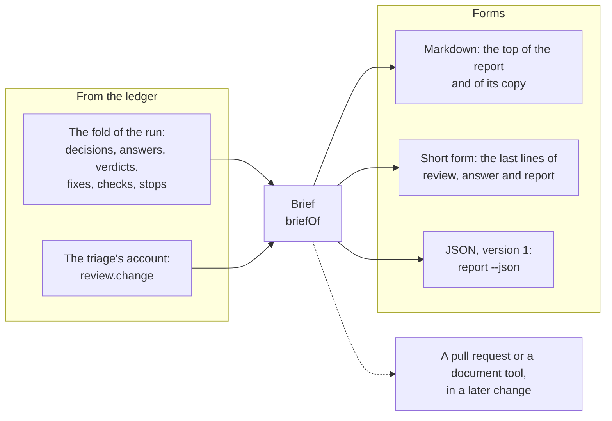

# Technical Design: The brief of a run

Product part: [2026-10-20-run-brief.requirements.md](2026-10-20-run-brief.requirements.md).

## Summary

The brief is a value of a new type, `Brief`, that a new module `src/review/brief.ts` computes from the fold of a run. Three renderers show it. A Markdown form goes at the top of the report, and a short form of plain lines goes at the end of a command. A JSON form with a version goes to a program. The report keeps its evidence sections after the brief, in a new order, and the facts of the run come last.

The answer of the triage gets a new field, `change`: a title, what the change does, why the change says it does it, and the two judgments of principle 8. The ledger records it in `candidates.recorded@2`, and the fold keeps it as `review.change`. The controller gives the triage the commit messages of the change in its task. Each worker after the triage gets the core in a new section of its scope block.

The decider rubric gets one sentence about the words of a question. A copy of the report goes beside the ledger. `review`, `answer`, `commit` and a new `report` command write it again. The skills show the short form that the command printed.

## Non-Goals

### No record of the brief

The brief is a view of the ledger. It gets no event, and no test compares a recorded brief with a computed one.

### No interface for other places

No module publishes the report to another place. One function chooses the place of the copy, and a later change can add a place.

### No change to the rules of a decision

The decider still applies the option that is the easiest to take back. Only the words of its questions change.

## Context

### How the engine renders the report

`renderReport` in `src/review/report.ts` renders the report from the fold of a run and from a `ReportInput`. The input holds the identity and the entry of the engine, the statistics, and the spend that the budget check counted. For a fix run, it also holds the paths of the evidence and the patches. It also holds the command that continues a fix pass that the budget stopped.

The sections of the report are the header, Decisions (`src/review/decision-report.ts`), Angles, Conventions (`src/review/survey-report.ts`) and Findings. A fix run then has Fixes, Checks and Changed files (`src/review/fix-report.ts`). Refuted at verification, Statistics and Limitations come last.

The step `write-report` of the controller (`src/review/controller.ts`) is the only caller of `renderReport`. It puts the report into the evidence store and appends `report.written@5`, with the reference of the report, the statistics and the patches. Then `review` prints the path of the report (`reviewEnded` in `src/command.ts`). An answer pass ends in the same step, so `answer` prints the path of its new report too. `commit` appends `commits.created@1` and renders nothing.

### What the triage records

The triage is the worker of the angle `SCAN`, which runs alone before the other angles (`roles/fragments/phase1-finders.md`). Its task, `triageTask` in `src/review/tasks.ts`, asks for its candidates and for one lead for each other angle. Its answer must match `triageOutputSchema` in `src/review/schemas.ts`. `checkTriageLeads` refuses an answer that gives no lead for an angle or two leads for one.

The phase records the answer as `candidates.recorded@1` with its `leads` (`src/review/phases.ts`), and the fold keeps them as `review.leads`. The task of each finder names its lead (`finderTask`).

### What the prompt of a worker holds

A prompt is the role prompt, the task and the scope block (`composeWorkerPrompt` in `src/review/prompts.ts`). The controller renders two scope blocks for a run (`scopeBlockFor`): one for the surveyor, and one for each later worker. The block of a later worker names the repository, the base, the head, the mode, the changed files, the convention sources and the patch. It holds no commit message.

The launch of each worker records its prompt and its output schema in the evidence store (`worker.launched@1`). Thus the ledger keeps the text that each worker saw.

### The commits of a change

The scope of a run has a mode and a base (`chooseMode` in `src/scope/capture.ts`). A range and a ref compare their base with the working tree at `HEAD`. The mode `last-commit` compares the first parent of `HEAD`, or the empty tree, with `HEAD`. The mode `worktree` compares `HEAD` with the working tree. Thus the commits of a change are the commits from its base to `HEAD`, and a change of the working tree alone has none.

### Where the checkpoint is

`locateCheckpoint` in `src/checkpoint/locate.ts` puts the checkpoint in `deep-review-checkpoint` under the git common directory, which each worktree of the repository shares. The evidence store is its directory `artifacts`, and a report there has its hash as its name.

### What `status` shows

With no `--run`, `status` shows the active run of the repository that has no report yet, in any of its worktrees. For a run, it shows the counts of its decisions, and the path of its report when it has one (`describeRun` in `src/review/status.ts`). `status --json` gives the part of the fold for the review, with summaries of it.

## Design

### The brief (R1, R2)



Figure 1. One value that the engine computes from the ledger, and the forms that show it. The dashed arrow is a later change.

`briefOf(state)` in the new module `src/review/brief.ts` computes the brief from the fold alone. It reads nothing else, so the same version of the engine computes the same brief from the same ledger. The type holds these fields, in the order of R2:

| Field | What it holds | From |
|---|---|---|
| `title` | The triage's title, or a title from the scope for an older run | `review.change`, the scope |
| `headline` | How many questions and departures wait for an answer | the decisions, the answers |
| `change` | What the change does, why, and the sources of each, or null for an older run | `review.change` |
| `questions` | For each question: its finding, its words, the option in place now, the choice of deep-review, the options with their costs and rules, where the decider looked, its grounds, and its answer or null | the decisions, the answers |
| `departures` | For each departure: its finding, the rule and its source, the fact against it, the fix that deep-review decided and its fate, and its review or null | the decisions, the fates, the answers |
| `notCovered` | Each gap, with its kind and its words | the angles, the groups, the scope, the settings, the checks, the fixes, the stops |
| `look` | Each condition of principle 8 that holds, with its findings | the decisions, the verdicts, the fixes, `review.change` |
| `changed` | The fixes applied, already in the tree, deferred, blocked and not attempted, the commits that hold them or none, the findings left, and the checks before and after | the fates, the commits, the checks |

The fate of each fix comes from the state of the fix pass, as `fateOf` in `src/review/fix-report.ts` gives it today. A departure shows the approach that the decider chose, and then its fate: applied, already in the tree, deferred, blocked or not attempted. In a run that only reviewed, a departure says that deep-review decided the fix and that the run did not fix. The condition of a `PLAUSIBLE` verdict counts the fixes that a fixer applied, or in a run that only reviewed, the findings decided as fixes.

The questions and the departures come in the order of the rank of their findings. Each item names the ids of its findings.

The kinds of gap in `notCovered` are `angle`, `unverified`, `excluded`, `oversized`, `check`, `fix`, `budget` and `stop`, the items of R10. A worker that a stop ended counts as a gap only when no later worker ran its unit again. When the run has no gap, the brief says so in one sentence, which names the checks only for a run that fixed.

A question counts in the headline until a person answers it. A departure counts until a person accepts or rejects it.

A default is in place only when the tree holds it. A default that keeps the code is in place. A default that edits the code is in place once a fixer applied it, and never in a run that only reviewed. The brief then calls it the default, and says why it is not in place. An answered question shows the answer first, in place of the default, and the option that the person chose is marked in the table. A departure that a person rejected says that the fix now follows the rule, and whether the tree holds that fix. The fate of the departing fix no longer stands then. The JSON form gives each answer its `kind` and its `option`, and each question `defaultApplied`.

### The triage's account of the change (R3, R4, R6)

The answer of the triage gets a field `change`, with this shape:

| Field | Type | Rule |
|---|---|---|
| `title` | text, 1 to 80 characters | names the change |
| `what` | text, 1 to 600 characters | at most five sentences, in plain words |
| `why` | text, 1 to 400 characters, or null | the change's own words, quoted or restated, or null when the change states no reason |
| `whyFrom` | up to 20 commits or paths | where `why` comes from, and empty when `why` is null |
| `restsOn` | up to 30 commits or paths | what `what` rests on; the task asks for at least one |
| `publicInterface` | an object of `holds`, `what` and `files` | a sentence and the files that show it when `holds` is true |
| `wideEffect` | an object of `holds`, `what` and `files` | the same rule as `publicInterface` |

The whole account can also be null, when the triage gives none.

The triage is the one worker of a run with no degraded outcome. When it fails twice, the run blocks (`degradationOf` in `src/review/steps.ts` gives it none), and a refused answer loses its candidates and its leads too. Thus the account adds no reason to refuse an answer.

The schema sets the types and a wide limit of 2000 characters for each text. The structured output of the runtime holds the model to the types. The task asks for the limits of the table. The brief shows the title, `what` and `why` whole, however long the triage wrote them (R3). The evidence holds the whole account under `## The change, in full`, with `whyFrom` and `restsOn`.

`normalizeTriageChange` in `src/review/schemas.ts` makes the account agree with the rules of the table, and it refuses nothing. It trims each text. An account with no title or no `what` left is no account, and the record holds null. An empty `why` is null. A condition that does not hold loses its sentence and its files. A null `why` loses its sources. Each list loses its empty entries and its repeats, and keeps its first entries up to its limit. A `why` with no source stays, and the brief marks it as a reason with no source. The output schema sets no lower limit on a text, so an empty text is a matter for the normalization, not a refusal.

`triageTask` asks for the account after the leads. It says who reads the account: a person who did not read the change, and the other workers of the run. It says to take the reason only from the commit messages that it lists and from the documents that the change adds or edits. It says to name them in `whyFrom`. It says to write `why` as null when they state no reason.

The fragment `roles/fragments/phase1-finders.md` names the account as the third job of the triage, after its own review and the leads.

The new part of the task reads as follows. The text is a proposal, and the work can change its words. The angle brackets mark what the engine fills in.

```text
Then describe the change in `change`, for a person who did not read it and for
the workers that review it after you:

- `title`: what the change is, in at most 80 characters.
- `what`: what the change does, in at most five sentences of plain words. Name
  no file, line or internal name that a reader must look up; put those in
  `restsOn`.
- `why`: why the change does it, in the change's own words: quote or restate the
  commit messages below, or a document that the change adds or edits. Write
  null when they state no reason. Never give a reason of your own.
- `whyFrom`: the commits or paths that `why` comes from; empty when `why` is null.
- `restsOn`: the files and commits that `what` rests on.
- `publicInterface`: whether the change alters a command, a flag, an exported
  function or type, a format of a file, or an output that a person or a
  program reads; when it does, one sentence that says what, and the files
  that show it.
- `wideEffect`: whether the change affects many files beyond the files it
  changes; when it does, one sentence that says what, and the files that show it.

### The change's own words

The subjects of the commits of the change, oldest first:

<commit> <subject>
...

The whole messages, oldest first:

commit <commit>
<message>
...

<n> subjects and <m> whole messages are left out at the limits.
```

The controller reads the commit messages before it launches the triage, with a new function `commitMessages(repo, base, head)` in `src/scope/git.ts`. The function runs `git log --reverse --topo-order --format=%H%x00%B%x00 <base>..<head>`, so each commit comes after its parents. When the base is the empty tree, it reads the message of `HEAD` alone. When the base is `HEAD`, it reads none. `taskFor` gets the messages through `TaskOptions`, so the task stays a pure function of its input.

A history that git cannot read must not stop the run, as the reviewer's authorship that the survey reads must not. A setting of git that `git log` refuses is one such case. The controller then logs why, and the task says that the engine could not read the commit messages and gives git's reason. The triage then takes the reason only from the documents of the change.

The task lists the subject of each commit first, oldest first, up to 16 KiB. Then it lists each whole message, oldest first, until the whole list reaches 32 KiB. It says how many subjects and how many whole messages it left out. A range has no limit on its number of commits, so both lists need a limit.

The prompt of the triage holds the messages, and the launch records the prompt. Thus a later read of the run sees what the triage saw. A commit does not change, so a relaunch of the triage reads the same messages.

### The record: `candidates.recorded@2` (R3, R18)

`candidates.recorded@2` is version 1 with one more field, `change`. It holds the object of the table above for the triage, and null for a finder and for the sweep. Its schema refuses a `change` on a phase other than the triage. A record of the triage holds `change: null` when the triage gave no account. The schema also refuses what the normalization never writes: a condition that does not hold but has a sentence or files, and a null `why` with sources. The phase records each new answer of the triage, of a finder and of the sweep as version 2.

The reducer folds both versions. `review.change` has three states, so the brief can tell an older run from a triage that gave no account. It is `unrecorded` until the triage answers, and for good when the triage recorded version 1. It is `none` when the triage recorded version 2 with no account, and `given`, with the account, otherwise. The fixture `schema-1-14` holds version 2, and the older fixtures still fold.

### The core in the prompts of later workers (R5)

The controller renders a third scope block once the triage answered. It is the block of each worker after the triage, with a section `### The change, as the triage read it` before the patch.

The section says that the account is the triage's, which no verifier examined. It says that the account is context and not a finding, and that the patch below is what the worker reviews. It also says that a stated intent never removes or refutes a candidate. The rule "Deliberate is not refuted" of `roles/fragments/rubrics.md` says the same for the verifiers. A worker that needs the intent quotes the change's own words that the account names.

Then the section gives the title, what the change does, why with its sources, and the two judgments.

The section reads as follows, with the same note on its words as above:

```text
### The change, as the triage read it

This is the triage's account of the change, which no verifier examined. It is
context, not a finding: the patch below is what you review, and the patch wins
where the two differ. A stated intent never removes or refutes a candidate: a
change can mean to do what it does and still be wrong. Where you need the intent
to decide, quote the change's own words that the account names, not the account.

Title: <title>
What it does: <what>
Why, in the change's own words: <why> (from <whyFrom>)
Public interface: <yes, and what, in which files | no>
Wide effect: <yes, and what, in which files | no>
```

When `why` is null, its line reads `Why: the change states no reason.`

The triage itself gets the block with no section. A run whose triage gave no account, and a run that an older engine started, get the block with no section too.

The replay tools find a scope block by its line of the repository, and they change the paths of frozen blobs in it (`src/replay/prompt.ts`). The new section names no frozen blob, so they read the block as before. The section folds each field of the account into one line with `inlineText`. `sourceLine` in `src/review/prompts.ts` does the same for the other text of a model in a scope block. Thus no field can start a line that looks like the start of a scope block, where the replay tools anchor.

### The words of the decider (R7)

The rule "Make it answerable at a glance" of `roles/fragments/decider-rubric.md` gets one more sentence. The sentence asks the decider to write the question, each option and each cost for a person who did not read the change. It asks for no file, no line, no number of a requirement and no internal name in them. It asks the decider to put such references in where it looked and in its grounds. This changes the prompt of the decider and the digest of the roles. The rule then reads as follows, with the same note on its words as above:

```text
- **Make it answerable at a glance**: one question; two to four options,
  each with what it costs and whom; the one you recommend; the one you
  applied. Write the question, each option and each cost for a person who
  did not read the change: plain words, and no file, line, requirement
  number or internal name of the code. A command, a flag or a setting that
  a user types is fine. Put the rest in where you looked and in your
  grounds, one step below the question.
```

### The Markdown form (R8 to R12, R15)

The report starts with the brief. The title is a heading of the first level. The headline sentence follows, and then the parts of R2, each under a heading of the second level. A rule (`---`) and one sentence separate the brief from the evidence.

This example shows the form. Its content is invented, on the model of a real run of the configuration change.

```markdown
# Settings from four files and flags

5 things need you: 3 questions and 2 fixes that go against a written rule. Nothing waits for you: each question has a default in place.

## The change

A run takes its settings from the file of the repository, the file of the operator, the file of the clone and the command line, and it records which one set each value. `config show` prints them before a run starts.

Why, in the change's own words: "Configure a run from repository and operator files" (commit 41c817d).

This is the triage's account of the change, which no verifier examined. It rests on src/config/resolve.ts, src/review/configuration.ts and commit 41c817d.

## Questions for you (3)

Each question has a default, the option that is the easiest to take back. Answer only to choose another one. To answer, ask your agent with the deep-review skill, or type the command at a terminal as the end of this report shows.

### 1. When an operator settles a check with --set, which flag does the record name? ([SWEEP-4](#finding-sweep-4))

In place now: option 1, because it is the easiest to take back. deep-review's choice: option 2.

| Option | What it does | What it costs |
|---|---|---|
| 1, in place now | Keep the words of the dedicated flag. | An operator who typed --set reads a flag that they did not type. |
| 2, deep-review's choice | Name the flag as the operator typed it. | The record and the report can name one check in two ways. |
| 3 | Record the spelling in a new version of an event. | A new version of an event, which cannot be taken back. |

To take deep-review's choice: `deep-review answer --finding SWEEP-4 --option 2`. For another option, give its number.

<details><summary>The rule that each option makes, where deep-review looked, and why it asks</summary>

- Option 1 makes this rule: a check that a flag settles is worded as --check or --no-check.
- Option 2 makes this rule: the record names the flag as the operator typed it.
- Option 3 makes this rule: each place that names a check names the flag as typed.
- Where deep-review looked: src/review/survey-report.ts:35-42, src/review/tasks.ts:153-156, the commits of the change.
- Why it asks: the repository states the wording of the flag on purpose, but that reason does not reach --set.

</details>

## Fixes that go against a written rule (2)

### [SCAN-6](#finding-scan-6): a resume compares a setting from a flag only with a flag given now

The rule: "A resume names each recorded setting whose current value differs as not applied" (docs/changes/2026-10-16-configuration.design.md:198).

The fact against it: a setting that a flag gave is not in force again when the next command gives no flag, so it never differs.

What the fix does: it compares a setting from a flag only when the command gives the flag again. A fixer applied it.

To keep the fix and change the rule: `deep-review answer --finding SCAN-6 --accept`. To follow the rule: `deep-review answer --finding SCAN-6 --reject`.

## What the review did not cover

- 86 changed paths under dist/** and test/fixtures/checkpoints/**, which the settings of the repository leave out.

Each angle ran, a verifier examined each candidate, and each check ran before and after the fixes.

## Where to look

- 2 fixes go against a written rule: SCAN-6, ALTITUDE-3.
- 13 fixes rest on a verdict that is only PLAUSIBLE: REMOVALS-2, SWEEP-7, ALTITUDE-3 and 10 more.
- The change alters a public interface, in the triage's judgment: the flag --set of the command line, in src/cli.ts.

## What deep-review changed

deep-review applied 35 fixes, in 40 commits. It left 2 findings as the repository intends. The checks passed before and after the fixes.

---

The evidence for each statement above follows.

## Decisions
...
```

The brief says once how to run a command, in the first of its parts that gives one: the questions, or else the departures. It names no path, because `deep-review` is not an executable that is installed. The command for a terminal, with the entry of the engine, is in the facts of the run.

The brief uses the plain words of this table. The evidence keeps the words of the engine, because a reader of the evidence checks one statement against the ledger.

| In the evidence | In the brief |
|---|---|
| `Default` | in place now |
| `Recommended` | deep-review's choice |
| asked, kept as is | a question, with its default in place |
| already applied | already in the tree |
| left by decision, intended | left as the repository intends |
| not attempted | no fixer attempted it |
| deferred | its fixer put it off |
| blocked | its fixer could not apply it |
| degraded | did not finish |
| cluster, batch, attempt, the name of a phase | not named |

Each finding in the evidence gets a fixed anchor before its heading, `<a id="finding-<id>"></a>`, with its id in lower case. A link in the brief points at that anchor.

The evidence follows the brief in this order. The table also shows where each part of today's report goes.

| Today | After this change |
|---|---|
| The header: repository, commits, mode, run, engine, runtime, models, digest of the roles, settings, the counts | The facts of the run, the last section. The brief says the counts in plain words. |
| Decisions: the sentence that counts, and the paragraph about the answer command | The headline of the brief. The paragraph goes to the facts of the run. |
| Questions for the author | The brief: Questions for you |
| To fix, with each departure | The evidence: Decisions. Each departure is in the brief too. |
| Left | The evidence: Decisions |
| (none) | The evidence starts with `## The change, in full`: each field of the triage's account, with its sources |
| Findings | The evidence, after Decisions, with an anchor for each finding |
| Fixes, Checks, Changed files | The evidence, after Findings |
| Angles, Conventions | The evidence, after Changed files |
| Refuted at verification, Statistics | The evidence, after Conventions |
| Limitations | Each gap goes to the brief. The rest goes to Notes of the run. |

The brief holds no local path that the engine writes. Today the report holds local paths in several places, and this table says where each one goes:

| A local path today | After this change |
|---|---|
| The repository, in the header | The facts of the run |
| The executable of the runtime, in the header | The facts of the run |
| The earlier reports of the run, in the header | The evidence names each one by its name in the store |
| The outputs of a check, under Checks | The evidence names each one by its name in the store |
| The patches, under Changed files | The evidence names each one by its name in the store |
| The bytes that a write back replaced | The evidence names them by their name in the store |
| A rules file of the person, under Conventions | A path that starts with `~` for the home directory |
| The paths that the settings left out, each value not followed, each setting ignored and its file | The facts of the run, beside the `Settings:` line. The brief counts the paths left out as a gap. |
| The command for a terminal, with the entry of the engine | The facts of the run |
| The command that continues a fix pass that the budget stopped | The facts of the run, and the brief says that they hold it |

A name in the store is `artifacts/<hash>`, and the facts of the run say once where the store is. They come last, under the heading `## The run`, so a later publication can leave them out. The report does not name its own record, because the name of a record is the hash of its bytes. `report` and the JSON form give that path.

Two kinds of place are text of a model: the raw place that a finder gave for a candidate that the engine cannot locate, and the places where the decider looked. The report shows them as they are.

`renderReport` keeps its signature. It renders the Markdown form of `briefOf` first, and then the evidence. `decision-report.ts` keeps the lists to fix and left, and the questions move to the brief. Decisions keeps one line per question under `### Asked`: its default in place, or its answer. The paragraph about what an answer does stays in Decisions, and the line about how to type a command at a terminal goes to the facts of the run, since it names the engine's path. The lines of Limitations split in two. The lines of R10 come from `briefOf`, and the other lines stay in `report.ts` under the heading `## Notes of the run`. The lines of the settings go to the facts of the run instead, beside the `Settings:` line: the paths left out by name, each value not followed and each setting ignored. That is where the skills point when a person asks why a run reviewed what it did, and the file of an ignored setting can be a local path.

The input of `renderReport` gets the directory of the evidence store and the home directory, and a fix run's patches come as references to the store, not as paths. A local path outside the facts of the run is named by one function, `localPathWords` in `src/review/markdown.ts`. It gives a path inside the worktree relative to it, and a path inside the home directory under `~`. It compares the text only, without case on a Windows path, so a render reads no file system.

A departure's heading is its number and the link to its finding. Its rule, the fact against it and its fix follow, each as a sentence. A check with no command shows in the gaps with what the operator dropped, as Limitations said it before.

### The short form (R13)

The short form has at most 8 lines. Each line has at most 200 characters. A list of ids shows at most 8 of them and gives the count of the others. The first line gives the whole title, as the brief does, and only the line's limit cuts it. The line `The change:` gives the first sentence of `what`, cut at a word to fit, with three periods. The last line, the path, has no limit, because a path cannot be cut.

A line keeps its sense when a model rewords it, so it names its subject in its first words. Here is an example, with invented content:

```text
Settings from four files and flags (run 38e9b68a)
The change: A run takes its settings from the file of the repository, the file of the operator, the file of the clone and the command line, and it records which one set each value.
Questions: 3, each with a default in place: SWEEP-4, CONVENTIONS-1, ALTITUDE-6
Against a written rule: 2 fixes: SCAN-6, ALTITUDE-3
Not covered: 86 changed paths that the settings leave out
Look at: 2 departures, 13 fixes on a PLAUSIBLE verdict, a change to a public interface
Changed: 35 fixes, not committed
C:\work\repo\.git\deep-review-checkpoint\reports\2026-10-17-38e9b68a.md
```

A line with nothing to say says so, for example `Questions: none`. The last line is the path of the copy. When the engine cannot write the copy, the last line is the path of the record, and stderr says why.

`reviewEnded` in `src/command.ts` prints the short form. `answer` prints it after an answer pass. `report` prints it.

### The copy (R14)

The function `reportCopyPath(checkpointRoot, state)` in a new module `src/review/report-copy.ts` chooses the place: `<checkpoint>/reports/<date>-<run>.md`. The date is the day that the run started, in UTC, and the run is the first 8 characters of its id. The function is the only place that knows this rule, so a later change can move the copy.

The step `write-report` writes as the copy the string that it puts into the evidence store. Thus the copy that `review` writes equals its record. For the other commands, `writeReportCopy` renders the report from the current fold and writes it with `writeFileAtomic` (`src/atomic-write.ts`). The record in the evidence store stays as the step `write-report` wrote it.

To render the report outside the step, the module gets the input of `renderReport` from the ledger. The statistics and the budget check come from the fold and the adapter of the runtime of the run, as `status` gets them. The patches come from the current report of the run. The command that continues a stopped fix pass comes from `continueCommand`, as `status` gets it.

Three events clear the current report of a run that works again: `answer.pass`, `fix.pinned` and `fix.reopened`. The fold then keeps the earlier record as the report before. While the report is clear, no command renders a copy. The run is active, and `status` shows it. The copy keeps its last bytes until the run writes its next report.

These commands write the copy:

| Command | When |
|---|---|
| `review` | after the step `write-report` |
| `answer` | after it records an answer, also when it then refuses the pass, and after an answer pass writes a new report |
| `commit` | after it records its commits |
| `report` | each time |

When the copy cannot be written, the command logs `run <id>: could not write the copy of the report to <path>: <reason>` on stderr and goes on. The record is the report, and a copy never fails a command.

A copy that a later command renders names the engine that rendered it. That name is in the facts of the run and in the command for a terminal. The copy names the roles of a stopped fix pass by their digest, as `status` does. It gives a placeholder for roles that are not the engine's own. Thus such a copy can differ from the record in those lines, even when the ledger holds nothing new. The same version of the engine at the same path renders the same copy from the same ledger.

### The `report` command (R16)

`deep-review report [--run <id>] [--json] [--repo <dir>]` takes the run that `--run` names, or else the newest run of the worktree by the time that it started. It writes the copy, and then it prints the short form, whose last line is the path of the copy. With `--json`, it prints the brief as JSON. It refuses with exit code 2 when the worktree has no run, and when the run has no current report. The refusal says why and names `status`. A run has no current report when its review is not done, and when an answer pass, a continuation or a reopened fix pass runs.

The JSON form has this shape, which `briefJsonV1` in a new module `src/review/brief-json.ts` states as a schema:

| Field | What it holds |
|---|---|
| `version` | 1 |
| `run` | the id of the run |
| `title` | as in the brief |
| `headline` | `text`, and the counts of open `questions` and `departures` |
| `changeState` | `given`, `none` when the triage gave no account, or `unrecorded` when an older engine reviewed the run |
| `change` | `what`, `why`, `whyFrom`, `restsOn`, `publicInterface` and `wideEffect`, or null |
| `questions` | `id`, `question`, `default`, the option that is the easiest to take back, `defaultApplied`, whether it is in place, `choice`, `options` with `option`, `cost`, `rule` and `edits`, `lookedIn`, `grounds`, `answer` or null, `command` |
| `departures` | `id`, `rule`, `source`, `fact`, `fix`, `fate`, `review` or null, `accept`, `reject` |
| `notCovered` | `kind` and `text` for each gap |
| `covered` | the sentence that says the run covered everything, or null when a gap is listed |
| `look` | `condition`, `findings` and `text` for each condition |
| `changed` | `fixed`, whether the run fixed; `decided`, whether it decided its findings, false for a run configured before the decision step; `applied`, `alreadyInTree`, `deferred`, `blocked`, `notAttempted`; `toFix`, the findings decided as fixes in a run that only reviewed; `commits`, their `shas` and the `uncommittedPatches`, or null; `patches`; `left`; `checks`, each `kind` with its outcome `before` and `after` |
| `local` | the local facts: `copy`, `record`, `repository`, `store`, and `continueCommand` or null |

A change of this shape is a new version, as for an event of the ledger. A test checks the output of `report --json` against the schema.

`status` prints its line `Report:` as today, when the run has a current report, and the line names the copy. `status --json` gets a field `reportCopy`.

### The skills (R17)

In both skills, step 4 says that stdout ends with the short form of the brief. It says that the last line is the path of the report. The skill shows the lines before the path as printed, in a code block. Then it shows the path and says that the report is the user's to read. It still does not summarize, quote or interpret the findings beyond those lines.

Step 6 names the questions and the departures of the brief in place of the section Decisions. A new sentence says to run `report` when the user asks what a finished run found. The skill shows what it prints as in step 4.

The paragraph of each skill about why a run reviewed what it did names the `Settings:` line and the section `## Limitations` today. It names the facts of the run and the gaps of the brief instead. `test/skills.test.ts` holds the new sentences.

### An older run, and an older engine (R18)

`briefOf` gives a run whose `review.change` holds no account a title from its scope, such as `The change from 97ecac01 to d2973873`. Its part "The change" says that the triage of the run did not record the core, because an engine before this change reviewed it. Its conditions of a public interface and of a wide effect are absent. The JSON form gives `change: null`. A run whose triage gave no account gets the same form, with words that say so.

An older engine finds `candidates.recorded@2`, which it cannot read, and passes over the run (`listRuns`). This is the same as for each earlier new version of an event.

### The golden fixture

The new version of an event fails the golden test until a new fixture exists. `scripts/golden-checkpoint.ts` writes a record of the triage at version 2, with a `change`, and `npm run golden -- --output test/fixtures/checkpoints/schema-1-14` writes the fixture. The fixtures `schema-1-01` to `schema-1-13` stay, and each still opens and folds.

### The steps of the work

The work follows the order of the design, and each step has its tests:

1. The record `candidates.recorded@2`, its reducer, `review.change` and the fixture `schema-1-14`.
2. The account of the triage: its schema, its task, the commit messages, its record, and the fragment of the triage.
3. The core in the scope block of the later workers.
4. The words of the decider.
5. `briefOf`, the JSON form and its schema.
6. The Markdown form, the new order of the report and its snapshots.
7. The copy, and its writers in `review`, `answer` and `commit`.
8. The short form, and the output of `review` and `answer`, whose last line names the copy.
9. The command `report`, and the line `Report:` of `status`.
10. The skills, the README and the usage text.
11. The build, the self-review and the checks.
12. The gate, then the record of the verification.

## Technical Decisions

### TD1: A new version of `candidates.recorded`, not a new kind of event

The core is a part of the triage's answer, and the triage records its answer in one event with its candidates and its leads. A new version keeps one record for one answer. A new kind of event puts two records for one answer on the ledger, with a point between them where a stop can cut.

### TD2: The engine computes the brief, and it does not record it

A computed brief is current after each answer and commit, and the same version of the engine computes the same one. A recorded brief is out of date after the next answer, and it is a second account of the facts that the ledger holds.

### TD3: The commit messages go into the task of the triage, not into the record of the scope

The launch already records the prompt, and a commit does not change. Thus the task keeps the messages on the ledger at no extra cost. A new version of `scope.captured` with the messages changes the capture of each run and its migration, for text that only the triage reads.

### TD4: The core reaches later workers through the scope block

The scope block is the part of the prompt that the engine renders for the workers of each phase. One section there reaches each later worker with one change. A sentence in each role fragment changes approximately ten fragments and their digests. A line in the task of each phase changes approximately ten functions.

### TD5: Three renderers of one value

The Markdown form, the short form and the JSON form each render the same `Brief`. Thus the words of a fact are the same in each form, and the tests check the value once. The proposal rejects a short form cut out of the Markdown, because a change of the Markdown then breaks the short form.

### TD6: The copy is written by an atomic replace, and a failure to write it only logs

The record in the evidence store is the report of a run. The copy is a convenience for a person. Thus a failure to write the copy must not fail a run, an answer or a commit. An atomic replace never leaves half a copy.

### TD7: One function chooses the place of the copy

The author is not sure of the place. One function that knows the rule makes a later move one change.

### TD8: A version and a schema for the JSON form, which a test checks

A program reads the JSON form, so its shape is a contract. A version number and a schema make a change of the contract visible in a review.

## Open Questions

### Is 32 KiB enough for the commit messages of a long series?

The pull request of the resumable runs held 159 commits. Their subjects alone fit in about 10 KiB. The gate shows if the limit cuts the reason of a long change.

### Do 8 lines hold the short form of each run?

A run with many kinds of gaps can need more. The gate shows the short form of a large run.

### Does a document tool show the anchors and the blocks `<details>`?

GitHub shows both. A later change that publishes to a document tool checks it there.

## Test Strategy

### R1 and R2: The brief

`test/review/brief.test.ts` builds folds from events, as the tests of the report do. It checks the order of the parts, and the headline with and without open questions. It checks that a question leaves the headline when a person answers it. It checks that a departure leaves the headline when a person accepts or rejects it. It checks that two calls of `briefOf` on the same fold give equal values.

### R3, R4 and R6: The triage's account

`test/review/schemas.test.ts` checks `normalizeTriageChange` against each rule of the table. A condition that does not hold loses its sentence and its files, a null `why` loses its sources, and a `why` with no source stays. It checks that no rule of the account refuses an answer, and that an answer with `change: null` passes.

`test/review/tasks.test.ts` checks that the task of the triage lists the subjects first. It checks the cut of the subjects at 16 KiB and of the whole list at 32 KiB. It also checks the counts of what the task left out. A new file, `test/scope/git.test.ts`, checks `commitMessages` in a repository that the test makes. It checks a range, one commit, a root commit and a change of the working tree.

`test/review/phases.test.ts` checks that the phase records version 2 with the account of the triage.

### R5: The core in later prompts

`test/review/prompts.test.ts` checks that the scope blocks of a finder, a verifier, the decider and a fixer hold the section. It checks that the block of the triage holds none. It checks that a run with no account renders no section. `test/replay` checks that the replay tools still find the blobs of a block with the section.

### R7: The words of the decider

No test can check the words of a model. `test/roles` checks that the decider's prompt holds the new sentence. The gate checks the words of its questions.

### R8 to R12 and R15: The Markdown form

The snapshot tests of the report (`test/review/report.test.ts`, `fix-report.test.ts`, `survey-report.test.ts`) get new snapshots. The author reads each of them in the review of this pull request. New tests check that the brief comes before the evidence and that each finding has its anchor. They also check that each link of the brief points at an anchor that exists. A test renders a fold whose model text names no local path. It checks that only `## The run` names an absolute path, and that a path under the home directory starts with `~`.

### R13: The short form

`test/review/brief.test.ts` checks that the short form has at most 8 lines of at most 200 characters each. It checks that a list of 12 ids shows 8 and says "and 4 more". `test/cli.test.ts` checks that the last line of `review` and of `answer` is the path of the copy. It checks that the last line is the path of the record when the copy cannot be written.

### R14: The copy

`test/review/report-copy.test.ts` checks the place of the copy, its atomic write, and a failure to write that logs and does not fail the command. Tests of `answer` and `commit` check that each of them writes the copy again, and that the copy of a committed run names its commits.

### R16: The `report` command

`test/cli.test.ts` checks the choice of the run, the refusal when no run has a report, and the text and the JSON output. A test checks the JSON output against `briefJsonV1`.

### R17: The skills

`test/skills.test.ts` checks the new sentences of step 4 and step 6 and the sentence about `report`, in both skills.

### R18: Older runs and older engines

`test/checkpoint/golden.test.ts` opens and folds each fixture, `schema-1-14` with it. A test folds a run with a record of version 1 and checks that its brief says that the triage did not record the core.

### R19: The gate

The gate runs the engine on its own pull request with `review --runtime claude --branch --fix`, the command that the skill gives. A read-only run on Codex checks that the triage of the other runtime writes the account too. The author reads the brief of the gate run, answers each question from its block alone, and judges the core. The Verification records the metrics of the requirements.

## Verification

No check ran yet.

## Risks & Migration

### Ledgers before this change

A record of version 1 still folds, and its run gets a brief with no core. Nothing on an older ledger changes.

### An older engine and a newer run

An older engine passes over a run that holds version 2. A person who goes back to an older engine cannot continue or answer such a run.

### The reports in the evidence store

The reports that older runs wrote stay as they are. `report --run <id>` writes a copy of an older run in the new form, with no core.

### The place of the copy

The directory `reports` appears beside the ledger at the first write. Nothing moves there from the evidence store.

### The digest of the roles changes

The new words of the triage and of the decider change the digest of the roles. A run pins the digest that it started with. After the update, such a run refuses to resume with the new roles. An answer pass on it refuses too, because `controller.ts` and `answer.ts` compare the digests. This holds a run that is active at the update, a fix pass that the budget stopped, and an answer on an earlier fix run.

The person has three ways out. They finish the run with the engine of before. Or they pass `--roles` with the roles that the run started with, which git keeps under `roles/` at an earlier commit. Or they record an answer with `--record-only` and apply it by hand. Each change of a role prompt has this effect today, and this change has it too.
