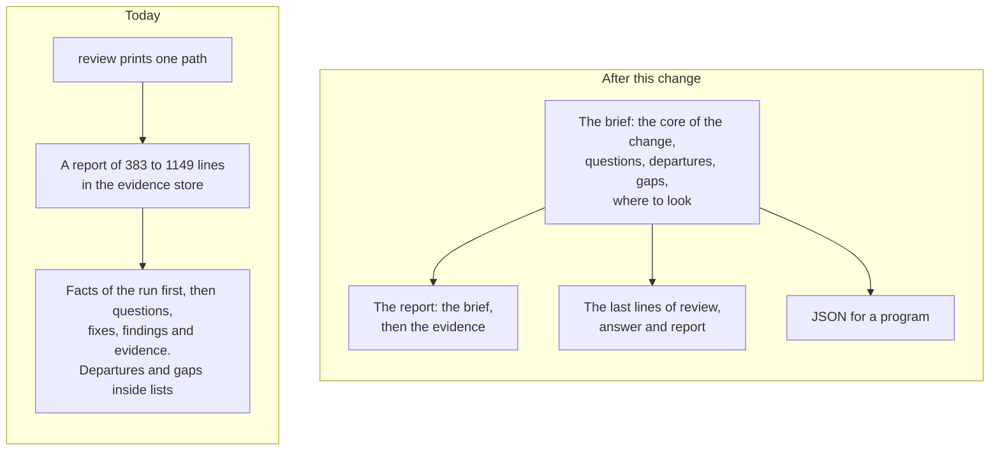

# Product Requirements: The brief of a run

Technical part: [2026-10-20-run-brief.design.md](2026-10-20-run-brief.design.md).

## Summary

A run of deep-review ends with a report. The report is one Markdown file in the evidence store under the git directory of the repository, and the command prints only its path. The report starts with facts about the run: its repository, its engine and its models. The first question for the person comes after about 300 words.

A fix that goes against a written rule is in the list of fixes. What the run did not examine is in the last section, among about 80 records of the fixers. No part of the report says what the change does or why.

This proposal adds the brief of a run: the part of its result that a person reads first. The brief holds five parts: the core of the change, the questions for the person, the departures from rules, what the run did not cover, and where to look. The engine computes the brief from the ledger as one value. The top of the report, the last lines of a command and a new `report` command show that value, each in its own form. A later change can post the same value to a pull request or to a document tool.

The triage of the run writes the core of the change. The triage already reads each hunk of the change before the other angles run. Now it also writes what the change does and why the change says it does it. It also says if the change alters a public interface or affects many files. Each later worker gets the core as context, because the intent of a change matters to the agents that review it too.

The proposal also sets the form of what a person reads: plain words, each question answerable from its own block, and each reference one step away.

Figure 1. What a person gets from a run, today and after this change.

## Problem

### What a person gets at the end of a run

When a run ends, `review` prints one line on stdout: the path of the report (R9 of the read-only review). The report is in the evidence store under the git directory, with a hash as its name and no extension (PD9 of the read-only review). The skills show that path and nothing more, so that no model rewrites a finding (PD8 of the read-only review). A person who wants the result must find that file and open it.

The engine renders the report from the ledger alone. In the gate runs of the last two weeks, a report had 383 to 1149 lines. The report of run `38e9b68a` has 1095 lines and 210 KB. The report of run `beaef8b8` has 1149 lines and 29007 words.

### Where a person must search

Principle 5 of the vision note sets the order of a report. It starts with the core of the change, then the questions, then the departures from rules. What the run did not examine comes next. The report of today starts with 14 lines about the run itself: its repository, its commits, its engine, its runtime, its models, the digest of its roles and its settings. A paragraph about the answer command comes next. The first question comes at line 26 to 28, after 271 to 350 words.

A departure is a line "Departs from:" inside the list of fixes. What the run did not examine is in Limitations, the last section. In the report of run `beaef8b8`, that section has 85 lines, and 80 of them are records of how the fixers validated their fixes. The other 5 lines mix four things: the run budget, the workers with no reported cost, the paths that the settings left out and the candidates outside the change.

Each question shows a "Default" option and a "Recommended" option. In 8 of the 16 questions of four recent reports, the two lines point at different options. The design is correct: the engine applies the option that is the easiest to take back (principle 4). But the labels do not say this, so a person asks why the engine did not apply its own recommendation.

The questions and their options also hold references that a person must look up, such as `requirements.md:103 R4` and `process.ts:100`. Principle 6 does not permit a question that a person can answer only after a read of the code.

### What no part of a run writes

No worker writes what the change does and why. The prompt of a worker holds the patch and the list of changed files, but not the commit messages of the change. Thus each finder, each verifier and the decider judge the change with no stated intent. The report cannot give the core of the change either.

Principle 8 names four conditions in which a person must look. Two of them are a departure from a rule and a fix whose verdict is only `PLAUSIBLE`. The other two are a change to a public interface and a change with an effect on many files. The ledger holds the first two. No worker judges the other two.

### Why a new order of one file is not enough

The person is not the first reader of a run. In a session, the model of the host reads the output of the command first. The vision note puts a review in three places: the loop of an author agent, the check that a pull request must pass, and the triage of pull requests. There, an agent, a pull request or a tool reads the result first. Principle 7 makes the pull request the surface on which a person answers.

Thus the same brief must reach several surfaces in several forms. A new order of the Markdown file serves one surface. A later change that posts the questions to a pull request then has to cut that file apart again.

A report is also a picture of one moment. `deep-review commit` and `deep-review answer` change what the brief says, but no command renders the report again. After run `beaef8b8` made 42 commits, its report still says that the edits are uncommitted.

## Goals

A person who reads only the brief knows what the change does and why, and what to decide. The person also knows where deep-review went against a written rule, what the run did not cover, and where to look. Each item of the brief names its evidence, one step away. A person can answer each question from its own block, with no read of the code.

Each surface shows the same brief from the same value: the report, the output of a command, a JSON value for a program, and later a pull request or a document. The brief is current when a person reads it, so answers, reviewed departures and commits show in it.

Each worker after the triage knows what the change does and why, as the change states it.

## Non-Goals

### A pull request, a repository or a document tool as the place of the brief

This proposal shows the brief in the report, in the output of a command and in a `report` command. It posts nothing to a pull request, to a repository or to a document tool. A later change does that, because principle 7 makes the pull request the surface on which a person answers. This proposal makes the brief ready for that change: one value, and Markdown that such places show as it is (R15).

### A check of the core against the request

The core is the triage's account of the change and of the change's own words. No verifier examines it. The vision note names an angle that reads the change against its request. The request can be the body of the pull request, the issue or the change proposal. That angle can check the core later.

### A rule written from an answer

Each option of a question states the rule that it makes. The engine does not yet write that rule to a convention source (principle 9). The answers change left this out, and this proposal does not change it.

### Which option the engine applies

The engine applies the option that is the easiest to take back (principle 4), and the decider names its own choice too. This proposal names both clearly. It does not change which option the engine applies, because that changes principle 4.

### A score that ranks pull requests

The brief lists each condition of principle 8 with its count and its findings. It gives no single score. A score for the triage of many pull requests needs the answers of people as labels first (principle 10).

### Another format, another language, an executable

The brief has a Markdown form, a form of plain lines and a JSON form. An HTML form, the language of the reader, an executable named `deep-review` and a package for CI are separate changes.

## Requirements

### R1: The brief is one value that the engine computes from the ledger

The engine computes the brief of a run from its ledger alone, so two engines compute the same brief from the same ledger. The engine does not record the brief. Each command computes it when it shows it, so the brief is current. The report, the output of a command and the JSON form show this one value.

### R2: The brief holds five parts in the order of principle 5

The first part is the core of the change: a title, what the change does, and why, as the change states it. The second part is the questions that only a person can answer. The third part is the fixes that go against a written rule. The fourth part is what the run did not cover. The fifth part is where a person must look.

One sentence before the parts says how many things need a person, and that nothing waits for an answer. One paragraph after the parts says what deep-review changed. It names the fixes that it applied, and the commits that hold them or that they are not committed. It also names the findings that it left and the result of the checks.

### R3: The triage writes the core of the change

The triage writes the core of the change in the same answer as its candidates and its leads. The core has a title of at most 80 characters, what the change does in at most five sentences, and why the change does it. Each statement names the files or the commits that it rests on.

The triage takes the reason from the words of the change: its commit messages, and the change proposals or other documents that the change adds or edits. It quotes or restates those words and names where they are. It does not write a reason of its own. When the change states no reason, the core says so.

The triage writes the core for a person who did not read the change. It uses plain words. It names no file, line or internal name that a reader must look up, except in the list of what the core rests on.

The brief marks the core as the triage's account, which no verifier examined.

### R4: The triage judges a public interface and a wide effect

The triage says if the change alters a public interface: a command, a flag, an exported function or type, a format of a file, or an output that a person or a program reads. It also says if the change has an effect on many files beyond the files that it changes. For each condition, it gives its answer, one sentence that says what, and the files that show it.

### R5: Each worker after the triage gets the core

Each worker that starts after the triage answered gets the core of the change in its prompt. This includes the finders, the verifiers, the sweep, the worker that ranks the findings, the decider and the fixers. The prompt says that the core is the triage's account, which no verifier examined. It also says that the core is context and not a finding, and that the patch is what the worker reviews.

### R6: The triage gets the commit messages of the change

The engine gives the triage the messages of the commits in the reviewed change, up to a limit of size. A change of one commit gets its message. A change of the working tree alone has no commits, and it gets none.

### R7: The decider writes each question for a person who did not read the change

The decider writes each question, each option and each cost in plain words, for a person who did not read the change. A question, an option or a cost names no file, no line, no requirement by its number and no internal name. Such references go to the places where the decider looked and to its grounds, one step below the question.

### R8: A question shows the option in place now and the choice of deep-review

Each question names the option that is in place now. It says that this option is in place because it is the easiest to take back. When the decider chose another option, the question names that option as the choice of deep-review. Each option shows what it costs and the rule that it makes. The question gives the command that takes the choice of deep-review first, and then says how to choose any other option.

### R9: A departure shows the rule, the fact against it and what the fix did

Each fix that goes against a written rule shows three things: the words of the rule and where they are, the fact against the rule, and what the fix did instead. It gives the command that accepts the departure and the command that rejects it. It says what each command does to the rule and to the fix.

### R10: The brief says what the run did not cover

The brief lists what the run did not examine: each angle that did not run, and each group of candidates that no verifier examined. It also lists the changed paths that the settings left out and the files too large to freeze. It lists what the run did not finish: each check that did not run, and each finding that no fixer attempted or that stayed blocked. It also lists the work that the run budget did not start, and each stop that left work undone. When the run covered all of these, the brief says so in one line.

### R11: The brief lists where a person must look

The brief lists each condition of principle 8 that holds, with its count and its findings. Two conditions come from the decisions: the fixes that go against a written rule, and the fixes that rest on a `PLAUSIBLE` verdict. Two come from the triage: a change to a public interface, and a change with an effect on many files. The brief does not fold the conditions into one answer.

### R12: The report starts with the brief, and the evidence follows it

The report starts with the brief. The evidence follows. First come the decision on each finding, the findings, the fixes, the checks and the changed files. Then come the angles, the conventions, the refuted candidates, the statistics and the notes of the run. The facts of the run come last: its repository, its commits, its engine, its runtime, its models, the digest of its roles and its settings.

Each finding has a fixed anchor by its id, so each item of the brief links to its evidence. The brief uses plain words, and it names no internal part of the engine, such as a cluster, a batch, an attempt or a phase. The evidence keeps those names.

### R13: A short form ends the output of a run

When a run writes its report, `review` prints the short form of the brief on stdout. The short form has a fixed maximum of lines for any number of findings. The last line stays the path of the report. `answer` does the same after it writes a new report.

### R14: A copy of the report that a person can open

The engine keeps a copy of the report as a Markdown file, with the date and the run in its name. The copy is beside the ledger, outside the worktree. Each command that changes what the report says writes the copy again: `review`, `answer` and `commit`. The report in the evidence store stays the record of its moment. The place of the copy can change in a later change.

### R15: The brief and the report can go to other places later

The brief and the report are Markdown that a pull request and common document tools show as it is. The brief holds no local path that the engine writes. The evidence names a file of the evidence store by its name in the store. A path under the home directory of the person starts with `~`. The facts of the run at the end of the report hold each other local path that the engine writes: the repository, the runtime, the store and the commands for a terminal. A later change can then publish the report to another place with no new renderer, and leave the facts of the run out.

Text that a model wrote can still name a local path, because the engine shows the words of a model as they are (PD5). A later publication must check that text.

### R16: A `report` command shows the brief of a run

`deep-review report` shows the brief of a run that has a report: by default the newest such run of the worktree, or the run that `--run` names. It prints the short form and the path of the copy. With `--json`, it prints the brief as JSON with a version number. It also writes the copy again.

### R17: The skills show the lines that the engine printed

The skills show the short form as the command printed it, and then the path. They still give no summary of their own of the findings (principle 1).

### R18: An older run shows what it has

A run that an older engine reviewed has no core. Its brief says that the triage of the run did not record the core, and it shows the other parts. An older engine passes over a run that holds the new record of the triage.

### R19: The gate

A real run of the engine on the pull request of this change is its gate (principle 12). The author reads the brief of the gate run, answers each question from its block alone, and judges if the core is correct.

## Metrics

### The words before the first question

In the report of run `38e9b68a`, the first question comes after 25 lines and 271 words. In the other recent reports, it comes after 26 to 28 lines. After this change, only the title, the headline sentence and the core come before the questions. Target: at most 15 lines and 250 words, for any run.

### The evidence of each item

Each item of the brief names a finding, a file or a commit. Target: each item of the brief of the gate run.

### Questions that a person answers from their blocks

The author answers each question of the gate run from its block alone. Target: each question. A question that needs a read of the code counts against R7.

### The core

The author judges the core of the gate run. Target: the core is correct, and it attributes its reason to the right words of the change.

### The cost of the core

The core adds to the output of the triage and to the prompt of each later worker. The gate compares the input tokens per worker with the last gate of a similar size. Target: less than 5 percent of the cost of the run.

## Product Decisions

### PD1: The brief is a value that each surface shows, not a new order of one file

Today the report is the only form of the result, and a person reads it last, if at all. A new order of the file serves one surface. But the brief must reach a model of a host, a terminal, a program and later a pull request. One value that the engine computes from the ledger serves each of them with the same words. It is also current, because each command computes it again.

The proposal rejects a new order of the Markdown file alone. Each later surface then has to parse Markdown, and the report stays out of date after `commit`.

### PD2: The triage writes the core, not a new worker and not the angle of the intent

The triage reads each hunk of the change and the function around it before the other angles run. It already gives each of them a lead. Thus it knows the change best, and it can write the core at a small extra cost.

The proposal rejects a new worker for the core, because a new worker brings its own failures, retries, budget and resume. It rejects a wait for the angle that reads the change against its request. The first part of principle 5 then stays empty for a long time. It rejects the commit messages as the core. They are too long for a long series, and a change of the working tree has none.

### PD3: The reason is the change's own words, and none when the change states none

A model can see what a change does in its code. It cannot see why from the code alone. A reason that the triage guesses is a claim with no evidence (principle 1). Thus the triage takes the reason from the words of the change and names where they are.

When the change states no reason, the core says so. For a change that an agent wrote, an absent reason is itself useful to the person.

### PD4: The core goes to each later worker too

The author asked for this: the intent of a change matters to the agents that review it, and not only to the person. A finder that knows the intent can tell a defect from a change that was meant. A decider that knows the stated reason can leave a finding that the change intended, and say so. A fixer can keep its fix inside the intent.

The risk is that a wrong core leads each worker the wrong way. The prompt says that the core is the triage's account, which no verifier examined, and that the patch is what the worker reviews. The proposal accepts the risk that stays, and the gate checks the core.

### PD5: What a person reads uses plain words, and the decider writes for that person

Principle 6 asks for a question that a person can answer with little context. The questions of today cite requirements by number and code by line. The engine cannot make such a question plain by its form alone. It also must not rewrite the words of a model (PD8 of the read-only review). Thus the decider writes the question, the options and the costs for a person who did not read the change. It puts each reference one step below.

The engine's own words in the brief are plain too. They name no internal part of the engine, such as a cluster, a batch or a phase.

The proposal rejects a rule in the renderer that removes references from the text of a model. Such a rule changes what the model said.

### PD6: The option in place now and the choice of deep-review, both named

The engine applies the option that is the easiest to take back, and the decider also names the option that it thinks best. Today the labels "Default" and "Recommended" do not say why the two differ. The brief says that the option in place now is there because it is the easiest to take back. It also names the choice of deep-review. The two differ in half of the recent questions, so the command that takes the choice of deep-review comes first.

The proposal rejects the removal of the choice, because the choice helps a person to answer quickly. It rejects the choice as the default, because that changes principle 4.

### PD7: The conditions of principle 8 with their counts and findings, not one answer

In run `38e9b68a`, 13 of the 35 fixes rest on a `PLAUSIBLE` verdict. Each of the four recent gate runs on Claude Code has at least one departure. A single answer "a person must look" is then yes on almost each run, and it tells a person nothing. Principle 8 asks to name each condition. Thus the brief names each condition that holds, with its count and its findings.

### PD8: The triage judges a public interface and a wide effect, not a rule of the engine

What counts as a public interface differs by language and by project, and a wide effect needs a judgment of the code. A rule of the engine misses many cases and flags others by mistake. Examples of such a rule are a change to an exported name and a count of files. The repository survey made the same choice for the checks and the conventions of a repository: the model judges, and the ledger records its answer.

### PD9: One file, with the brief at the top

The report stays one file: the brief, then the evidence. One file is one thing to open, to share and to publish, and principle 5 asks the report to start with the brief. The short form and the JSON form give the brief alone where a surface needs it.

The proposal rejects two files, one for the brief and one for the evidence, because a person then holds two links for one run.

### PD10: A copy beside the ledger that each command writes again

The copy is outside the worktree, beside the ledger. In the worktree, the copy shows in `git status`, a person can commit it by mistake, and it sits next to the repository's own `.deep-review/config.toml`. The worktrees of a repository share the ledger, and they share the copy too. PD9 of the read-only review made the same choice: the report lives in the evidence store, not in the tree.

Each command that changes what the report says writes the copy again, so the copy is current. The report in the evidence store stays the record of its moment.

The author is not sure yet of the place of the copy. Thus one function chooses the place, and a later change can move the copy, for example into the repository or to a document tool.

### PD11: A `report` command, and a JSON form with a version

`status` shows a run that is active. A run that has its report needs its own command. A program needs a contract that does not change with the words of the text. Examples are the loop of an author agent and a check that a pull request must pass. Thus the JSON form has a version number, and a later change of its shape gets a new version.

The proposal rejects `status --json` as that contract, because it gives the whole fold of the run, which changes with each new event.

### PD12: The output of a command is a relay, and the copy is the original

A model of a host can reword the lines that it shows, whatever the skill says. In the work on the skill surface, a model reworded the `Scope:` line of `config show`. Claude Code in print mode did not show the lines at all. Thus each line of the short form must keep its sense when a model rewords it. The copy is the original that a person can open.

### PD13: Markdown that other places show, with local facts at the end

The author expects that a later change publishes the report to a repository, a pull request or a document tool. A local path means nothing in those places, and it tells others about the machine. Today the report holds local paths in many places. Its header names the repository and the runtime. Its evidence names the outputs of the checks, the patches, the bytes that a write back replaced and the earlier reports. It also names a rules file of the person and the commands for a terminal.

Thus the engine moves each local path that it writes to the facts of the run, which come last. Or it names a file of the evidence store by its name in the store. A later change can then leave the facts of the run out. The proposal does not change the text of a model to remove a path from it, for the reason of PD5.

### PD14: One pull request with the proposal and the work

The proposal and its implementation go in one pull request, as the configuration and the resumable runs did. The proposal can change during the work, and each change of it gets its own commit before the code.

## Against the vision note

### Principle 1, evidence, not trust

Each item of the brief names its evidence. The core is an account that names what it rests on, and the brief marks it as not verified. The skills still give no summary of their own.

### Principle 2, record before action

The triage's core goes on the ledger with its candidates, before any later worker starts and before any edit. The brief records nothing, because it is a view of the ledger.

### Principle 4, the person answers once

A question still has its options, the cost of each, the rule that each makes and the option in place now. The brief adds the choice of deep-review, and it does not change which option the engine applies.

### Principle 5, the core, the questions and the departures go to the person

The brief is this principle: the core, the questions, the departures and what the run did not cover, in that order, before the evidence.

### Principle 6, easy to understand, with little context

The brief uses plain words. The questions name no line and no number of a requirement. A departure names its rule, the fact against it and what the fix did. Each statement links to its evidence.

### Principle 7, nothing waits for a person

The brief says that each question has a default in place and that nothing waits. A later change posts the brief to a pull request, where a person answers.

### Principle 8, say what was not examined, and when a person must look

The brief lists what the run did not cover, and each condition of the principle with its findings.

### Principle 10, answers are labels

The new words of the decider change its rubric. The gate compares the split of fix, leave and ask with the last gates, and a large change sends the words back for review. The core in each prompt can change what the finders find. The gate compares the findings with the last gates in the same rough way.

### Principle 12, a real run is the gate

R19 makes a real run on the pull request of this change its gate.

### How to use this document

The proposal reduces what a person must read. It shows the core, the questions and the departures first, and it makes no question block a run.

## Risks

### A wrong core leads the workers the wrong way

The triage can misread a change, and each later worker reads its core. The prompt marks the core as an account that no verifier examined, and it says that the patch is what the worker reviews. The gate checks the core. The angle that reads the change against its request can check the core later.

### Each prompt gets longer

The core adds about 200 to 400 words to the prompt of each later worker, and a run has about 80 workers. The metric "The cost of the core" bounds this.

### The new words of the decider change its decisions

A rule about the words of a question can also change what the decider asks. The gate compares the split of decisions with the last gates.

### Each snapshot of the report changes

The tests compare the report with snapshot files that a person read in review. Each snapshot changes, so the author reads each new snapshot in the review of this pull request.

### A model still rewords the short form

The skills show the short form as printed, but a model can still reword it. Each line keeps its sense alone, and the copy is the original.

### The place of the copy changes later

The author is not sure of the place. A later move of the copy changes one function and the texts that name its place.

### An older engine skips a run of this engine

An older engine passes over a run that holds the new record of the triage, as it does for each new version of an event. It does not show such a run in `status`, and it does not continue it.

### The triage fails its structural check more often

The answer of the triage gets larger, so it can fail its structural check more often. A failed answer costs a fresh attempt, as today.
