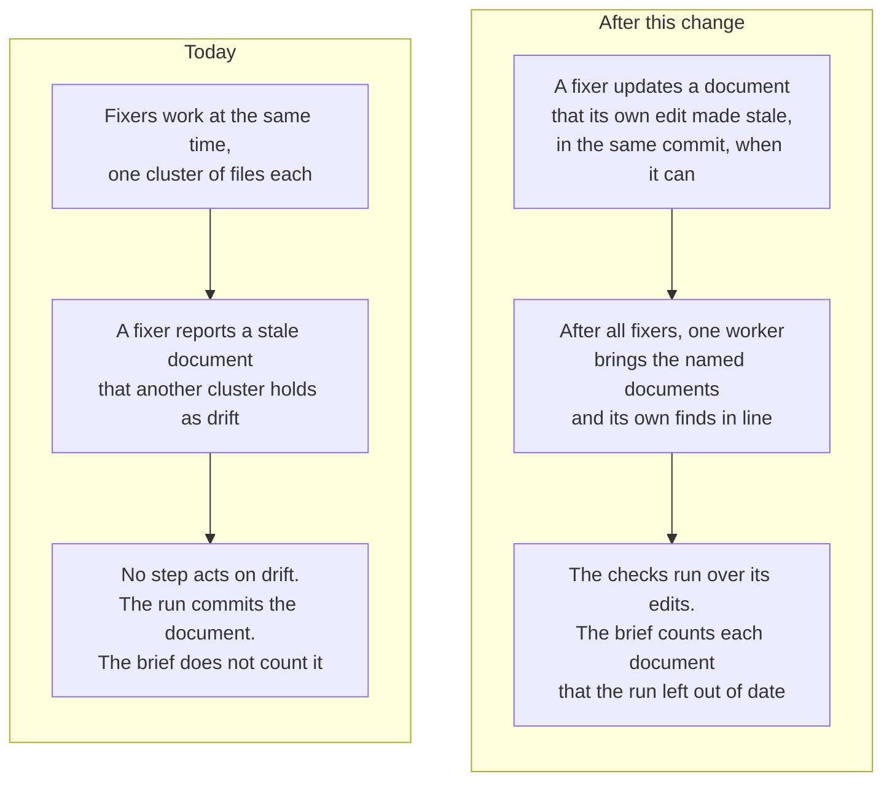

# Product Requirements: The documentation step

Technical part: [2026-10-23-documentation-step.design.md](2026-10-23-documentation-step.design.md).

## Summary

A fix run of deep-review gives its findings to fixers that work at the same time, one cluster of files each. The edit of a fixer can make a document out of date. The fixer can update that document only if no other cluster holds the file. If another cluster holds it, the fixer reports the stale fact as `drift`. No step of the run acts on `drift`. The report lists it under "which nothing in this run updated", and the brief does not count it.

On pallets/click #3878, each of the three fix runs on Claude Code committed documents that its fixers named as out of date. In one run, the document said the opposite of the answer of the person. Its example showed an output that the code no longer gives. The brief of two of these runs said "Nothing needs you".

This proposal adds the documentation step. One worker runs after each fixer of the fix pass returned and before the checks. It brings the documentation in line with the edits of the run: the stale facts that the fixers named, and what its own search finds. A fixer also updates a document that its own edit made stale, in the same commit, when it can. The brief counts each document that the run knows is out of date and did not bring in line. Thus "Nothing needs you" never stands over such a document.

Figure 1. What happens to a document that the edits of a fix run make out of date, today and after this change.

## Problem

### What the fix pass does with a stale document

The fix pass puts the findings that it fixes into clusters by file (R3 of the fix pass). Each cluster owns its files, and the fixers of different clusters work at the same time. A fixer can edit a file that no cluster owns, after it claims the file (R1 of commit series integrity). It must not edit a file that another cluster owns or claimed.

The prompt of each fixer asks for `drift`: each fact in documentation outside the files of the fixer that its edits made out of date. The fix pass left the step that acts on these lines to a later element (PD1 of the fix pass). That element does not exist yet. The report lists the lines under "Documentation the fixers say their edits made stale, which nothing in this run updated". The code that writes this sentence points to issue #29.

### What the runs on pallets/click #3878 show

The report on what a person gets from a run ([2026-10-23-skill-ux.md](../reports/2026-10-23-skill-ux.md), U2) reads six runs on this pull request. In each of the three fix runs on Claude Code, `docs/testing.md` was out of date after the fixes. The run committed it as it was.

In run `a1b8920a`, the person chose that the command reads the bytes unchanged. `docs/testing.md` still said that the echo removes them from the input that the command reads. Its example `test_shout` showed an output that the code no longer gives. In run `b8f3df7d`, a fix limited the translation to a charset that holds the bytes as single bytes. `docs/testing.md` and `CHANGES.md` still said that the bytes are always translated. In run `69dfd23d`, the same fix left `docs/testing.md` out of date in the same way.

The brief of run `b8f3df7d` said "Nothing needs you". So did the brief of run `a1b8920a`, after the person accepted its departure. The brief of run `69dfd23d` counted only its departure.

### Why the fixer did not update the document

The table of changed files in each report shows who held each file. In the three runs on Claude Code, findings about the words of `docs/testing.md` formed their own cluster. That cluster held the file while the cluster that changed the behavior worked. A fixer cannot claim a file that another cluster holds, so the fixer that changed the behavior reported `drift`. In run `a1b8920a`, the fixer of the documentation cluster also recorded a correction. The tree did not hold the new behavior yet, because the other cluster owned that fix and was possibly still at work on it.

The step-by-step run on Codex, `144eea7b`, had one cluster. Its fixer claimed `docs/testing.md` and `CHANGES.md` and updated them in the commits of the fixes. The person answered a question there with an option that changed the behavior too. Thus the difference was the shape of the clusters, not the runtime.

The prompt of the fixer also says two things that do not agree. One part tells the fixer to write the documentation that its fix touches as the conventions ask. Another part tells it to report a fact outside its files as `drift`, and says that `drift` permits no edit outside its files. In run `b8f3df7d`, no cluster held `CHANGES.md`, but the fixer reported it as `drift` and did not update it.

### One fix can make the text of another fix wrong

Clusters work in isolation, so no fixer sees what another cluster does to the text that it just wrote. Run `71ae22a2` reviewed the decision step of deep-review itself. In it, one cluster wrote a line of the report, and another cluster changed the behavior that the line described. A fixer reported the line in its `drift`, and nothing updated it (issue #29). A step that reads only the `drift` lines misses a contradiction that the fixer that reports it cannot see either.

### The workers that are alone in the tree

The repair worker and the fixer of an answer pass are alone in the tree, and they can edit any file. But they get the same prompt. It asks them to report a stale document outside their files as `drift`, and it gives them no rule to update it. An answer pass changes the behavior to the answer of the person. Thus its edits can make a document out of date that the fix pass wrote for the default.

## Goals

A fix run does not leave a document out of date by its own edits in two conditions: the run can see the fault, and the repository settles what the document must say.

When the run does not bring such a document in line, the brief says so first. The headline counts it, and a part of the brief names it, what is out of date and why the run left it.

Each edit of documentation is recorded and committed as a fix is, with a message that says why.

## Non-Goals

### Documentation that the change itself left out of date

The step reconciles the documentation with the edits of the run, not with the reviewed change. A document that the change itself left out of date is a finding of the review, and the angles report it as such. The step does not review the documentation of the change again.

### A documentation step after the repair or an answer pass

The repair worker and the fixer of an answer pass are alone in the tree. They update the documentation that their own edits make stale (R6), and the brief counts what they leave (R7). A second worker after each of them is left out until a run shows the need (PD4).

### A new question from the step

When a document needs a choice that nothing settled, the step leaves it and names it. It does not ask the person a new question with options (PD5).

### The rules of the repository

The step does not edit a convention source, such as `AGENTS.md`. A fix that departs from a rule amends what states the rule (R5 of the decision step), and the step keeps that amendment. The step leaves and names each other statement of a convention source that the edits of the run made false. This departs from principle 9, and "Against the vision note" says why.

### The decider

A decision can settle a question of direction with no ask (U8 of the report on what a person gets from a run). The step follows the recorded decision, and this proposal does not change the decider.

### Test assessment

The fix pass left two elements for later: the documentation step and a review of the tests of the fixers (PD1 of the fix pass). The report on what a person gets from a run found the evidence of the tests good. This proposal adds only the documentation step.

### Other parts of the short form

The short form of a fix run gets one line for the documents left out of date. The other changes that the report on what a person gets from a run proposes for the short form and the chat are separate.

## Requirements

### R1: The step runs once in each fix run whose fixes changed a file

The documentation step runs in each fix run whose fixes changed at least one file. It runs once, after each unit of the fixes settled, the second round too, and before the checks. It does not run in a run that only reviews, or in a fix run whose fixes changed no file. When the run budget stopped a unit of the fixes, the step does not run in that pass. When the run then reopens the fix pass, the step runs after the units that the reopen gives back.

### R2: The step gets what the fixers reported and what the run changed

The engine gives the step each `drift` line of the fixes, grouped by the document that it names. The engine reads the path of each line as it reads each path that a worker reports. Thus each document is one file of the repository. A path that the engine refuses, such as one outside the repository, still makes a document, and the step can only leave it.

The engine also gives what each fixer did, the patch of each change of the fixes, the decisions and the answers of the person. With the patches, the step tells the edits of the run apart from the reviewed change. Before the worker starts, the engine records the list of documents that the step must answer for.

### R3: The step brings the documentation in line with the code as it is now

The step checks each named document against the code of the tree. It updates each fact that the edits of the run made out of date. It also searches the repository for other documentation that the edits of the run made out of date, also where no fixer reported any. Documentation here is text for a person: a document, a changelog, or a comment in the code that describes the changed behavior. The step does not change code, a test or a configuration to make a document true.

### R4: The step follows only what the repository settles

The step writes only what the code of the tree, a recorded decision or an answer of a person settles. It does not choose a behavior. If the correct text of a document needs a choice that nothing settled, the step leaves the document as it is and gives the reason. The step also leaves each convention source as it is. If the edits of the run made a rule false, the step leaves the rule and gives the reason.

The step writes each edit as the convention sources of the file ask. It follows the rules of the repository for a historical or append-only record: it leaves such a record as it is and gives the reason. It also leaves each path that `scope.exclude` keeps out of the review, such as built output. It names the setting for a stale fact there (PD11).

### R5: Each document gets an answer and its own commit

The step answers each named document once: brought in line, already correct, or left with a reason. A document whose path the step cannot edit, such as one outside the repository, is left with that reason. It answers once more for what its own search found. Each answer with edits has a commit message that says why. The edits of each answer become one revision and one commit, as the edits of a fix do.

### R6: A fixer updates a document that its own edit made stale

A fixer updates a document that its own edit made out of date, in the same finding. Thus the fix and its documentation are one commit. In the fixes phase, the fixer claims the file first. If the claim is refused, the finding is not blocked: the fixer reports the stale fact as `drift`, and the documentation step gets it. The repair worker and the fixer of an answer pass are alone in the tree, and they update such a document with no claim. A fixer edits a convention source only as its decision says, as a fix that departs from a rule does today.

The task of an answer pass also lists the documents that the run left out of date. Its fixer brings one in line when an answer that it applies settles what the document must say.

### R7: The brief counts each document that the run left out of date

A document is left out of date when the run knows that its edits made the document stale and did not bring it in line. The brief counts these documents in its headline, as things that need the person. A part of the brief lists each one with its file, what is out of date and why the run left it. The short form of a fix run has one line for them, and the JSON form holds them. A run that only reviews edits nothing, so its brief says nothing of documents.

A document is left in five cases. In the first, the documentation step left it with a reason. In the second, the documentation step reported it as out of date at its end. In the third, the documentation step did not answer. The run budget stopped it or a unit of the fixes, its worker failed twice, or the fixes changed no file. Then each `drift` line of the fixes counts.

In the fourth, a worker reported it after the engine planned the documentation step: the repair or the fixer of an answer pass. In the fifth, the run has no documentation step, because an engine before this change configured it, and then each `drift` line counts.

The count of a document ends when a later answer pass changed its file and did not report it in `drift` again (PD10). A document that the person brings in line by hand still counts in the brief of the run. In the same way, a question that the person settles by an edit of the code stays open. The next review of the changed tree is a new run.

### R8: The step never blocks the run

If the worker of the step fails twice, or if the run budget is reached before it starts, the step is not attempted. The run goes on to the checks and the report, and R7 counts the `drift` lines of the fixes as left. A stop of the engine or the usage limit of a provider blocks the step as it blocks any unit. The next command continues it.

### R9: The checks and the repair cover the edits of the step

The checks after the fixes run after the step, so they check its edits too. The repair worker owns the files that the step changed, as it owns the files of the fixes.

### R10: The report shows what the step did

The evidence of the report shows the step: each document with its answer, its note, its files and the subject of its commit. It shows each `drift` line of the fixes with the document that took it, and each line that the step did not take. The paragraph of the brief on what deep-review changed says in one sentence what the step did.

### R11: An older run and an older engine

A run that an engine before this change configured does not get the step, also when the new engine continues or resumes it. It folds as it did. Its report shows its `drift` lines in the new section on the documentation, and its brief counts them (R7). An older engine passes over a run that holds the new records.

### R12: A stop at any point of the step is resumable

The contract of resumable runs holds for the step. A stop at any point of it, and the same command again, give the result of the same run with no stop.

### R13: The gate

Three real runs accept this change (principle 12). The engine reviews and fixes the pull request of this change on Claude Code. Two fix runs on pallets/click #3878 use the same commit as the runs of the report on what a person gets from a run. One runs on Claude Code, and one runs on Codex. The author checks that each document that a fixer named as out of date agrees with the tree, or that the brief counts it.

The report on what a person gets from a run shows one fix run on Codex. That run had one cluster, and its fixer updated the documents itself. Thus the run on Codex shows the step and R6 on that runtime, not the fault.

## Metrics

### Documents committed out of date with no count

The count of documents with three properties, on the gate runs on pallets/click #3878: a fixer named the document as out of date, the committed tree leaves it out of date, and the brief does not count it. Today it is 1 or 2 documents in each fix run on Claude Code. Target: 0 in each gate run.

### The cost of the step

The spend of the step as a part of the spend of each gate run. Target: less than 10 percent. This target is an estimate before the gate, and the gate measures it.

### The commits of the documentation

Each commit that the step makes has a message that says why. Target: each commit of the gate runs.

### The second round

R6 can make more findings wait for the second round, because a fixer claims a document that another cluster then needs. The gate counts the findings in the second round, and the author reads each one that a claim of a document caused. Target: no such finding stays not applied.

## Product Decisions

### PD1: A step after the fixes, not a new route for documentation-only findings

The proof of concept of deep-review sent each finding about documentation alone to the owner of the documentation, which ran after the code. That avoids two edits of one document. But the engine must then sort the findings by the kind of their files, with a rule of its own. The survey and the brief left such judgments to a model (PD8 of the brief of a run). The move also takes these findings out of the batches and the second round.

The step after the fixes gives the same result with no such rule. It owns each document after all fixers returned, and it reads the final code. Thus a finding about documentation alone still gets its own cluster and its own commit. The step then corrects what that cluster wrote against a behavior that changed later.

### PD2: The step runs when the fixes changed a file, not only when a fixer reported drift

A fixer reports only what it sees. It does not see what another cluster did to the text that it wrote (issue #29). Thus the step searches in each fix run whose fixes changed a file. A run whose fixes changed nothing gets no step, because nothing of the run can make a document stale.

### PD3: The fixer updates a document that its own edit made stale

A commit that changes a behavior and leaves its documentation for a later commit is not in line with itself. Principle 6 asks for one commit for each fix, with a message that says why. Commit series integrity asks that the repository accept each commit alone. Thus the fixer updates such a document in the same finding when it can claim the file. The documentation step takes what the fixer cannot reach.

The proposal accepts a cost. A fixer now claims documents, so another cluster can find a document claimed and wait for the second round. The metric of the second round watches this.

### PD4: No documentation step after the repair or an answer pass

The cause of the fault is that the fixers work at the same time on files that they hold apart. The repair worker and the fixer of an answer pass are alone in the tree. Thus they can update each document that their own edits make stale (R6).

A second worker after each of them adds a phase and a cost to each answer. But principle 7 keeps the cost of an answer to its own finding. Thus the brief counts what they leave (R7). The proposal adds such a worker when a run shows a document that they left out of date.

### PD5: A document that needs a choice is left and named, not asked

The proof of concept let the owner of the documentation ask the person a question. Here a question has options, the cost of each, the rule that each makes and a default (principle 4), and the decision step writes it. A question from the documentation step needs a new kind of answer and a new pass that applies it.

The case is rare, because each edit of the run follows a recorded decision or an answer, which settles what the document must say. When it occurs, a fix changed a behavior that a document states, and the decision did not see the document. That is a matter of the decider (U8). Thus the step leaves the document and names the reason, and the brief counts it (R7).

### PD6: The headline counts the documents left out of date

The headline counts the things that need the person: the open questions and the departures that no person reviewed. A document that the edits of the run left out of date needs the person too, before a merge. It is a fault that the run itself made, and the run knows of it. A fix that a fixer deferred or did not apply leaves a fault of the change, not of the run. It stays in "What the review did not cover".

### PD7: One answer for each document, and one for the search

The step answers each named document once, and once for its own search. Thus each document gets its own status in the report and its own commit. One answer for all documents gives one commit with unrelated edits, and no status for each document. One answer for each `drift` line gives many small commits, and two lines on one document give two edits of it.

The edits of the search form one commit, because the step does not know its documents before it searches. Its commit message names each document that it changed.

### PD8: The `documentation` role, with its own prompt

The roles of the engine already declare a `documentation` role, but its prompt is the prompt of a fixer in a cluster. The step gets that role with its own prompt: what it does, when it runs, what it owns and what it must leave. Its policy is the policy of a fixer: the strong model, high effort, 8 USD and 30 minutes.

### PD9: One pull request with the proposal and the work

The proposal and its implementation go in one pull request, as the brief of a run did. The proposal can change during the work, and each change of it gets its own commit before the code.

### PD10: The count of a document ends when an answer pass brings it in line

The count of a question ends when the person answers it, and the count of a departure when the person reviews it. A document left out of date needs an end too. Otherwise the brief of the run never says "Nothing needs you" again.

The way out that the run gives is an answer pass. A document that needs a choice waits for an answer (PD5). The fixer of the pass updates the documents that its edits make stale (R6). Thus the task of an answer pass lists the documents left out of date. An edit of such a document by that fixer, with no new `drift` line for it, ends the count.

The proposal rejects four other ways. With no end, the brief counts a document that the run itself brought in line. An end at each later edit with no `drift` line trusts a worker that did not know of the stale fact. An act of the person for a document needs a new kind of answer. A comparison with the tree makes the brief more than a view of the ledger (TD2 of the brief of a run).

On 2026-10-23, the author chose this end over the four other ways.

### PD11: The step leaves each path that the review leaves out

The setting `scope.exclude` names the paths that the review leaves out, such as the output of a build. In many repositories, an edit by hand of such a path is wrong, and a convention source does not always say so. Thus the task lists the patterns of the setting, and the step leaves each path that matches one. For a stale fact there, the step names the setting as the reason, and the brief counts the document (principle 8).

The proposal accepts one cost. A check after the step can write such a file again, as a build writes its output. The brief still counts the document, because the brief reads the answer of the step and not the tree.

The proposal rejects two other ways. If only the convention sources keep the step out, the step can edit the built output of a repository with no such rule. If the brief does not count such a document, the brief hides a stale fact that the run knows. On 2026-10-23, the author chose this way.

## Against the vision note

### Principle 1, evidence, not trust

Each edit of the step is a revision with a commit message, and the report names the `drift` line that it answers. The brief names each document that the run left, with what is out of date and why.

### Principle 2, record before action

The engine records the list of documents that the step answers for before its worker starts. Each document comes from a `drift` line on the ledger, or from the search that the step reports in its answer.

### Principle 3, rules can be wrong, and a departure is reported

The step does not edit a rule. A rule that the edits of the run made false stays as it is, and the brief names it. A fix that departs from a rule still amends what states it, as R5 of the decision step asks.

### Principle 4, deep-review decides; the person answers and writes rules

This proposal departs from the form of principle 4 in one case. A document whose text needs a choice that nothing settled goes to the person as a document left out of date, with the reason. It does not go as a question with options and a default. The reasons are in PD5: the case is rare, and its cause is a decision that did not see the document. On 2026-10-23, the author accepted this departure. The next note can say if such a document must become a question.

### Principle 5, the core, the questions, and the departures go to the person

The brief shows the documents left out of date in its first layer, after the departures, and its headline counts them.

### Principle 6, easy to understand, with little context

Each edit of documentation has its own commit with a message that says why. A fixer keeps a fix and its documentation in one commit when it can.

### Principle 7, nothing waits for a person

The step never blocks a run (R8). An answer pass still runs one worker.

### Principle 8, say what was not examined, and when a person must look

The brief names each document that the run knows is out of date and did not bring in line. On a fix run, its sentence "Nothing needs you" says that the run left no document out of date that it knows of.

### Principle 9, the rules grow from the answers

This proposal departs from principle 9 in one case. The edits of the run can make a statement of a convention source false with no departure. The step then leaves the statement, and the brief counts the file. The person writes the rule by hand, and principle 9 does not permit a rule that only a person can write by hand.

The reasons are two. First, the step cannot tell a rule from a description in such a file, and a rule changes from an answer or a reviewed departure. Second, a fix that departs from a rule amends the rule itself (R5 of the decision step). Thus the case means that the decider did not see the rule. Principle 3 asks the run to show such a departure, not to hide it in a quiet edit. The next note can say if the step must write such a rule.

The proposal rejects two other ways. If the step edits each statement that it judges a description, a wrong judgment changes a rule with no report. If the step edits the statement and reports the edit as a departure, the engine needs a new record for it. It also needs a new pass that undoes the edit when the person rejects it. On 2026-10-23, the author accepted this departure.

### Principle 11, recovery without a person

A step that fails or meets the run budget does not stop the run. The proposal adds no documentation step after the repair or an answer pass until a run shows the need.

### Principle 12, a real run is the gate

R13 makes three real runs the gate: one on this pull request, and one on each runtime on the pull request that showed the fault.

### How to use this document

On a fix run, the proposal adds one line to the short form and a clause to "Nothing needs you". It also adds a sentence to what deep-review changed. More comes only when the run left a document out of date: the headline counts it, and a part names it. The brief of a run that only reviews does not change.

The vision note names more text to read as a way to go against it. The proposal accepts the line and the clause on each fix run for one reason. Without them, "Nothing needs you" does not say if the run knows of a stale document (principle 8). When the run left one, one line of the brief replaces a search through a long report. The proposal hides no question and no departure, and it makes no question block a run.

The proposal rejects two other ways. A line only when the run left a document changes the shape of the short form from one fix run to the next. A line on each run adds a line that always says `none` to the brief of a run that only reviews. On 2026-10-23, the author chose the line and the clause on each fix run.

## Risks

### The step writes a wrong document

A model can misread the code and write a wrong fact. The checks run after the step, each document has its own commit, and the report names each edit. A person can revert one commit.

### The step reaches beyond the edits of the run

A search can find a document that was out of date before the run. The prompt limits the step to the edits of the run, and the gate reads each commit of the step.

### The step follows a decision that the person did not see as a question

When the decider settled a question of direction with no ask (U8), the step makes the documentation follow that decision. The decision stays in the report, and the commit of the step names the finding that it follows.

### Each fix run costs more

The step is one more worker in each fix run whose fixes changed a file. The metric of the cost watches it.

### More findings wait for the second round

A fixer that claims a document can make another cluster wait (PD3). The metric of the second round watches it.

### The digest of the roles changes

The new prompts change the digest of the roles. A run that started with the old roles refuses to resume with the new ones, as for each change of a role prompt. The design says what the person does then.

### An older engine skips a run of this engine

An older engine passes over a run that this engine configured, as it does for each new version of an event.

### A program reads the JSON form

The JSON form of the brief gets a new version with the documents left out of date. A program that reads version 1 must read version 2.
