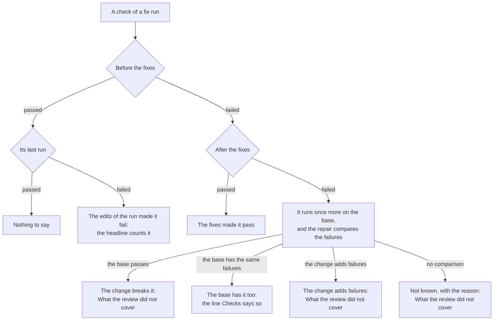

# Product Requirements: The facts before a merge

Technical part: [2026-10-28-facts-before-a-merge.design.md](2026-10-28-facts-before-a-merge.design.md).

## Summary

After a fix run, a person asks one question first: can this change merge? The report [`2026-10-23-skill-ux.md`](../reports/2026-10-23-skill-ux.md) shows that the brief does not give the facts for that question (U3). It does not say if a check that fails also fails on the base of the change. It can say that a check failed after the fixes when it failed after the answers (#78). The short form in the chat has no line for the checks. And only the end of the report says how the fixers validated the fixes. So the hosts did the work of the report: Claude Code made a worktree of `main` and ran the typecheck there, and Codex took a failure that `main` also has as a reason to wait.

This proposal gives the brief those facts. A check that fails before the fixes and after them runs once more on the base of the change, in a temporary worktree. The repair worker compares the failures of the change as submitted with those on the base. Then the brief says if the base has the same failures, if the change causes the failure, or that the run could not compare. Each check says when its last run failed: after the fixes, after the repair or after the answers. The headline counts a check that the edits of the run made fail. A check that the change itself breaks goes to "What the review did not cover". The short form of a fix run gets a line `Checks:`. "What deep-review changed" gets one sentence on how the fixers validated the fixes.

The core of the change stays what it is: the account of the change as it was submitted for review.



Figure 1. Where the brief puts each check of a fix run after this change.

## Problem

### What a person asked after the runs

In the sessions of the report, the person asked each host if the pull request could merge now (U3). The brief did not answer, so each host did something of its own. Claude Code took 1 minute 39 seconds and 9 permission prompts. It made a temporary worktree of `main`, ran the typecheck there, compared the errors, ran the tests and removed the worktree. Its answer was correct: the typecheck failure is the same 7 errors that `main` has, so the change did not cause it. Codex took 17 seconds and read only the report. It counted the same typecheck failure as a reason to wait, because the report does not say that `main` has it too.

### What "before the fixes" means

A fix run runs each check before any fixer edits the tree, and again after the fixes. "Before the fixes" is the change as it was submitted, not the base of the change. Thus "typecheck failed before and after the fixes" has two meanings that the brief does not tell apart. The base may fail in the same way, and then the change is not the cause. Or the base may pass, and then the change breaks the check. The person must decide the merge differently in the two cases.

### When a check failed

The brief takes the newest run of each check as its outcome after the fixes (#78). After an answer pass, that run is the check of the answer pass. In the gate of the questions in the chat, the `test` check failed once after the answers. The brief said "test passed before the fixes and failed after them". The Checks part of the same report said "After the repair: not run, since no check failed after the fixes". The two disagree.

### What the chat and the headline say

The short form has no line for the checks. In the same gate, the headline of the brief after the answers said `1 thing needs you: 1 question`, and the short form named no check. The headline counts the open questions, the departures that no person reviewed and the documents that the run left out of date. It does not count a check that the edits of the run made fail. So a run whose answer pass breaks a test, with no question open, says "Nothing needs you".

### How the fixers validated the fixes

Each fixer reports how it validated each fix: a test that fails on the code before the fix, a mutation of the fix that the test catches, the tests that already exist, a reading of the source, or a limit that it names. The report shows these lines only in its evidence, at the end. A person who asks if the fixes can be trusted does not find them in the brief (U3).

## Goals

After a fix run, the person learns from the chat how each check ended, and if a check that fails also fails on the base of the change. The person learns from the brief which check the edits of the run made fail, which check the change itself breaks, and which check the run could not compare with the base, with the reason. Each outcome says when the check ran. The brief says in one sentence how the fixers validated the fixes. The person can then decide a merge without a check of their own, and a host can answer the question from the lines of the engine.

## Non-Goals

### An account of the change after the fixes

The core of the change is the account of the change under review, as it was submitted. It does not describe the tree after the fixes and the answers. What deep-review changed has its own part of the brief, and `report --fixes` gives a line for each fix (PD7).

### Installing what the checks need on the base

The run does not install the dependencies of the repository in the worktree of the base. A check whose tools need such a step cannot run there, and the brief says so (PD2). A repository setup step, apart from the review, is issue #83.

### A repair of a failure that the change causes

The repair keeps its scope. It fixes the failures that the fixes added, and not a failure that the change brought with it (PD8).

### A verdict on the merge

The brief gives facts. It does not say that the change can merge or cannot merge, because the merge is the act of the person.

### Checks in a run that only reviews

A run that only reviews runs no check, as today. Its brief does not change.

### The base again after an answer pass

An answer pass does not run a check on the base again. The comparison of the fix pass stands. A check that passed earlier in the run and fails after the answers is a check that the edits of the run made fail (R4).

### The rule for the interpretation by the host, and the language of the reader

Step 4 of each skill and the language of the brief stay as they are (U4, U7). The line `Checks:` is text of the engine that a host can show as printed.

### A new condition of where to look

A fix that the fixer could not validate well does not become a condition of "Where to look" (PD6). The conditions of principle 8 stay as the vision note lists them.

## Requirements

### R1: A check that failed before the fixes and after them runs once more on the base

In a fix run, a check that failed or timed out before the fixes, and again after them, runs once more on the base of the change. The base is the commit that the scope starts from: the merge base for a branch, the parent for the last commit, and `HEAD` for the working tree. The run makes a temporary worktree of that commit and runs the same command there, with the same timeout. It removes the worktree after the check. The output is kept as evidence, as for each other run of a check.

The run installs nothing in the worktree (PD2). When the base is the empty tree, the check does not run there, and the brief says why. A check that passed before the fixes, or that passed after them, does not run on the base. The base runs before the repair, once in each fix run.

### R2: The repair compares the failures with the base

The repair worker gets the output of the check on the base beside its output before and after the fixes. For each check that ran on the base and failed there, the worker compares the failures before the fixes, on the change as submitted, with the failures on the base. The comparison is about the change, not about the edits of the run, so no repair and no answer pass makes it old. The worker says one of three things. The base shows the same failures. The change adds failures to those of the base. Or the outputs cannot be compared, for example because the check failed on the base for a missing tool or dependency and not for the code. The worker says it in a few words, and the report keeps them.

When the check passed on the base, the engine knows without the worker that the change breaks the check. When no answer of the repair says it, because the run budget stopped the repair or its worker failed, a check that failed on the base reads as not compared. The repair still fixes only the failures that the fixes added (PD8).

### R3: Each check says when its last run ended so

The brief gives each check its outcome before the fixes, and the outcome of its last run with when it ran: after the fixes, after the repair or after the answers. Its sentences in "What deep-review changed" use these words, so no failure after the answers reads as a failure after the fixes (#78). The report and the JSON form say the same. A brief of a run that this change did not configure also follows this rule, because the fold of the run holds when each check ran.

### R4: The headline counts a check that the edits of the run made fail

A check whose last run failed, after an earlier run in the same fix run passed, counts in the headline as a thing that needs the person. The earlier run is the run before the fixes, after the fixes or after the repair. The edits of the run made it fail, and the run knows it, as for a document that it left out of date (PD4). An invented example:

```text
1 thing needs you: 1 check that the edits of the run made fail. Nothing waits for you: the run went on as it decided.
```

A check that failed before the fixes does not count, whatever the base says. On a fix run, the sentence "Nothing needs you" also says that the edits of the run made no check fail.

### R5: What the review did not cover names a check that the change breaks or that the run did not compare

"What the review did not cover" lists each check that the change itself breaks: the check passes on the base, or the repair says that the change adds failures to those of the base. It also lists each check that failed before and after the fixes and that the run did not compare with the base, with the reason. A check whose base shows the same failures is not listed. The run covered it, and R6 says what it found. Invented examples:

```text
The typecheck check fails on the change and passes on its base, the merge base with origin/main (2247b35e). No step of the run fixes a failure that the change brings.
The typecheck check failed before and after the fixes, and the run could not compare it with the base, the merge base with origin/main (2247b35e): the check failed there for a missing tool.
```

### R6: The short form of a fix run has a line `Checks:`

The short form of a fix run gets a line `Checks:`, after the line of the documents left out of date and before `Not covered:`. It names each check that did not pass at some point of the run, with what happened to it in a few words, and then the checks that passed. When each check passed, the line says so. The line has at most 200 characters and is cut at a word, as the other lines. A run that only reviews has no such line. The short form then has at most 23 lines, one more than R13 of the brief of a run and PD12 of the questions in the chat allow today. Invented examples:

```text
Checks: each passed before and after the fixes
Checks: typecheck failed, as it does on the base (2247b35e), with the same failures; build, lint and test passed
Checks: test failed after your answers and passed before; typecheck fails on the change and passes on the base (2247b35e); build and lint passed
Checks: typecheck failed before and after the fixes, not compared with the base; build, lint and test passed
```

### R7: What deep-review changed says how the fixers validated the fixes

The part "What deep-review changed" of a fix run gets one sentence on the validation that the fixers reported for the fixes that they applied. It counts the fixes that a test validated: the test failed on the code before the fix, or a mutation of the fix made it fail. It names the other fixes by the weaker kind of validation of each: the tests that already exist, a reading of the source, a limit that the fixer named, or none. The sentence says that the fixers report it. The short form does not get it. An invented example:

```text
The fixers report that a test validated 5 of the 6 fixes: it fails on the code before the fix, or on a mutation of the fix. TESTS-3 rests on the tests that already exist.
```

### R8: The report shows the run on the base

The Checks part of the report shows the run of each check on the base: its command, its outcome, its evidence and the words of the repair on the comparison. It also says why a check did not run on the base. With R3, the brief and the Checks part say the same of each check: in the gate of the questions in the chat, the Checks part was right that no check failed after the fixes, and the brief was wrong.

### R9: The JSON form gives the same facts

Version 4 of the JSON form of the brief gives each check its outcome before the fixes, the outcome of its last run and when it ran, and the outcome on the base with the comparison. Its headline counts the checks of R4, and it gives the applied fixes under each kind of validation of R7. A program that reads version 3 must read version 4.

### R10: An older run and an older engine

A run that an engine before this change configured has no run on the base. Its brief follows R3 and R4, which the fold gives, and says nothing of the base. An engine before this change passes over a run that this engine configured, as it does for each new version of an event.

### R11: A stop at any point of the run on the base is resumable

A stop during the run on the base is resumable, as the contract of resumable runs asks for each phase. A worktree that a stop left behind is removed when the run resumes. The run on the base never blocks the run: a worktree that cannot be made, or a check that cannot start there, gives a check that the run did not compare, with the reason (R5).

### R12: The gate

The gate is a real run (principle 12). The engine of this branch runs a fix run on pallets/click #3878 in interactive sessions of Claude Code and Codex, on fresh clones at the head `f8c5a8e` and the base `2247b35`. The typecheck of that change fails on the base with the same errors (U3), so each run shows a check whose base has the same failures. deep-review also reviews and fixes this pull request on Claude Code.

One more run shows a check that the change breaks (PD10). It runs on pallets/click #3878 with a check command, given by `--check`, that passes on the base and fails on the change. Its brief lists that check in "What the review did not cover", and its headline does not count it.

In each host, after the fix run, the person asks if the change can merge. The gate records if the host runs a check of its own, and how long the answer takes. Before this change, Claude Code took 1 minute 39 seconds and 9 permission prompts, and Codex counted the failure of the base as a reason to wait.

## Metrics

### A failure with no fact of the base

The count of checks, in the gate runs, that failed before and after the fixes and whose brief does not say if the base has the same failures, if the change breaks the check, or why the run did not compare. Today it is each such check. Target: 0.

### The time of the run on the base

The wall time of the runs on the base as a part of the wall time of each gate run. Target: less than 10 percent. This target is an estimate before the gate, and the gate measures it. A tool that makes its own environment, such as `tox`, downloads it in the new worktree.

### The checks of the host

In each host of the gate, the commands that the host runs on its own to answer if the change can merge. Target: none.

## Product Decisions

### PD1: A run on the base only for a check that failed before and after the fixes

The run on the base answers one question: did the change cause a failure that the fixes did not remove? A check that passed before the fixes needs no base, because the change did not break it. A check that the fixes made pass needs none either. Thus the base runs only for a check that failed both times, and a run whose checks pass costs nothing more.

The proposal rejects two other ways. A run of each check on the base costs a run of each check, and a check that passes tells the person nothing more. No run on the base, with a sentence that the run does not know, leaves the question of the report open. On 2026-10-27, the author chose the run on the base.

### PD2: A temporary worktree of the base, with nothing installed

The run never changes the tree of the person, so the base runs in a worktree of its own. The run installs nothing there. A check that needs installed dependencies, such as `npm run typecheck` in this repository, then fails on the base for a missing tool, and the brief says that the run did not compare it. A tool that makes its own environment, such as `tox` or `uv run`, works there.

The proposal rejects two other ways. The survey can choose an install command, such as `npm ci`, and the run can run it in the worktree first. That costs time, network and disk, and it changes the survey. A link to the dependencies of the tree of the person needs a way for each ecosystem, and it is wrong when the change edits the lock file. On 2026-10-28, the author chose to install nothing now, and asked for a repository setup step apart from the review engine later (#83).

### PD3: The repair worker compares the failures, and the engine does not compare the text

The output of a check names the paths of its worktree, and the lines of a failure move when the code moves. A comparison of the text by the engine reads such outputs as different. A comparison of the exit codes reads a base that failed for a missing tool as the same failure. The repair worker already reads the output before the fixes and the output after them, and it tells the failures that the fixes added from the others. The output on the base is one more output beside them, so no new worker is needed. The worker compares it with the output before the fixes. Whether the change causes a failure is a question about the change as submitted, and a comparison with the output after the fixes would count a failure that the fixes added as a failure of the change.

When the base passes, the engine needs no reading: the change breaks the check.

### PD4: The headline counts only a check that the edits of the run made fail

PD6 of the documentation step sets what the headline counts. A document that the run left out of date needs the person before a merge, it is a fault that the run made, and the run knows of it. A fix that a fixer did not apply leaves a fault of the change, not of the run, and it stays in "What the review did not cover". A check that the edits of the run made fail is a fault of the run, so the headline counts it. A check that the change breaks is a fault of the change, so it goes where the faults of the change go.

The proposal rejects two other ways. A count of each check that the change breaks makes the headline count a fault of the change, and then a fix that a fixer did not apply must count too, which reopens PD6. No count leaves "Nothing needs you" over a check that the edits of the run made fail. On 2026-10-28, the author chose to count only a check that the edits of the run made fail.

### PD5: A line `Checks:` on each fix run

The chat gets the short form, and a person who reads only the chat learns nothing of the checks today. One line on each fix run says how the checks ended. The line is on each fix run, as the line of the documents left out of date is, so the shape of the short form does not change from one fix run to the next.

The proposal rejects two other ways. A line only when a check failed changes the shape of the short form. No line leaves the facts of this proposal out of the chat. On 2026-10-28, the author chose the line.

### PD6: The sentence on the validation in the brief, not in the short form or in where to look

The validation answers if the fixes can be trusted. The fixers already report it per fix, so a count of it needs no new worker. One sentence in "What deep-review changed" puts it in the brief. The short form keeps the lines that a person needs before a merge.

The proposal rejects a condition of "Where to look" for a fix that a test did not validate. The conditions of principle 8 are the list of the vision note, and a new one is a change of that list. On 2026-10-28, the author chose the sentence.

### PD7: The core of the change stays the change as submitted

The first part of the brief describes the change under review: the pull request, the branch or the commits that the person asked deep-review to review. The fixes of deep-review change the tree after that, and "What deep-review changed" says so. Since the questions in the chat, the line of the change says when the account describes the change before the fixes.

The proposal rejects an account of the change after the fixes in place of the account of the triage. The person reads the core to learn what the change under review does. An account of the tree after the fixes is deep-review's account of its own edits, and it does not belong in that place. On 2026-10-27, the author set that the top of the brief describes the change under review.

### PD8: The repair keeps its scope

When the base passes, the run knows that the change breaks a check. The repair could fix that failure too. But the repair then edits the change for a fault that no decision recorded, against principle 2, and it widens the fix pass. The proposal reports the failure and leaves it. A later proposal can make such a failure a finding with a decision.

### PD9: One pull request with the proposal and the work

As for the brief of a run, the documentation step and the questions in the chat, the proposal ships with its implementation in one pull request.

### PD10: A gate run with a check that the change breaks

The gate runs on pallets/click #3878 show a check whose base has the same failures. No natural run shows a check that the change breaks, which is the case that PD4 sends away from the headline. A run with a check command given by `--check`, which passes on the base and fails on the change, shows that case with real output. On 2026-10-28, the author asked for this run.

## Against the vision note

### Principle 1, evidence, not trust

The output of each check on the base is kept as evidence, and the report names it. The comparison is the reading of the repair worker, and the report keeps its words beside both outputs. The sentence on the validation says that the fixers report it, and the evidence of the report keeps each line of it.

### Principle 2, record before action

A run on the base edits nothing. The repair edits as it does today, and only for the failures that the fixes added (PD8).

### Principle 5, the core, the questions, and the departures go to the person

The core of the change stays the change under review (PD7). The headline counts a check that the edits of the run made fail, and "What the review did not cover" lists a check that the change breaks, so both are in the first layer of the brief.

### Principle 6, easy to understand, with little context

The line `Checks:` names each check by its kind, says when it failed, and names the base by its commit. A person reads from it if the change causes a failure, with no read of the outputs.

### Principle 7, nothing waits for a person

The run on the base never blocks the run (R11). An answer pass runs no check on the base.

### Principle 8, say what was not examined, and when a person must look

A check that the run did not compare with the base is listed with the reason. The sentence "Nothing needs you" of a fix run also says that the edits of the run made no check fail.

### Principle 11, recovery without a person

A worktree that a stop left behind is removed when the run resumes (R11). The proposal builds no install step until a run shows the need (#83).

### Principle 12, a real run is the gate

R12 makes four real runs the gate: one on this pull request, one on each runtime on pallets/click #3878, and one on pallets/click #3878 with a check that the change breaks.

### How to use this document

On a fix run, the proposal adds one line to the short form, a clause to "Nothing needs you" and a sentence to "What deep-review changed". More comes only when a check failed: the headline counts a check that the edits of the run made fail, and "What the review did not cover" lists a check that the change breaks or that the run did not compare. The brief of a run that only reviews does not change.

The vision note names more text to read as a way to go against it. The proposal accepts the line, the clause and the sentence on each fix run for one reason. Without them, the person or the host must run the checks again to learn if the change can merge, which the report shows (U3). One line replaces a run of the checks by hand. The proposal hides no question and no departure, and it makes no question block a run.

## Risks

### The run on the base costs time and network

Each check that failed before and after the fixes runs once more. A tool that makes its own environment downloads it in the new worktree. The metric of the time watches it.

### A base that fails for the environment reads as the same failure

A check can fail on the base for a missing tool. The repair worker reads the outputs, and it says that it cannot compare them (R2). A wrong reading stays possible. The report keeps both outputs, so a person can check it.

### The repair worker reads the comparison wrong

The comparison is a reading of a model. The line `Checks:` gives it as a fact of the run, and the report names the outputs that it rests on.

### A failure that the fixes add to a check that already failed

A check that failed before the fixes can hold, at its last run, failures that the fixes added and the repair did not remove. The comparison is about the change, so the brief says what the base says of the change. The answer of the repair for the check, in the report, says what the repair did. The headline does not count such a check, because the check never passed in the run.

### A test that fails by chance counts in the headline

A test that fails under the load of the machine, as in the gate of the questions in the chat, counts as a check that the edits of the run made fail. The engine cannot tell such a failure from a real one. The line `Checks:` says when it failed, and a later run can show that it passes.

### A worktree stays on the disk

A crash of the engine can leave the worktree of the base. The run removes it when it resumes (R11), and the design says what removes a worktree that no run resumes.

### A program reads the JSON form

The JSON form of the brief gets a new version. A program that reads version 3 must read version 4.
