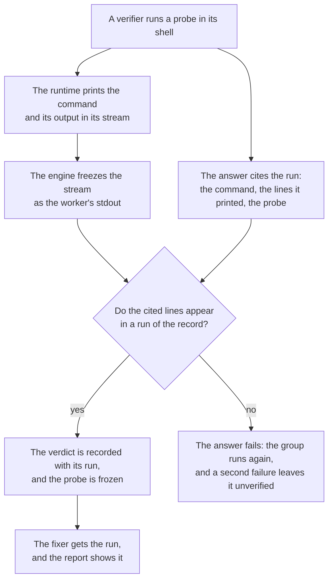

# Product Requirements: Runs on the record

Technical part: [2026-10-31-runs-on-the-record.design.md](2026-10-31-runs-on-the-record.design.md).

## Summary

A verifier that runs code to grade a candidate says so in its evidence line, in its own words. A fixer that runs a test to validate a fix says so in its validation, in its own words. The engine records the words and not the runs. On Claude Code, no record of the run holds them at all: the engine freezes the one result envelope that `--output-format json` prints, and the envelope holds the final answer and no tool call. On Codex, the event stream that the engine freezes holds each command and its output, but nothing ties a verdict to the command that it rests on. So a statement such as "I ran `parse("")` and it threw" is the word of a model, and a person who checks it later finds no run behind it.

This proposal keeps the run and ties the statement to it. A Claude Code worker prints the stream of its turns, so the frozen stdout of each worker, on both runtimes, holds each shell command that it ran and the output that it saw. Each verdict says how it was established: a run of code showed it, the verifier traced the lines, or the lines alone settle it. A verdict that rests on a run cites the run: the command, the lines that it printed, and the file of the probe when the verifier wrote one. The engine looks for each cited run in the verifier's own record. When the run is there, the verdict is recorded with it, and the probe is frozen in the evidence store. When it is not, the answer fails, as an answer that misses a verdict fails today: the group runs again, and a second failure leaves it unverified. A fixer gets the runs of its finding, and cites the runs of its own validation in the same way. The engine records whether each is in the fixer's record, and never refuses a fixer's answer for it. The report shows each run beside the statement that it supports.

The brief does not change. The runs are evidence, one step away from the statement that they support (principle 6).



Figure 1. How a run that a verifier cites reaches the ledger, the fixer and the report.

## Problem

### A verdict that says it ran something

The verifier rubric asks a verifier to run a probe when the question is what the code does when it runs and a probe can run, and to trace the code line by line otherwise (`roles/fragments/rubrics.md`). On the correctness and cost angles, CONFIRMED needs "you ran or traced the named input to the wrong result". The answer of a verifier gives, for each candidate, one verdict and one evidence line of at most 1000 characters (`src/review/schemas.ts`). How the verdict was established is in the words of that line, and nowhere else.

The ledger of this repository's own runs holds 37 runs, created from 2026-10-06 to 2026-10-24, and 1,295 verdicts. Of the 376 CONFIRMED verdicts, 52 say in their evidence that the verifier ran something, 137 say that it traced the lines, and 187 say neither. Of the 507 REFUTED verdicts, 42 say that the verifier ran something. These counts come from the words of the evidence, so they are an estimate. 83 evidence lines end within 20 characters of the limit. The author keeps the copy of the ledger and the scripts behind these numbers outside the repository.

### Claude Code keeps no run in the record

The Claude adapter runs each worker with `--output-format json`. Its frozen stdout is one result envelope: the answer, the usage and the refused tool calls. The tool calls themselves are not in it. One verifier of that ledger took 10 turns and wrote "I ran recordedStorePrefix on a prompt shaped role table, ... It threw ReplayRefusedError". Its frozen stdout is 5,726 bytes and holds no tool call. Claude Code keeps a transcript of each session of its own, in the home directory of the operator and outside the checkpoint, and the engine does not freeze it ([`2026-10-03-fixer-time-and-cost.md`](../reports/2026-10-03-fixer-time-and-cost.md) read the transcripts there).

### Codex keeps the run, and nothing points at it

Codex prints an event stream, and the engine freezes it as the stdout of the worker. Each `command_execution` item of the stream holds the command, its output and its exit code. But a verdict does not name its run. In the Codex gate run on j178/prek #2844, 7 verdicts say that the verifier ran a probe, and their evidence describes the probe in its own words, not as the command that ran. Codex on Windows also wraps each command, as `"C:\WINDOWS\System32\WindowsPowerShell\v1.0\powershell.exe" -NoProfile -Command '...'` with quotes of its own, so a command that a model quotes differs from the text that the stream records.

### A fixer's validation is its own report

Each fixer reports how it validated each fix: a new test that fails on the code before the fix, a test that fails when the fix is undone, the tests that already exist, a reading of the source, or a limit that it names. Each entry gives its source and its evidence in words. The 318 fixers of the ledger gave 947 entries: 327 for a test that fails when the fix is undone, 273 for the tests that exist, 203 for a reading of the source, 94 for a limit and 50 for a new test that fails on the code before the fix. The engine checks none of them against what the fixer ran, and on Claude Code it has nothing to check them against. The brief says so in the heading of its column, "How its fixer reports checking it".

### The verifier's probe does not reach the fixer

A fixer gets, for each candidate of its finding, the summary, the detail and the evidence line. A probe that the verifier wrote and ran is a reproduction of the defect, ready to run. The fixer gets one sentence about it. The file of the probe, when there was one, stays in the scratch directory of the verifier, which no record names.

## Goals

A person who reads a statement of the report that rests on a run finds the run: the command, the lines that it printed, and the probe, frozen in the evidence store, with the engine's word that the run is in the worker's own record. No recorded verdict rests on a run that its verifier did not make. Each verdict says how it was established, as a fact that the ledger holds, so the verdicts that rest on a run can be counted and measured against what people decided (principle 10). A fixer starts from the probe of its verifier.

## Non-Goals

### The engine runs no probe and no test

The engine looks for a run in the record of a worker. It does not run a probe again, and it does not run the tests of a fix with the fix and without it. A probe is code that a model wrote after reading a change that an agent wrote, and only a worker runs such code (PD1). The [report for the person](2026-10-29-report-for-the-person.requirements.md) names a run of the tests of each fix by the engine among the facts that a later proposal records. This proposal leaves that fact to that proposal.

### No new rule on when a verifier runs a probe

The rubric and its grades stay as they are. A verdict that rests on a trace stays a verdict, and a candidate that no probe can show, such as one that needs two requests at once, stays PLAUSIBLE as the rubric says (PD5).

### The brief stays

The brief, its short form and its JSON form do not change, and the column "How its fixer reports checking it" keeps its words. The runs are in the block of each finding (PD7).

### No check of the lines that a verdict cites

A verdict cites lines of code as `file:line`. The stream of a worker records its reads too, but this proposal checks only the runs.

### No compression of the evidence store

The stream of a Claude worker is larger than its envelope. The evidence store keeps it as it keeps each output today. The risk "The evidence store grows" gives the estimate.

### No change to the role prompts

The verifier and the fixer learn what to cite from their task, and their answer gets the fields from its schema (PD6). No fragment under `roles/fragments/` changes.

## Requirements

### R1: The record of each worker holds its shell runs

The frozen stdout of each worker holds each shell command that the worker ran, with the output that the worker saw, on both runtimes. On Claude Code the worker prints the stream of its turns, which ends with the same result as the envelope of today. The engine reads each shell run from the frozen stdout: its command, its output, and its exit code when the runtime gives one. This proposal calls the runs that it reads the record of the worker.

### R2: A verdict says how it was established

Each verdict of a run configured with this change has a basis. The basis is `ran` when a run of code showed the result, `traced` when the verifier followed the code line by line, and `read` when the lines alone settle the claim, as they do for most candidates of the design and conventions angles. A verdict with the basis `ran` cites at least one run. A verdict with another basis cites none.

### R3: A cited run gives the command, the lines it printed and the probe

A cited run gives the command as the worker ran it; one to five lines of what the run printed, each copied exactly, that show the result; and, when the worker wrote the probe as a file, the path of that file in the worker's scratch directory. A verdict cites at most three runs.

### R4: The engine finds each cited run of a verifier in its record

A cited run is found when one shell run of the record printed each cited line, in the order cited, and, when the cited run names a probe, the command of that run names the file of the probe. The comparison does not see line endings, terminal colors, or spaces at the end of a line. An answer of a verifier with a cited run that is not found fails, as an answer that misses a verdict fails today: the group runs again with a fresh worker, and when the second answer fails too, each candidate of the group stays PLAUSIBLE with the mark that no verifier examined it (PD3). The log names each cited run that was not found.

### R5: A found run is recorded with its verdict, and its probe is frozen

The ledger records each verdict with its basis and its found runs. Each run is recorded with its command, the cited lines, its exit code when the record gives one, its place in the record, and its probe frozen in the evidence store. A probe is a file inside the worker's scratch directory, of at most 64 KiB. A probe path outside that directory, a path that names no file, and a larger file each fail the answer as in R4.

### R6: The fixer starts from the runs of its finding

The task of a fixer gives, for each candidate of its finding, the runs of its verdict beside its evidence: the command, the lines and the name of the frozen probe. When a candidate's verifier ran a probe, the task asks the fixer to run it on the code before the fix and again after the fix, when it can, and to cite both runs in its validation.

### R7: A fixer cites the runs of its validation, and the engine looks for them

Each validation entry of a fixer may cite the runs that it rests on, at most four, in the form of R3. The engine looks for each in the fixer's record, as R4 finds a run, and records whether it found it. A cited run that is not found never fails the answer of a fixer, of the repair or of an answer pass, and their edits stand (PD4). The same holds for the documentation step, whose entries cite runs in the same way.

### R8: The report shows each run beside its statement

In the block of each finding, the evidence of the verifier is followed by its basis and by each of its runs: the command, the lines, the exit code, the place in the record, and the name of the frozen probe in the evidence store. Each validation line of the fix says which of its cited runs the fixer's record shows, and names each that it does not show. "Refuted at verification" gives the basis and the runs of a refuted candidate in the same way. `deep-review report --stats` counts the verdicts of each grade by their basis, and the cited runs of the editing workers by whether the engine found them. An invented example of the lines of one block:

```text
Evidence: Mechanism: parse.ts:41 reads `input.length` before the guard at :44 ... Not PLAUSIBLE: the probe threw.
How the verifier established it: it ran code.
Shell run 3 of its record: node probe-1.mjs printed "TypeError: Cannot read properties of undefined (reading 'length')", exit 1. The probe is artifacts/9c1e..., named probe-1.mjs.
- Validation, as its fixer reports it: old-code, test/parse.test.ts 'parses the empty string': the new test failed before the fix and passes after it. Its record shows shell run 5 and shell run 9.
```

### R9: An older run and an older engine

A run that an engine before this change configured keeps the answers of today: its verdicts have no basis and cite no run, and its report says nothing of runs, also when this engine resumes it. Its Claude workers that this engine launches still print the stream, since the adapter has one way to run a worker, so their records hold their runs, and nothing of the run reads them. An engine before this change passes over a run that this engine configured, as it does for each new version of an event.

### R10: Replay

The replay of a run's verifiers sends each recorded prompt with the schema of the answer that its run asked for, so a replay of a run configured before this change measures what it measured before. A replay of a run of this change looks for the cited runs of each replayed answer in the record of the replayed worker, as the run does.

### R11: A stop is resumable

The engine looks for the cited runs and freezes the probes while it records the finish of the worker, in the same append as its answer. A stop before that append loses the worker as it does today, and its unit runs again. The contract of resumable runs holds at each stop point, the freezing of a probe among them.

### R12: The gate

The gate is a real run (principle 12). deep-review reviews and fixes the pull request of this change on Claude Code. It also runs a fix run on Codex on Windows, under the shipped sandbox, on pallets/click #3878 at the head `f8c5a8e`, from a fresh clone, as the gate of the facts before a merge did on Linux. The gate records, for each runtime, the cited runs that the engine found at the first answer; each answer that failed for a cited run that was not found, and what the second answer gave; the verdicts by basis; the validation entries whose cited runs the record shows; and the size of the evidence store of each run against the estimate.

## Metrics

### Cited runs found at the first answer

The share of the cited runs of verifiers that the engine found at the first answer, for each runtime. Target: at least 95 percent. A run that is not found costs a second worker for its group, so the gate reads each one, to tell a run that the worker did not make from a run that the lookup missed.

### Verdicts by basis

The share of CONFIRMED verdicts and of REFUTED verdicts with the basis `ran`, for each runtime. The estimate from the words of the evidence is 14 percent of CONFIRMED and 8 percent of REFUTED (Problem). There is no target. The count is a fact that later proposals measure the rubrics with, against the answers of people (principle 10).

### Validations that the record shows

The share of the validation entries for a new test that fails on the code before the fix, and for a test that fails when the fix is undone, whose cited runs the record shows. Today no entry can be checked. Target: none before the gate. The gate reads each entry whose run the record does not show.

### The size of the evidence store

The bytes that a run adds to the evidence store. The estimate before the change is about 7.2 MB more per run, beside about 8.5 MB per run today (the risk "The evidence store grows"). Target: the store of a run grows to less than twice its size of today.

### The cost of a worker

The spend of each verifier and each fixer, beside the workers of the same roles in the ledger before the change. The stream changes what the engine keeps, not what the model does, but the task asks for runs to be cited and for the probe to be run by the fixer. Target: the median spend of each role rises by less than 10 percent.

## Product Decisions

### PD1: The engine looks in the record and runs nothing

Apart from git and the runtimes, the engine runs only the checks of the repository, which the survey or a flag chose and the ledger pinned before any of them runs. A probe is code that a model wrote after it read a change that an agent wrote, and the change can carry instructions aimed at the model. A Codex verifier runs its probe in the read-only sandbox of Codex, and a probe that the engine runs again runs outside it. A Claude Code verifier has no sandbox of the system, only the tools that the adapter gives a reader, so there the engine would gain no rights, but it would still run code that a model wrote as a command of its own, which no rule of the engine does today.

The proposal rejects two other ways. A run of the probe by the engine proves that the probe fails now, in the environment of the engine, which can differ from the worker's for reasons that are not in the code, and it costs the rights above on Codex. A run of the probe again by a second worker is the report of a model once more, and costs one worker for each probe. The run that the verifier made is the run that its verdict rests on, so the record of that run is the proof, and the engine only reads it.

### PD2: The record is the runtime's own stream, frozen whole

The engine freezes stdout as each worker printed it, and this stays so. On Claude Code the stream takes the place of the envelope, and its last event is the envelope of today.

The proposal rejects two other ways. A copy of only the shell runs is the engine's reading of the stream, not what the process printed, and it drops the reads that a later check of cited lines can use. A copy of the transcript that Claude Code keeps reads a file whose place and form belong to Claude Code, outside the checkpoint, and it is not what the process printed. The cost is the size of the store (the risk "The evidence store grows").

### PD3: A verdict that cites a run not in the record fails its answer

A verdict without evidence is not a verdict (principle 1), and a cited run that the record does not hold is evidence that is not there. The engine already treats an answer that fails a structural check this way: the unit runs again with a fresh worker, and a group whose second answer fails is kept PLAUSIBLE and marked unverified. A run that is not found becomes one more structural check, so no new path is needed.

The proposal rejects two other ways. A verdict kept with a mark still goes to the decider and to a fixer on grounds that are not there. A verdict that the engine regrades to PLAUSIBLE is a grade that no verifier gave, since the other checks of the rubric were never weighed without the run.

### PD4: A fixer's run not in the record never fails its answer

The answer of an editing worker carries its edits, and a refusal costs them, as TD6 of the [facts before a merge](2026-10-28-facts-before-a-merge.design.md) keeps the edits of the repair when its comparison is missing. The fix was decided before the fixer ran, and the checks of the run check the tree after it. A validation that cites a run that the record does not hold is a false statement in the report, so the report names it in the block of the fix.

### PD5: The rubric stays, and the basis is measured

The `interrogate` skill of [pstack](https://github.com/cursor/plugins/tree/main/pstack), which this proposal took the idea from, keeps only the findings that a run proves. deep-review's rubric keeps a candidate PLAUSIBLE when one named condition cannot be settled here, such as an interleaving of two requests, a platform or a size, and sends it to the decider. A rule that drops each candidate that no run proves would drop real defects that no probe can show, with no question and no mark. This proposal records the basis instead, so a later proposal can measure, against the answers of people, whether a verdict that rests on a trace holds less often than one that rests on a run, before any rule changes.

### PD6: The instructions are in the task, not in the role prompts

The verifier's task asks for the basis and the cited runs, and the fixer's task gives the runs of its finding and asks for the runs of its validation. The schema of each answer holds the new fields. Neither the task text nor the schema is in the digest of the roles, so a run that started before this change can resume under the new engine, as TD6 of the facts before a merge allowed. The rubric already asks for a probe where one can run, so no rule of a role prompt changes.

### PD7: The brief stays

The vision note names more text for the person to read as a way to go against it. The runs support statements of the evidence layer, so they go there. A cited run that the record does not hold is the one fact that could belong in the brief, and how often it happens is not known before the gate. A verifier's such run already ends in a second worker or the mark "unverified", which the brief shows today. A fixer's such run stays in the block of its fix. If the gate shows fixers that cite runs that their record does not hold, a later proposal can bring that fact to the brief.

### PD8: A cited run is found by what it printed

A model copies the lines that a run printed from the output that it saw, and the record holds that output. A command is not a good key: Codex wraps each command in a shell with quotes of its own, and a model shortens a long command when it quotes it. The command of a run must name the file of a cited probe, since a file name has no character that a shell quotes. A line that the worker did not see is unlikely to appear in any of its outputs. The lookup proves that the worker ran a command that printed the lines, and the risk "A cited line that another run printed" names what it does not prove.

### PD9: A probe is a file of the worker's scratch directory

A probe file outside the scratch directory would be a file of the reviewed tree or of another place that the run does not own. A limit of 64 KiB and three runs for each verdict keep the store and the task of a fixer small. A read-only Codex worker has no scratch directory, so its probes are commands only, and its cited runs name no probe.

## Against the vision note

### Principle 1, evidence, not trust

Today a statement that a run showed a result is the word of the verifier. After this change the run is in the frozen record, the engine has found it there, and the probe is in the evidence store, so the person can check it later at any point. A verdict cannot rest on a run that its verifier did not make (PD3). A fixer's validation says which of its runs the record shows.

### Principle 2, record before action

A fixer still acts only on a decision. The runs of its finding are part of the evidence that it is given, as the evidence line is today.

### Principle 6, easy to understand, with little context

Each run is one line beside the statement that it supports, with the lines that it printed, so a person reads what the run showed without opening the record.

### Principle 8, say what was not examined, and when a person must look

A group whose answers cite runs that the record does not hold ends unverified, and the report marks each of its findings as no verifier examined, as it marks a group whose verifier failed twice today.

### Principle 10, answers are labels

The basis of each verdict is a fact of the ledger. Across runs, the answers of people can then be read against verdicts that rest on a run and verdicts that rest on a trace.

### Principle 11, recovery without a person

The proposal adds no blocker. An answer that fails for a run that is not found uses the second worker and the mark of today.

### Principle 12, a real run is the gate

R12 makes two real runs the gate: one on the pull request of this change on Claude Code, and one on pallets/click #3878 on Codex on Windows.

### How to use this document

The proposal adds text only to the evidence layer: one line for the basis of each verdict, one for each cited run, and a clause in each validation line of a fix. The vision note names more text to read as a way to go against it, and the proposal accepts these lines for one reason: each turns a statement that the person had to take on trust into one that the person can check, and the person reads them only to check a statement. The brief does not change (PD7). The proposal hides no question and no departure, and it makes no question block a run.

## Risks

### The evidence store grows

The stream of a Claude worker holds each message of its session, and each tool call with its result. For the Claude workers of the ledger, the streams would have taken about 267 MB over the 37 runs, about 7.2 MB per run, where their envelopes take 12.2 MB in all today and the evidence store holds 315 MB, about 8.5 MB per run. The estimate counts the messages of the transcripts that Claude Code kept for those sessions, so it is an estimate and not a measurement. A probe of two shell calls and a structured answer on Claude Code 2.1.314 printed a stream of 11.8 KB, beside a transcript of 70.6 KB for the same session. The metric of the size watches it, and compression of the store is left out (Non-Goals).

### A lookup that misses a real run

A model can copy a line with a change, or cite more of a line than the output held. A miss costs a second worker for a group of verifiers, and a second miss leaves the group unverified. The metric of the cited runs found counts the misses, and the gate reads each one.

### A cited line that another run printed

A model can cite lines that another of its runs printed. The lookup shows that the worker ran a command that printed the lines, not that the command is the one that the worker describes, and not which tree the command ran on. For a probe file, the command must name the file. For a test that fails when the fix is undone, the record does not show that the fix was undone when the test ran.

### Codex on Windows runs few probes

On Windows, under the shipped `none` and under `unelevated`, a Codex worker that reads runs under the unelevated sandbox of Codex, where a Node process cannot start a child whose output it captures, so many probes cannot run there. Its verdicts then rest on traces, and their basis says so.

### A later Claude Code changes its stream

The adapter reads the events that Claude Code 2.1.314 prints. A change of their shape fails the decode, as a change of the envelope fails it today, and the worker fails with the reason. The preflight requires `--verbose` in the help text, as it requires every flag that the adapter uses.

### A longer task for a fixer

The task of a fixer gains the runs of each candidate of its finding: at most three runs for each verdict, each of at most five lines. The metric of the cost watches it.
