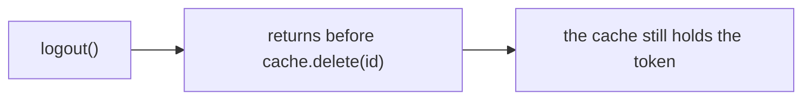

# Technical Design: The review on the pull request

Product part: [2026-11-01-review-on-the-pull-request.requirements.md](2026-11-01-review-on-the-pull-request.requirements.md).

## Summary

`--pr` is a scope flag. `namedScopeOf` names its scope without GitHub, as `{ mode: 'pull-request', request: { pullRequest, paths } }`. An active run resumes whatever the command names, as today, so a run of a pull request resumes offline, and `namesScope` matches the named pull request with the one that a run recorded only to reopen a fix run that the budget stopped. For a new run, the controller resolves the pull request before it creates the run, through a new directory, `src/github/`, which runs `gh api` as a child process: the pull request, the head of its base branch, the merge base that GitHub's comparison gives, and the list of its files. It checks the head, the tree, the merge base and the paths, and the capture records the change as a range from the merge base to `HEAD` with `scope.captured@3`, which adds the pull request to the request and its facts to the scope, with the body frozen. A run of any other scope still records `scope.captured@2`.

`deep-review publish` chooses a run as `report` does, takes the start lock and the run's lock, as `commit` does, and lets the start lock go once it holds the run's. It settles a publication that a stop left open, refuses what R8 lists, reads the pull request and its files again, and places each finding: on its line when the line is on the new side of a hunk of GitHub's patch for its file, else in the body. A new module, `src/review/pull-request-form.ts`, renders the body and the comments from the brief value and the findings, and `src/review/public-text.ts` cleans each text of the workers and of the writer that they hold. The engine records `publish.prepared@1` with the payload frozen, posts it with one call to the reviews endpoint, reads the comments of the review, and records `publish.posted@1`. A refusal of GitHub records `publish.dropped@1`.

A read-only run of a pull request ends its review with a new phase, `explanation`, which comes right after `decision`, so in a run that does not fix it is the last phase before `report`. It launches one worker of a new role, the writer, which answers with a conclusion, an account of the pull request, and an explanation of each finding that goes on a line or in full in the body. The engine checks what it can count in the answer (TD9) and records `explanation.recorded@1` with the answer frozen, and the form merges it with the facts of the ledger, falling back to them where a part failed.

`github.executable` and `github.args` are operator-only settings, and `review.language` gives the writer its language. A read-only run of a pull request records the three with its other settings before its first worker, in a second version of the record of the settings, so a resume and `publish` use the language that the run recorded. The golden fixture is `schema-1-18`, and the contract test of resumable runs gains two stop points of `publish`.

## Non-Goals

### The roles of the review keep their prompts

No worker reads the pull request, its title or its body, the writer included. The roles of the review keep their prompts. The writer is a role of its own, so the digest of the roles changes.

### No change to the phases of other runs

A run of a pull request runs the phases of a range, and one that only reviews adds `explanation` before `report` (TD8). A run of any other scope, and a run that fixes, runs its phases as today.

### No new mode of a scope

The mode that a run of a pull request records is `range` (TD2).

### No change to `briefJson`

Version 5 stays, and it does not name the pull request of a run. A later version can.

### No GraphQL

Every call is REST, through `gh api`. Resolving a thread, which only GraphQL can do, is later work, and so is a thread on a file in the one review (PD5 of the requirements).

### No fetch

No command of deep-review runs `git fetch` (TD7).

## Context

Verified at `89e5499e`. No uncommitted change was used.

### The scope and its request

`namedScopeOf` in `src/command.ts` names a scope from the flags without a look at the tree, and `scopeRequestOf` adds the checks of the tree, such as the clean tree of `--last-commit`. `--branch` is a range from `review.base` to `HEAD` with `mergeBase: true`, and `scopeModeFlagCount` refuses two modes.

`resolveScopeRequest` and `chooseMode` in `src/scope/capture.ts` refuse a range that does not end at `HEAD`, and take the merge base or `from` as its base. `listChanges` diffs the base against the working tree, untracked files included, in every mode but `last-commit`, with `--no-renames`, so a rename is a deleted path and an added path. `namesScope` matches the scope that a command names with the one a run recorded, without a look at the tree, so a run is found again after its fixes changed the tree.

The controller creates a run before it captures its scope (`src/review/controller.ts`), and a run with no scope resumes on the next command. A configuration is checked before the run exists, so that a refusal leaves no run behind.

`scope.captured@2` records the mode, the request with its patterns, the base, the head, the files, the patch and the paths left out, and the fold reads a version 1 capture as one that left nothing out. `askedMode`, `baseNameOf`, `endWords` and `scopeLine` in `src/scope/scope-line.ts` write the `Scope:` line.

### The brief and the report

`briefOf(state)` gives one value, `Brief` in `src/review/brief.ts`, which the report, the short form and the JSON form render: the title, the findings, their numbers, the status, the needs, the checks, the fixes, the gaps, the findings left as is, the change, the questions and the departures. `findingBlock` in `src/review/report.ts` writes a finding: its status, severity and verdict, its place, the reason, the evidence, the cited runs, the decision and the fix.

`escapedText` in `src/review/markdown.ts` escapes `<`, `*` and `__` in the words of a worker, so no worker text opens an HTML element. `withoutScratch` writes the scratch directories as `<scratch>`. Neither touches the path of the worktree, the home directory, a mention or an issue reference. A place is one line of the after state (`src/review/locations.ts`), `inScope` says that the file is changed and not that the line is in a hunk, and an unlocated candidate keeps the spelling of its worker, which can be a local path. "About this run" is the one part of the report that names local paths. The checkpoint is the directory `deep-review-checkpoint` under the git common directory (`src/checkpoint/locate.ts`), which for a linked worktree is outside the worktree, and the prompts of the workers name files of its evidence store, so a worker's words can hold its path.

### Phases, roles and the vocabulary

`phases` in `src/review/vocabulary.ts` lists the phases in the order that the fold holds a run to. The ledger freezes each set of phases as a vocabulary, today the twenty of `reviewVocabularyV9`, which a test holds equal to `phases`, and versions over it each event that names a phase: `phase.started`, `phase.finished`, `worktree.checked`, `attempt.failed`, `worker.lost`, and `report.written`, whose statistics hold a row for each phase. `phaseVersions` in `src/review/event-versions.ts` gives each phase added since then the first version of each kind that names it, as the documentation step and the checks on the base each added a row, so a run that never enters a new phase holds no event that an older engine cannot read. `review.configured@9` says by its version alone what the workers of its run do. `reviewRoles` lists the roles, each assembled from the fragments under `roles/fragments/` by `roles/manifest.json`. A verifier's answer that fails a structural check runs again once, and a second failure leaves its group unverified.

### The commands after a run

`commitRun` in `src/review/commit.ts` chooses its run under the checkpoint's start lock and folds it again under the run's lock. It settles a series that a stop left open by where the branch is, records `commits.prepared@1` before it moves the branch and `commits.created@1` after, or `commits.dropped@1`, and writes the copy of the report again before it releases the run's lock. `answer` takes the same locks. The contract test of resumable runs (`test/helpers/resume-contract.ts`) stops `commit` before and after it moves the branch.

### Executables and settings

`resolveExecutable` and `refuseShim` in `src/review/executable.ts` look a name up on PATH once, and refuse a `.cmd` or `.bat` shim on every platform and anything but a `.exe` or `.com` on Windows. `runtimes.claude.executable`, `runtimes.codex.executable` and their arguments are operator-only settings in `src/config/settings.ts`: the repository's file cannot set them. A setting has an owner: `repository-first`, whose repository layer is over the operator's, as for the commands of the checks; `operator-first`; or `operator-only`. The settings resolve in two passes (`src/config/resolve.ts`): pass 1 resolves `scope.default` and `review.base` from every layer but the repository's, to choose the change, and pass 2 resolves every setting with the repository's file read at the base of that change. `config show` runs both passes through `scopeRequestOf` and `scopeEnds` in `src/command.ts`, not through the controller. A run records its settings, each with its layer, before its first worker, and a resume uses them (R6 of the configuration). The names that a record can hold are frozen in `recordedSettingsV1` in `src/checkpoint/events.ts`, which a test holds equal to the settings registry, so a setting that the engine adds is a new version of the record and of the events that hold it (TD4 of the configuration): `review.configured@6` and later, and the fix side of `fix.pinned@2`. This repository's `.deep-review/config.toml` leaves out `dist/**` and `test/fixtures/checkpoints/**`. Every worker is launched with a shell (`src/review/phases.ts`), and `workerEnvironment` in `src/runtime/environment.ts` gives it the engine's environment with a few variables pinned, so a token in the environment of the command reaches each worker.

### GitHub and `gh`

GitHub's REST documents state these facts. POST `/repos/{owner}/{repo}/pulls/{n}/reviews` takes `commit_id`, `body`, `event` and `comments`, each comment with `path`, `body`, `line` and `side`; `position` is closing down. A comment of a review takes no `subject_type`: a comment on a file, `subject_type: file`, is a post of its own to POST `/pulls/{n}/comments`. GitHub's GraphQL documents add that `addPullRequestReviewThread` adds a thread on a line or on a file to a pending review. The events are `APPROVE`, `REQUEST_CHANGES` and `COMMENT`, and no event makes a pending review. `COMMENT` requires a body. A submitted review cannot be deleted. `commit_id` defaults to the latest commit, and an older one can make a comment outdated. GET `/pulls/{n}/reviews` lists the reviews with their bodies, and GET `/pulls/{n}/reviews/{id}/comments` the comments of one. GET `/pulls/{n}/files` lists at most 3000 files, 100 a page, each with `filename`, `status`, `previous_filename` for a rename, and a `patch` that can be absent. GET `/compare/{base}...{head}` gives `merge_base_commit`. The secondary rate limits allow 80 requests that create content a minute and 500 an hour, and answer with 403 or 429 and `retry-after`.

The documents do not state the longest body or comment, how many comments a review takes, whether one comment outside the diff fails the review, whether an account has one pending review a pull request, what a token needs, or which commit `base.sha` names once the base branch has moved. People report a 422 for a body over 65,536 characters, a 422 "line must be part of the diff" that fails the whole review, a refusal of an approval or a request of changes on the account's own pull request, and one pending review per account and pull request.

`gh api` takes a method, `--input -` for a body on stdin, `--include` for the status line and the headers, `--hostname`, and `--paginate`, and fills `{owner}` and `{repo}` from the clone's repository or `GH_REPO`. It uses `GH_TOKEN` or `GITHUB_TOKEN`, or the account that `gh auth login` stored. `gh pr checkout` checks out the head of a pull request, also one from a fork.

## Design

### The flag and the named scope (R1, R4)

`--pr` is a string option of `review` and of `config show`. `scopeModeFlagCount` and `hasScopeFlags` count it, so it refuses another scope flag, and `--base` refuses it as it refuses every scope but `--branch`. `namedScopeOf` reads its value without GitHub: a whole number from 1, or the URL of a pull request, `https://<host>/<owner>/<repo>/pull/<number>`, with any path, query or fragment after the number left out. It gives `{ mode: 'pull-request', request: { pullRequest: { number, repository }, paths } }`, where `repository` is `<host>/<owner>/<repo>` for a URL and null for a number. `NamedScope['mode']` gains `pull-request`. `scope.default` takes no such value, since a default names no pull request.

An active run is resumed first, whatever scope the command names, and the log says that the named scope is ignored (`openRun` in `src/review/controller.ts`): `review --pr 42` resumes the stopped run of #42 without GitHub, and so does `review --pr 43`, with that line. `namesScope` serves only `reopenRun`, which reopens a fix run that the run budget stopped. It matches a named `pull-request` with a recorded scope whose `pullRequest`, the facts that GitHub gave at the capture, has the same number and, when the named one has a repository, the same host, owner and repository, compared without regard to case; it takes that `pullRequest` beside the mode and the request, since a run named by its number records no repository in its request. `chooseContinuation` continues a finished read-only run with `--fix` when the change named now is its change, and for `--pr` it resolves the pull request to compare them. The continued run is a fix run, so the skills and the README say to post a review that the person wants posted before the run is continued.

### Reading GitHub (R1, R2, R15, TD1)

`src/github/gh.ts` runs `gh api` with `spawnSync`, no shell, the executable and arguments of `github.executable` and `github.args`, a timeout of two minutes for each run of `gh`, one with `--paginate` included, and `--include`, with the body of a write as JSON on stdin. It reads the status line, the headers and the JSON body, and gives an answer or an error that says which of these it is: `gh` missing, a timeout, an answer with a status and GitHub's message, or an answer that it cannot read. A read that `gh` refuses for want of an account is refused with the action `gh auth login --hostname <host>`, or `GH_TOKEN`, or `GH_ENTERPRISE_TOKEN` on an Enterprise server. A run of a pull request launches its workers without `GH_TOKEN`, `GITHUB_TOKEN`, `GH_ENTERPRISE_TOKEN` and `GITHUB_ENTERPRISE_TOKEN`, which only the engine's own calls of `gh` need.

`src/github/pull-request.ts` reads, for a pull request:

| What | Call | What it keeps |
|---|---|---|
| The pull request | GET `repos/{owner}/{repo}/pulls/<n>` in the worktree for a number, or `repos/<owner>/<repo>/pulls/<n>` with `--hostname` for a URL | its URL, from which the host, the owner and the repository are read; `state` and `merged`; `head.sha`; `base.ref`; `changed_files`; the title and the body |
| The head of its base branch | GET `repos/<owner>/<repo>/git/ref/heads/<base.ref>`, each segment of the name percent-encoded | the commit |
| The merge base | GET `repos/<owner>/<repo>/compare/<base head>...<head>` | `merge_base_commit.sha` |
| Its files | GET `repos/<owner>/<repo>/pulls/<n>/files`, a page of 100 at a time | each path, its status, the previous path of a rename, and the patch |
| Its reviews | GET `repos/<owner>/<repo>/pulls/<n>/reviews`, every page | each id, URL and body |
| The comments of a review | GET `repos/<owner>/<repo>/pulls/<n>/reviews/<id>/comments`, every page | each id and body |

Every call after the first passes `--hostname`: with the host that the first call gave, in the capture, and with the host that the run recorded, in `publish`. The comparison takes two commits, so the name of the base branch reaches only the call that reads its head, encoded, since a name can hold a slash, a `#` or a `%`. A pull request whose `changed_files` is more than 3000 is refused before its files are listed, since GitHub lists no more.

### The capture of a pull request (R2, R3, TD3)

For a named `pull-request` with no run to resume, the controller resolves the pull request before it checks a configuration and creates the run, so a refusal leaves no run. It reads GitHub before it takes the checkpoint's start lock, which refuses every other command of the repository at once while it is held. Without the lock it looks for an active run, and with `--fix` for a fix run to reopen; with neither, it reads GitHub and takes the lock. Under the lock it resumes an active run or reopens a fix run that another engine left meanwhile, continues a finished read-only run whose change is the pull request that it read, or checks again that `HEAD` is the head that GitHub gave and creates the run. An active run that has no scope yet captures the scope of the command, as today, and for `--pr` that capture reads GitHub under the lock, the one case that does. The base at which pass 2 reads the repository's file is the merge base that GitHub gives, so pass 1 also resolves `github.executable` and `github.args`, which no repository layer can set, and the order is pass 1, then GitHub, then pass 2 at the merge base. `config show --pr` resolves the pull request with the same function, in the same order, so it shows the scope that `review --pr` would capture and refuses what it would refuse. In this order, it reads the pull request and refuses one that is closed or merged; refuses when `HEAD` is not its head, naming `gh pr checkout <n>`; refuses a tree that `git status` does not show clean, as `--last-commit` does; reads the merge base and refuses it when the clone does not hold the commit, naming a fetch of the history, such as `git fetch --unshallow`; and lists the files of the pull request. The request is then a range, `{ from: <merge base>, to: 'HEAD', mergeBase: false }`, with the pull request, the paths and the patterns, and `resolveScopeRequest` resolves it as it resolves a range. The changed paths of that range with no path and no pattern must be the paths that GitHub lists, by the status of each file: a path that is not `removed` is a path at the head; the previous path of a `renamed` file is also a deleted path, as `--no-renames` lists it, while that of a `copied` file is not, since a copy leaves it in place; and a file that is `unchanged` is no path of the change. A difference refuses, naming up to ten paths of each side. The capture freezes the body in the evidence store, with an empty body as none, and records `scope.captured@3`.

### The events and the fold (R3, R5, R13)

These events are new or get a new version:

| Event | Version | Written for |
|---|---|---|
| `scope.captured` | 3 | The capture of a pull request. Every other capture records version 2 |
| `review.configured` | 10 | A read-only run of a pull request, which plans `explanation` and records its settings with the second version of the record. Every other run records version 9 |
| `phase.started` | 8 | An event that names `explanation` |
| `phase.finished` | 9 | An event that names `explanation` |
| `worktree.checked` | 9 | An event that names `explanation` |
| `attempt.failed` | 9 | An event that names `explanation` |
| `worker.lost` | 7 | An event that names `explanation` |
| `report.written` | 8 | A report whose statistics hold a row for `explanation` |
| `explanation.recorded` | 1 | The writer's checked answer |
| `publish.prepared` | 1 | A publication, before its post |
| `publish.posted` | 1 | A publication that GitHub made |
| `publish.dropped` | 1 | A publication that GitHub refused, or that a settle did not find |

`scope.captured@3` has the shape of version 2, its request with `pullRequest: { number, repository: string | null }`, and `pullRequest: { host, owner, repository, number, url, baseRef, title, body: artifact reference | null }`. Its reducer refuses a version 3 whose request has no `pullRequest`, whose mode is not `range`, or whose range is not `{ from: base, to: 'HEAD', mergeBase: false }`. `ScopeState` gains `pullRequest`, null for versions 1 and 2.

`review.configured@10` records its settings with `recordedSettingsV2`, whose names are those of version 1 and `github.executable`, `github.args` and `review.language`; in all else it has the shape of version 9. The test of the registry then holds version 2. The fix side of `fix.pinned@2` keeps version 1, since the fix pass reads none of the three. `explanation.recorded@1` holds the frozen answer, each dropped part with its failures, and the ids of the findings marked unexplained. Its reducer refuses one in a run that was not configured with version 10, and a second one. `RunState` gains `explanation`, null until it is recorded.

`publish.prepared@1` holds the marker; the target, `{ host, owner, repository, number }`; the commit that the review is made on; the payload, a reference to the frozen JSON body of the post; the place of each finding, `{ finding, place: 'line' | 'body', reason }`, where the reason is `on-the-diff`, `left`, `outside-the-diff`, `no-patch` or `no-place`; and the count of the secrets replaced. `publish.posted@1` holds the marker, the review's id and URL, and `{ finding, comment }` for each comment. `publish.dropped@1` holds the marker and the reason: `refused`, with GitHub's status and message, or `not-found`.

The fold keeps `publications` on the run state, in order, each with its marker, target, commit and status, `prepared`, `posted` or `dropped`, and the review and comments of a posted one. A reducer refuses a posted or a dropped with no prepared of its marker, a prepared while another is open, a prepared in a run whose scope has no pull request, and a prepared after a posted one, so a run is posted at most once.

The marker is `deep-review publication <run id> <serial>`, the serial counting the prepared publications of the run from 1, and the body carries it as its last line, `<!-- deep-review publication <run id> <serial> -->`. Each comment carries `<!-- deep-review finding <run id> <finding id> -->` as its last line. The settle and the match of a comment read a marker only on the last line, since a worker's text can hold `<!--` inside a code span, where `escapedText` leaves it and GitHub shows it as text.

### Publish (R7, R8, R13, R14)

`publishRun` in `src/review/publish.ts` takes the checkpoint's start lock and chooses the run: the one `--run` names, else the one that `report` would show. It takes the run's lock and then lets the start lock go, since the start lock serves to find the run and take its lock, and it would otherwise refuse every other command of the repository for as long as the calls of GitHub take. Under the run's lock it folds the run again, as every writer does, and then:

1. Settles a publication that a stop left open (TD5): it reads the reviews of the pull request and looks for the marker. A review that carries it is recorded with `publish.posted@1`, with its comments read and matched to their findings by their markers. No such review records `publish.dropped@1` with `not-found`. A read of the settle that fails records nothing and ends with exit 1, as a timeout of the post does, so the next `publish` settles again. With `--dry-run` it records neither: it prints what the next `publish` would record, and then the URL of the review that carries the marker and ends, or goes on as if the publication were dropped.
2. Prints the URL of a posted publication and ends with exit 0.
3. Refuses, with exit 2 and the action, a run with no current report, a run configured with `fix` or continued into the fix pass, a run whose scope has no pull request, and a run whose request names paths, before it reads GitHub. It then reads the pull request and refuses one that is not open, a head that is not the run's head, and a merge base that is not the run's base.
4. Lists the files of the pull request, places each finding (below), and renders, cleans and fits the body and the comments.
5. With `--dry-run`, prints the body, each comment with its path and line, and the place of each finding, and ends with exit 0, having posted and recorded nothing.
6. Records `publish.prepared@1`, with the payload frozen in the evidence store.
7. Posts `{ commit_id: <run head>, body, event: 'COMMENT', comments }` to `repos/<owner>/<repo>/pulls/<n>/reviews`, each comment with `path`, `line`, `side: 'RIGHT'` and its body.
8. On a 2xx answer, reads the comments of the review, matches each to its finding by its marker, records `publish.posted@1`, and prints the URL of the review as the last line. On an answer of 4xx, records `publish.dropped@1` with `refused`, GitHub's status and message, and refuses with exit 2 and the action of the status: the message for a 422; the wait of `retry-after` for a 403 or 429 that carries it; `gh auth` for a 401 or 404; and, for a 403 without `retry-after`, that the account or the token cannot write to the pull request, as the token of a workflow on a pull request from a fork cannot. On a timeout, a 5xx, or an answer that it cannot read, it leaves the publication open and ends with exit 1, saying that `publish` again looks for the review before it posts.
9. Writes the copy of the report again before it releases the run's lock, as `commit` does, so "About this run" names the review.

### The place of a finding (R10, TD4)

A finding in rank order goes on its line when it is decided `fix`, with or without a departure, or `ask`; its place is located; its file is among the files of the pull request with a patch; and its line is on the new side of a hunk of that patch. A hunk header `@@ -a,b +c,d @@` gives the new lines from `c` to `c + d - 1`, and a line of the hunk that starts with `-` has no new line, so a context line takes a comment as an added line does, and its comment says that the pull request does not change the line. So does each finding in the body that is outside the diff or in a file that the pull request does not change. The place says only whether the line changed, not whether the change made the defect. Every other finding goes in the body, with the reason of its place.

### The explanation (R18, R19, TD8, TD9)

A read-only run whose scope has a pull request is configured with `review.configured@10`, whose version alone says that the run plans `explanation` right after `decision`. Every other run records version 9 and plans as today. `reviewVocabularyV11` freezes the twenty-one phases, and `phaseVersions` gains the row of `explanation`: `phase.started@8`, `phase.finished@9`, `worktree.checked@9`, `attempt.failed@9`, `worker.lost@7` and `report.written@8` are the first versions that name it, and an event that names only the older phases keeps its version. The reducer of `review.configured@10` refuses one that sets `fix`. The role `writer` joins `reviewRoles`; a role is free text where the ledger pins it, so no event changes for it.

The phase launches one worker of the role `writer`. `roles/policy.json` gives it the strong tier, effort `high`, a budget of 8 USD and a timeout of 30 minutes, as the decider has. The policy must name exactly the roles of the review (`resolvePolicy` in `src/review/policy.ts`), so a directory of roles that `--roles` names, whose policy does not name `writer`, is refused for every run until it does. Its prompt holds the brief value; the ranked findings with their decisions, evidence and cited runs, cleaned as R11 cleans the posted text; which of them go on a line or in full in the body; the scope's patch; and the language that the run recorded (R20). It holds no title and no body of the pull request. The worker reads the tree at the head and edits nothing. It gets no shell where the runtime allows it, since it cites lines and runs no code: on Claude Code it gets the tools that read files and not `Bash`; Codex has no allowlist of tools and gives every worker a shell, so there the writer gets the read-only sandbox of a verifier, which still runs commands. Its answer has three parts:

- `conclusion`: a why of two or three sentences, a sentence for each action by the id of its finding, and a diagram or none.
- `account`: the terms as pairs of a term and its meaning, the problem before the change and the change, each with a diagram or none.
- `findings`: for each finding that goes on a line or in full in the body, its id with a title, the problem, the cases, each a sentence with its cited lines `{ side, path, from, to }`, where `side` is `head`, or `base` for lines that the change removed, a diagram or none, and the words on its decision; or its id, `unexplained` and the reason.

The engine checks the answer: each id is a finding of the run that goes on a line or in full in the body, and the conclusion has a sentence for each such finding and no other; each cited path is in the tree of the commit of its side, the head or the merge base, read with git, so a resume in a worktree that moved checks the same lines, and each range within its lines; no part holds `CONFIRMED`, `PLAUSIBLE` or `REFUTED` as a word in upper case, and the severities, which are ordinary words, are left to the gate; and each diagram starts with `flowchart`, `sequenceDiagram` or `stateDiagram-v2`, quotes the label of each node of a flowchart, and holds no HTML entity and no semicolon in a label, in a message or in a note, the text after a colon in the two other kinds. The form puts each diagram in a fence longer than any run of backticks in it, as `fenceFor` in `src/review/prompts.ts` does for the commit messages in a prompt, so no diagram ends its fence. A failed check runs the worker again once, with the failures, as the unit's second attempt, as a verifier's does; the second answer replaces only the parts that failed, and a part that passed the first time is kept. After a second failure, each part that still fails is dropped: the conclusion, the account, or the explanation of one finding. `degradationOf` in `src/review/steps.ts` gives the phase its rule, since a phase without one blocks the run: a writer that fails twice degrades, and the engine records `explanation.recorded@1` with each part dropped that no answer passed. The phase also degrades at the run's budget instead of blocking, as the fixes do (`isBudgetDegradingPhase` in `src/review/vocabulary.ts`), so the run writes its report and the form takes the ledger's words for each dropped part. A writer lost with its engine blocks with `worker-failed`, as every unit does (`exhaustedOutcome`), and the next command gives it fresh attempts. The engine records `explanation.recorded@1` with the answer frozen in the evidence store, each dropped part with its failures, and the findings marked unexplained.

The form merges the explanation with the facts. A dropped part, an unexplained finding and a run recorded before this change take the form of the ledger alone, and the body names each dropped part. When the ledger records an answer after `explanation.recorded@1`, the body names the findings that the explanation predates.

### The form of the pull request (R9, R10, R12, TD6)

`src/review/pull-request-form.ts` renders the body and the comments from `briefOf(state)`, the ranked findings with their decisions, the places, and the explanation (R18). It writes its own sentences from the table of the recorded language (R20): the headings, the status line, the lines of a finding's block, who answers a question and where, and each note; it reuses none of the report's sentences, which are built in English. Each gap of the brief is a `BriefGap` whose words are English text, so the form gives it as it is, in a review of any language. The body follows the order of R9 under headings of its own. It opens with a heading that names the review as deep-review's, with the run and the head; the engine's line of what the pull request needs, such as `Before the merge: 2 fixes and 1 question`; and the writer's conclusion, whose actions the engine lists in the rank of their findings, each with its number, severity and verdict; then "What this pull request does", with the title and the core of the brief, and the writer's account folded under them; then the status line, "What to know before the merge" and the rest. A question and a departure are in full only in their comment, or in the body when they have no line, and the conclusion links each, so the body has no section of its own for what needs a person or for the fixes. A finding on its line links to the line in the files of the pull request, `<url>/files#diff-<SHA-256 of the path>R<line>`, and any other finding with a place gives `https://<host>/<owner>/<repo>/blob/<head>/<path>#L<a>-L<b>` on a line of its own, where `a` is two lines before its line and `b` two lines after, within the file, so that GitHub shows the lines as code. GitHub's documents say that a permalink shows as code in a comment of its own repository, and the author has seen it shown in reviews, which the author keeps outside the repository. The body names a run by the first 8 characters of its id, as the answer command takes it. A case links its cited lines at the commit of its side, `blob/<head>/`, or `blob/<merge base>/` for removed lines, a commit of the base branch. The refuted candidates come from `refuted(review)`, each with its summary, its place and the evidence that refuted it, under a folded "Refuted at verification". The evidence under a finding with the mark is headed as evidence that no verifier checked. The legend takes its words from the table of the language (R20): each verdict, severity and status in the words of the role prompt that defines it, the mark of a finding that no verifier examined, and the line that a model wrote the explanations from the evidence beneath them, which alone the verifier checked, except where the mark says otherwise, with a link to the README of deep-review's repository.

A comment reads, for example:

````markdown
**3. Logout returns before it clears the cached token.**

deep-review would fix this. Major, CONFIRMED.

A user who logs out can still call the API with the old token until its cache entry expires.

- A request with the old token right after logout is accepted: [src/auth/session.ts:41-47](https://github.com/<owner>/<repo>/blob/<head>/src/auth/session.ts#L41-L47)



deep-review decided to clear the entry in `logout()`, and rejected a lifetime on the cache. Clearing it where the session ends closes the gap for every caller.

<details><summary>Evidence that the verifier checked</summary>

- Summary: the cache keeps a revoked token after logout.
- Reason: the logout path never reaches the cache.
- Evidence: `logout()` returns before `cache.delete(id)`.
- How the verifier established it: it ran code. The run `node <scratch>/probe.mjs` printed "token still valid".

</details>

<!-- deep-review finding <run id> RIPPLE-3 -->
````

A question says the option that deep-review would apply, lists each option with its cost and rule, and ends with who answers and how: the person who ran the review, on the machine that holds the run, with `deep-review answer --run <id> --finding <n> --option <k>`; a reply on the pull request is not read yet. A departure ends the same way, with `deep-review answer --run <id> --finding <n> --accept` or `--reject`.

A body or a comment stays under 60,000 characters, a margin under the 65,536 that people report. Four reports of real runs of this repository, all of them fix runs, are 49 to 167 KB, of which their findings take 26 to 113 KB and their refuted candidates 11 to 21 KB; the author keeps them outside the repository. A read-only run has no fixes to report, but the body of a large one holds its refuted candidates and its findings left as is, so it can exceed the limit. A body over the limit is cut in this order, and the evidence of a finding that goes on a line or in full in the body is never cut: the diagrams of the account of the pull request, then the account down to the core of the brief, then the refuted candidates down to their summaries and places, then the findings left as is down to their rows in the table. The text names each cut and says that the report of the run holds all of it. A body that still does not fit, and a comment over the limit, are refused before `publish.prepared@1`, with the size and the parts of the text. The paths that the run left out are named by the patterns of `scope.exclude` that left them out, each with its count and the layer of the settings that set it, as the run recorded them.

### The cleaning (R11)

`src/review/public-text.ts` cleans each text that the engine did not write, the words of the workers and of the writer, before the form puts it beside the engine's own, so no value of the environment can change a marker or a link of the engine, in this order:

1. Secrets. A token of a known form becomes `[redacted <kind>]`: a GitHub token (`ghp_`, `gho_`, `ghu_`, `ghs_`, `ghr_` or `github_pat_`), an Anthropic key (`sk-ant-`), an OpenAI key (`sk-`), an AWS access key id, a Slack token (`xox` and a letter) and a private key block. So does the value of each variable of the command's environment whose name holds `TOKEN`, `SECRET`, `PASSWORD`, `PASSWD`, `API_KEY`, `PRIVATE_KEY` or `CREDENTIAL`, when the value is 8 characters or longer. The count goes on `publish.prepared@1`, and no value does.
2. Paths. First, the longest first, the checkpoint root becomes `<checkpoint>`, the git common directory `<git>`, the directory of the engine `<engine>`, and each spelling of a scratch directory that `scratchSpellings` gives `<scratch>`; then the worktree that the run recorded, with a separator after it, gives way to the path from the root. The checkpoint goes first because in a worktree that is not linked it sits in the worktree's `.git`, which no path of the repository names. Each is matched in both slash spellings. Then any path that is left and starts at a directory that the root of the machine holds, at a drive letter, at a UNC share or at `~` becomes `<local path>`; a path such as the route `/pulls/42`, whose first part the root does not hold, stays as it is. The spelling of an unlocated finding is not posted, and the place of such a finding reads that it has none in the repository.
3. Escaping and mentions. `escapedText` escapes the words of a worker as it does for the report. In the writer's prose it also escapes `[`, and writes each URL as code, so the writer's text holds no link and no image; the links of the review are the ones that the engine builds. Outside code spans and fences, an `@name` after the start or after a character that is not a letter, a digit, a period or a slash, a `#<n>`, a `GH-<n>`, an `<owner>/<repo>#<n>` and the URL of an issue, a pull request or a discussion, `https://<host>/<owner>/<repo>/issues/<n>` and its kin, are each written as code.

### The settings (R15, R20)

`github.executable`, by default `gh`, and `github.args`, by default none, are operator-only settings, declared as the executable and the arguments of a runtime are. The repository's file cannot set them, and the operator's or the clone's file, or `--set` on the command, can. Pass 1 resolves them, since a run of a pull request needs `gh` to learn the base at which pass 2 reads the repository's file. `review --pr`, `config show --pr` and `publish` resolve the executable once a command with `resolveExecutable`, so a shim that a spawn without a shell cannot start is refused by name.

`review.language`, by default `en`, takes a language tag. `en` and `ko` have a table of the engine's words in `src/review/pull-request-words.ts`, and another tag gets the writer's words in that language with the engine's words in English. It is declared `repository-first`, as the commands of the checks are. A read-only run of a pull request records it at its configuration, so a resume writes in it, and `publish` takes the engine's words from the table of the recorded language, whatever the files say by then.

### The status and the report (R6)

`askedMode` gives `pull-request` for a request with a `pullRequest`, and `baseNameOf` names the merge base with the base branch of the pull request, so the line reads, for example, `Scope: pull-request #42 of owner/repo, 3 commits and 12 files (2 more paths left out by scope.exclude), from the merge base with main (3f2a9c1e) to the working tree, which has no uncommitted change`. "About this run" gains `Pull request: <url>` and, once the run is posted, `Review: <url>`, and `status` names the review in a line of its own.

### The fakes

`test/helpers/fake-gh.ts` is a Node script that a test names with `github.executable` and `github.args`, as the tests name a fake runtime. It reads a script of answers from a file that an environment variable names, appends each call, its arguments and its stdin, to a log, and answers each call with a status line, headers and a body as `gh api --include` does. A step of the script can end the process before or after it answers, for the contract test.

### A stop (R13)

`publish` has two stop points: after `publish.prepared@1` and before the post, and after the post and before `publish.posted@1`. The contract test stops at each, as it stops `commit` before and after it moves the branch. After the first, the next `publish` records the publication as not found and posts once. After the second, it finds the marker, records the review as posted, and prints its URL. The contract test also gains a read-only run of a pull request that stops inside `explanation`, before and after the writer answers, since the phase launches a child. Its part "nothing false" holds that the ledger never records a review that the fake does not hold, and that the fake never holds two reviews of one run.

### The golden fixture

A change of the event kinds needs a new fixture: `npm run golden -- --output test/fixtures/checkpoints/schema-1-18`. Its run is a read-only run of a pull request, configured with `review.configured@10`, with `scope.captured@3`, the phase `explanation` with each of the six kinds that name it at its new version, `explanation.recorded@1`, one publication prepared and dropped, and one prepared and posted. The older fixtures must still open and fold.

### Where the code goes

Running `gh api` and reading its answer go to `src/github/gh.ts`, and the reads of a pull request and the new lines of a patch to `src/github/pull-request.ts`. The flag and the command go to `src/command.ts`; the resolution of a pull request before the run is created, to `src/review/controller.ts`; the capture, `namesScope` and the check of the paths, to `src/scope/capture.ts`; and the words of the scope, to `src/scope/scope-line.ts`. The events go to `src/checkpoint/events.ts`, and their reducers to `src/checkpoint/fold.ts`. The command goes to `src/review/publish.ts`, the body and the comments to `src/review/pull-request-form.ts`, the cleaning to `src/review/public-text.ts`, and the settings to `src/config/settings.ts`. The phase, the writer's prompt and the checks of its answer go to `src/review/explanation.ts`; the role, to new fragments under `roles/fragments/`, to `roles/manifest.json` and to `roles/policy.json`; the phase and the role, to `src/review/vocabulary.ts`; the new vocabulary, to `src/checkpoint/events.ts`; and the row of the phase, to `src/review/event-versions.ts`. The tables of the engine's words go to `src/review/pull-request-words.ts`.

### The skills and the README

Both skills gain one step: for a review of a pull request, they run `review --pr <n>`; when the person asks to post the review, they run `publish` and show its last line, the URL, without summarizing the review. The `allowed-tools` of the Claude Code skill already covers every command of the engine. The README gains "Reviewing a pull request" and "Posting the review": `gh` and its account, what is posted and what is not, that each comment holds the merge where the repository requires each conversation to be resolved, the cleaning and what it does not find, what the writer writes and what its mark means, that a directory of roles given with `--roles` needs a `writer` in its policy, and what a workflow needs: a checkout of the head of the pull request with its history, such as `ref: ${{ github.event.pull_request.head.sha }}` and `fetch-depth: 0`, and a `GH_TOKEN` with `pull-requests: write`, which a pull request from a fork does not get. It says that the engine keeps the token from the workers' environment but not from a process of the same user, so a workflow reviews with that token only code that it would run with it, and that a workflow on `pull_request_target` must not check out the head of a pull request from a fork. It also says that the run of a review that a workflow posts ends with its job, so its questions name an answer that no one can give until a later change keeps the checkpoint.

## Technical Decisions

### TD1: GitHub through `gh api`, and no token on the ledger

`gh` holds the account, the host of a GitHub Enterprise server, the proxy and the token of a workflow, so the engine starts a process and reads its answer, and no token enters its ledger or its logs. The engine reads the values of its environment only to find a secret in the text that it posts (R11), and gives no worker of a run of a pull request the variables that hold a token. The tests replace `gh` with a script, as they replace a runtime.

The design rejects two other ways. `fetch` with a token from the environment makes the engine choose where a token comes from, find the address of an Enterprise server, and handle proxies and certificates; it asks a person who only ran `gh auth login` to export a token; and the engine would send the token itself on each call. An engine that only renders the review, with a person or a skill that posts it, loses the record before the post, the guard against a second post, the comment of each finding, and the check of the head at the moment of the post; and a skill that posts needs a grant for `gh`, which reaches every call that its account can make.

### TD2: A run of a pull request is a range, with the pull request beside it

The change is a range from the merge base to `HEAD`, so the capture records the mode `range` and a request with that range, and readers of the mode, the change shape and the range work as they do. The request also says that a pull request named it, and the scope holds its facts. Only a capture of a pull request records version 3, so a run of any other scope stays readable by an older engine.

The design rejects two other ways. A mode `pull-request` changes every reader of the mode, among them the change shape and the scope's words, for a change that is a range. A separate event beside `scope.captured@2` leaves a request that no longer says how the person named the change, and `namesScope` would read two events.

### TD3: The merge base from GitHub, and the paths checked against GitHub's list

The merge base is GitHub's, from a comparison of the head of the base branch now with the head of the pull request, because the review must be of the change that the pull request shows. The list of paths checks the whole range against what GitHub shows, so a merge base or a diff that differs from GitHub's is refused before the run spends anything.

The design rejects two other ways. `git merge-base` with the base branch needs a fresh ref of that branch, which the engine does not fetch (TD7), and a stale ref is the very case that this proposal fixes. `base.sha` of the pull request is a commit whose meaning the documents do not state once the base branch has moved, and a merge base from an older head of the base branch is not GitHub's when the pull request merged a newer one.

### TD4: The place of a finding comes from GitHub's patch

GitHub decides which lines take a comment, so its patch of each file is the authority, and a file with no patch, such as a large one, has its findings in the body.

The design rejects the frozen patch of the scope: its hunks can differ from GitHub's, and it cannot say that GitHub shows no diff for a file.

### TD5: A publication is settled by its marker

The body carries the marker, and a submitted review cannot be deleted, so a review that carries it is the publication, as the commit series of `commit` is settled by where the branch is.

The design rejects two other ways. A record made only after the post leaves a review that the ledger does not know after a stop between the two, and the next `publish` posts it again. A search by the text of the body can find the review of another run of the same change. A match of a comment by its line fails when GitHub lists the line empty, which the author has seen.

### TD6: The form of the pull request is a form of the brief value

The body and the comments are rendered from `briefOf(state)` and the findings, as the report and the JSON form are, so a change of the brief reaches each form through one value.

The design rejects a rewrite of the Markdown of the report: its text speaks to the operator's terminal and names local paths, and a rewrite by patterns breaks when the report's words change.

### TD7: The engine does not fetch

No command of deep-review moves a ref or talks to a remote through git. A refusal names the fetch, and the person or the workflow runs it.

### TD8: The writer is a phase of a read-only run of a pull request

The phase runs while the tree is the reviewed head and while the run holds its budget and its lock, so the writer reads the reviewed code and resumes as every phase does, and `publish` stays a renderer that launches no worker: the dry run shows what is posted and records nothing.

The design rejects a step of `publish` that launches the writer: `publish` would need the runtime, the budget and a worktree at the head, and its settle would cover a worker as well as a post.

### TD9: The engine checks what it can count

The checks are those that need no model: ids, paths and line ranges at the head or the merge base, the verdicts, which are words in upper case that prose does not use, and the rules that keep a diagram one that GitHub draws. The author has seen GitHub decode an HTML entity before Mermaid reads a diagram, which ends a quoted label, and keeps that outside the repository. Whether a case follows from its lines is left to the gate (PD11).

The design rejects rendering each diagram with a headless browser: each operator would download a browser for a check that GitHub makes when it draws, and the drawing that the gate reads is GitHub's.

## Open Questions

### Does GitHub refuse the whole review for one comment outside the diff?

The design checks each line against the patch before it posts, so it should not happen. A refusal records GitHub's message on `publish.dropped@1`, and the gate reads each one.

### How long can a body or a comment be?

The design keeps under 60,000 characters. The gate records the length of each posted text.

### Does a pending review of the account block a review with an event?

The gate tries a post while the account holds a pending review on the pull request.

### Do the links into the files of a pull request still lead to the line?

The anchor `#diff-<SHA-256 of the path>R<line>` is not documented. The gate follows the links of each posted body.

### How does `gh` choose the repository of a bare number in a clone with several remotes, with no prompt?

The gate runs `review --pr <n>` in a clone with `origin` and `upstream`. When `gh` cannot choose, the refusal asks for the URL.

### Does a review that GitHub has just made show at once in the list?

The gate stops `publish` after the post and runs it again.

### Does the list of paths of a real pull request ever differ from the capture's?

The check refuses such a run. The gate records each refusal, and reads it against the history of the pull request.

### Does GitHub draw each diagram that passes the rules?

The rules come from diagrams that GitHub drew and failed to draw. The gate reads each diagram of each posted review as GitHub draws it.

### Does GitHub show the code of a permalink in a review?

GitHub's documents say that a permalink shows as code only in a comment of the repository it belongs to, and do not name the body of a review or a comment on a line. The gate reads each posted body. Its run on a pull request from a fork posts in the base repository, while the head belongs to the fork, so the gate sees a permalink of a head of the same repository and one of a fork.

## Test Strategy

### R1 and R4: The flag and the named scope

Tests of `namedScopeOf` hold a number, a URL with and without a path after the number, a URL of an Enterprise host, a value that is neither, and the refusals of `--pr` with another scope flag and with `--base`; and that `--pr` goes with `--path` and `--fix`. Tests through `openRun` hold that `review --pr` resumes the active run with no call of `gh`. Tests of `namesScope` hold that a number and a URL reopen the fix run of their pull request that the budget stopped, a run named by its number included, and that another number and the URL of another repository do not. A test holds that `publish` refuses a read-only run of a pull request that `--fix` continued.

### R2 and R3: The capture

With the fake `gh`, tests refuse a closed and a merged pull request, a `HEAD` that is not the head, an uncommitted change, an untracked file, a merge base that a shallow clone does not hold, and a list with an extra path, with a missing path, with a rename and with a copy; a base branch whose name holds a slash and a `#`; a pull request of more than 3000 files, refused from `changed_files`; and hold that no run exists after each refusal. Tests hold that the capture reads GitHub before it takes the start lock, and refuses a `HEAD` that moved between the read and the lock. A test holds that a path that `scope.exclude` leaves out is no difference. A test holds the recorded `scope.captured@3`, with the body frozen and an empty body recorded as none, and tests of the fold refuse each version 3 that its reducer refuses.

### R5: Older runs and older engines

The fixture `schema-1-18` holds a read-only run of a pull request with its explanation and two publications, and every older fixture still opens and folds. A test holds that a run of `--branch` still records `scope.captured@2` and `review.configured@9`.

### R6: The status and the report

Tests hold the `Scope:` line of a run of a pull request, the lines of "About this run" before and after a post, and the line of `status`.

### R7, R8, R13 and R14: The command

With the fake `gh`, tests hold each refusal of R8 and that it posted nothing; that `publish` holds the start lock only until it holds the run's lock; that a posted run prints its URL and posts nothing; that a dry run makes no write call and records nothing, also while a publication is open; that a 422 records `refused` with GitHub's message; that a 403 with `retry-after` names the wait; that a timeout and a 5xx leave the publication open with exit 1; that the settle records a review that carries the marker as posted, and none as not found; and that each comment is matched to its finding by its marker.

### R9, R10, R11 and R12: The form and the cleaning

Tests of the form hold the order of the body, the conclusion first, the account folded under the core, a question and a departure in full once, in their comment or in the body when they have no line, with who answers, and each place: a line of a hunk, a context line with the words that the pull request does not change it, a line that only the old side holds, a file with no patch, a file outside the list, a finding with no place and one left as is, and the refuted candidates with their evidence; the heading over each evidence and the legend's line on the explanations; and the link of a finding outside the diff, with two lines on each side within its file. Tests of the cleaning hold the worktree, a scratch directory, the checkpoint of a linked worktree and of one that is not, the common directory and the engine in both slash spellings, a path under the home directory, one under `/tmp`, one from `~`, a drive letter and a UNC share, and a route whose first part the root does not hold, which stays; a mention, an issue reference and a cross-repository reference outside code and inside it; the URL of an issue, of a pull request and of a discussion; each form of a secret, the value of an environment variable, and the count; and that no worker text puts a marker on the last line of a body or a comment. Tests of the fit hold each cut in its order with its note; that no evidence of a finding that goes on a line or in full in the body is cut; that a body that still does not fit is refused before anything is recorded; and the patterns of the paths left out, with their counts.

### R15: The settings

Tests hold that the repository's file cannot set `github.executable` or `github.args`, that a shim is refused, that a missing `gh` is refused with its action, that pass 1 resolves `github.executable` before the repository's file is read, that `config show --pr` shows the merge base that the fake `gh` gives, and that the workers of a run of a pull request get none of the four variables that hold a token while the engine's calls of `gh` keep them.

### R16: The skills and the README

`npm run verify` and the tests of the skills hold the built skills.

### R17: The gate

The gate records each metric of the requirements and reads each finding in the body, each refusal and each open question above against the posted review. It reads each explanation against the evidence beneath it, and each diagram as GitHub draws it.

### R18 and R19: The explanation

With a fake runtime, tests hold that a read-only run of a pull request records `review.configured@10` and plans `explanation` right after `decision`, and that a run of `--branch` and a fix run of a pull request do neither; that each of the six kinds that name `explanation` is written at its new version, and refused at the version before it; that the writer's prompt holds no title and no body of the pull request; that the writer runs without a shell on Claude Code; that a link, an image and a bare URL in its prose are posted as text; each check of R19: an id of no finding, a path or a line range that its side does not hold, a case on removed code that cites the merge base, a verdict in a part, a severity word that passes, a diagram of another kind, an unquoted label of a node of a flowchart, an entity and a semicolon in a label and in a message, and a diagram that holds three backticks, which stays inside its fence; that a failure runs again once and a second drops the part and names it, while a part that passed the first time is kept; that a writer that fails twice, or meets the run's budget, records as dropped each part that no answer passed and the run writes its report; that a writer lost with its engine is resumed; that an unexplained finding keeps the engine's words and its mark; that the engine writes the line of what the pull request needs and lists the actions in rank order, whatever order the writer gives; that a stop during the phase resumes it; that the form falls back for a run recorded before this change; and that an answer recorded after the explanation names its finding in the body.

### R20: The language

Tests hold that the repository's file sets `review.language` over the operator's and the command sets it over both; that a run records the language before its first worker, and that a resume and `publish` keep it after the operator's file changes; that each table of words has every key, and a legend entry for each verdict, severity and status of the vocabulary; that a language with no table keeps the engine's words in English; that a Korean review takes every sentence of the form from the Korean table and gives each gap in English; and that the verdicts, severities and commands of a review are the same in each language.

## Verification

### Implementation

The work is in pull request #96, after the proposal. It came in units, each a commit that passes `npm run check` alone: the ledger (`scope.captured@3`, `review.configured@10` with `recordedSettingsV2`, the six kinds that name `explanation` at their new versions, `explanation.recorded@1`, the three events of a publication, `reviewVocabularyV11`, the three settings, and the golden fixture `schema-1-18`), which no engine wrote yet; `src/github/`, which runs `gh api` and reads a pull request, with the fake `gh` of the tests; the cleaning of `src/review/public-text.ts`; the capture of a pull request by `review --pr` and `config show --pr`; the role `writer` and the phase `explanation`; the switch that configures a read-only run of a pull request at version 10 and launches the writer, with its stops in the contract test; the tables of the engine's words in English and Korean and the form of `src/review/pull-request-form.ts`; `publish`, with its two stops in the contract test; the README and the skills; and the engine built into `dist/`.

An independent review of the series, by a worker that did not write it, found that the form joined or split a text after the cleaning had left a fenced block in it as code, so a mention, an issue reference or an `<!--` inside the fence went live; and that a mention or a reference spelled as an HTML entity passed the cleaning. Each was reproduced by a test on the rendered body and comment and fixed in a commit of its own, with the lesser findings of the same review: the gaps of the brief posted without cleaning, a home directory whose name holds a space, the words of a refusal after a settle, the text on a flowchart's arrow and a Mermaid directive, a cited path that holds a NUL, the clean tree checked again under the start lock, and a replay of a verifier of a run of a pull request that kept the token variables.

At the head of the work, before the gate, `npm run check` passed (3338 tests: 3325 passed, 0 failed, 13 skipped, against 3105 passed before the work), `npm run verify` passed, and `npm run test:contract` passed 104 of 104, against 89 before the work: a read-only run of a pull request stops inside `explanation`, before and after the writer answers, and `publish` stops after `publish.prepared@1` and after its post, and the part "nothing false" holds that the ledger never records a review that the fake `gh` does not hold and that the fake never holds two reviews of one run. With the settle made to answer "not found" every time, the stop after the post broke "nothing false" with two reviews of one run, so the contract test sees the case that the settle prevents.

`config show --runtime claude --pr 96`, with the engine built at the head and `gh` 2.102.1, read this pull request on GitHub at its pushed head: its scope line read `pull-request #96 of josephjang/deep-review, 16 commits and 89 files (115 more paths left out by scope.exclude), from the merge base with main (89e5499e)`, the paths of the range matched the list that GitHub gives, and the repository's file was read at the merge base. Before the push, the same command refused, since `HEAD` was not the head that GitHub gave, and named `gh pr checkout 96`.

### Changes of the proposal during the work

- Every refusal of a pull request exits 2, the tree with an uncommitted change included, which `--last-commit` refuses with the usage and exit 1. A `gh` that times out or answers what the engine cannot read is an error, exit 1.
- A range on the command no longer names a run of a pull request, so `--from <base> --to HEAD` does not reopen its fix run; the command that continues such a run names `--pr <url>`.
- The token variables are kept from the checks and the checks on the base of a run of a pull request too, since they run the code of the change, and from a replay of its verifiers.
- `explanation.recorded@1` also holds the worker that answered, null when the phase dropped every part without an answer, and its answer is null when no part passed. The fold also refuses it while its phase is not running, and one that names a finding the run did not rank.
- The fold refuses a `scope.captured@3` whose request names another number or repository than its facts, a `review.configured@10` whose scope has no pull request, a `publish.prepared@1` whose marker, target, commit or findings are not the run's, and a `publish.posted@1` with a comment for a finding placed in the body.
- The writer's answer gives each finding as `{ id, explanation, unexplained }` with one of the two null, and its schema is in `src/review/schemas.ts` beside the other roles'. The writer runs even when no finding asks a person to act, for its conclusion and its account. A writer that fails twice with no answer, or meets the run's budget, is settled by a step of its own, `drop-explanation`.
- The form writes the status line from the counts of the brief, with the words of the table, since the brief's own text is English. A question gives the option that deep-review would apply and the default that stands until someone answers. The note of a cut says that the report holds the text only where it does: the report holds the refuted candidates and the findings left as is, not the writer's account.
- The run records one count of the paths left out and one layer for all the patterns of `scope.exclude`, so the body names the patterns with that count and layer, not a count for each.
- `publish` runs `gh` as the operator's and the clone's file name it when it starts, as every command that calls `gh` resolves `github.executable` and `github.args` again, so a `gh` that moved since the review does not leave the review unposted; the run's record of them is informational. A missing `gh` or one with no account refuses with exit 2 at any read.
- The cleaning also writes the operator's home directory, with the rest of its path, as `<local path>`, so a name with a space in it is not posted; and when the root of the machine cannot be read, it writes every path from the root as `<local path>`. It escapes the `&` of an entity outside code. Code is delimited after the cleaning, from the cleaned text, and nothing joins or splits a text after it.
- The checks of a diagram also read the text on a flowchart's arrow, and refuse a `%%{` directive; the writer's role says both.
- The tree must be clean again under the start lock, beside `HEAD`, since the reads of GitHub before it can take minutes.
- In the report too, a paragraph that starts with a code span shows as code, since the escape of a leading backtick now applies only to one that opens a fence.

### The gate (R17)

Not run yet. The three real runs of R17, a review of this pull request with `--pr` on Claude Code posted here, a review in Korean of a pull request from a fork with Codex on Windows, and the continuation of the first with `--pr --fix`, are the next step, and each records what R17 asks.
