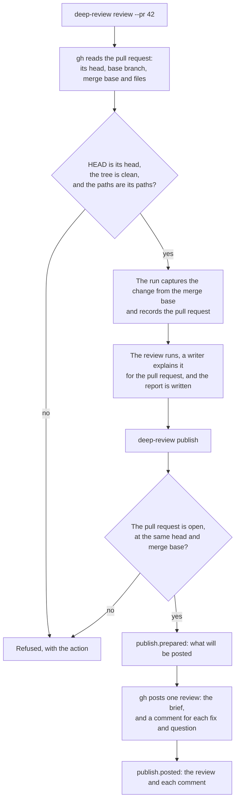

# Product Requirements: The review on the pull request

Technical part: [2026-11-01-review-on-the-pull-request.design.md](2026-11-01-review-on-the-pull-request.design.md).

## Summary

deep-review reviews a change on the machine where it runs, and its report stays there: a file beside the checkpoint, and the short form of the brief in the chat. A person who opens the pull request sees nothing of the run. The vision note says that the pull request is the surface on which a person answers (principle 7), and three proposals left it for later work: the [answers](2026-10-11-answers.requirements.md) leave out a pull request surface, the [questions in the chat](2026-10-24-questions-in-the-chat.md) write each question as text that a later change can post there, and the [brief of a run](2026-10-20-run-brief.design.md) draws the pull request as a form of the brief that a later change adds.

This proposal adds two things. `deep-review review --pr <number or URL>` reviews a pull request on GitHub: the change from the merge base that GitHub gives to the head of the pull request, which must be the HEAD of a clean tree. The run records the pull request: where it is, its base branch, and its title and body as they stood. Before its report, a worker of the run, the writer, explains the review for a reader of the pull request, in the language that `review.language` names: a conclusion, what the pull request does, and for each finding that asks a person to act, the problem in plain words, the cases in which it breaks and a diagram. The writer decides nothing: the numbers, verdicts, decisions and evidence stay as the ledger records them, each case cites the lines that show it, and a finding that the writer cannot explain from its evidence says so. `deep-review publish` posts a finished run that only reviewed a pull request as one review of that pull request. The body of the review opens with the engine's line of what the pull request needs and the writer's conclusion, and gives the brief with the writer's explanation, written for a reader of the pull request. Each finding that asks a person to act, a fix that deep-review would make or a question, gets a comment on its line, with its evidence folded under it. Every other finding is in the body. Nothing of the machine that ran the review leaves it: no local path, no mention that notifies an account, and no secret of a known form.

The engine talks to GitHub through the GitHub CLI, `gh`, and never asks for, keeps or sends a token. It records the review on the ledger before it posts it, and the comment of each finding after, so a stop does not post twice once GitHub lists the review, and a later change can read the replies to a comment as answers. The review is always a comment: it never approves and never requests changes. In this change the answers stay with the person who ran the review: the review says how to answer with `deep-review answer`.

Figure 1. A pull request, from the review to the posted review.

## Problem

### The report never reaches the pull request

A run writes its report to a file in the checkpoint and prints the short form of its brief. The pull request is where the people who decide a merge look, and a person who wants the review there copies it by hand. Nothing records what was copied, or where.

### The change a run reviews is not always the pull request's

`--branch` reviews the change from the merge base with the branch that `review.base` or `origin/HEAD` names to the working tree. GitHub shows a pull request as the change from the merge base with its base branch to its head. The two differ when the pull request targets another branch, as a pull request against a release branch or one stacked on another pull request does; when `origin` is a fork whose default branch is behind the upstream; and when the tree holds a change that no commit holds, since a range reviews the working tree. A review posted from such a run speaks of a change that is not the pull request's.

### The report is written for the operator's terminal

"What needs you" speaks to the person at the terminal, and an answer is a command for that terminal. "About this run" names the path of the repository on the machine, the evidence store and the engine. The words of the workers that the report quotes can hold the path of the worktree and of the person's home directory: the report writes only the scratch directories of the workers as `<scratch>`. The evidence of a statement is one step away in the evidence store, which a reader of the pull request cannot open.

### A reader of the pull request needs the review explained

The brief speaks in the engine's sentences, and a finding in its worker's summary, reason and evidence line, for a reader who knows deep-review and the code. A reader of the pull request, its author, a reviewer or someone who joins later, needs what the change does, the problem of each finding in plain words, the cases in which it breaks, and a picture where the flow takes long to say. Reviews that the author posted in that form, written from deep-review's reports outside this repository, are rated well by the people who read them; the author keeps them outside the repository.

### Text that leaves the machine

GitHub turns `@name` into a mention, which notifies the account, and `#12`, `owner/repo#12` or the URL of an issue into a link that leaves a trace in that issue. The words of a worker can hold any of them. A worker that ran code can quote what the code printed, and the change under review can carry instructions aimed at a model, such as one that asks it to print a file of the person's home directory. Such text in a local report stays on the machine. In a pull request of a public repository it is public.

## Goals

A person who opens a pull request that deep-review reviewed reads the brief of the run in the pull request: the core of the change, what needs a person, and what the review did not examine. The review is explained for a reader who knows neither the code nor deep-review, and each statement of the explanation rests on the evidence beneath it. Each fix and each question is on its line, with its evidence one step away under it. The run reviewed exactly the pull request's change, and the text names nothing of the machine that ran it. The ledger records what was posted, to which pull request, and the comment of each finding.

## Non-Goals

### No answers from the pull request

A reply to a comment is not read. The person who ran the review answers with `deep-review answer` as today, and the review says so (PD7). The ledger records the comment of each finding, so a later change can read the replies as answers, with the account that replied, as the answers proposal planned.

### No review of a fix run

`publish` refuses a fix run. The edits of a fix run would reach the pull request as suggestions or as commits pushed to its branch, and each is a choice of its own.

### No check run and no required check

The review is a comment. A check that a branch rule requires is a place that the vision note names for later.

### No second revision

A run reviews one head. When the pull request moves, `publish` refuses, and a new run reviews the new head in full. A review of only what changed since the last run, and the closing of the comments of an earlier review, are later work. A new run does not carry the answers of an earlier run, as today, so a pull request that moved gets its questions again, as new threads, from the review of its new head. A posted review is not posted again, so an answer recorded after the post does not reach the pull request. A posted review is not edited either. GitHub lets the account edit the body of its review and each comment, but not add a comment to a submitted review or change its event; the marker and the recorded comments leave that edit to a later change.

### No angle reads the request

The run freezes the title and the body of the pull request, and no worker reads them (PD8). The angle that reads a change against its request is later work.

### No other forge, and no identity of its own

The forge is GitHub, on github.com or on a GitHub Enterprise server that `gh` reaches. The review is posted as the account that `gh` uses. An application identity for deep-review is later work.

### No workflow for CI

The two commands can run in a workflow, and the README says what they need there. A workflow file that runs them, and where the checkpoint lives across jobs, are later work. Until then the run of a review that a workflow posts ends with its job, so no one can answer the questions that the review posts, though it says who answers them and how; the README says so.

### No change to the content of the other forms of the brief

The report, the short form and the JSON form keep what they say about the change and the findings. The report and the status name the pull request of a run and its review (R6). The writer's explanation appears only in the pull request and in `publish --dry-run`.

## Requirements

### R1: `review --pr` reviews a pull request

`deep-review review --pr <pr>` takes the number of a pull request of the repository that `gh` takes as the clone's, or the URL of a pull request. It is a scope as `--branch` is: it goes with `--path`, `scope.exclude` and `--fix`, and not with another scope flag. `config show` takes it too, and prints the scope that it would review. A pull request that is closed or merged is refused.

### R2: The change is the pull request's change

The HEAD of the worktree must be the head of the pull request, and the tree must hold no uncommitted change, as for `--last-commit`. The change starts at the merge base that GitHub gives for the base branch and the head, and that commit must be in the clone. The changed paths, before `scope.exclude` and `--path` leave any out, must be the paths that GitHub lists for the pull request. Each refusal names its action: check out the head, for example with `gh pr checkout`; clean the tree; fetch the history down to the merge base; or, for a list that differs, the paths that differ. A refusal creates no run.

### R3: The run records the pull request

The capture records the pull request beside the change: its host, owner, repository and number, its URL, its base branch and its title. The body is frozen in the evidence store as it stood. These facts are read from GitHub once, when the change is captured.

### R4: A command finds the run of a pull request as it finds any run

A later `review --pr <pr>` resumes the active run of the worktree, as a command of any scope does, and reads nothing from GitHub to do it, unless the run has no scope yet; the scope that the command names is then ignored, and the log says so. A fix run of a pull request that the run budget stopped is reopened only by a command that names that pull request, by its number or its URL, again without GitHub. `review --pr <pr> --fix` continues a finished read-only run of that pull request into the fix pass, as `--fix` continues a read-only run of the same change, and reads the pull request to compare the two; the run is then a fix run, which `publish` refuses (R8), so a review that is to be posted is posted before its run is continued.

### R5: Older runs and older engines

A run that does not review a pull request records its scope as today, so an older engine still reads it. An engine before this change passes over a run of a pull request and over a run that holds a publication, as it does for each new version of an event.

### R6: The run names its pull request and its review

The `Scope:` line of `config show` and of `status` names the pull request. "About this run" names its URL. Once the run is posted, `status` and "About this run" name the review.

### R7: `publish` posts one review

`deep-review publish [--run <id>]` posts a run as one review of its pull request, on the head that the run reviewed, and prints the URL of the review as the last line. The review is a comment (PD4). A run that is already posted to its pull request is not posted again: the command prints the URL of that review and succeeds.

### R8: `publish` refuses what it cannot post truthfully

`publish` refuses, with exit 2 and the action, a run that has no current report, a fix run or a run continued into the fix pass, a run of another scope than a pull request, a run that `--path` narrowed to part of the pull request, and a run whose pull request is no longer open. It reads the pull request again and refuses when its head is not the run's head or its merge base is not the run's base, since a run is posted only on the change that it reviewed (PD2). It refuses when `gh` is missing or has no account for the host. Nothing is posted when it refuses.

### R9: The body is the brief, for a reader of the pull request

The body of the review holds, in this order: a heading that names the review as deep-review's, the engine's line of what the pull request needs before a merge, and the writer's conclusion, whose actions each link to the finding on its line or in the body; the title and the core of the change, as the brief gives them, with the writer's account of what the pull request does folded under it (R18); a line that says that deep-review reviewed the pull request at its head, with the status line of the brief; what to know before the merge, with each gap of the brief; a table of the findings, each with its number, severity, verdict, status, summary and place; each finding that deep-review would fix or asks about and that has no line in the diff, in full, in the form of a comment (R10); the findings left as is, folded; the candidates that verification refuted, each with its evidence, folded; the patterns that left paths out of the run, each with its count and the layer that set it; a folded legend of the words of the review, each verdict, each severity, each status and the mark of a finding that no verifier examined, and a line that says that a model wrote the explanations from the evidence beneath them, which alone was verified, except where the mark says that no verifier examined it, with a link to deep-review's README; and a last visible line with the version of the engine, the runtime and its models, the run, and the commits it reviewed, followed by the marker of the publication (R13). Each question and each departure is in full once, in its comment or, when it has no line, in the body: a question with its options, the cost of each, the option that deep-review would apply and who answers it and how, and a departure with its rule, its source, the fact against it and who accepts or rejects it and how. The conclusion names each action in one sentence, so the body has no section of its own for what needs a person or for the fixes. Each finding with a comment on its line links to that line in the diff. Each other finding with a place gives its lines at the head as a link on a line of its own, from two lines before its line to two lines after, which GitHub shows as the code.

### R10: A comment on its line for each fix and each question

A finding that deep-review decided to fix, with or against a written rule, or that it asks about, gets a comment on its line when the line is on the new side of the pull request's diff. The comment holds the number of the finding and the writer's title for it; its status, severity and verdict, with the mark when no verifier examined it; the writer's problem, cases and diagram (R18); the decision: the approach of the fix, the question with its options, or the departure, followed by the writer's words on it; and the evidence, folded under a heading that says that the verifier checked it, or, for a finding with the mark, that no verifier did: the summary of the finding, the reason, the evidence line, and each run that the verdict cites. Every other finding is in the body (R9): one left as is, one whose line is not in the diff, one whose file has no diff that GitHub shows, and one that has no place in the repository. A comment on a line that the pull request does not change, a context line of a hunk, says so, and so does a finding in the body whose line or file the pull request does not change.

### R11: Nothing of the machine leaves it

The text that `publish` posts names a file of the repository by its path from the root, a scratch directory as `<scratch>`, and the checkpoint and the engine each by a mark of its own. Any other path of the machine, under the home directory or not, is written as a mark, so the text names no place of the machine and no spelling of a place that the repository does not hold. A mention, an issue reference, a cross-repository reference and the URL of an issue, a pull request or a discussion in the words of a worker are written as code, so they notify no one and leave no trace in another issue. A token of a known form, and the value of an environment variable whose name says that it holds a secret, is replaced by a mark that names its kind, and the count of the marks is recorded with the publication.

### R12: The review fits

A body longer than GitHub takes is cut, first in what explains and then in what is folded, and never in the evidence of a finding that asks a person to act: the diagrams of the writer's account of the pull request, then the account itself, then the refuted candidates down to their summaries, then the findings left as is down to their rows in the table. The text names each cut and says that the report of the run holds all of it. A body that still does not fit, and a comment that does not, are refused before anything is recorded, with their size. The paths that the run left out are named by the patterns that left them out, each with its count and the layer that set it.

### R13: The record comes before the post, and a stop is settled by its marker

The engine records the publication before it posts: the pull request, the head, a marker that the body carries, the posted text frozen in the evidence store, and where each finding goes and why. After the post it records the review and the comment of each finding. When GitHub answers a post with a refusal, the engine records that nothing was posted, with GitHub's reason. The next `publish` settles a publication that a stop left open: it looks for the marker among the reviews of the pull request, records the review that carries it as posted, and records the publication as not posted when no review carries it. A review that GitHub made but does not list yet is the one case in which a stop can still post twice (the risk "A review that GitHub does not list yet").

### R14: A dry run

`publish --dry-run` reads the pull request, makes every check, and prints what it would post and where. It posts nothing and records nothing: a publication that a stop left open is not settled, and the dry run says what the next `publish` would record for it.

### R15: GitHub through `gh`

The engine reads and posts through `gh api`, with the account and the host that `gh` uses, and never asks for, keeps or sends a token. A run of a pull request launches its workers without the variables of the environment that hold a token for `gh`, since a worker runs the code of the change. The executable of `gh` and its arguments are operator-only settings, as the executable of a runtime is, so a file of the repository never chooses a program that runs on the operator's machine.

### R16: The skills and the README

The skills run `review --pr` when the person asks for a review of a pull request, and `publish` only when the person asks to post the review. The README gives both commands, what is posted and what is not, what the comments do where each thread must be resolved before a merge, what the writer writes and what its mark means, and what a workflow needs: the head of the pull request checked out with its history, and a token that can write to pull requests, with what the engine does to keep it from the workers and why a workflow must not review the head of a pull request from a fork with that token, and that the questions of a review that a workflow posts cannot be answered once its job ends.

### R17: The gate

The gate is a real run (principle 12). deep-review reviews the pull request of this change with `--pr` on Claude Code and posts the review. It also reviews and posts, with Codex on Windows, a pull request whose head is in a fork and whose base is in another repository, both of accounts that the author controls, such as a copy of pallets/click in an organization of the author's and a fork of that copy under the author's account, with the commits of pallets/click #3878. That run writes in Korean, with `review.language` set in the repository's file of the base, so the order of the layers is what decides it. A third run continues the first with `--pr --fix` once its review is posted, which tries the continuation, and is not posted. No review is posted to a repository of a third party. The gate records the place of each finding and why, each refusal it met, the size of each review, and what a second `publish` and a `publish` after a stop between the record and the post did. It reads each explanation against its evidence: each case and the lines that it cites, each mark, each fallback, and each diagram as GitHub draws it.

### R18: A writer explains the review for the readers of the pull request

A run of a pull request that only reviews ends its review with one more step, after the decision step and before the report: a worker, the writer, explains the review for a reader of the pull request who knows neither the code nor deep-review. It reads the change at the head, the brief, and the findings with their decisions and evidence, and not the title or the body of the pull request (PD8). It runs no command where the runtime allows it, and its text carries no link or image of its own: the links of the review are the engine's. On Codex, where every worker has a shell, the writer has the read-only shell of a verifier. It writes a conclusion: why the pull request needs what it needs before a merge, in two or three sentences, a sentence for each action, and, where it helps, a diagram of where the findings arise. The engine writes the line above it, which counts the fixes and the questions that the pull request needs before a merge, and lists the actions in the rank of their findings, so the writer neither judges whether the pull request is ready nor orders its findings. It writes what the pull request does, for a reader who does not know the change, such as someone who joins later: the terms that a newcomer needs, and the problem before the change and the change, each with a diagram where the flow takes long to say. The conclusion is for the author and the reviewers, who know the change and look first for what to do, and the explanation of each finding is for every reader, so the body folds the account under the core of the change. For each finding that goes on its line or in full in the body, it writes a title that names the cause in one sentence, the problem as who meets what, the cases in which it breaks, a diagram where the flow takes long to say, and the decided fix or the question in plain words. The writer decides nothing: the numbers, verdicts, severities, statuses, decisions, evidence, cited runs and places are the ledger's, and the engine writes them. Its answer is recorded like any worker's, counts against the run's budget, and resumes after a stop. A writer that fails twice, or that the run's budget stops, leaves each part that no answer of it passed in the engine's own words: the run records the explanation with those parts dropped and writes its report, so a step that decides nothing never holds a finished review back. A writer lost with its engine is resumed by the next command, as every worker is. An answer that a person records after the writer and before the post changes what the engine writes, and the body names each finding that the explanation predates.

### R19: The explanation rests on the evidence

Each case in which a finding breaks cites the lines that show it, at the head, or at the merge base for code that the change removed, and the engine refuses an answer that cites a line that its commit does not hold. The writer names no finding that the run does not hold, and its text holds no verdict of the review, `CONFIRMED`, `PLAUSIBLE` or `REFUTED`, since the engine writes the verdict and the severity beside each finding. The severities are ordinary words, such as critical and minor, so the engine does not look for them, and the gate reads each explanation for a severity that is not its finding's. A finding that the writer cannot explain from its evidence and the code is marked so, and the review gives it in the engine's own words with the mark, so a reader knows to look (principle 8). A diagram is Mermaid of a kind that GitHub draws, a flowchart, a sequence diagram or a state diagram. The label of each node of a flowchart is quoted, and no label, message or note of any kind holds an HTML entity or a semicolon, since GitHub decodes an entity before Mermaid reads the diagram and Mermaid ends a statement at a semicolon. The fence of a diagram is longer than any run of backticks in it, so no diagram can end its fence and turn the text after it into Markdown. An answer that fails a check runs again once; a second failure leaves each part that still fails in the engine's own words, and the review says so. The verified evidence stays folded under each explanation (R10).

### R20: The language of the review

The writer writes in the language that the setting `review.language` names, and in English when no layer sets it. The repository's file sets it over the operator's, and the clone's file and the command set it over both, since the people who read a pull request share its repository. The words that the form writes itself, its headings and labels, the line of what the pull request needs, the status line, the legend, the line of who answers and how, and the notes of a cut or of a fallback, come from a table of that language, which this change writes for English and Korean; for another language they stay in English. Each gap of the brief, which the brief holds only as English text, and the words of the other workers stay in English in a review of any language: rebuilding a gap in another language needs the brief to carry the facts behind its words, which a later change can do. Verdicts, severities, identifiers, paths and commands are never translated. The run records the language with its other settings before its first worker, so a resume writes in the same language and `publish` posts in it, whatever the files say by then.

## Metrics

### Findings on their line

The share of the findings decided fix or ask that the review puts on their line, and why each of the others is in the body. There is no target before the gate, and the gate reads each such finding.

### Local paths in posted text

The paths of the machine that the posted text of the gate holds, whatever their place: the worktree, the checkpoint, the engine, the home directory, a scratch or temporary directory, or another. Target: none.

### Reviews posted twice

The reviews of one run on one pull request. Target: one, across a second `publish` and a stop between the record and the post.

### Runs refused for a pull request that moved

The runs that `publish` refuses because the head or the merge base moved after the review. There is no target. A high count is the case for the review of a second revision.

### The size of a review

The length of each posted body and comment, against GitHub's limit, and each cut.

### Explanations that rest on their evidence

The cases in which a finding breaks that the gate finds beyond the finding's evidence or the lines that they cite. Target: none. The gate also counts each finding that the writer marked, each part that fell back, each cited line that the engine refused, and each explanation that gives its finding another severity than the ledger's.

### Diagrams that GitHub draws

The diagrams of the gate's reviews that GitHub does not draw. Target: none.

## Product Decisions

### PD1: A pull request is a scope of its own, and only its runs are posted

`review --pr` reads the pull request before the run, so a change that is not the pull request's is refused before the run spends anything, and the run records what it reviewed. `publish` then needs no target: it posts to the pull request of the run.

The proposal rejects two other ways. `publish --pr <pr>` for a run of `--branch` checks the range only after the run has spent its budget, and it leaves the pull request out of the run's record. A `publish` that takes the pull request from the branch of the run guesses its target, and a branch can have more than one pull request.

### PD2: A run is posted only on the change that it reviewed

The head, the merge base and the changed paths must be the pull request's when the change is captured, and the head and the merge base again when it is posted. The first part of the brief is the account of the reviewed change, and a reader of the pull request reads it as the account of the pull request. A run of another range describes another change, and its findings in commits of the base branch are not for the author of the pull request to act on.

The proposal rejects two other ways. A run that reviewed more than the pull request, posted with a note, keeps the account of a larger change. A run posted whenever the head is the same, with the difference stated, can post a review that did not read part of the pull request, and a reader who misses one paragraph takes the rest as reviewed. A path that a pattern of `scope.exclude` leaves out is not a difference: the run records the paths that each pattern left out and the layer of the settings that set it, and the body names each pattern with its count and that layer (R9), as principle 8 asks, so a reader sees what the review did not read and who chose that; this repository leaves `dist/` out of each review. A run that `--path` narrowed is another matter: the ledger does not name the paths that it left out, so its body could not say what the review did not read, and naming them would need a record that this change does not add. `publish` refuses it, and it stays with the person who ran it.

### PD3: Posting is its own command, after the review

The review runs without a person (principle 7) and writes its report. Posting is a separate act that a person or a workflow chooses, as `commit` is. It can come later than the review, and a refusal costs nothing of the run.

The proposal rejects two other ways. `review --publish` ties a public act to a long run, and a refusal at its end reads as a failure of the review. A post at the end of every review of a pull request posts what no one chose to post.

### PD4: The review is a comment

An approval and a request of changes are acts of the account that posts them, and GitHub refuses both on the account's own pull request, which each pull request of this repository's gate is. A comment says what deep-review found and decided, and the merge stays with the people and the rules of the repository. A required check is a later place (the vision note's "Where this leads").

The proposal rejects two other ways. A review that requests changes when a finding is decided fix blocks the merge in the name of the account that `gh` uses, for a decision that its person never saw. An approval when no critical or major finding remains counts, in the name of that account, toward the approvals that a branch rule requires, for a review that no person checked; a person who reads the review and approves does it in their own name.

### PD5: A comment on the line for what asks a person to act

GitHub makes each comment on a line a thread that a person resolves, and a repository can require each thread to be resolved before a merge. A fix that deep-review would make, a question and a departure each ask a person to act, so each goes on its line. A finding left as is asks nothing, so it goes in the body, folded. Where a repository requires each thread to be resolved, each comment holds the merge until a person resolves its thread, the cost that PD4 rejects for a request of changes. The proposal accepts it for a thread and not for a review: anyone who can write to the repository resolves a thread, in their own name, once they have read it, while a request of changes holds the merge in the name of the account that `gh` uses until that account or an administrator dismisses it. The repository chose that a comment on a line waits for a person, and the README says what a posted review does there.

The proposal rejects four other ways. A comment for every finding gives a thread to resolve for each finding left as is, and adds to what the person must read, which the vision note names as a way to go against it. A review with no comment on a line is the simplest, but the reader has to find each line, and the later change that reads replies as answers needs a thread for each question. A comment on the file for a finding whose line is outside the diff gives it a thread too, but GitHub takes a comment on a file only as a post of its own, since the call that makes a review takes comments on lines only: each such post is one more notification, and one more post to record and to settle after a stop. GraphQL can add a thread on a file to a pending review and submit the review once, which a later change can use; the metric of the findings on their line counts each finding whose line is outside the diff, so the gate shows what it would bring. A comment in the conversation beside the review, for the background and the findings left as is, is one more post for the same reasons, and the body folds them.

### PD6: The evidence goes with its finding, folded and cleaned

A reader of the pull request cannot open the evidence store, so the evidence that the report shows one step away from a statement is under the statement, folded (principles 1 and 6). The cleaning of R11 applies to all of it.

The proposal rejects two other ways. A comment with no evidence asks the reader to trust the verdict. A comment with the evidence as the workers wrote it carries local paths, mentions, and whatever a run printed. The cleaning finds secrets of known forms only, which the risk "A secret in what a run printed" accepts.

### PD7: The answers stay with the operator, and the review says how

An answer is recorded on the ledger of the machine that ran the review, by `deep-review answer`, as today. The review shows each question in full and says that the person who ran the review answers it there, and that a reply on the pull request is not read yet. Reading replies needs the account that replied on the answer, a ledger that a workflow keeps, and a design of its own.

The proposal rejects a review that asks its reader to reply with an answer that no command reads.

### PD8: The request is frozen, and no worker reads it yet

The title and the body say what the pull request asked for when it was reviewed. The run records them once, for one read, so the ledger holds the request beside the review that it asked for, and the angle that reads a change against its request, or a measure of the triage with the body and without it, can start from runs that hold it.

The proposal rejects giving them to the workers now. The triage already reads the commit messages of the change, the same author's text, fenced and under rules that keep it from giving a reason of its own, and the body could go to it the same way. But the triage's rules are written for commit messages, one for each commit, quoted for the why in the change's own words. A body is another kind of text: often a template with a checklist, links and mentions, written for reviewers, and it can state more than the change does, such as an issue that it closes or a follow-up that it promises. Rules that tell which of it is a reason for the change and which is a request to check against the code are the work of the angle that reads the request. The cost is a pull request whose commits are terse: its core has no why, though its body states one. A later proposal decides how the triage reads the body, with the runs that this change records.

### PD9: An open pull request only

A review of a closed or merged pull request reaches no one before a merge. `review --pr` and `publish` refuse it.

### PD10: The engine explains the review, as the last step of the run

A reader of the pull request understands a review that says what the change does and, for each finding, what goes wrong for whom and when, with a picture where the flow is long, and reviews written in that form are rated well by their readers (the problem "A reader of the pull request needs the review explained"). Only a writer can say it, so a worker writes it. It runs as the last step of the review, while the tree is the head that the run reviewed, so it reads the reviewed code; its answer is on the ledger like every worker's; and `publish --dry-run` shows the text that `publish` posts and records nothing. It costs one worker in each run of a pull request, posted or not.

The proposal rejects three other ways. The host agent of a skill writes the explanation and `publish` takes it: this is the closest to how such reviews were written, but a workflow has no host agent, the text would sit outside the record of the workers, and the skills tell the host not to summarize or interpret a finding. `publish` runs the writer when it is first asked: it costs only runs that are posted and sees the answers recorded after the review, but the tree may have left the head by then, so it needs a worktree of its own, and a dry run would have to record the text in order to post what it showed. No explanation leaves the reader the engine's sentences and the workers' evidence lines, written for the person who ran the review.

### PD11: The explanation cites the code that it rests on

An explanation is a model's restatement, and a reader takes it as the review's claim. Each case cites lines at the head, or at the merge base for code that the change removed, that the engine finds, the verdicts and severities are the ledger's, a finding that the writer cannot explain carries a mark and the engine's own words, and the verified evidence is under each explanation, so a reader can check each statement (principle 1). The checks find a cited line that does not exist, not a wrong reading of a line that does, and the gate reads each explanation for that (the metric).

The proposal rejects two other ways. A second worker that checks each explanation against the evidence and the code comes closer to principle 1, but it costs one more worker in each run before any run has shown an explanation that goes beyond its evidence; the metric decides whether a later change adds it. Checks of the structure alone accept a case that cites nothing, which asks the reader to trust it.

### PD12: The review is in the language of the repository

The people who read a pull request share its repository, so the language of the review is a setting that the repository's file sets over the operator's, as the commands of its checks are. A team that reviews in Korean reads the review in Korean, and a contributor to a project whose file sets English does not post Korean there because their own file says Korean. A project with no file of deep-review, or with one that does not set the language, does not stop it: the operator's file then decides, so a contributor whose own file says Korean posts Korean there. The README says to set the language in the clone's file, or on the command, for a repository that reviews in another language than the operator's. The engine's own words come from a table, so the line that says who answers and how stays exact in each language. Verdicts and severities stay as the ledger has them, as identifiers do, so a reader can match them with the report.

The proposal rejects four other ways. A setting that the operator's file sets first follows the person who runs the review, who would then post in their language on a project that reviews in another. English alone leaves a team that reviews in another language to read the review through a translation of its own. A writer that translates the engine's own words too makes a command a model's restatement. A setting that names a file of writing rules for the writer, such as a style guide of the language, waits for a run that shows its need (PD2 of the configuration): a file that the repository names is text that a change can aim at the writer, so it would have to be read at the base, refuse a link out of the repository and have an owner of its own.

### PD13: The conclusion comes first in the pull request

A reader of a pull request asks first what it needs before a merge and what to do first, and reviews that open with the answer are rated well by their readers. The body opens with the engine's line of what the pull request needs and the writer's conclusion, whose actions the engine lists in the rank of their findings with the severity and the verdict of each, and the core of the change follows at once. The brief keeps the core first: its reader ran the review, and it is the account of the change that the run reviewed.

The proposal rejects the order of the brief in the pull request: the author and the reviewers of a pull request know the change, and would read an account of it before what they must do. The writer's account serves the reader who does not know the change, so it is folded under the core: the reader who knows the change passes it, and the one who joins later opens it.

### PD14: The refuted candidates go to the pull request, folded

A reader of the pull request, a reviewer or a review bot, can raise a point that verification refuted. The body gives each refuted candidate with the evidence that refuted it, so the author can point to it and no one checks it again, and a reader sees what the review examined and set aside (principle 8). Folded, the list adds nothing to read.

The proposal rejects leaving them in the report alone: the report never reaches the pull request.

## Against the vision note

### Principle 1, evidence, not trust

Each comment carries the evidence of its verdict and the runs that it cites, and a finding that no verifier examined keeps its mark. A body that must be cut to fit loses the writer's account first, then the evidence of the refuted candidates and of the findings left as is, and never the evidence of a finding that asks a person to act (R12). The change is checked against the pull request's own list of paths before it is recorded, so the claim that the run reviewed the pull request rests on a check. The writer's explanation changes no recorded fact: the verdicts and the evidence are the ledger's, each case cites the lines it rests on and the engine finds them, and a finding that the writer cannot explain carries the mark (PD11). Each case is still a new claim about how the code behaves, which no verifier examined, and a reader takes it as the review's: this departs from the principle, which marks what no verifier examined. The review draws the line instead of a mark on each case: the legend says that a model wrote the explanations from the evidence beneath them and that only the evidence was verified, where no mark says otherwise, and the evidence under each explanation is headed as what the verifier checked. The metric of explanations that rest on their evidence decides whether a later change adds a worker that checks each case (PD11).

### Principle 2, record before action

The publication is recorded, with its text frozen, before the post, and its outcome after.

### Principle 4, deep-review decides; the person answers and writes rules

The principle does not permit the same question two times, and the proposal departs from it across revisions. A run reviews one head, and a new run of a pull request that moved carries no answer of the run before it, so its review posts the same question again, as a new thread, whether or not the person answered it on the machine that ran the first review. The reason is the scope of this change: carrying answers to a new run is the review of a second revision, which the vision note names and this proposal leaves for later (the non-goal "No second revision"). The metric of runs refused for a pull request that moved counts how often a pull request moves.

### Principle 5, the core, the questions, and the departures go to the person

The proposal departs from this principle in the pull request, and keeps it in the brief. The principle puts the core of the change first, then the questions, the departures and what the run did not examine. The body opens instead with a conclusion of what the pull request needs before a merge and the actions in it, and gives the core after it (PD13). The reason is the reader: the author and the reviewers of a pull request know the change and look first for what to do, while the person who ran the review, whom the principle has in mind, reads the brief in its order. The questions and the departures still come before the evidence, each named in the conclusion with a link to its full text on its line or in the body. The next note can say whether the order of the first part depends on its reader.

### Principle 6, easy to understand, with little context

The review reads alone. It names no local path, the evidence of each statement is under it, and the one command that it gives, the answer, says who runs it and where. The writer explains it for a reader who knows neither the code nor deep-review: a conclusion for the people who must act, what the change does, folded for the reader who does not know it, and each problem with the cases in which it breaks and a diagram (PD10). It writes in the language that `review.language` names, which the repository's file sets over the operator's (PD12). A folded legend says what each verdict, severity and status means, for a reader who meets deep-review for the first time. The lines of a finding outside the diff show as code in the review. A finding on a line that the pull request does not change says so, so its author can tell a finding on the change from one on the code around it.

### Principle 7, nothing waits for a person

The review runs to its report with no person present, and the post waits for nothing. A writer that fails twice or meets the run's budget gives way to the engine's own words, so it never holds the report back (R18). In a repository that requires each thread to be resolved before a merge, the comments of a review hold the merge until a person resolves them: the change waits for a person there, by the repository's own rule (PD5). The principle also says that the pull request is the surface on which a person answers, and this proposal stops short of it: it shows each question on the pull request and leaves the answer to the command (PD7). The reason is the record: an answer read from a thread needs the account that gave it and a ledger that the workflow keeps. The principle stands, and a later proposal reads the replies.

### Principle 8, say what was not examined, and when a person must look

The body names the gaps of the brief, the paths that the run left out, each finding that has no line in the diff, and the candidates that verification refuted, with their evidence (PD14). A finding that the writer cannot explain from its evidence says so (R19).

### Principle 11, recovery without a person

Each refusal names its action. The next `publish` settles a stop between the record and the post. This is the reading of the record that principle 2 asks for, as `commit` settles its series, not a recovery for a failure that no run has shown: without it, a stop leaves a run neither posted nor unposted.

### Principle 12, a real run is the gate

R17 makes three real runs the gate, and two of them post a real review.

### How to use this document

The proposal adds text where the person already reads, the pull request, and adds none to the report. A comment on a line goes only to a finding that asks a person to act, the evidence is folded, and the findings left as is are one folded list (PD5). Each action is in full once, on its line or in the body, and the conclusion names it in one sentence. The writer's explanation adds text to the review, and it takes the place of reading the diff and the code to understand a finding: a finding left as is gets none, and the evidence under each explanation is folded. The proposal hides no question and no departure, and makes no question block a run.

## Risks

### GitHub behaviors that its documents do not state

The documents of GitHub's REST API do not state the longest body, how many comments a review takes, whether one comment on a line outside the diff fails the whole review, or whether a pending review of the account blocks a new one. The design checks each line against the diff before it posts, keeps a margin under the limit that people report, and records each refusal of GitHub with its message. The gate records what it meets. The author has seen GitHub list a comment of a review with both `line` and `original_line` empty, and refuse an approval on the account's own pull request, and keeps these outside the repository; so a comment is matched to its finding by its marker, never by its line.

### A secret in what a run printed

The cleaning finds tokens of known forms and the values of the environment variables that the command sees. A secret of another form, or one that only the environment of a worker held, goes through. The risk is the one of the report, and the review is public. A repository that cannot accept it does not post.

### The pull request moves between the review and the post

A push to the pull request while the run works makes `publish` refuse, and a new run reviews the new head in full. The metric of refused runs counts it.

### A review that GitHub does not list yet

The settle looks for the marker among the reviews of the pull request. A review that GitHub made but does not list yet would be recorded as not posted, and the next `publish` would post a second review. The gate tries a stop after the post.

### A pull request from a fork in a workflow

A workflow that runs for a pull request from a fork gets a token that cannot write, and GitHub refuses the post. The README says so.

### The token reaches the code of the change

A verifier runs the code of the change, and the change can hold code or text that aims at the token that posts the review. The engine keeps the variables that hold a token out of the environment of the workers, but a worker runs as the same user as the engine and `gh`: on a person's machine it can use the account that `gh auth login` stored, as it can today, and in a workflow it can read the environment of the engine's process. The README says to review with a token that can write only code that the workflow would run with that token anyway, and never the head of a pull request from a fork in a workflow that `pull_request_target` starts.

### The review is in the name of a person

`gh` posts as its account, which is often the person who ran the review. The body says that deep-review wrote it.

### The explanation goes beyond its evidence

The writer can state a case that its cited lines do not show. The checks find a cited line that does not exist, not a wrong reading of one that does, and the reader has the verified evidence under each explanation. The gate reads each case (the metric), and a later change can add a worker that checks each one (PD11).

### Text in the change aims at the writer

The change under review is the author's code, and it can hold text aimed at a model, such as a comment that asks for a sentence in the review. The writer reads the change as each finder does. Its answer passes the checks of R19 and the cleaning of R11, and it decides nothing, but a sentence that such text puts in the explanation is posted. On Codex the writer has a read-only shell, so such text can also have it run a command that reads and quote what the command prints, which the cleaning then meets as it meets every worker's words.

### A wrong finding reaches the pull request

A finding whose verdict its evidence does not bear out is posted as the run recorded it. The person who ran the review reads the dry run and can choose not to post, and the writer marks a finding that it cannot explain, but no command records that a person judges a finding wrong. A label of a person on a finding is later work (principles 9 and 10).
