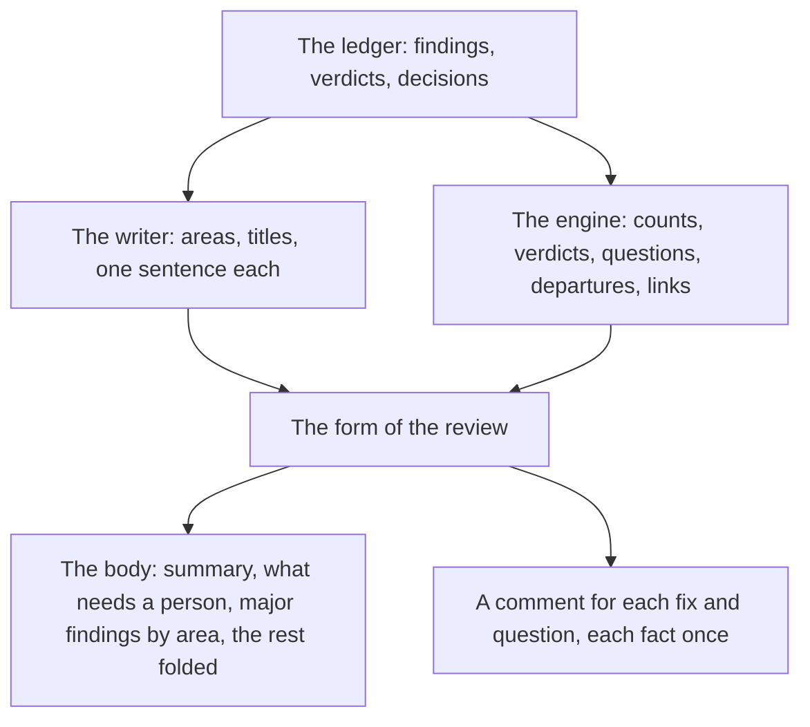

# Product Requirements: The review that reads as a report

Technical part: [2026-11-04-review-that-reads-as-a-report.design.md](2026-11-04-review-that-reads-as-a-report.design.md).

## Summary

`deep-review publish` posts a finished read-only run of a pull request as one GitHub review: a body, and a comment on its line for each finding that deep-review would fix or asks about ([the review on the pull request](2026-11-01-review-on-the-pull-request.requirements.md)). Its first real post, on #96, was hard to read. The body held 49,848 characters and the 29 comments 113,038 more, each finding was said up to six times, and an independent read of it and of a second post found thirteen faults of form, filed as #101 to #113. The facts under the post were sound: the same read checked 15 findings against the code, and all 15 held.

The same ledger was then written up by hand twice: first as a report for an engineer without context, then as the review that `publish` would have posted at the end of the read-only run, before any fix. That draft is the template of this proposal. Its body opens with a summary and with what needs a person, gives the major findings by area with one line each, folds the minor ones, says what the run did not examine and how far to trust it, and holds 19,388 characters; its comments hold 54,823 and say each fact once. It is posted on #96, in place of the first text, with a note that the fixes have since landed.

This proposal makes `publish` post that form. The writer gains what the template needed from it: areas, titles that name the problem, one sentence of what deep-review would do, one line of how the verifier checked each finding, and one line for each refuted candidate. The verifier gains two facts that the template needed and that its evidence held only as free text: why a finding is `PLAUSIBLE` and not `CONFIRMED`, and whether the author must decide. The engine writes everything else from the ledger, as it does today.

Figure 1. Where each part of the review comes from.

## Problem

### Each finding is said many times

The first post on #96 named each finding in the conclusion's list of actions, in the table of findings, in the comment's title, its problem, the decided fix, the writer's words on the decision, and the folded summary of its evidence: up to six times in different words (#109). A reader cannot tell whether two of them say the same thing, and the review is too long to read.

### The minor findings weigh as much as the major ones

"Before the merge: 27 fixes and 2 questions" counted 8 major fixes with 19 minor cleanups, and the table and the list of actions gave them the same weight (#102). A reader who opens the review to learn what blocks the merge has to sort the 30 findings by severity.

### The words name the code, not the problem

A title such as "The UNC-share alternative of `localPath` takes any run of two or more backslashes followed by a word as a network path" names the mechanism, and a summary in the table names a fact about the code (#113). The reader learns what goes wrong for whom only in the paragraph below it.

### Internal names, mixed languages and links that drift

Ids such as `SCAN-2` and `RIPPLE-1` stand in the text and the diagrams with nothing that says what they are (#106). A review in Korean switched to English for its table and its titles and said its decisions in both (#111). Links into the files of the pull request by a line anchor point to other lines after a later push (#112).

### What needs a person is spread out

The questions, the fixes against a written rule and the findings left as is sat in the conclusion, the table and the comments. A question named the option deep-review would apply and a different default as if they were two answers (#104), and the review did not say that nothing changes until the person who ran it runs `--fix` (#108).

### `PLAUSIBLE` means two things

Of the 13 `PLAUSIBLE` findings on #96, 4 were not confirmed because a fact could not be settled, such as how GitHub answers, 7 because the defect was there and a choice of how to fix it remained, and 2 gave no reason. The reason was free text at the end of the evidence. A reader takes "not confirmed" as doubt about the defect, which it is for 4 of them and not for the other 9.

### A finding left as is can need the author

A verifier adds `Needs the author:` to its evidence when acting on a finding means a choice that the code leaves open, and the decider treats the note as a hint that the repository may answer. On #96 it did: finding 8, a secret that could be posted, was left as is because the README states the limit in public, while the verifier had written that the author must decide. That is the design working, and the reader still saw only a finding left as is, folded with the others (#107). The note was free text in the evidence, so the form could not show it beside the decision.

## Goals

A reader of the pull request, who knows neither the code nor deep-review, finds on the first screen of the body how many findings matter before the merge, what needs a person and what happens next. Each major finding reads once, in its comment or in the body, with what goes wrong, what deep-review would do, and one step to how it was checked. The review of #96 in the new form is under half the length of its first post.

## Non-Goals

### No change to what is posted where

A finding that deep-review would fix or asks about still gets a comment on its line when its line is in the diff, and every other finding is in the body. The rules of the place of a finding, of the cleaning, of the record before the post and of the size stay as the review on the pull request set them.

### No edit of a posted review

The template was written once more after the fixes, with what each fix became; that text is in the edit history of #96. A review that `publish` updates after `--fix` needs the commit of each finding, which the ledger does not record, and lifts the non-goal "No second revision" of the review on the pull request. It is a proposal of its own.

### No answer from the pull request

The review still says that the person who ran it answers with `deep-review answer` (#103).

### No new fact about where a defect began

A defect older than the change is still listed with the others (#101). Telling it apart needs a check at the merge base, which is a proposal of its own.

### No change to the report on the machine

The brief, its Markdown and its JSON forms, and the chat keep their form. The writer's new parts go only to the pull request.

### No change to the finders, the deduplication or the decider

The prompts of the roles that find, merge and decide stay. The verifier's prompt changes only to give its two new facts.

## Requirements

### R1: The body puts first what a person must know and do

The body holds, in this order: the heading; one line on what the run reviewed and that it changed no file; a summary; what needs a person; how the review worked; the major findings by area; each finding that has no line in the diff and asks a person to act or carries the mark of R9, in full; the minor findings, folded; the other findings left as is, folded, each with its reason; what the run did not examine; how far to trust the review; and the last line with the marker. The summary says how many findings the review keeps and how many of them are major, names the areas of the major ones in a sentence, says how many deep-review would fix, ask about and leave as is, and says that nothing on the branch changes until the person who ran the review runs `review --pr <n> --fix`.

### R2: What needs a person is one list

The section lists each question, each fix against a written rule and each finding of R9, with a link to the lines its comment sits on or to its text in the body, one sentence of what it asks, and for a question the option deep-review recommends and what stands until someone answers. It ends with the one command that answers, who runs it and where, and that a reply on the pull request is not read yet. A run with nothing that needs a person says so in one sentence.

### R3: How the review worked, in counts the engine takes from the ledger

The section says in plain words what the finders, the verifiers and the decider do, and gives the counts of the run: the candidates, how many remained after merging duplicates, how many the verifiers refuted and kept, how many joined another finding, and how many findings remain. A fixed diagram shows the steps, the post and what follows it. It says what each verdict and severity means, so the body needs no legend.

### R4: The major findings by area

The writer puts each major finding that asks a person to act in one area, and gives each area a title, one or two sentences that say what the area is, and a diagram where it helps. Each finding of an area is one line: its number and title linked to the lines its comment sits on or to its text in the body, its verdict, and the sentence of what deep-review would do or, for a question, that it asks and what it recommends. The engine refuses an answer that leaves such a finding out of every area, puts it in two, or names a finding that is not major.

### R5: Each comment says each fact once

A comment holds, in this order: the number and title; one line with the severity, the verdict with how the verifier checked it, and the decision; what goes wrong, with the reason of R7 for a `PLAUSIBLE` finding; a diagram where the writer gives one; what deep-review would do in one sentence, a question (R8) or a fix against a written rule (R8); the decided fix, folded; how the verifier checked it, folded; the lines of code at the reviewed head that it rests on; and the id and the marker. The body of a minor finding's comment is the problem and what deep-review would do in one paragraph, with the folded fix and one line of code.

### R6: Titles name the problem

The writer's title of a finding says what goes wrong for whom, not which code does it: "Quoting a regex or an escaped string turns the code into `<local path>`", not "The UNC-share alternative of `localPath` takes any run of two or more backslashes followed by a word as a network path". The cause stays in the lines below it.

### R7: A `PLAUSIBLE` verdict says why

The verifier gives, with each `PLAUSIBLE` verdict, whether a fact was not settled or a choice remains, and names it in one sentence. The review writes it beside the verdict: "Why PLAUSIBLE: one fact is not settled: ..." or "Why PLAUSIBLE: the defect is there, and a choice remains: ...". A verdict recorded before this change, with no such fact, says that it was recorded before verifiers gave their reason on its own, and that the report of the run holds its evidence, since most such verifiers gave a reason in the free text of their evidence.

### R8: A question and a departure say what stands

A question gives its question, its options with the cost of each, then one sentence that names the option deep-review recommends and the option that stands until someone answers, as two facts: "deep-review recommends option 2. Until someone answers, option 1 stands: the code stays as it is." A fix against a written rule gives the rule, its source, the fact against it, and that `--fix` makes it as decided unless the person who ran the review rejects it first. Each ends with the command that answers it.

### R9: A finding left as is that its verifier sends to the author

The verifier gives, with each verdict, the choice that it leaves to the author, or none, as it writes `Needs the author:` today. The decider still treats it as a hint that the repository may answer. A finding that the decider leaves as is while its verifier named such a choice goes into what needs a person, and its text in the body gives both: why it is left as is, and the choice that the verifier named. The writer explains only the findings that ask a person to act, so the text of such a finding is in deep-review's own words, with the mark that tells the reader to look at it.

### R10: One line of how each finding was checked

The writer gives, for each finding of R4 and each minor finding, one line of what the verifier did and saw: what it fed and what it got back for a run, or what it traced or read. The line names no path of the machine and quotes no command, since a command holds the paths of the worker's scratch directory. The verifier's full evidence stays in the run's report.

### R11: One line for each refuted candidate

The section on what the run did not examine says whether a check ran, which patterns left paths out and how many, and gives the refuted candidates folded, each as its lines, one sentence of its claim and one sentence of why it was refuted, which the writer gives.

### R12: How far to trust the review

The section gives the counts of the verdicts, of the major findings `CONFIRMED`, of how the findings were checked (run, traced, read), and of the refuted candidates, and says that a model wrote the explanations from the verifiers' evidence, which the report of the run holds, and that only that evidence was verified.

### R13: The minor findings are folded

The body says how many minor findings there are, how many reach what a user sees and how many are about the code, and which of them need a person, and folds their table: number and title linked to the lines its comment sits on, verdict, and what deep-review would do. The writer gives each minor finding its kind: what a user sees, or the code.

### R14: Links and names

Each link to code points to the file at the reviewed head, by its commit, not to a line of the pull request's diff. The id of a finding appears only in the small line at the end of its comment, for tracing it to the run.

### R15: One language

Every heading, label and sentence of the engine comes from the table of `review.language`, and the writer writes in it. The verdicts, the severities' original words where the engine shows them, identifiers, commands and code stay as they are.

### R16: An older run

A run whose writer answered before this change is posted in the new form: its findings sit in one area named by the engine, its titles are the writer's as they were, a minor finding has no kind and is listed with the code, and the lines of R10 and R11 fall back to the engine's words. A run with no explanation, whose writer failed, is posted in the same way with the engine's words throughout, as today.

### R17: The gate

Two real runs: the read-only review of a pull request of this repository, posted with `publish --dry-run`, and one of a repository that reviews in Korean. An independent read compares each with the template and with #101 to #113, and the design's Verification section records what it found.

## Metrics

### The length of the review

The characters of the body and of all comments, against the first post of #96: 49,848 and 113,038. The template holds 19,388 and 54,823.

### Places per finding

How many times the review states each major finding, counted by hand on the gate's runs. The template states it twice: one line in the body and its comment.

### The first screen

Whether the summary and what needs a person fit before the first area of findings on a laptop screen, judged on the gate's runs.

### The readers' view

What the independent read of the gate says, finding by finding, against the faults of #101 to #113 that this proposal addresses.

## Product Decisions

### PD1: The template is the review of #96 at the end of its read-only run

The proposal takes as its template the draft written from #96's ledger as `publish` would have posted it before any fix, not the text written after the fixes. A review is posted before the fixes, and its reader then needs what deep-review would do, not what it did. The draft is posted on #96 in place of the first text, with a note that the fixes have since landed; it links each finding of the body to its comment, which a first post cannot do, since a comment's URL exists only once GitHub makes the review (the design's open question).

### PD2: The minor findings are folded by default

The reader of the body looks for what matters before the merge. The 19 minor findings of #96 each have a comment on their line, so the body only needs to say they exist, which of them need a person, and where they are.

### PD3: The review leaves out the core of the change

The first post gave the title and the core of the change, and the writer's account of what the pull request does, folded. The pull request's own description says what it does, and the template did not miss it. The review starts with what it found.

### PD4: The evidence on the pull request is one line

The first post gave each finding's summary, reason, evidence and runs, folded. Readers did not open it, and it was a third of each comment. The template gives one line of how the verifier checked it, which a reader can weigh, and leaves the full evidence to the report of the run.

### PD5: The reasons are facts of the verifier, not text the engine reads

Why a finding is `PLAUSIBLE` and whether the author must decide could be read out of the evidence's text, where the verifiers already write "Not CONFIRMED:" and "Needs the author:". Text is not a contract: two of #96's thirteen gave the phrase with nothing after it. The verifier gives both as fields of its verdict, the ledger records them, and the engine never parses evidence.

### PD6: The writer groups, the engine checks

Areas are a judgment of how findings relate, which no recorded fact gives. The writer makes it, as it writes the titles, and the engine checks only what it can count: each major finding that asks a person to act is in exactly one area.

## Against the vision note

The author means to revisit the principles of the vision note in its next version, and the template was judged on what a reader of a pull request needs. This section names where the proposal departs from the note as it stands, so the next note can decide.

### Principle 1, evidence, not trust

The proposal departs from this principle on the pull request (PD4). A reader of the review sees one line of how each finding was checked, written by the writer, not the verifier's evidence, and the evidence one step away is in the run's report, which a reader of the pull request cannot open. The reason is the reader: the full evidence was a third of each comment of the first post, and the line says what a reader weighs, whether the problem was reproduced by running it, traced or read.

### Principle 4, deep-review decides; the person answers and writes rules

A question on the pull request names its options, the cost of each and what stands until someone answers, and leaves out the rule text that a convention source would state for each option, which stays in the report. The rule text is for the person who answers, at the terminal.

### Principle 5, the core, the questions, and the departures go to the person

The proposal departs from this principle on the pull request (PD3). The body leaves out the core of the change and starts with the summary of the findings, then what needs a person. The questions and the departures still come before the evidence, in one list.

### Principle 6, easy to understand, with little context

The proposal serves this principle: titles that name the problem, areas, one language, plain words beside each verdict, and counts that show how the review worked.

### Principle 8, say what was not examined, and when a person must look

The review says whether a check ran, what the settings left out and which candidates were refuted, and it names a finding left as is that its verifier sends to the author (R9). A fix whose verdict is only `PLAUSIBLE` now says why (R7), which tells a reader whether to look.

## Risks

### A wrong area or a misleading title

The writer's areas and titles are judgments that no check verifies, and a title that names the problem can name it wrongly. The cases below each finding still cite the lines they rest on, and the gate reads each title against its finding.

### Less evidence on the pull request

A reader who doubts a verdict has one line where the first post had the whole evidence. A reviewer who wants more must ask the person who ran the review for the report.

### A minor finding that matters

A finding ranked minor is folded and can be missed. The severity is the ranker's, as it is today, and a minor finding that needs a person is listed in what needs a person.

### Two more facts from the verifier

A verifier that marks every `PLAUSIBLE` as a choice, or never says the author must decide, gives a reader false comfort. The gate reads each against the evidence.
