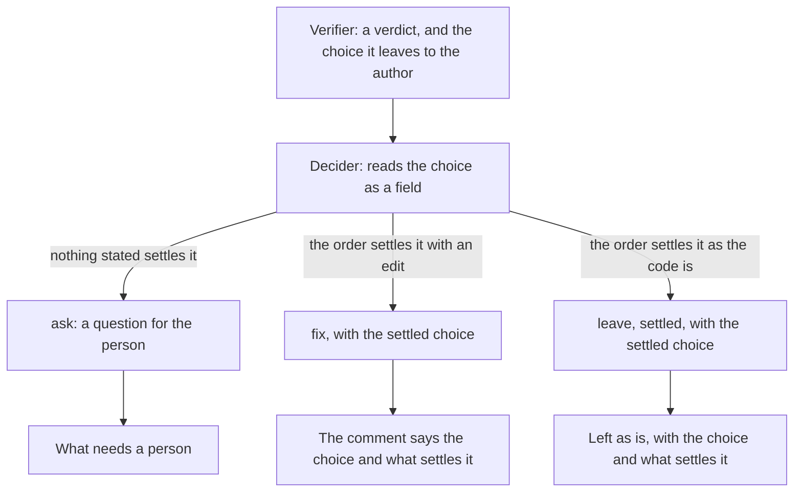

# Product Requirements: The decider settles each choice on the record

Technical part: [2026-11-06-choice-settled-on-the-record.design.md](2026-11-06-choice-settled-on-the-record.design.md).

## Summary

A review by deep-review runs workers in order. Finders propose defects, a verifier checks each one and gives its verdict, and the decider decides for each finding whether deep-review fixes it, leaves it as is with a stated reason, or asks a person. Since [the review that reads as a report](2026-11-04-review-that-reads-as-a-report.requirements.md), a verifier in a read-only run of a pull request also names, as a field of its verdict, the choice it thinks acting on the finding leaves to the author (`authorChoice`). The decider never receives that field. It reads the same choice only as a `Needs the author:` note in the free text of the evidence, and its rubric tells it to treat the note as a hint that the repository may answer.

Two judgments of one choice can therefore disagree, and today the engine settles the disagreement while it renders the review: a finding that the decider left as is, while its verifier named a choice, is posted in what needs a person (R9 of that proposal). The report [How the review on a pull request is written and read](../reports/2026-11-05-review-written-and-read.md) names this as W4. A judgment is made after the decision is recorded, by code that cannot weigh it, and it filled the first screen of the gate's review: 20 of 32 Korean findings carried "Needs the author", and the English list of what needs a person held 11 items where the template held 4 (#115).

The same report names a second fault of the decision, W5. In #115, three English findings were decided `fix` with an approach that begins "Make no edit, and keep ...". The review posted them as "deep-review would fix this" and counted them among the fixes. The decider's rubric leads there: it says to decide `fix` when its order of what settles a choice settles it, and that order can settle a choice in favor of the code as it is, for which no reason to leave a finding exists.

After this change the decider receives the verifier's choice as a field, and each decision that settles a choice records the choice, which step of the rubric's order settles it, and the source it rests on. A choice settled in favor of the code as it is becomes a finding left as is with a reason of its own, and a `fix` always edits. The form stops deciding: what needs a person holds only the questions and the departures from rules, and a finding left as is shows beside its reason the choice it settles and what settles it.

Figure 1. Where a choice that a verifier names ends after this change. The form places each finding by its recorded decision alone.

## Problem

### The form decides after the decision is recorded

`forAuthor` in `src/review/pull-request-form.ts` puts a finding in what needs a person when its decision is `leave` and its verifier named a choice. The rule was right for the case that motivated it: on #96, finding 8, about a secret that a review could post, was left as "intended, as the repository states" while its verifier wrote that the author must decide which variables to clean (#107). A reader saw a confirmed major finding folded with the findings they may skip. But the rule puts the verifier's view above the decider's every time, without knowing whether the repository answers the choice. Principle 2 of the vision note asks that each decision be recorded with its grounds before anything acts on it, and principle 4 asks deep-review not to hold for the person a finding that the repository already answers.

### The decider settles a choice without saying how

The decider's rubric says that "your decision names the choice and its answer", and its order says how a choice is settled: the change's stated intent, the repository's stated contract, the behavior before the change, keeping a behavior that was there before, and, for a shape only a maintainer would see, the shape the surrounding code uses. None of this is recorded apart from the free text of the grounds. A reader of #107 could not tell whether the decider had weighed the verifier's choice at all, and no code can tell either.

### A verifier names a choice too readily

#115 says that "a choice remains" is given too readily: eight of nine English `PLAUSIBLE` verdicts gave a choice, three of them for the scope of a fix or for a choice that the design records as made. Those three are choices the repository answers, which the decider is there to settle. Under R9 each of them went to the first screen.

### A fix that edits nothing

The decision schema gives each option of a question an `edits` flag and gives a `fix` none, because a fix is meant to edit. The rubric's table sends to `fix` every choice that its order settles, including a choice settled by keeping the code as it is, and the three reasons to leave a finding (`outside-change-not-regression`, `superseded`, `intended`) do not cover it. The engine takes a finding's status from the kind of its decision, so a fix that edits nothing is counted and posted as a fix, and in a fix run it is routed to a fixer.

## Goals

Every judgment that decides where a finding goes in the review is made by a worker and recorded on the ledger before the form reads it. A reader sees, for each choice that a verifier named, either a question for the person or the step of the rubric's order and the source that settle it. What needs a person holds only questions and departures from rules. No decision of `fix` leaves the code as it is.

## Non-Goals

### NG1: The verifier's prompt and its fields

The verifier still names a choice as it does today, and still writes the `Needs the author:` note in its evidence. #115 says it names one too readily; this proposal has the decider settle each choice, and a change to how readily the verifier names one is a change of the verifier's rubric, measured on its own.

### NG2: The verifier's fields in other runs

The verifier gives `authorChoice` only in a read-only run of a pull request, which records its verdicts at version 3. In every other run the decider reads the note in the evidence, as today. Recording the fields in every run is a change of the verifier's answer in those runs, and is left for later.

### NG3: The writer's explanation of a finding left as is

The writer still explains only the findings that deep-review would fix or asks about. A finding left as is is folded with its reason and its settled choice, not posted in what needs a person, so it no longer needs to be in the writer's words to be read first (W6 of the report).

### NG4: The language of the decider's text

The settled choice and its source are the decider's words, which a review in Korean still shows in English, as it shows the decider's questions today (#111). The step of the order that settles a choice is shown in the engine's words, in the review's language.

### NG5: The core of the change and when a person must look

Posting the core of the change and the conditions of principle 8 is a proposal of its own (G1 and G2 of the report).

### NG6: The fixer and the answers

The fixer, its routes and `deep-review answer` stay as they are. A finding left as is goes to no fixer, as today.

## Requirements

### R1: The decider is given the verifier's choice as a field

In a run whose verdicts record them, the decider's task gives, for each candidate of a finding, the choice its verifier leaves to the author and why a `PLAUSIBLE` verdict is not `CONFIRMED`, each on a line of its own and labeled, beside the evidence. The rubric calls the choice a verifier's view that the decider settles or asks about, not an answer, as it calls the note today.

### R2: A decision that settles a choice records how

A decision may carry a settled choice: the choice in one sentence, in plain words; the step of the rubric's order that settles it, one of the stated intent of the change, the stated contract of the repository, the behavior before the change, keeping a behavior that was there before, or the shape the surrounding code uses; and the source that the step rests on, cited. A decision of `fix` or of `leave` as `intended` or `settled` on a finding whose verifier named a choice carries one, and a decision of `leave` as `settled` always carries one. The engine refuses an answer that breaks this, as it refuses an answer that breaks any other rule of the decisions today. A decision of `ask` carries none, since its question is the record of the choice.

### R3: A choice kept as the code is, is left as settled

A fourth reason to leave a finding, `settled`, says that acting on the finding needs a choice and the rubric's order settles it in favor of the code as it is. The rubric says that a `fix` edits the code, and that a choice the order settles without an edit is left as `settled`, not fixed. `intended` keeps its meaning: the repository states the behavior on purpose and the finding says that intent is wrong.

### R4: The form places each finding by its decision alone

What needs a person lists the questions and the fixes that depart from a written rule, and nothing else. A finding left as is goes in the folded section of findings left as is, whatever its verifier named, and its line there gives its reason, its grounds and, when its decision settles a choice, the choice, the step that settles it and the source. The summary no longer counts findings left for the author.

### R5: A fix says which choice it makes

The comment of a fix whose decision settles a choice, or its text in the body when it has no line in the diff, says under what deep-review would do the choice it makes, the step that settles it and the source, in one line.

### R6: The report on the machine

The report shows the reason `settled` in its own words, and, wherever it shows a decision whose decision settles a choice, the choice, the step and the source.

### R7: An older run

A run whose decisions were recorded before this change has no settled choices. Such a run is posted as today, R9 of the review that reads as a report included: a finding it left as is while its verifier named a choice still goes in what needs a person, since its decider was not given the choice as a field and recorded nothing of it.

### R8: The gate

The gate is a real run (principle 12). deep-review reviews this pull request on Claude Code and posts the review with `publish --dry-run`. The engine of this branch then reviews again the change whose reviews #115 counted: #114, which the gate of the review that reads as a report reviewed twice, once in English and once with `review.language = "ko"`. #114 is merged, and `review --pr` and `publish` refuse a pull request that is not open, while a run with `--from` and `--to` has no pull request to post to and no writer. So the two runs review a pull request that holds #114's commits on the base they had, opened in a copy of this repository under an account the author controls, as R17 of the review on the pull request opened one with the commits of pallets/click #3878, and each posts with `publish --dry-run`. The gate records each metric below for each run, and the author reads each decision that settles a choice a verifier named and says whether it was a question of direction; the record keeps their word.

## Metrics

### M1: The length of what needs a person

The items of what needs a person in each review, against the English review of #115, which held 11 where the template held 4. The target is that each item is a question or a departure.

### M2: Fixes that edit nothing

The decisions of `fix` whose approach makes no edit, read by hand on the gate's runs. #115 found 3 in English. The target is none.

### M3: Where the verifier's choices end

Of the findings whose verifier named a choice, how many the decider asked about, fixed with a settled choice, and left as `intended` or `settled`, with the steps of the order that settled them. For each settled one, the author's word on whether it was a question of direction that deep-review should have asked.

## Product Decisions

### PD1: The decider settles the choice, and the form shows what it decided

The choice a verifier names is evidence for the decider, which owns the decision of whether a choice is the person's to make. The form shows the outcome and does not weigh it. Principle 2 places the judgment before the form, and principle 4 gives the decider the question of whether the repository answers a choice.

### PD2: Rejected: keep R9 as a safety net

The report left open whether the form should still send to what needs a person a finding that the decider left as is while its verifier named a choice. The proposal rejects it for new runs. With the rule kept, the decider's settlement would be overruled whenever a verifier disagreed, which is the disagreement this change removes, and the first screen would keep the items that #115 counted. The case of #107 is covered without it: the decider now sees the choice as a field, and a decision to leave it must say what settles it, which the review shows beside the reason.

### PD3: The settlement is a field, not the text of the grounds

The grounds could be asked to name the choice and what settles it. Text is not a contract, which is why the verifier's reasons became fields (PD5 of the review that reads as a report): the engine cannot tell whether free text answered the choice, and the form cannot show the step in the review's language. A field that the engine checks is a contract, at the cost of a new version of the decisions on the ledger.

### PD4: A choice kept as the code is, is a reason to leave

A decision that keeps the code as it is, is a decision not to act, and the review must say so rather than count it as a fix. The proposal adds the reason `settled` instead of widening `intended`, whose test is narrower: a behavior the repository states on purpose, against a finding that says the intent is wrong. A choice settled by the behavior before the change, or by keeping a behavior that was there before, rests on no stated intent.

### PD5: Rejected: an `edits` flag on a fix

The report suggested recording on a fix whether it edits, as an option of a question records it, and refusing a fix that edits nothing. A flag that must always be true checks nothing: a decider that writes "make no edit" in its approach can also write that the fix edits. The fault is that the rubric has no right decision for the case, and R3 gives it one. The gate counts what is left of it (M2).

### PD6: The step of the order is a value, and its source is text

The step that settles a choice is one of the five of the rubric's order, so the engine can name it in the review's language and count it across runs. The source it rests on is the decider's citation, as its grounds are.

### PD7: An older run keeps R9

A run decided before this change recorded no settlement, so its disagreements are unresolved on the record. Posting such a run in the new way would fold a choice that no decision answered. The rule stays for those runs only, and is tied to the version of their decisions on the ledger.

## Against the vision note

This proposal is read against the vision note of 2026-11-05.

### Principle 2, record before action

The form no longer makes a judgment that no worker recorded. Every placement of a finding in the review follows from its recorded decision, and the settlement of each choice that a verifier named is recorded with its step and its source before the form reads it.

### Principle 4, deep-review decides; the person answers and writes rules

The proposal serves this principle: a choice that the repository answers is settled by the decider and reported, not held for the person, and a choice that nothing stated settles is asked. The vision note counts against a proposal one that "decides a question of direction inside deep-review and does not record an ask". The risk is real here, since a decider can settle a choice that was the person's. The proposal accepts it because each settlement is recorded with the step and the source it rests on, shown in the review beside the decision, and read by the author at the gate (M3).

### Principles 5 and 6, the questions first, easy to understand with little context

What needs a person returns to the questions and the departures, which a reader can decide from the item alone. A finding left as is says in one line which choice it settles and why, with the step in the review's language, so a reader does not have to read the verifier's evidence to see why it is not a question.

### Principle 8, say when a person must look

The four conditions of principle 8 do not include a choice that a verifier named, and this proposal does not add one. A finding left as is with a settled choice is folded with the findings left as is, where the reader of #107 found the secret-posting finding. The difference is that its line now says what settled the choice, so a reader who disagrees can see it at a glance. The proposal names this as a choice: the first screen is kept for what only a person can answer.

### Principle 10, answers are labels

No answer on the ledger is about a settled choice, since the person answers questions and departures. The gate measures the settlements against the author's reading of each (M3), which the principle calls an approximation. A later note can decide whether a person's correction of a settled choice becomes an answer.

### Principle 12, a real run is the gate

R8 is a real run of this pull request, and two of #114's change, in English and in Korean, on an open pull request that holds its commits, since the engine refuses to review or post a merged one.

## Risks

### RK1: The decider settles a choice that was the person's

A decider can cite a step of the order that does not reach the case. The step and the source are shown beside the decision in the review and the report, and the gate reads each settlement (M3). A settlement that the author judges wrong is a case for the decider's rubric.

### RK2: The decider asks more

A decider that now sees the choice as a field may ask about it more often, and lengthen what needs a person. Each question still has to say where the decider looked and found nothing, and the gate counts the items (M1).

### RK3: More answers refused

The new rule of R2 refuses an answer that leaves a choice unsettled, and a refused answer costs another run of the decider. The gate records each refusal.

### RK4: A run started before the change cannot resume after it

The decider's role prompt changes, so a run configured before the change and resumed after it is refused with the action to name the old roles directory (`--roles <dir>`), as for every earlier edit of a fragment.
