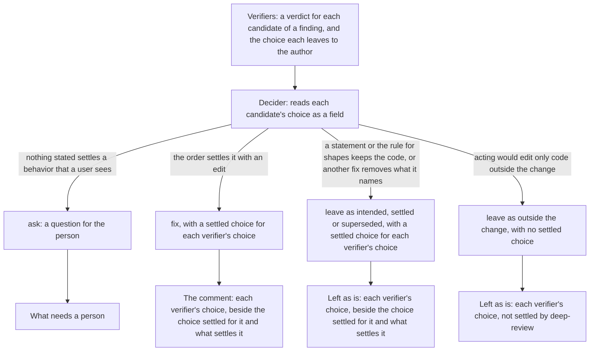

# Product Requirements: The decider settles each choice on the record

Technical part: [2026-11-06-choice-settled-on-the-record.design.md](2026-11-06-choice-settled-on-the-record.design.md).

## Summary

A review by deep-review runs workers in order. Finders propose defects, which the engine calls candidates, and a verifier checks each candidate and gives its verdict. Candidates that describe one defect are merged into one finding, and the decider decides for each finding whether deep-review fixes it, leaves it as is with a stated reason, or asks a person. Since [the review that reads as a report](2026-11-04-review-that-reads-as-a-report.requirements.md), a verifier in a read-only run of a pull request also names, as a field of its verdict, the choice it thinks acting on the finding leaves to the author (`authorChoice`). The decider never receives that field. It reads the same choice only as a `Needs the author:` note in the free text of the evidence, and its rubric tells it to treat the note as a hint that the repository may answer.

Two judgments of one choice can therefore disagree, and today the engine settles the disagreement while it renders the review: a finding that the decider left as is, while its verifier named a choice, is posted in what needs a person (R9 of that proposal, which this proposal calls the author rule). The report [How the review on a pull request is written and read](../reports/2026-11-05-review-written-and-read.md) names this as W4. A judgment is made after the decision is recorded, by code that cannot weigh it, and it lengthened the first screen of the gate's review: the English list of what needs a person held 11 items where the template held 4, each finding left for the author an item with no action (#115).

The same report names a second fault of the decision, W5. In #115, three English findings were decided `fix` with an approach that begins "Make no edit, and keep ...". The review posted them as "deep-review would fix this" and counted them among the fixes. The decider's rubric leads there: it says to decide `fix` when its order of what settles a choice settles it, and that order can settle a choice in favor of the code as it is, for which no reason to leave a finding exists.

After this change the decider receives each verifier's choice as a field, and each decision records each choice it settles: the side it settles in one sentence, the step that settles it, the source it rests on, and the candidates of the finding whose verifiers named that choice. A finding can merge several candidates whose verifiers name different choices, and a decision that must settle them settles each one. A choice kept as the code is, is no longer a fix. It is left as is when the repository states the behavior, or when it is a choice between two shapes that only a maintainer would see; it is a question for the person, with keeping the code as the default, when it is a choice between two behaviors that a caller or a user would see and nothing stated settles it. A `fix` always edits. The form stops deciding: what needs a person holds only the questions and the departures from rules, and wherever the review shows the decision of a finding whose verifiers named choices, it shows each such choice, labeled as the verifier's, beside the choice that the decision settles for it and what settles it, or beside a statement that deep-review did not settle it.

Figure 1. Where a choice that a verifier names ends after this change. The form places each finding by its recorded decision alone.

## Problem

### The form decides after the decision is recorded

`forAuthor` in `src/review/pull-request-form.ts` puts a finding in what needs a person when its decision is `leave` and its verifier named a choice. The rule was right for the case that motivated it: on #96, finding 8, about a secret that a review could post, was left as "intended, as the repository states" while its verifier wrote that the author must decide which variables to clean (#107). A reader saw a confirmed major finding folded with the findings they may skip. But the rule puts the verifier's view above the decider's every time, without knowing whether the repository answers the choice. Principle 2 of the vision note asks that each decision be recorded with its grounds before anything acts on it, and principle 4 asks deep-review not to hold for the person a finding that the repository already answers.

### The decider settles a choice without saying how

The decider's rubric says that "your decision names the choice and its answer", and its order says how a choice is settled: the change's stated intent, the repository's stated contract, the behavior before the change, keeping a behavior that was there before, and, for a shape only a maintainer would see, the shape the surrounding code uses. None of this is recorded apart from the free text of the grounds. A reader of #107 could not tell whether the decider had weighed the verifier's choice at all, and no code can tell either.

### A verifier names a choice on many findings

In the Korean review of #115, 20 of 32 findings carried a `Needs the author:` note, the choice that a verifier leaves to the author, which a read-only run of a pull request also records as the field `authorChoice`. That count is of the verifiers' notes, not of the findings that the author rule moved, which were only those decided `leave`. It shows that the choice a verifier names reaches many findings, so whether the decider or the form settles it decides where many findings go in the review.

### A fix that edits nothing

The decision schema gives each option of a question an `edits` flag and gives a `fix` none, because a fix is meant to edit. The rubric's table sends to `fix` every choice that its order settles, including a choice settled by keeping the code as it is, and the three reasons to leave a finding (`outside-change-not-regression`, `superseded`, `intended`) do not cover it. The engine takes a finding's status from the kind of its decision, so a fix that edits nothing is counted and posted as a fix, and in a fix run it is routed to a fixer.

## Goals

Every judgment that decides where a finding goes in the review is made by a worker and recorded on the ledger before the form reads it. For each choice that a verifier named, on any candidate of a finding, a reader sees either a question for the person or that choice itself, labeled as the verifier's, beside the choice that the decision settles for it with the step and the source that settle it, or with a statement that deep-review did not settle it. Each settled choice states the side that deep-review decided, so a reader learns which way it went without reading its source. What needs a person holds only questions and departures from rules. A choice between two behaviors that a caller or a user would see, which nothing stated settles, is a question for the person, even when the order would keep the code as it is. No decision of `fix` leaves the code as it is.

## Non-Goals

### NG1: The verifier's prompt and its fields

The verifier still names a choice as it does today, and still writes the `Needs the author:` note in its evidence. This proposal has the decider settle each choice that a verifier names; how readily a verifier names one is a matter of the verifier's rubric, and a change to it is measured on its own.

### NG2: The verifier's fields in other runs

The verifier gives `authorChoice` only in a read-only run of a pull request, which records its verdicts at version 3. In every other run the decider reads the note in the evidence, as today. Recording the fields in every run is a change of the verifier's answer in those runs, and is left for later.

### NG3: The writer's explanation of a finding left as is

The writer still explains only the findings that deep-review would fix or asks about. A finding left as is is folded with its reason, its verifiers' choices and its settled choices, not posted in what needs a person, so it no longer needs to be in the writer's words to be read first (W6 of the report).

### NG4: The language of the decider's text

The settled choice and its source are the decider's words, and the choice a verifier names is the verifier's, which a review in Korean still shows in English, as it shows the decider's questions today (#111). The step of the order that settles a choice is shown in the engine's words, in the review's language.

### NG5: The core of the change and when a person must look

Posting the core of the change and the conditions of principle 8 is a proposal of its own (G1 and G2 of the report).

### NG6: The fixer and the answers

The fixer's routes and `deep-review answer` stay as they are, and a finding left as is goes to no fixer, as today. The fixer's task gains only the settled choices of its decision and of each finding that its fix removes, with the verifiers' choices beside them (R5).

## Requirements

### R1: The decider is given the verifier's choice as a field

In a run whose verdicts record it, the decider's task gives, for each candidate of a finding, the choice its verifier leaves to the author, on a line of its own and labeled, beside the evidence and under the candidate's id, by which a settled choice names it (R2). The rubric calls the choice a verifier's view that the decider settles or asks about, not an answer, as it calls the note today. The verifier's other field of the same version, why a `PLAUSIBLE` verdict is not `CONFIRMED`, is not given as a field: no rule of this proposal reads it, and the evidence already holds it.

### R2: A decision that settles a choice records how

A decision may carry settled choices, as a list. Each settled choice holds the choice, stated as the side that the decision settles; the step that settles it; the source that the step rests on, in one sentence that names what the source is and what it says; and the candidates of the finding whose verifiers' choice it answers. The choice is one declarative sentence that states that side, not the question it answers, as in "Ids in the writer's text are replaced by the numbers the body shows." Both sentences are written for a person who did not read the change: in plain words, with no file, line, requirement number or internal name of the code, since the review shows them to such a reader. The engine does not check the form of either sentence (PD10). The grounds keep the citation, as `file:line` or a commit, one step below.

A step is one of seven. Five are the rubric's order: the stated intent of the change (`intent`); the stated contract of the repository (`contract`); the behavior before the change (`before`); keeping a behavior that was there before (`kept`); and, for a choice between two shapes that only a maintainer would see, the one the surrounding code already uses, else the one that adds less (`shape`). Two are the ways the rubric's `fix` row reaches a fix outside that order: no choice remains, since acting on the finding has one sound way and the verifier's choice is not a real one, which the source says (`none`); and the scope, since the fix keeps to the part of the result inside the change, as the rubric decides when part of it lies past the change (`scope`).

A finding merges one or more candidates, each verified on its own, so its verifiers can name several choices. A candidate named a choice when its verdict gives the choice it leaves to the author as a field (R1). Each settled choice names, by their ids, the candidates whose choice it answers. One settled choice may answer several candidates that named the same choice, and one may answer none, for a choice that no verifier named. No settled choice names a candidate that is not the finding's, or one whose verifier named no choice, and no candidate is named by two settled choices of a decision. The candidate is the unit because the ledger records a verdict, and with it a choice, for each candidate, so the engine can check each name against what the run recorded (PD9).

Whether a decision must answer each candidate that named a choice, may carry settled choices or must carry none, and which steps they may name, depend on the decision, as the table below gives. "Each answered" means that each candidate of the finding whose verifier named a choice is named by exactly one settled choice of the decision. "Optional" means that the decision may carry settled choices, which may answer some of those candidates, all of them or none; each choice that no settled choice answers is shown as not settled by deep-review (R4). "At least one" means that the decision carries one or more settled choices, and "refused" that it carries none. In a run whose verdicts do not record the field, no candidate named a choice, and every finding falls under the column "When none did".

| Decision | When a candidate's verifier named a choice | When none did | Steps it may name |
|---|---|---|---|
| `fix` without a departure | each answered | optional | all seven |
| `fix` with a departure | optional | optional | all seven |
| `leave` as `intended` | each answered | optional | `intent`, `contract` |
| `leave` as `settled` | each answered | at least one | `shape` |
| `leave` as `superseded` | each answered | optional | all but `before` |
| `leave` as `outside-change-not-regression` | refused | refused | no settled choice |
| `ask` | refused | refused | no settled choice |

A fix acts on the finding, so it records each choice it makes and answers each candidate whose verifier named a choice. A fix with a departure need not, since its departure records how the decision went against the order. Each settled choice of a leave as `intended` names one of the two steps that are statements, and each of a leave as `settled` names `shape` (R3). A finding left as `superseded` is acted on by the fix that removes what it names, so it records the choices that fix makes for it, with the steps of a fix but `before`: that step restores what the change altered by an edit of the finding's own, which would make the finding a fix of its own. A finding left as outside the change is one that deep-review does not act on, so no choice is settled for it, and an ask's question is the record of its choice. The engine refuses an answer that breaks the table, as it refuses an answer that breaks any other rule of the decisions today. The decider's task, which the engine writes in every run, states the seven steps with one line each, this table and the rule by which a settled choice names candidates, so a decider whose role prompt predates this change, as in a run resumed with its old roles directory (RK4), is told them too; the rubric says the same at more length. Where the table makes a settled choice optional, the rubric still asks the decider to record each choice it settles.

### R3: A choice kept as the code is, is never a fix

The rubric says that a `fix` edits the code, and that a choice the order settles without an edit is not fixed. Such a choice goes one of three ways, by what settles it.

When the change's stated intent or the repository's stated contract settles it in favor of the code as it is, the finding is left as `intended`, since the repository then states the behavior on purpose. `intended` keeps its other case, a finding that says a stated intent is wrong.

When it is a choice between two shapes that only a maintainer reading the code would see, nothing stated settles it, and the rubric's rule for shapes, the one the surrounding code already uses, else the one that adds less, keeps the code as it is, the finding is left as `settled`, a fourth reason to leave a finding.

When it is a choice between two behaviors that a caller or a user would see, nothing stated settles it, and the order settles it only by keeping a behavior that was there before, the decision is an `ask`. Its default, the option that deep-review applies, keeps the code and does not edit (`edits: false`). Such an ask reaches no fixer, and the review already says that the code stays as it is until the person answers. A leave would decide inside deep-review which behavior a user sees when the repository does not say, which the vision note names a question of direction (PD4).

The step `before` restores what the change altered, which is an edit, so it settles a fix and never a leave. The engine holds the steps of each reason as R2's table gives them.

### R4: The form places each finding by its decision alone

What needs a person lists the questions and the fixes that depart from a written rule, and nothing else, in every run, a run decided before this change included (R7). A finding left as is goes in the folded section of findings left as is, whatever its verifiers named, and its line there gives its reason and its grounds. Then, for each settled choice of its decision, the line gives the choices of the candidates that it answers, each labeled as the verifier's and each distinct text once, and beside them the settled choice, under a label that states it as what deep-review decided, with the step that settles it and the source; a settled choice that answers no candidate is given alone. Then the line gives each choice that a verifier of the finding named and no settled choice answers, labeled as the verifier's, with a statement that deep-review did not settle it, as for every choice of a finding left as outside the change, which settles none. So no choice that a verifier named is missing from the review, whichever candidate of the finding named it, and a reader sees at once when the choice that deep-review settled is not the one its verifier named (PD8). When the body is too long and the engine cuts the findings left as is, it keeps the lines of those with a candidate whose verifier named a choice and replaces only the others with their count, worded as the other findings left as is, in words distinct from those of a cut that keeps no line, since those lines are what PD2 and the principle-4 risk rely on. The summary no longer counts findings left for the author.

### R5: A fix says which choice it makes

The comment of a fix whose decision settles a choice or whose verifiers named one, or its text in the body when it has no line in the diff, gives under what deep-review would do the same lines that R4 gives a finding left as is: for each settled choice, the verifiers' choices that it answers, labeled as the verifiers', then the choice it makes, the step that settles it and the source; then each verifier's choice that no settled choice answers, with the statement that deep-review did not settle it. Only a fix with a departure can leave a verifier's choice unanswered, and its departure says how the fix goes against the rule. The writer, whose text explains the fix in the same comment and who is given each verifier's choice, is given the same lines, each settled choice as the decision's, so its text does not present as the author's a choice that the decision settled. The fixer that applies the fix, whose evidence can still hold the verifier's note, is given the same lines with its decision, so it applies each choice the decision made and sees which verifier's choice the decision did not settle. Both tasks give the step in words, as the report does, not as its raw value. The fixer of a fix with a departure can be given a verifier's choice that the decision did not settle, and can still read the verifier's note in the evidence; the proposal accepts this gap, which the section on principle 2 below names. A fix that removes what a finding left as `superseded` names acts on that finding too, so its fixer is given, beside each finding that the fix removes, that finding's settled choices, each with the verifiers' choices it answers.

### R6: The report on the machine

The report shows the reason `settled` in its own words, and, wherever it shows a decision of `fix` or `leave`, the same lines as the review by the same rule: for each settled choice, the verifiers' choices that it answers, labeled as the verifiers', and the settled choice with its step and its source; and each verifier's choice that no settled choice answers, with the statement that deep-review did not settle it.

### R7: An older run is posted as any other

A run whose decisions were recorded before this change has no settled choices, and it is posted as a run of this change is. What needs a person holds only its questions and its departures. A finding that it left as is while its verifiers named choices is in the folded section of findings left as is, with each such choice labeled as the verifier's and the statement that deep-review did not settle it (R4), which is true of such a run. The author rule is removed for every run (PD7).

### R8: The gate

The gate is a real run (principle 12). deep-review reviews this pull request on Claude Code and posts the review with `publish --dry-run`. The engine of this branch then reviews again the change whose reviews #115 counted: #114, which the gate of the review that reads as a report reviewed twice, once in English and once with `review.language = "ko"`. #114 is merged, and `review --pr` and `publish` refuse a pull request that is not open, while a run with `--from` and `--to` has no pull request to post to and no writer. So the two runs review a pull request that holds #114's commits on the base they had, opened in a copy of this repository under an account the author controls, as R17 of the review on the pull request opened one with the commits of pallets/click #3878, and each posts with `publish --dry-run`. A third run reviews #96's change the same way, in English, since #96 holds the finding of #107, the case that the author rule was made for, and records what the decider decides for it and what the review shows. The gate records each metric below for each run, and the author reads each decision that settles a choice a verifier named and says whether it was a question of direction; the record keeps their word.

The gate passes when the runs meet the targets of M1, M2 and M3, and fails when a run misses one; the record says which. The run of #96's change passes when the finding of #107 is asked, or fixed, or left with a settlement that the author judges not to be a question of direction. If that rerun does not surface the finding, the gate says so, and the case of #107 stays untested and is named as untested in the record, not counted as passed.

### R9: A refused answer is named to the next attempt

When the engine refuses the decider's answer, it names in one refusal every rule that the answer broke, each with the decision it concerns, within the length that the ledger keeps for the reason of a failed attempt. The decider's next attempt is given that refusal under a section that says what failed in the earlier answer, as the writer's next attempt is given the parts of its earlier answer that failed, and the task says to give the whole answer again. The section holds only the refusals of the rules of the decisions, not a failure of another kind. Resuming a run clears the failures of the phase it stopped in, so the first decider attempt after a resume starts without them. The proposal accepts this, since a resume already gives the phase fresh attempts, and each refusal stays on the ledger.

## Metrics

### M1: The length of what needs a person

The questions and the departures in what needs a person in each review. The baseline is the questions and the departures of the English review of #115, whose list of what needs a person held 11 items where the template of the review that reads as a report held 4. W6 of the report counts 5 of the 11 as findings left for the author, so the proposal infers that 6 were questions and departures. The 6 is inferred from those two counts, not counted in the review itself. R4 makes every item a question or a departure, so the count measures RK2, the decider asking more, and not the form. The author reads each question and says whether only a person could answer it. The target, in the English run of #114, is no more than 6 items plus the questions that the author judges only a person could answer.

### M2: Fixes that edit nothing

The decisions of `fix` whose approach makes no edit, read by hand on the gate's runs. #115 found 3 in English. The target is none.

### M3: Where the verifier's choices end

Of the findings whose verifier named a choice, how many the decider asked about, fixed with a settled choice, fixed with a departure, left as `intended`, `settled` or `superseded` with a settled choice, and left as outside the change with no settled choice, with the steps that settled them. For each settled one, the author's word on whether it was a question of direction that deep-review should have asked. The target is no settled choice that the author judges a question of direction that deep-review should have asked.

## Product Decisions

### PD1: The decider settles the choice, and the form shows what it decided

The choice a verifier names is evidence for the decider, which owns the decision of whether a choice is the person's to make. The form shows the outcome and does not weigh it. Principle 2 places the judgment before the form, and principle 4 gives the decider the question of whether the repository answers a choice.

### PD2: Rejected: keep the author rule as a safety net

The report left open whether the form should still send to what needs a person a finding that the decider left as is while its verifier named a choice. The proposal rejects it for every run. With the rule kept, the decider's settlement would be overruled whenever a verifier disagreed, which is the disagreement this change removes, and the first screen would keep the items that #115 counted. The case of #107 is covered without it: the decider now sees the choice as a field, and a decision to leave it as `intended`, `settled` or `superseded` must say what settles each choice that its verifiers named, which the review shows beside each one. A decision to leave it as outside the change settles nothing, since deep-review does not act on the finding, and the review then shows the verifier's choice with the statement that deep-review did not settle it. So the reader of #107 would see the verifier's choice next to the decision in every case (PD8).

### PD3: The settlement is a field, not the text of the grounds

The grounds could be asked to name the choice and what settles it. Text is not a contract, which is why the verifier's reasons became fields (PD5 of the review that reads as a report): the engine cannot tell whether free text answered the choice, and the form cannot show the step in the review's language. A field that the engine checks is a contract, at the cost of a new version of the decisions on the ledger.

### PD4: A choice kept as the code is, is left or asked, never fixed

A decision that keeps the code as it is, is a decision not to act, and the review must say so rather than count it as a fix. Which decision it becomes depends on who may make the choice. The stated intent and the stated contract are statements, and a behavior the repository states is one it states on purpose, which is what `intended` says, so `intended` takes them. A choice between two shapes that only a maintainer would see is deep-review's to make, as the rubric already says, so the rule for shapes settles it, and when that rule keeps the code the finding takes the new reason `settled`. A choice between two behaviors that a caller or a user would see, which nothing stated settles, is the first question of direction that the vision note names: which behavior a change must have when the repository does not say. Keeping a behavior that was there before answers it only by presumption, so a leave by that step would decide the question inside deep-review and record no ask, which the note counts against a proposal. Such a choice is asked instead, and its default keeps the code, the option easiest to reverse that principle 4 asks deep-review to apply. The step `before` restores the behavior the change altered, which is an edit, so it settles a fix and never a leave. Each reason then has its own steps, the decider has one rule for choosing between a leave and an ask, and M3 can count them apart.

### PD5: Rejected: an `edits` flag on a fix

The report suggested recording on a fix whether it edits, as an option of a question records it, and refusing a fix that edits nothing. A flag that must always be true checks nothing: a decider that writes "make no edit" in its approach can also write that the fix edits. The fault is that the rubric has no right decision for the case, and R3 gives it one. The gate counts what is left of it (M2).

### PD6: The step is a value, and its source is text

The step that settles a choice is one of seven, so the engine can name it in the review's language and count it across runs. Five are the rubric's order. The other two are the ways that the rubric's own `fix` row reaches a fix outside that order: acting needs no choice (`none`), and the fix keeps to the part of a result inside the change (`scope`). Without them, a decider that judges the verifier's choice unreal, or keeps a fix inside the change, could pass the check only by naming a step that did not settle anything. A fix that departs from a rule need not name a step, since its departure is already the record of the choice. The choice is the decider's sentence, and states the side that the decision settles, not the question it answers (PD10). The source a step rests on is the decider's sentence in plain words too, which the review shows, while the grounds keep the citation that a reader who doubts it follows. The two say one fact at two depths, as a question and the places it names where the decider looked do.

### PD7: Rejected: keep the author rule for runs decided before this change

A run decided before this change recorded no settlement, and posting it in the new way folds a choice that no decision answered. That was the reason to keep the author rule for such runs. The same holds for a run of this change: a finding that it leaves as outside the change settles no choice either, and is folded with the verifier's choice shown. So the reason separates nothing, and the rule is removed for every run. A run decided before this change is posted as any other (R7), with the verifier's choice and the statement that deep-review did not settle it on the line of each such finding (PD8), and the engine needs no record of which version its decisions were recorded at.

### PD8: The verifier's choice is shown beside every settlement

The engine checks that each candidate whose verifier named a choice is named by one settled choice where R2 requires it, not that the settled choice answers that candidate's choice: a decider can name a candidate and settle a narrower choice, or another one. So wherever the review or the report shows a decision of `fix` or `leave` of a finding whose verifiers named choices, it shows each of them, labeled as the verifier's, and beside it the settled choice that names its candidate, or the statement that deep-review did not settle it. A reader then sees at once when the two differ, and no settlement takes the place of a verifier's view in the review. A fix with a departure keeps its exemption from a settled choice (R2), and its verifiers' choices are shown on it as on any other fix. An ask shows its question, which is the record of its choice, and not the verifier's choice beside it, so what needs a person does not grow. The cost is a line for each such choice, in the folded section of findings left as is and in the comments of the fixes, which a reader opens as evidence.

### PD9: A decision settles each verifier's choice, by candidate

The first gate of this proposal, recorded under Verification in the design, showed that one settled choice for each decision leaves a choice out. In the review of this pull request, deep-review found, as its finding 2, that the line of a merged finding shows the choice of one candidate's verifier only. A finding merges candidates that are each verified on their own, and two verifiers can name different choices for the author. The first form of this proposal kept one choice for each finding, the one that the engine picked for display, and one settled choice for each decision. The decider, which sees every candidate's choice (R1), could then settle one candidate's choice while the review showed another's beside it. The other choice was then neither settled nor asked, against PD8, and the fixer could make it itself, which principle 2 does not permit.

So a decision carries a list of settled choices, and each names the candidates whose choice it answers (R2). Where R2 requires a settlement, each candidate that named a choice is named once, so no verifier's choice of the finding is left between a settlement and a question. The candidate is the unit, not the text of the choice, because the ledger records a verdict, and with it a choice, for each candidate, and the ranking records which candidates a finding merges. The engine can check each name against those records, while it cannot tell whether two texts name the same choice. One settled choice may name several candidates that named the same choice, so the decider does not repeat itself, and the review shows each distinct text once. The finding no longer has one choice for display, and the review shows each choice beside the settled choice that names its candidate (R4).

The list changes the shape of version 2 of the decisions on the ledger, which this proposal added and which has not reached `main`. The design changes that version in place rather than adding a version 3 (TD6 of the design).

### PD10: A settled choice states the side it settled

The first gate, recorded under Verification in the design, showed that 79 of its 80 settled choices were written as the choice still open, as "Whether X or Y". The review then read "deep-review settles it: Whether X or Y", and only the source sentence said which way the choice went. The rubric asked the decider to write the choice "as you write a question", meaning for a reader who did not read the change. The decider took the words as the form of a question, and copied the verifier's choice, which a verifier phrases as a question.

So the rubric and the decider's task say that the choice states, in one declarative sentence, the side that the decision settles, not the question, and give one example (R2). They keep the rule of plain words for a reader who did not read the change, without the words "as you write a question". The review labels the settled choice as a statement of what deep-review decided (R4). A reader then learns from one sentence which way deep-review went, without reading its source, which principle 6 asks for a reader with little context.

The engine does not check the form of the sentence. Text is not a contract (PD3), since the engine cannot tell from words whether a sentence states a side, as it cannot tell whether free text answered a choice. A settled choice still written as a question shows in the review under its label, where a reader sees it as a fault of the decider's text.

## Against the vision note

This proposal is read against the vision note of 2026-11-05.

### Principle 2, record before action

The form no longer makes a judgment that no worker recorded. Every placement of a finding in the review follows from its recorded decision, and the settlement of each choice that a verifier named, on any candidate of the finding, is recorded with the candidates it answers, its step and its source before the form reads it. Each fixer that acts on a finding is given the choices its decision settled, the fixer of a fix that removes a finding left as `superseded` included, so no fixer makes a choice that the decision made.

One gap is accepted. A fix with a departure need not settle its verifiers' choices (R2), so its fixer can be given a verifier's choice marked as not settled by deep-review, can read the verifier's note in the evidence, and could make that choice itself, which this principle does not permit. The proposal accepts the gap because the departure is the decision's record of how the fix goes against the order, and the fixer is given it; and because the review lists the departure in what needs a person and shows the verifier's choice in the fix's comment with the statement that deep-review did not settle it (R5), so a reader sees both. The fixer is given the settled choices whenever such a fix carries them.

### Principle 4, deep-review decides; the person answers and writes rules

The proposal serves this principle: a choice that the repository answers is settled by the decider and reported, not held for the person, and a choice that nothing stated settles is asked. A choice between two behaviors that a caller or a user would see is asked even when the order would keep the code as it is, with keeping the code as the default, since that choice is a question of direction (R3, PD4); only a choice between two shapes that a maintainer alone would see is left as `settled`. Where R2 requires a settlement, the choice of every candidate of a merged finding is answered by name, so a choice that only one of its verifiers named is no longer left neither settled nor asked (PD9). The vision note counts against a proposal one that "decides a question of direction inside deep-review and does not record an ask". The risk is still real, since a decider can settle a choice that was the person's by a step that does not reach it. The proposal accepts it because each settlement is recorded with the step and the source it rests on, shown in the review beside the verifier's choice (PD8), and read by the author at the gate against a target that the gate can miss (M3).

### Principles 5 and 6, the questions first, easy to understand with little context

What needs a person returns to the questions and the departures, which a reader can decide from the item alone. A finding left as is says which way deep-review decided each choice it settles, in one declarative sentence under a label that states it as decided (PD10), and why, with the step in the review's language, so a reader does not have to read the verifier's evidence or the source to see why it is not a question and which way it went. The verifier's choice that the review shows beside each settlement (PD8) is a line in the folded section or in a fix's comment, which a reader opens as evidence, and not on the first screen.

### Principle 8, say when a person must look

The four conditions of principle 8 do not include a choice that a verifier named, and this proposal does not add one. A finding left as is with a settled choice is folded with the findings left as is, where the reader of #107 found the secret-posting finding. The difference is that its line now gives each verifier's choice and what settled it, so a reader who disagrees can see it at a glance, and that the line stays when the body is cut, which the folded section does not today. The proposal names this as a choice: the first screen is kept for what only a person can answer. A run decided before this change is posted the same way, so a finding that it left as is while its verifier named a choice is folded too, with the statement that deep-review did not settle the choice (R7).

### Principle 10, answers are labels

No answer on the ledger is about a settled choice, since the person answers questions and departures. The gate measures the settlements against the author's reading of each (M3), which the principle calls an approximation. A later note can decide whether a person's correction of a settled choice becomes an answer.

### Principle 11, recovery without a person

The proposal departs from this principle in one case it adds, and in the recovery it builds for that case. The rules of R2 and R3 are a new way for the decider's answer to be refused, and two refusals stop the run before its report, so a person must resume it, which the principle counts as a person back in the loop (RK3). The stop names its action, a resume, which gives the phase fresh attempts.

R9 is a recovery built before a run showed the failure, which the principle does not permit. The proposal builds it anyway, for two reasons. The rules are new, so no run could show how often a decider breaks them before they exist, and the first run that showed it would already have stopped. And its cost is one section of the decider's task, built from the failures that the fold already keeps, with no new event. R9 makes the second refusal less likely. A resume clears the failures that R9 names, so the decider after it starts without them; the proposal accepts this, since after the resume the second attempt is again told what the first broke. The decider's task states the steps and the table of R2 in every run, so a run resumed with its old roles directory is not stopped for rules that its rubric never stated (RK4).

The proposal builds no further recovery, such as a degraded decision, since the principle permits recovery only for a failure that a run has shown; the gate records each refusal and each stop, and a stop that real runs show is the case for it.

### Principle 12, a real run is the gate

R8 is a real run of this pull request, two of #114's change, in English and in Korean, and one of #96's change, each on an open pull request that holds the change's commits, since the engine refuses to review or post a merged one. Each metric has a target that a run can miss, so the gate can fail, and a case that a rerun does not reach, such as the finding of #107, is named as untested rather than counted as passed.

## Risks

### RK1: The decider settles a choice that was the person's

A decider can cite a step of the order that does not reach the case, or settle a choice other than the one its verifier named. The step and the source are shown beside the verifier's choice in the review and the report (PD8), and the gate reads each settlement (M3). A settlement that the author judges wrong is a case for the decider's rubric.

### RK2: The decider asks more

A decider that now sees the choice as a field may ask about it more often, and a choice between two behaviors that it would have kept as the code is, is now a question (R3); both lengthen what needs a person. Each question still has to say where the decider looked and found nothing, and the gate counts the items (M1).

### RK3: More answers refused

The new rules of R2 and R3, such as the rule that each candidate whose verifier named a choice is named by exactly one settled choice (PD9), refuse a whole answer when one decision breaks them, and the Korean review of #115 had 20 of 32 findings whose verifier named a choice. The decider is tried twice and its phase has no degraded result, so two refused answers stop the run before its report, with the blocker of a worker that failed twice; resuming the run gives the phase fresh attempts. Principle 11 counts such a stop against a run, so the second attempt is told every rule that the first broke (R9), which makes a second refusal for the same rules less likely. The gate records each refusal and each stop.

### RK4: A run started before the change cannot resume after it

The decider's role prompt changes, so a run configured before the change and resumed after it is refused with the action to name the old roles directory (`--roles <dir>`), as for every earlier edit of a fragment. A run resumed so has a rubric that defines neither the steps nor `settled`, so the decider's task states both, with the table of R2 and the rule by which a settled choice names candidates, and such a run is not refused for rules that its rubric never stated.

### RK5: A rerun differs for reasons other than the decider

The gate's runs review #114's and #96's changes again from the start, so their finders and verifiers may surface other findings and name other choices than the runs that #115 and #107 describe. A count against #115 mixes the decider's change with that difference, and M1's baseline is itself inferred. The author's word on each question and each settlement, not the count alone, is what the gate keeps. A rerun of #96's change may not surface the finding of #107 at all, and the gate then names that case as untested (R8).
