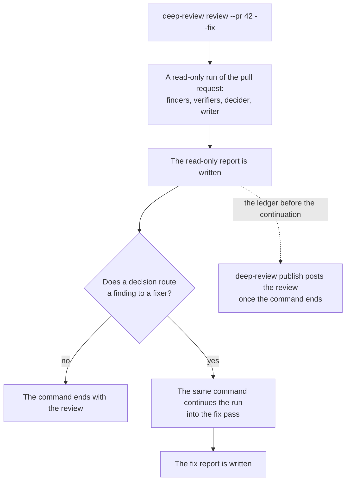

# Product Requirements: The review of a fix run on the pull request

Technical part: [2026-11-08-review-of-a-fix-run.design.md](2026-11-08-review-of-a-fix-run.design.md).

## Summary

deep-review reviews a change and, when asked with `--fix`, fixes the findings it decided to fix. `deep-review review --pr <number>` reviews a pull request on GitHub, and `deep-review publish` posts that review on the pull request as a comment. Today `publish` posts only a run that did not fix (#125). It refuses a run started with `--fix`, and it refuses a read-only run that a later `--fix` continued into its fix pass, the second step of a run, in which fixers edit the tree. So a person who wants both the review on the pull request and the fixes must review read-only, post, and only then continue with `--fix`, and the head of the pull request must not move in between. When the order is missed, posting needs a second full review of the same head. On #123 that second review would have cost about 24 USD and 25 minutes, after a fix run that cost 43.23 USD had already reviewed the same head.

This proposal makes every run of a pull request review first and fix second, on the ledger, the append-only record of a run. `review --pr <number> --fix` creates a read-only run of the pull request, with its writer, the worker that explains the review for a reader of the pull request, and with each verifier's choice given to the decider as a field. When that run has written its report, the same command continues it into the fix pass, as `review --pr <number> --fix` continues a finished read-only run today. `publish` then posts the run as it stood when its read-only report was written: the events of the ledger before the continuation. The posted review says that deep-review went on to fix on the machine that ran it, and that those edits are not part of the review. It no longer says that the run changed no file, or that `--fix` will apply the fixes and the answers.

Figure 1. A run of a pull request with `--fix` after this change. The review that `publish` posts is the part of the run before the fix pass.

## Problem

### The review of a fix run cannot be posted

`publish` refuses a run started with `--fix`, and a read-only run that `--fix` continued (`whyNotPostable` in `src/review/publish.ts`). The non-goal "No review of a fix run" of [the review on the pull request](2026-11-01-review-on-the-pull-request.requirements.md) gives the reason: the edits of a fix run would reach the pull request as suggestions or as commits pushed to its branch, and each is a choice of its own. That reason covers the edits, but the refusal also covers the review. A fix run reviews the pull request in full before its fix pass, with the same finders, verifiers and decider as a read-only run.

### A fix run started with `--fix` lacks what a posted review uses

A run started with `--fix` is configured at `review.configured@9` (`openRun` in `src/review/controller.ts`). It runs no `explanation` phase, so no writer explains its findings for a reader of the pull request. It records its verdicts at version 2, without the two notes of version 3: why a `PLAUSIBLE` verdict is not `CONFIRMED`, and the choice that the verifier leaves to the author (`authorChoice`). So its decider does not get that choice as a field (NG2 of [the settled choice](2026-11-06-choice-settled-on-the-record.requirements.md)). A run continued with `--fix` after a read-only review has both, because it was configured at `review.configured@11` before it was continued.

### The only way to post is an order the person must keep

The README says: "To have the review on the pull request, post it with `publish` before you continue its run with `--fix`." The person must run three commands in that order, and nothing may move the head of the pull request between the first and the third. On #123 a read-only run at `bbc4009b` decided 13 fixes, then three commits moved the head. A fix run of the new head reviewed it from the start, and posting its review needs one more read-only run of the same head.

### The posted text assumes that nothing was fixed

The body of a posted review says that the run "changed no file", and that nothing on the branch changes until the person who ran the review runs `review --pr <n> --fix`. A question says that `--fix` then applies its answer, and a departure says that `--fix` makes the fix unless it is rejected first. Each sentence is true of a read-only run. None is true of a run that went on into its fix pass.

## Goals

A person who runs `review --pr <number> --fix` can post the review of that run on the pull request once the command ends, whether its fix pass finished, blocked or was refused, with no second review. The posted review is the same review that a read-only run of the same head would post, written by the same workers, and it says truthfully what happened after it: that deep-review went on to fix on the machine that ran it. Every run of a pull request gives its decider the verifier's choice as a field, and has its writer explain the review.

## Non-Goals

### NG1: A fix run that did not review first

A run configured with the fix pass from its start, as `review --pr --fix` made before this change, is still refused. It has no writer's explanation and no version 3 verdicts, so its review would need a second form of the posted review, one with no writer, which no reader has read. The refusal says why, and what to run instead.

### NG2: The fixes in the review

The posted review holds no suggestion, no commit, no count of the fixes applied and no link to where the fixes went, such as a pull request stacked on this one. Each would be a claim about edits that the reader of the pull request cannot see, and that a later answer pass can change. The results of the checks that the fix pass runs are left out for the same reason: they are results of the edited tree, not of the head that the review read, and the review says where they are (R6). Whether a review names where its fixes went is a choice of its own, as the non-goal of the review on the pull request says.

### NG3: Answers recorded after the continuation

The posted review shows the run as it stood when its read-only report was written. An answer that the person recorded with `deep-review answer` before the continuation is in it, as in a read-only run. An answer recorded after the continuation is on the ledger and in the report on the machine, but not in the posted review, which then shows that question as open with its default applied. Carrying those answers is the same later work as an answer recorded after a post (the non-goal "No second revision" of the review on the pull request).

### NG4: A pull request that moved

A run is still posted only on the head and the merge base it reviewed (PD2 of the review on the pull request). Fixes pushed to the branch of the pull request move its head, so `publish` refuses after such a push. The README says to post before the fixes are pushed to that branch.

### NG5: Other scopes

A run of `--branch`, `--last-commit`, a range or the working tree with `--fix` is a fix run from its start, as today. Only a run of a pull request can be posted, so only it needs a review apart from its fixes.

## Requirements

### R1: `review --pr --fix` reviews first, then fixes, in one command

A new run of a pull request is configured as a read-only run of a pull request, whether or not the command gives `--fix`: its verifiers record verdicts at version 3, its decider gets each verifier's choice as a field, and its writer explains the review. When its report is written and the command gives `--fix`, the same command continues the run into the fix pass, as `review --pr <n> --fix` continues a finished read-only run today (R1 to R6 of [fix pass continuation](2026-10-10-fix-pass-continuation.requirements.md)). The run budget is the run's over both passes (PD7 of fix pass continuation), and the checks are settled as a continuation settles them. The command then ends as a fix run ends: exit 0 with the path of the fix report as the last line of stdout, or exit 2 with a blocker or a refusal.

### R2: A run with nothing to fix ends with its review

When the decisions of the run route no finding to a fixer, the command does not continue the run. It ends with the read-only report, exit 0, and the log says that the run has nothing to fix and why, as the refusal of PD6 of fix pass continuation says it. A fix run started with `--fix` that has nothing to fix ends with a report and exit 0 today, so the exit code does not change.

### R3: A command with `--fix` continues the read-only run of a pull request that it finishes

A command with `--fix` that resumes a read-only run of a pull request and brings it to its report continues it into the fix pass, as R1 says. This holds for a run that `review --pr --fix` started and a stop cut short, and for a run started without `--fix`. The log of the resume says that the run is continued into the fix pass once its report is written, in place of the line of R10 of fix pass continuation that says `--fix` is ignored.

### R4: The continuation of the same command names its run and reads nothing from GitHub

The command continues the run that it brought to its report, and no other. It reads nothing from GitHub to do so. It holds the run to every check of a continuation that reads the ledger and the tree: the run is complete and was not continued already, its files hold what the run froze and `HEAD` is the head it reviewed, its spend is below the run budget, and its checks can be settled. A refusal exits 2 with the action, says that the review is written and where its report is, and leaves the run complete and continuable, so the same command continues it once the action is taken. That later command is a continuation that a person asks for, which reads the pull request again (R4 of the review on the pull request): it continues the run only while the pull request is still at the head the run reviewed, and creates a new run otherwise. The refusal says so. The command never creates a second run.

### R5: `publish` posts the review of a continued run

`publish` posts a run that `--fix` continued as the run stood when its read-only report was written: the events of the ledger before the continuation. Every refusal of R8 of the review on the pull request applies to that review, the checks of the head and the merge base included. The fix pass need not be finished: a run whose fix pass is blocked or was stopped is posted too, since its review is finished. A run that an engine is running is refused by its lock, as today, so the review of `review --pr --fix` can be posted only once the command ends, and not while its fix pass runs. A person who wants the review on the pull request before any fixer edits a file still runs `review --pr <n>`, posts, and then continues with `--fix`. Without `--run`, `publish` chooses the newest run of the worktree whose review is finished: a run with a current report, or a run continued into its fix pass, whatever the state of that pass. Choosing only a run with a current report, as `report` does, would pass over a continued run whose fix pass is blocked, and post an older run of the worktree or none.

### R6: The posted review says that the run went on to fix

The posted review of a continued run states what followed the review, in place of what a read-only run says will follow it, and claims no edit: a run can be posted while its fix pass is blocked or stopped, and a fixer can fail, so the review says what deep-review went on to do, and that the report on the machine that ran it says what each fix did. The line on what the run reviewed says that deep-review then went on to fix the findings it decided to fix, in its own run on the machine of the person who ran the review, and that those edits are not part of this review. The summary says that those fixes reach the branch only when that person pushes them. A question says that the person who ran the review answers it with `deep-review answer` once the run's fix pass has ended, since that command refuses an answer while the run has no current report, and that the command then applies the answer. A departure says that the fix pass sets out to make the fix as decided and that a rejection sends the finding back to a fixer, an option of a question that edits says that the fix pass makes it when that option is chosen, and the diagram of how the review works shows the review done and the fix pass started on that machine, its report holding what it changed. The line on the checks no longer says that the run only reviewed, so no test ran: it says that no check ran in this review, and that the fix pass runs the repository's checks on that machine, where its report holds their results. The words come from the table of the review's language, in English and in Korean. A finding decided `fix` is still shown as what deep-review decided, "deep-review would fix this", not as applied (NG2).

### R7: A fix run that did not review first is refused with the reason

`publish` refuses a run configured with the fix pass from its start, with exit 2 and an action: the run reviewed and fixed in one pass, as `review --pr --fix` did before this change, so it holds no review written for a reader of the pull request; review the pull request again with `deep-review review --pr <n>`, with or without `--fix`.

### R8: The skills and the README

The skills offer to post the review after any run of `--pr`, and no longer tell the host to post before it continues a run with `--fix`. The README says that `review --pr <n> --fix` reviews, writes the read-only report and continues the run in one command, that `publish` posts the review of such a run once the command has ended, whether its fix pass finished, blocked or was stopped, what the posted review then says, and that the fixes must not be pushed to the branch of the pull request before the post. The skill texts change in their own commit.

### R9: The gate

The gate is a real run (principle 12). On Claude Code, `review --pr <n> --fix` on the pull request of this change runs to its fix report in one command, and `publish --dry-run` then `publish` posts its review on that pull request. The gate reads the posted review against the run: the same findings, verdicts and decisions as the read-only report, the words of R6 where a read-only review has its own, and no sentence that says `--fix` will apply something. It records the spend of the writer and of the continuation's survey, which R1 adds to a fix run of a pull request.

## Metrics

### M1: Second reviews to post

The read-only runs of a head of a pull request that a fix run of the same head had already reviewed. Target: none.

### M2: The cost of reviewing first

The spend of the `explanation` phase and of the continuation's survey in each run of `review --pr --fix`, against the run's whole spend. There is no target. The gate records it, and a high share is a reason to revisit PD5.

### M3: Continuations refused in the same command

The runs whose continuation R4 refused, with the reason of each. There is no target. Each is a run that ended with its review where the person asked for fixes.

## Product Decisions

### PD1: A fix run of a pull request is a read-only run, continued by the same command

Two parts of the record already exist for a run that a person continues by hand: the review, which ends with the read-only report, and the fix pass, which starts at the continuation. `review --pr --fix` now makes that same record in one command. The decider gets the verifier's choice, the writer explains the review, and the review is on the ledger, finished, before any fixer edits a file.

The proposal rejects three other ways. A new version of the configuration for a fix run that explains its review, as #125 suggests, would add a version of `review.configured`, rules of the fold for it and a golden fixture, and `publish` would still have to take the review part out of a fix run that never wrote a read-only report, which is a second way to render the posted review. A review rendered from the state of a fix run as it is would show what the fixers did, and would hold claims that NG2 leaves out. Only stating the order in the README leaves the cost of #123 in place.

### PD2: The posted review is the ledger before the continuation

A continued run's ledger holds, before the continuation, exactly the events of a finished read-only run. `publish` folds those events and renders them as it renders any read-only run, so the review of a continued run and the review of a read-only run of the same head are made by the same code from the same kind of record.

The proposal rejects hiding the parts of the fix pass in the state of the whole run. Each part that the form reads would need its own rule for what to hide, and a part added later would leak into the posted review unless someone remembered to hide it.

### PD3: The review says that the run went on to fix, and not what it applied

The reader of the pull request reads a review of its head. The edits are on the machine that ran the review, and the report there says what each fixer did. The review says that the fixes exist, where they are, and that they are not in it, so a reader does not take "deep-review would fix this" for a promise that nothing has acted on, nor for a fix already in the branch.

The proposal rejects a count of the fixes applied. It is a claim about edits the reader cannot see, and an answer pass after the post changes it while the posted review stays as it was.

### PD4: The same command continues its own run, with no read of GitHub

A continuation that a person asks for later reads the pull request again, so that it continues only the run of the pull request that the command names. The command that just finished the review knows its run. When the pull request moved during the review, the run's tree is still the head it reviewed, and its fixes are fixes of that head.

The proposal rejects reading the pull request again before the fix pass. When the head had moved, the continuation would pass the run over and create a new run, which is the second full review that this proposal removes.

### PD5: The cost of reviewing first is paid by every fix run of a pull request

A fix run of a pull request now runs the writer, up to the writer's budget, 8 USD by the shipped policy, whether or not its review is posted, as a read-only run of a pull request does today. Its continuation asks the surveyor for the checks, one fast worker, which a fix run started with `--fix` asks at the start (PD5 of fix pass continuation). These costs fall inside the run budget.

The proposal rejects running the writer only when `publish` is first asked, which PD10 of the review on the pull request rejected for a read-only run: the tree may have left the head by then, and after a fix pass it has.

### PD6: `--fix` on a resumed read-only run of a pull request continues it after its report

PD4 of fix pass continuation rejected switching a resumed read-only run to the fix pass before its report, because the survey would be asked again mid-run and the person had not read a report. The switch here happens only after the report is written, as that decision requires, and the command's `--fix` states the intent. Without it, a `review --pr --fix` cut short by a stop would resume as a read-only run and end without fixing, since the ledger does not record that the command asked for fixes.

The proposal rejects recording that intent on the ledger. It would be a new event for what the command already says, and the person who resumes without `--fix` gets the read-only run, as before.

## Against the vision note

The proposal supersedes two parts of the review on the pull request: the non-goal "No review of a fix run" and the refusal of a fix run in its R8, and the last sentence of its R4, that a review to be posted is posted before its run is continued.

### Principle 2, record before action

The proposal makes every run of a pull request record its whole review, with its decisions and its explanation, and write its read-only report before any fixer edits a file. The posted review is that record, not a part of a fix run taken apart afterwards.

### Principle 4, deep-review decides; the person answers and writes rules

Each verifier's choice reaches the decider as a field in every run of a pull request, not only in a read-only one, so the decider settles it on the record in a fix run too.

### Principle 4, not the same question 2 times

The proposal departs from this principle in one case. An answer recorded after the continuation and before the post is not in the posted review (NG3), so the review on the pull request shows that question as open, and a reader may raise it again. The reason is PD2: the posted review is the record as it stood when the review was written, and carrying later answers into it is the same later work as an answer recorded after a post. RK1 names the gap.

### Principle 5, the core, the questions, and the departures come first, wherever the review reaches a reader

The order of the posted review does not change. Each question and each departure stays in full, and only the sentences on what follows the review change.

### Principle 6, easy to understand, with little context

The review says in plain words that deep-review fixed on another machine and that the fixes are not in it. It does not tell the reader to wait for a command that has already run, and it does not leave the reader to guess whether "would fix" means a fix to come or a fix made. Most of its new words replace those of a read-only review, but not all: the review of a continued run adds to the line on what the run reviewed what followed the review and where it is recorded, one sentence in English and two in Korean, and adds one sentence to the line on the checks, in each language, that says the fix pass runs the repository's checks and where their results are.

This departs from the vision note, under which a proposal that increases what the person must read goes against the vision ("How to use this document"). The reason is principle 8: the review must say what it does not show, the edits of the fix pass and the results of its checks, and where each is kept, and no sentence of a read-only review says that. The added sentences are only in the review of a continued run, and a read-only review reads as before.

### Principle 7, nothing waits for a person

A person who wants the review and the fixes runs one command. No order of commands must be kept, and posting never costs a second full review.

### Principle 8, say what was not examined, and when a person must look

The review states what it does not show: the edits of the fix pass, and the results of the checks that the fix pass ran, with where each is kept.

### Principle 12, a real run is the gate

R9 makes one real run and one real post the gate.

### How to use this document

The proposal increases what the person reads by the sentences that the section on principle 6 above names, in the review of a continued run only, and names that departure there with its reason. It hides no question and no departure, and makes no question block a run. NG3 can show a question that the person has already answered on the machine. It does not decide that question inside deep-review: the answer stays on the ledger and in the report, and the section on principle 4 above names the departure.

## Risks

### RK1: A posted question that is already answered

An answer recorded after the continuation and before the post is not in the posted review (NG3), so a reader of the pull request sees that question as open, with its default applied. The person who ran the review knows the answer and can say so in the thread.

### RK2: The writer costs every fix run of a pull request

A fix run of a pull request that is never posted still pays for its writer (PD5). M2 measures it.

### RK3: The fixes reach the branch before the post

When the person pushes the fixes to the branch of the pull request before running `publish`, its head moves, and `publish` refuses as for any pull request that moved. The README says to post first. Fixes that go to a pull request stacked on this one do not move its head.

### RK4: A run that an older engine started

A run that `review --pr --fix` started before this change is configured with the fix pass from its start. This engine resumes it as the fix run it is, and `publish` refuses it (R7). Its review can be posted only after a new run.

### RK5: The continuation is refused after the review

A run budget that the review spent, or a survey that failed and left checks unsettled, makes the continuation refuse after the review is written (R4). An old Node is still refused at the start, before the review spends anything, but a warning that a fix run on Codex for Windows gives before its first worker, that its editors run under the unelevated sandbox, now comes after the review. The person then holds a finished review and no fixes, and the refusal says what to do. A fix run started with `--fix` meets the same two conditions differently today: a survey that fails with checks unsettled blocks it before it reviews, and a review that spends the budget leaves its fixers unattempted. Here the person keeps the review in both cases, and the review can be posted. The next `review --pr <n> --fix` continues the run only while the pull request is still at the head the run reviewed; when the head has moved, it reviews the new head in a new run, as any continuation asked for later does.

### RK6: The review waits for the fix pass to be posted

The command holds the run's lock from the review to the end of the fix pass, so its review can be posted only after the fixes, though it was finished before them. The order of three commands remains for a person who wants it posted first.
