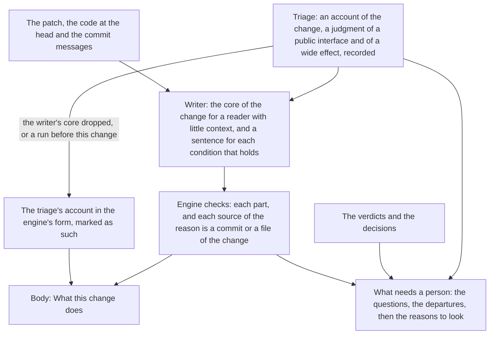

# Product Requirements: The core of the change in the review on a pull request

Technical part: [2026-11-09-core-of-the-change-on-the-pull-request.design.md](2026-11-09-core-of-the-change-on-the-pull-request.design.md).

## Summary

deep-review reviews a change with a series of model workers and records each answer on a ledger. For a pull request, `deep-review review --pr <number>` runs the review and `deep-review publish` posts it as a GitHub review: a body, and a comment on the line of each finding. The first worker after the survey, the triage, writes an account of the change: what it does, why in the change's own words, and whether it alters a public interface or affects many files beyond the ones it changes ([R3 and R4 of the brief of a run](2026-10-20-run-brief.requirements.md#r3-the-triage-writes-the-core-of-the-change)). The last worker of a read-only run of a pull request, the writer, explains the review for a reader who knows neither the code nor deep-review ([R18 of the review on the pull request](2026-11-01-review-on-the-pull-request.requirements.md#r18-a-writer-explains-the-review-for-the-readers-of-the-pull-request)).

The posted review leaves out what the change does. [PD3 of the review that reads as a report](2026-11-04-review-that-reads-as-a-report.requirements.md#pd3-the-review-leaves-out-the-core-of-the-change) decided so, on the reason that the pull request's own description says what it does, and named it as a departure from principle 5 of the vision note. The vision note of 2026-11-05 (#119) holds principles 5 and 6 for the review on a pull request, counts a proposal that leaves the core out of that review as against the vision, and says that a later proposal brings the core back. This is that proposal. The post also leaves out three of the four conditions under which principle 8 asks a person to look, so it can say that nothing needs a person on a change that the run itself judged to alter a public interface.

The review that deep-review posted on #130 shows both. Its body opens with the reviewed commit and a count of 19 findings, says "Nothing here needs a person", and never says that the pull request reduces the time of the tests and the work of CI. The same run's triage had written that account, and had judged that the change alters a public interface and affects many files beyond its own; one of its fixes rests on a `PLAUSIBLE` verdict. The run's report on the machine opens with the account. The post on the pull request has none of it.

After this change the body opens with the core of the change: what it does and why, written by the writer for the reader with the least context, in the language of the review. The writer writes it from the patch, the code at the head and the change's commit messages, and reads the triage's account as an unverified starting point, not as text to copy. The reason names the commits and the documents it comes from, and the engine checks that each of them is part of the change and links it. The engine says under the core that it is deep-review's reading of the change and that no verifier examined it. What needs a person lists, after the questions and the departures, each condition of principle 8 that holds, as a reason to look that nothing waits on: a public interface and a wide effect as the triage judged them, each explained by the writer with the files that show it, and the fixes whose verdict is only `PLAUSIBLE`. What the run did not examine moves up to follow it, as principle 5 orders. When the writer's core is missing, the engine posts the triage's account in its own form, so a run whose writer fails still opens with the core.

Figure 1. Where the core of the change and the reasons to look come from after this change.

## Problem

### The review on a pull request does not say what the change does

A reader of the review on a pull request is often not its author: a reviewer, a maintainer who has not touched the code for a long time, or an engineer who joined last week. Principle 5 puts the core of the change first, before the questions and the departures, because a reader cannot weigh a finding without knowing what the change sets out to do. The review on #130 names, in the titles of its findings, an "aggregate-status run", "contract-policy tests", "boundary calibration" and "plan validation", and says nowhere that the pull request introduced them to cut the time of the tests and of CI. A reader who did not read the diff cannot tell which of them the change adds and which it touches.

The description of the pull request does not fill the gap. Principle 5 says so in its own words: an agent often writes the description, and no review checks it against the code. No worker of deep-review reads it ([PD8 of the review on the pull request](2026-11-01-review-on-the-pull-request.requirements.md#pd8-the-request-is-frozen-and-no-worker-reads-it-yet)). deep-review holds an account written from the code and the commits, independently of the description, and posts nothing of it.

### "Nothing here needs a person" while a condition of principle 8 holds

Principle 8 names four conditions under which a person must look even when no finding asks: a departure from a rule, a fix whose verdict is only `PLAUSIBLE`, a change to a public interface, and a change that affects many files. The post lists the departures in what needs a person and nothing else of the four. On #130 it wrote "Nothing here needs a person: deep-review asks no question, and no fix goes against a written rule." The triage of the same run had judged that the change alters a public interface, since CI gains scheduled and manual runs and a plan, gate and aggregate status that tell a documentation exemption from a contract that ran, and that it affects many files, since the policy of CI governs the validation of every later change. Finding 17 is a fix whose verdict is `PLAUSIBLE`. A change of how CI validates every pull request is a question of direction for a maintainer, the kind that principle 8 says a review must point to when no finding raised it, and the review said the opposite.

### The account the run holds is written for the workers

The triage's account exists to give every later worker the intent of the change, and the brief shows it whole in the report on the machine. It is not written for the reader of a pull request. The triage is not told the language of the review, so in a review in Korean it is English. Its reason is labeled as the change's own words, while on #130 it is the triage's summary of seven commits: "The commits cite measured bottlenecks and repeated CI and local work: stop restarting path recognition at every suffix of a long word, reuse compiler state, cancel obsolete PR runs, exempt documentation-only PRs, and replace duplicate executions and padding sweeps while preserving their coverage boundaries." It lists the 13 paths it rests on. And the triage judges a condition from the patch before any finder has run, so its sentence for a condition can name what is not a public interface beside what is: on #130 it opens with "Typechecking now writes reusable local state", a file in an ignored cache directory, before the outputs of CI that a maintainer must look at. Posting the account as it is would put at the top of the review a text written for another reader.

### What the run did not examine comes after the evidence

Principle 5 orders what a reader reads first: the core of the change, the questions that only a person can answer, the departures from rules, and what the run did not examine. The findings, fixes, checks and changed files come after, as the evidence. The body today puts "What this review did not examine" second to last, after the major findings, the minor table and the findings left as is. On #130 it held "No check ran in this review" and the four paths under `dist/**` and `test/fixtures/checkpoints/**` that no worker read, on a pull request whose subject is the time the checks take and which rebuilds both engine bundles under `dist/`.

### The writer can fail, and every part of it then drops

A part of the review that only the writer writes is missing when the writer fails. On #130 the writer ran on Codex 0.167.0 and both of its attempts failed with "Codex used mcp_tool_call, which the worker is not given" (#99), so the run recorded its explanation with every part dropped, and the body and each comment carry deep-review's own words with a mark. A core that only the writer can give would be missing from such a run too, and the top of the review would be empty again.

## Goals

A reader who opens the review on a pull request learns first, in the language of the review and with no name left unexplained, what the change does and why, with the commits and the documents that state the reason one step away; then what deep-review asks, where it went against a rule, and each condition under which principle 8 asks a person to look; then what the run did not examine. Every statement of the core is true of the code at the reviewed head, and the review says whose reading it is and that no verifier examined it. "Nothing here needs a person" is said only when no question, no departure and no condition holds. A run whose writer fails still opens with the core.

## Non-Goals

### NG1: The report on the machine

The report written on the machine keeps the triage's account at its top and its own part "What needs you", as the brief of a run defines them. It already states the core and the conditions that hold, for the person who ran the review. Its "What needs you" also says "Nothing needs you" on a run whose conditions hold, as the review on #130 did, and showing the conditions there is a change of the brief, which is left to a proposal of its own. The writer's core is posted on the pull request and recorded on the ledger; the report does not show it.

### NG2: The triage's account and its judgments

The triage's prompt, its schema and its account stay as they are, and so do its judgments of a public interface and of a wide effect. In particular the triage is not told the language of the review, which belongs to passing the language to every worker whose text is posted (#111, and the sixth step of the report [How the review on a pull request is written and read](../reports/2026-11-05-review-written-and-read.md)). This change measures how good the triage's judgments are (M4) and does not change them.

### NG3: The description of the pull request

No worker reads the title or the body of the pull request, as PD8 of the review on the pull request decided. Comparing the description with the code is the work of the angle that reads a change against its request, a later change. The core gives a reader an independent account to compare the description with, and the review does not compare them itself.

### NG4: The comments on the lines

A comment on a line does not repeat the core. Repeating it in each comment would multiply what a person reads, and a comment cannot link to the body before the review is posted, since GitHub gives the body's URL only then (the open question "Should `publish` link the body to the comments after the post?" of the [design of the review that reads as a report](2026-11-04-review-that-reads-as-a-report.design.md#should-publish-link-the-body-to-the-comments-after-the-post)).

### NG5: The other gaps of the report

The names of the code in a finding's title that no part of the review defines (G3 of the report), the evidence that stays on the machine of the person who ran the review (G4), the text of other workers in English in a review in another language (G5) and answering a question on the pull request (G6) are left to their own changes. So is the structure in which the engine plans the review as data and the writer fills every slot (S2 to S5 of the report).

### NG6: The failure of the writer on Codex

The writer's failure on Codex with `mcp_tool_call` (#99) is a fault of the runtime's isolation, fixed on its own. This change gives the core a fallback for any failure of the writer (R10), and its gate runs the writer on Claude Code (R13).

### NG7: The length of the review

This change does not cap the core or the reasons to look below what the schemas of the answers already bound, and it does not cut them to fit. The author asked for the right content first. The review gets longer by the core and the reasons to look; the gate measures how much (M5), and a later change can shorten what the measure shows to be too long.

## Requirements

### R1: The review opens with the core of the change

The body of the review on a pull request gives, right after its heading and the line on what the run reviewed, a section on what the change does, before the summary of the findings. Nothing in the body comes between the line on what the run reviewed and the core. The core is never cut to fit the body.

### R2: The writer writes the core for the reader with the least context

The writer writes the core of the change: a title, what the change does, why it does it, and, where the flow takes long to say, a diagram. It writes for a reader who knows the craft but neither this repository nor the change, such as an engineer who joined the team last week (principle 6). It says what the change does in plain words, in the order a reader needs it, and explains each name of the code or of the change where it first uses it, or leaves the name out. It introduces the names of the change that the titles of the findings below use, so that a reader meets them in the core first.

The writer writes the core from the patch, the code at the head and at the merge base, and the commit messages of the change, which its task now gives it, as the triage's task gives them. It reads the triage's account in the brief as deep-review's earlier, unverified reading: a place to start, never a text to copy. Where the code says otherwise than the account, the core follows the code. The writer states nothing of the change that the code at the head does not show, and does not describe what the review found: the core is about the change as submitted, and the findings follow it.

### R3: The reason comes from the change's own words, and names where

The writer takes the reason from the words of the change: its commit messages, and the proposals and other documents that it adds or edits. It restates them in plain words, or quotes them where the exact words matter, and names each commit and each file that states the reason. It gives no reason of its own. When the change states no reason, the writer says so by giving none, and the review says that the change states no reason.

The engine checks each source that the reason names: a commit must be one of the change's commits, named by at least seven characters of its id, which name no other commit of the change, and a file must be one that the change adds, edits or removes. A reason with no source, or with a source that is not part of the change, fails its part. The body links each commit and each file of the reason at the reviewed commit.

### R4: The review says whose reading the core is

Under the core, the engine says in its own words that it is deep-review's reading of the change, written from its code and commit messages, and that no verifier examined it. When the core is the triage's account (R10), the line says that too. A reader can then weigh the core as they weigh any unverified statement, against the description of the pull request and the code.

### R5: The core is about the change, not about the review

The core names no finding and no candidate of the run, and holds no verdict of the review. The engine refuses a core that names an id of a finding or of a candidate of the run, or holds `CONFIRMED`, `PLAUSIBLE` or `REFUTED`, as it refuses every other text of the writer that holds a verdict.

### R6: What needs a person lists the reasons to look

What needs a person keeps its questions and its departures from rules, each with what stands and how to answer, and the one command that answers them. After them it lists each condition of principle 8 that holds and is not already listed, as a reason to look that nothing waits on and nothing answers:

A change to a public interface, when the triage judged that the change alters one, with the writer's sentence on what changes and for whom (R8), and each file that the triage named as showing it, linked at the reviewed commit.

A change that affects many files beyond the ones it changes, when the triage judged so, in the same form.

The fixes whose verdict is only `PLAUSIBLE`, as one item that names each by its number and links it, and says that deep-review would change the code on a claim that its verifier did not confirm. A fix with a departure whose verdict is `PLAUSIBLE` is named in this item too, since the item is about the verdict and the departure's own item is about the rule.

A departure from a rule is the fourth condition, and it is listed once, as today. The command that answers lists only the flags of the questions and the departures; a reason to look has none.

### R7: The review says "nothing needs a person" only when nothing holds

When no question, no departure and no reason to look holds, what needs a person says so, and also says that no fix rests on a `PLAUSIBLE` verdict and that, in deep-review's judgment, the change alters no public interface and affects no file beyond its own. When the run has no judgment of a public interface or of a wide effect, because its triage gave no account or an earlier engine ran it, the review says that it has none, and never states that a condition does not hold. When only reasons to look hold, the section says that nothing waits for an answer and lists them.

### R8: The writer explains each condition the triage judged, and adds none

For each condition that the triage judged to hold, the writer gives one or two sentences in plain words: what part of the change is the public interface and who reads or calls it, or which files beyond the change its effect reaches and how. It writes them from the code. When the code does not show what the triage judged, the writer says so in a sentence, in place of the explanation, and the review then gives the triage's own sentence for the condition, marked as the triage's judgment that the writer could not explain from the code, so a reader knows to look and to weigh it. The writer neither adds a condition that the triage did not judge to hold nor removes one that it did: the judgment was made and recorded before the writer ran (principle 2), and the writer decides nothing.

### R9: What the run did not examine follows what needs a person

The section on what the review did not examine follows what needs a person, so the first part of the body holds the four parts of principle 5 in its order: the core, the questions, the departures with the reasons to look, and what the run did not examine. The section on how the review worked follows it, and the findings come after that. The refuted candidates stay folded inside the section on what was not examined.

### R10: A core missing from the writer's answer is the triage's account

When the run's explanation holds no core, because the writer failed, its core failed its checks twice, or the run predates this change, the body gives the triage's account in the engine's own form: what the change does, why in the change's own words with where they are or that the change states none, as the brief of a run shows them, and the line of R4 that says it is the account of deep-review's triage, written before the review, which no verifier examined. When the run has no account either, the section says that deep-review has no account of this change and why, as the brief does. The same holds for a condition: with no sentence of the writer's for it, the item gives the triage's sentence under the mark of R8.

### R11: The core is in the language of the review

The writer writes the core and the sentence of each condition in the language that `review.language` names, as it writes the rest of its answer ([R20 of the review on the pull request](2026-11-01-review-on-the-pull-request.requirements.md#r20-the-language-of-the-review)). The engine's words around them, the headings, the line of R4, the labels of the reasons to look and the marks, come from the table of that language. The triage's account, which a fallback posts (R10), stays in the language the triage wrote it in, English today, until the triage is told the language (NG2); a review in Korean whose writer failed therefore opens with an English account, and the line of R4 says that it is the triage's.

### R12: An older run

A run configured before this change is posted in the new form. Its writer answered without a core, so its core is the triage's account (R10), and its reasons to look come from its triage's judgments, each with the triage's sentence under the mark of R8. A run whose triage recorded no account gets the sentences of R7 and R10 for a run with no account.

### R13: The gate

The gate is real runs (principle 12), each posted with `publish --dry-run`. deep-review reviews the pull request of this change on Claude Code. It reviews again, on Claude Code, the change of #130, which holds two conditions of principle 8 and a `PLAUSIBLE` fix: #130 is merged, and `review --pr` and `publish` refuse a pull request that is not open, so the run reviews a pull request that holds #130's commits on the base they had, opened in a copy of this repository under an account the author controls, as [R8 of the settled choice](2026-11-06-choice-settled-on-the-record.requirements.md#r8-the-gate) did for #114. And it reviews deep-review/click#1 with `review.language = "ko"` from the repository's file, on Claude Code, since the writer on Codex meets #99. A fourth run, on Codex, is recorded for what its body opens with whatever its writer does, which tests the fallback of R10 when #99 still holds.

For each run, the author reads the core against the diff and the commits, each source of its reason against what the core says it states, and each reason to look against the change, and records the metrics below. A reader who did not take part in the change, or an agent given only the body, writes what the change does and why from the core alone, and the author compares it with the change. The design's Verification section records each run and each reading.

## Metrics

### M1: The core is true of the code

The statements of each core that the code at the reviewed head does not support, counted by the author's reading against the diff. The target is none in each run. A false statement in the core is worse than no core, since it is the first thing a reader reads.

### M2: The reason rests on its sources

Of the sources each core's reason names, how many state what the core says they state, by the author's reading. The engine already holds each source to the change (R3); this measures what the engine cannot. The target is every source. A core that says the change states no reason, on a change whose commits or documents do state one, counts as a miss.

### M3: A reader with little context understands the change from the core alone

For each run, whether the account that a reader with no part in the change writes from the core alone, of what the change does and why, matches the change, as the author judges it; and the names in the core that such a reader could not follow. The target is a match in each run and no name left unexplained.

### M4: The reasons to look

For each condition that a run lists, whether the author judges that a maintainer should look for that reason, and for each run, a condition that the author judges holds and the review did not list. This change does not change the triage's judgments (NG2), so M4 has no target here: it is the baseline for a change of the triage's rubric. M4 also counts the conditions the writer could not explain from the code (R8).

### M5: What the change adds to the review

The characters of the core and of the reasons to look in each body, beside the body's whole length, and the writer's time and cost beside those of the same change's writer before this change where a run of it exists. This has no target (NG7). Principle 12 asks that a larger answer of the writer be measured on a real run, since the writer's budget and timeout were set for the answer of the review that reads as a report.

## Product Decisions

### PD1: The core comes back to the review on a pull request

The vision note of 2026-11-05 counts a proposal that leaves the core of the change out of the review on a pull request, or puts it after the evidence there, as against the vision, and names PD3 of the review that reads as a report as such a departure. This proposal reverses PD3: the core is in the body, first, and never cut. PD3 rested on the description of the pull request; principle 5 now says that the description does not take the place of the core, because an agent often writes it and no review checks it against the code.

### PD2: The writer writes the core, and the triage's account is its input and its fallback

The triage knows the change first and already writes an account, so posting that account would cost no worker. The proposal rejects posting it as the core, because it is written for the workers that follow the triage and not for the reader of a pull request: it is in English whatever the review's language, its reason can be the triage's summary under the label of the change's own words, it lists every path it rests on, and its sentences are written before any finder ran (the problem "The account the run holds is written for the workers"). The writer already runs in every read-only run of a pull request, on the strong tier, reads the patch and the code, writes in the review's language for a reader who knows neither the code nor deep-review, and has the whole review in view, so it knows which names of the change the titles of the findings will use. Writing the core is one more part of an answer it already gives.

The triage's account stays on the ledger and in the report on the machine, and it is the core when the writer gives none (R10). The proposal rejects a new worker for the core, for the reason PD2 of the brief of a run gave: a new worker brings its own failures, retries, budget and resume. It rejects having the triage write a second account for the pull request, since the triage writes before the review and in English, and since its text goes to every later worker too.

### PD3: No worker reads the description of the pull request, still

The writer could take what the change does from the description, which on #130 states it well. The proposal keeps PD8 of the review on the pull request: the core is valuable to a reader because it is written from the code independently of the description, which an agent often writes and nothing checks. A core that restated the description would leave the reader with one unchecked account presented as two.

### PD4: The writer reads the commit messages

The reason of a change is in its commit messages and its documents, not in its code (PD3 of the brief of a run). The documents are in the patch; the commit messages are not, and only the triage is given them today. The writer gets the same list, with the same limits, so it can state the reason from the change's own words and name the commit that states it, rather than restate the triage's reading of them.

### PD5: The engine checks where the reason comes from, and the gate checks what it says

A reason with sources is a claim with evidence one step away (principle 1). The engine can check, exactly and cheaply, that each source is a commit or a file of the change, and links it, so a reader reaches the words the reason rests on in one click. It cannot check that the words say what the core says they say, nor that the account of what the change does is true of the code. The gate reads both (M1, M2). The proposal rejects a second model that checks the core against the code, for the reason PD11 of the review on the pull request gave for the explanation of a finding: it costs a worker in every run before any run has shown a core that goes beyond the code, which principle 11 does not permit yet.

### PD6: The triage judges a condition, the writer explains it

What counts as a public interface, and whether an effect reaches many files, is a judgment of the code ([PD8 of the brief of a run](2026-10-20-run-brief.requirements.md#pd8-the-triage-judges-a-public-interface-and-a-wide-effect-not-a-rule-of-the-engine)), and the triage's is recorded before any later worker runs. The writer explains it for a reader, and when the code does not show it, says so in place of an explanation; the item then stays, with the triage's sentence and a mark. The proposal rejects letting the writer remove a condition it disagrees with, or add one: that would make the writer judge the change, which it is told never to do, after the judgment was recorded, which principle 2 does not permit. A condition the writer cannot explain is still a reason to look, and the mark tells a reader that two workers read the change differently, which is itself worth a look.

### PD7: The fixes on a `PLAUSIBLE` verdict are one item, of the engine's facts

Which fixes rest on a `PLAUSIBLE` verdict is a fact of the ledger, and each fix's comment already says why its verdict is not `CONFIRMED`. An item per fix would repeat each comment, and on a run with many such fixes would fill the first screen with what principle 8 means as one condition (PD7 of the brief of a run reached the same choice: name each condition with its findings, not one answer per finding). The item names each fix by its number with its link, and a reader opens the comment for the reason.

### PD8: The reasons to look belong to what needs a person

Principle 8 asks the review to name when a person must look. A separate section after what needs a person could still say "Nothing here needs a person" above a list of reasons to look, which is the contradiction of #130 moved down a heading. So the reasons to look are part of what needs a person, after the items that wait for an answer, under words that say nothing waits for the look. The answer command stays about the questions and the departures.

### PD9: What the run did not examine moves up

Principle 5 puts what the run did not examine in the first part, before the evidence. The section moves to follow what needs a person, and the section on how the review worked, which says how deep-review works and is the same on every review, moves after it. The proposal could have left the order for a later change, as the report did not name it. It moves it here because the change already reorders the top of the body for principle 5, and because the gap showed on #130, whose body said only near its end that no check ran on a change about the checks.

### PD10: Names are explained where they appear, with no list of terms

The writer's first answer held a list of terms with their meanings, which the review that reads as a report removed with the account ([TD2 of its design](2026-11-04-review-that-reads-as-a-report.design.md#td2-the-writer-stops-writing-the-account)). Principle 6 asks that a name be explained where it first appears, or left out. A list of terms is read apart from the sentence that needs the term, and grows with every name the writer thinks of. The core explains each name it uses where it uses it, and introduces the names that the titles of the findings will use, so the first place a reader meets them is the core.

### PD11: The core does not repeat the review

The core is the change as submitted. A core that says what the review found mixes the core with the evidence that principle 5 keeps apart, and would say a finding twice, which #109 named a fault of the first post. The summary of the findings follows the core and says what the review found.

## Against the vision note

This proposal is read against the vision note of 2026-11-05.

### Principle 1, evidence, not trust

The core is a model's reading of the change, which no verifier examined, and it is the first thing a reader reads. The proposal does not make it evidence. It makes the reading say so (R4), puts the sources of the reason one step away and checks that each is part of the change (R3, PD5), keeps the core to what the code shows (R2), and has the gate read each core against the code (M1, M2). The proposal accepts an unverified statement at the top of the review, because principle 5 requires the core and no verifier can confirm a summary of a change, and it names the cost as RK1.

### Principle 2, record before action

The core and the sentences of the conditions are parts of the writer's answer, recorded on the ledger before `publish` reads them, as every part of the writer's answer is. The reasons to look come from judgments recorded before the writer ran: the triage's two conditions and the verdicts of the fixes. The form adds no judgment of its own. It lists a condition when the recorded judgment says that it holds, and a fix when its recorded verdict is `PLAUSIBLE`. The writer explains each condition and cannot add or remove one (PD6).

### Principles 5 and 6, the core first, easy to understand with little context

The proposal serves both. The body opens with the core, never cut; the questions, the departures and the reasons to look follow; what the run did not examine comes next; and the evidence after (R1, R6, R9). The core is written for the reader with the least context, in the review's language, with each name explained where it appears (R2, R11, PD10).

One case departs from principle 6: a review in a language other than English whose writer gave no core opens with the triage's account in English (R11). The proposal accepts it until the triage is told the language (NG2), because an account in another language is better for that reader than none, and the line under it says whose account it is.

The vision note counts against a proposal one that "increases what the person must read". This proposal does: the body gains the core and the reasons to look (M5, NG7). The conflict is between that rule and principle 5, which requires the core and makes a review without it against the vision. The proposal follows principle 5, and names the conflict so that the next note can say how the two weigh.

### Principle 8, say what was not examined, and when a person must look

The proposal serves this principle: the review names each of its four conditions that holds, and stops saying that nothing needs a person when one does (R6, R7). The principle does not permit a "please review" that names no condition; each reason to look names its condition and the files or fixes that show it. Two of the four conditions are the triage's judgment, which this change does not improve (NG2). A condition the triage misses is not listed, and one it judges wrongly sends a reader to look for nothing. The gate measures both (M4).

### Principle 11, recovery without a person

A core that fails its checks is given back to the writer once, with what failed, and dropped after a second failure, as every part of the writer's answer is; no failure of the core stops the run. The fallback to the triage's account (R10) is the existing rule that a dropped part of the writer's answer gives way to the engine's own words, applied to a new part. The proposal builds no new recovery.

### Principle 12, a real run is the gate

R13 is four real runs, three of them on Claude Code from their start to `publish --dry-run`, and each metric is read on them. M1 to M3 have targets that a run can miss, so the gate can fail. M4 and M5 have none, since this change does not set what they measure, and they are recorded as baselines.

## Risks

### RK1: A wrong core misleads every reader

A core that misstates the change is read first and believed most, and a reader who trusts it reads every finding in the wrong light. The line of R4 says that no verifier examined it, the sources of its reason are linked, R2 keeps it to what the code shows, and the gate reads each core against the code (M1). A core that the gate finds wrong is a case for the writer's prompt, and a pattern of them is the case for a second model that checks it (PD5).

### RK2: A reason whose sources exist but do not say it

The engine checks that each source is part of the change, not that it states the reason, so a writer can cite a real commit for a reason the commit does not give. The gate reads each source (M2).

### RK3: The triage's conditions are wrong or missed

On #130 the triage named a typecheck cache as part of a public interface beside the outputs of CI. A wrong condition sends a reader to look at nothing, and a missed one keeps a reader from looking. The writer's sentence (R8) narrows a condition to what the code shows, and its mark tells a reader when the writer could not see it. The rest is the triage's rubric, which M4 measures for a later change.

### RK4: The writer costs more and takes longer

The writer's answer gains a part that reads the whole change, and its task gains the commit messages, up to 32 KiB. The writer runs with the budget and the timeout of its role, and a writer stopped by them drops its parts as today, so the core falls back to the triage's account. The gate measures the writer's time and cost (M5).

### RK5: The report on the machine and the post give two accounts

The report shows the triage's account and the post shows the writer's core, and they can differ. Each says whose it is, and a person who reads both sees two readings of one change by two workers. Showing the writer's core in the report is left open (the design's open questions).

### RK6: A run configured before the change cannot resume after it

The writer's role prompt changes, so a run configured before the change and resumed after it is refused with the action to name the old roles directory (`--roles <dir>`), as for every earlier edit of a fragment. Such a run keeps its writer's answer of the review that reads as a report and is posted with the triage's account (R12).

### RK7: A writer that fails on Codex leaves the triage's account at the top

Until #99 is fixed, a review on Codex whose writer meets it opens with the triage's account in English, under the line that says so. That is the core of principle 5 in a weaker form, and better than the empty top of #130's review. The fourth run of the gate records it.

### RK8: More sentences in the engine's words

The reasons to look, the line of R4 and the sentences of R7 are new words of the engine in each language, which W2 of the report names as where most faults of form began. The design keeps them as labels and short fixed lines, with numbers only in lists that no particle follows, and the plan of the review as data (NG5) is where they would move to the writer.
