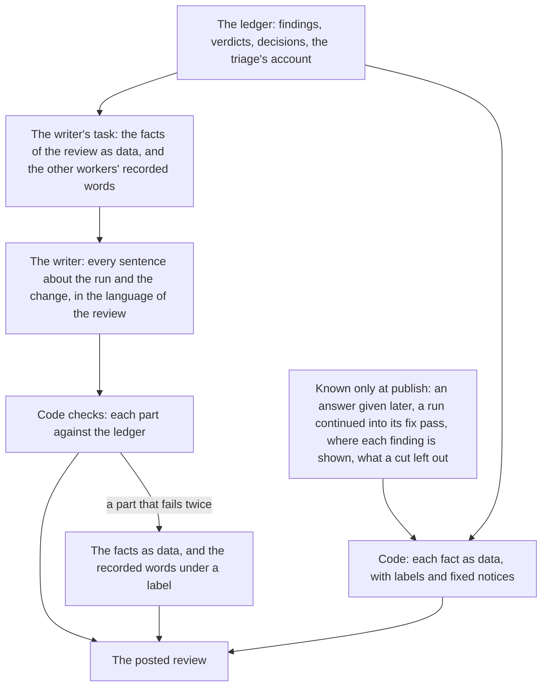

# Product Requirements: A model writes the review's sentences, and code shows its facts

Technical part: [2026-11-12-review-in-the-writers-words.design.md](2026-11-12-review-in-the-writers-words.design.md).

## Summary

deep-review reviews a change with a series of model workers and records each answer on a ledger, the append-only record of a run. For a pull request, `deep-review review --pr <number>` runs the review and `deep-review publish` posts it as a GitHub review: a body, and a comment on the line of each finding. Two parties write that review. The code of deep-review, which the repository's other documents call the engine and this proposal calls code, holds every fact exactly: each count, verdict, severity, link and command. The writer, the last model worker of the run, explains the review for a reader who knows neither the code nor deep-review.

Today the line between the two runs through the page and through single sentences. Code builds much of what a reader reads by joining facts and other workers' words into sentence templates, one set in English and one in Korean. The report [How the review on a pull request is written and read](../reports/2026-11-05-review-written-and-read.md) found that most faults of form in the posted reviews began in those templates (its W2), and that the text of the other workers, the decider that decides each finding and the verifiers that check it, is posted in English inside a review of another language (its G5, #111).

This proposal draws the line by kind of work. Writing a sentence in a natural language is what a model does best, and stating a fact exactly is what code does best. After this change the writer writes every sentence of the review that says something of this run or of this change, in the language of the review. Code writes none. It shows each fact as data beside the text it belongs to: a label and its value, a table, a list, a link or a command. It keeps a small set of fixed notices that are the same in every review, such as what `CONFIRMED` means. Where the writer's text is missing, code shows the facts and the recorded words of the worker whose text the writer would have restated, under a label that says whose they are.

The illustration below is the block of one question, before and after. It is written for this proposal and is not the output of a run.

```text
Today, in sentences that code builds around the decider's words:

  Why deep-review asks: The repository states no rule for a failed upload.
  The question: Should a failed upload be retried or reported?
  1. Retry once. Cost: a duplicate upload when the first one arrived late.
  2. Report the failure. Cost: the user must start the upload again.
  deep-review recommends option 2. Until someone answers, option 1 stands,
  the easiest to take back: the code stays as it is.

After this change, the writer's text, then the data that code shows:

  When an upload fails, the code can try once more or tell the user at once,
  and nothing in the repository says which. Trying again can store the same
  file twice when the first attempt was only slow. Telling the user costs
  them a second attempt, and deep-review recommends it, because a duplicate
  is harder to find later than a failed upload is to repeat.

  | Option | What it means                | What it costs                     | The rule it would become            |
  | 1      | Try the upload once more     | The same file can be stored twice | A failed upload is retried once     |
  | 2      | Tell the user that it failed | The user starts the upload again  | A failed upload is reported at once |

  Recommended: option 2. Stands until answered: option 1, no edit.
  Status: waiting for an answer.
  (folded) The options as the decider recorded them, which the answer applies.
```



Figure 1. Who writes what after this change. The writer writes the sentences, and code shows the facts.

## Terms

**Code**, with no article, is the program of deep-review, which the repository's other documents call the engine: what counts, checks, links and renders, as opposed to a model. The report uses the word in this way. "The code", with its article, is the code of the repository under review.

A **templated sentence** is a sentence that code builds by joining facts, or the text of a worker, into a fixed frame.

A **fact** is what the ledger or code holds exactly: a count, a number of a finding, a verdict, a severity, a status, a time, a place in the code, a link, a command, or the number of an option.

A **sentence of the run** is a sentence that says something of this run or of this change, as opposed to one that is true of every review.

A **label** is the name of a fact shown beside its value: a heading, the name of a column or of a field, or the name of a value of a closed list, such as a severity.

A **fixed notice** is a text of the form that is the same in every review of its language and holds no fact of the run, such as the meaning of each verdict, or who answers a question and where.

**Recorded words** are the text that a worker other than the writer wrote and the ledger holds, such as an option of the decider or a reason of a verifier.

A **late fact** is a fact that can change after the writer has run: an answer recorded later and what became of the finding it answers, whether the run went on into its fix pass, whether a finding is shown on its line or in the body, and what a cut to size left out.

## Problem

### Code builds sentences from templates, and the faults of form begin there

The words that code writes in the review are a table, `PullRequestWords`, in English and in Korean. Of its 119 entries, 54 are functions that build a sentence from counts, numbers and other text, and 6 of the 8 entries that word what follows a run continued into its fix pass are functions too. Each function is written twice, once per language, with its grammar coded by hand. The English one for the fixes that rest on a `PLAUSIBLE` verdict chooses between "A fix rests" and "Fixes rest" and between "finding" and "findings". The Korean table must attach a particle after a number, and Korean chooses the particle by how the number is read; the report found a function of that table that wrote "지적 사항 15은", and today `minorNeeds` still puts a fixed "는" after a list of numbers, whichever number ends it. The test of the tables holds the two languages to the same keys and types, which cannot find a sentence that reads wrongly.

The report traced the faults of form of #101 to #115 and found most of them here or in the layout around these sentences: the count of #102, the wording of a question's options in #104, who makes a fix in #108, the repetition of #109, and the sentences of #115 that read wrongly. Each later change added more of the same kind. [RK8 of the core of the change on the pull request](2026-11-09-core-of-the-change-on-the-pull-request.requirements.md#rk8-more-sentences-in-the-engines-words) records that the entries it added are "new words of the engine in each language, which W2 of the report names as where most faults of form began", and that it kept them to labels where it could.

### A sentence changes its author, and its language, in the middle

Many templated sentences wrap the text of a worker. In a review in Korean, the line of a question in an area is the table's "작성자에게 묻는 질문이며, deep-review는 2번 선택지를 권합니다:" followed by the decider's option in English. #111 quotes a sentence that opens in Korean and ends in the triage's English, and a fix that is given once in the decider's English and again in the writer's Korean. The decider, the verifiers and the triage, the first worker to read the change, are not told the language of the review, and [R20 of the review on the pull request](2026-11-01-review-on-the-pull-request.requirements.md#r20-the-language-of-the-review) leaves their words in English in a review of any language. What needs a person, which a reader with little context reads first, is where these words are densest: the decider's question, its options and its rule.

### A third language costs a hundred entries of grammar

For a language other than English and Korean, the writer writes in the language and every word of that table stays in English. Adding the language means writing all 119 entries again, 54 of them functions with their own agreement of number and their own particles or cases, and every later change to the form writes each new sentence once more per language.

### Some of what the writer writes is not posted, and some of what is posted nobody wrote for the reader

The writer gives, for each finding, the decision in plain words, and code keeps that text with the answer and posts the decider's own words in its place. The findings left as is are posted with a title taken from the first sentence of another worker's summary and with the decider's grounds as written, since the writer is not asked for them ([NG3 of the settled choice](2026-11-06-choice-settled-on-the-record.requirements.md#ng3-the-writers-explanation-of-a-finding-left-as-is)). #113 found that such titles name a fact of the code and not the problem. The gaps of what the review did not examine are sentences that the brief of the run, written for the person who ran it, builds in English.

## Goals

A reader of the review on a pull request reads every sentence in one language and in one voice, written for the reader with the least context, with no sentence that a template built and no text that switches language in its middle. Every fact the reader acts on stands beside that text as data from the ledger, exact, and labeled so that it reads without a sentence around it. What an answer applies is on the page as the decider recorded it. A new language of the review costs a table of fixed strings and, apart from how a finding is named inside a sentence (NG3), no grammar. A run whose writer fails still posts a review that is correct, in data and in the recorded words of the other workers. Being understood by that reader is the first aim of the writer's text, ahead of being short and ahead of staying close to the words it restates.

## Non-Goals

### NG1: The report on the machine

The report that the run writes for the person who ran it, and the brief it opens with, stay as they are, in the English sentences that code builds. The writer's text is written for the reader of the pull request, and whether the report should carry any of it is left open (OQ3 of the design).

### NG2: The other workers

The finders, the verifiers, the triage, the worker that merges and ranks, and the decider keep their prompts, their tasks, their schemas and their language. Step 6 of the report, which would tell each of them the language of the review, is not done (PD4).

### NG3: How a text names a finding

A worker names a finding by its id, as `RIPPLE-2`, and the form replaces the id with the finding's number where it posts the text, as [the finding names in the review](2026-11-08-finding-names-in-the-review.md) decided. That stays, for the writer's text too.

### NG4: The order of the body, the placement of a finding, the cleaning and the cuts

The sections of the body and their order, which finding gets a comment on its line, the cleaning of every text that code did not write, and the cuts that fit the body to GitHub's limit stay as they are. This change decides who writes each part and how each fact is shown, not what the review holds.

### NG5: Answering on the pull request, and the evidence on the reader's side

A reply on the pull request is still not read as an answer (#103), and the verifiers' full evidence still stays in the checkpoint of the person who ran the review. Both are gaps the report names (its G6 and G4), and each needs a change of its own.

### NG6: The writer on Codex

A writer on Codex that meets #98 or #99 still fails, and its review is then the one R8 describes. Fixing those is not part of this change.

### NG7: A shorter review

#109 and #115 ask for a shorter review and a lighter first screen. This change holds the review to its length except in the two ways R11 names and measures that length (M5), but it adds no cut and sets no target for the length.

## Requirements

### R1: Code writes no sentence of the run

Every text of the posted review, in the body and in each comment, is one of four kinds: the writer's text; a fact shown as data, which is a label with its value, a row of a table, an item of a list, a link, or code; a fixed notice; or recorded words under a label that says whose they are. Code joins no fact into a sentence, and it puts no worker's text inside a sentence of its own. A number that code shows never has a word after it that depends on how the number is read or on whether it is one or many. The one exception is the name that the form writes in place of a finding's id inside a worker's own sentence (NG3).

### R2: The writer writes every sentence of the run and of the change

The writer keeps what it writes today: the core of the change, a sentence for each condition under which a person should look, the areas of the major findings, and for each finding that deep-review would fix or asks about, its title, what goes wrong and for whom, the cases with their lines, a diagram where the flow is long, and one line of how its verifier checked it; and one line for each refuted candidate.

It also writes what the templated sentences and the other workers' words say today. The summary says what the review found and what deep-review decided. For each finding that deep-review would fix, the writer gives one sentence of what the fix does, and the decision in full: what the fix changes, each choice the decision settles and what settled it, and, for a fix against a written rule, the rule in plain words, the fact against it and what the fix does instead. What needs a person gives that text for each such fix, so a departure names its rule where a reader meets it first. For a finding that deep-review would fix or asks about and whose verdict is `PLAUSIBLE`, it says why the verifier could not confirm it. For each finding left as is, it gives a title that names the problem and why deep-review leaves it, with the choice its verifier named when there is one. And it says what the review did not examine and what that means for a reader. Each of these is written from the facts and the recorded words that the writer's task gives, for a reader who knows the craft and not this repository, as principle 6 of the vision note asks.

### R3: A question is restated option by option

For each question, the writer gives what is asked and why the repository does not answer it; for each option, by its number, what the option means, what it costs, and the rule the repository would hold to from then on if the author chose it; and why deep-review recommends the option it does. Code holds this part to the ledger: one entry for each option the decider recorded, by its number, and none other. Code shows the options as a table under the writer's text, and beside it, as data, the number of the option recommended, the number of the one that stands until someone answers, and whether that one edits the code.

### R4: What an answer applies, and each choice a verifier named, is shown as recorded

An answer chooses among the decider's options, and the fix pass applies the decider's approach. The review therefore shows these recorded words unchanged, folded, under a label that says they are the record that an answer and the fix pass apply: each option of a question with its cost and the rule that a convention source would state if the author chose it, as principle 4 lists the parts of an ask; the rule a fix departs from, with its source and the decider's reason for departing; the fix as decided, with each option it rejected; and the grounds of each decision, for a finding left as is too. `deep-review answer` prints the recorded text of the option it records beside the option's number, so the person who answers sees which words they chose.

The same folded record keeps each choice that a verifier left to the author beside the choice of the decision that settles it, with its source, or the statement that deep-review did not settle it, as [PD8 of the settled choice](2026-11-06-choice-settled-on-the-record.requirements.md#pd8-the-verifiers-choice-is-shown-beside-every-settlement) requires. The writer says the choice in the reader's words, and its text does not take the place of that comparison.

### R5: Each fact is shown as data beside the text it belongs to

What the templated sentences state today, code shows as data. The line on what the run reviewed gives the head, the merge base and the count of files as labeled values. The summary, how the review worked and how far to trust the review give their counts as tables. A finding's severity, verdict, how the verdict was reached, its decision, what became of it since and the note on its line are labeled values on one line under its title. The sources of the core's reason, the files of a condition, the fixes that rest on a `PLAUSIBLE` verdict, the paths that the settings left out and the last line of the body are lists or labeled values. Each thing the review did not examine is a labeled value of its kind, whether or not the writer's text stands: a review pass that did not run, the findings no verifier examined, the paths left out, the files too large to read, and the workers that a stop ended. The design's table "The parts of the form" gives the form of each.

### R6: The writer writes only what is settled when it runs

Four facts can change after the writer has run: an answer recorded later, with its time; whether the run went on into its fix pass; whether a finding is shown on its line or in the body, and the note on what the pull request does to that line; and what a cut to size left out. Code shows each as data, with a fixed notice where the reader needs an instruction, such as the command that answers. The writer's task holds none of them and tells the writer to say nothing of them, so no sentence of the writer can be made false by what happens after it.

An answer changes more than its own line. A question that is answered is no longer open, a fix whose departure is rejected follows the rule again, and every count taken from what became of a finding moves with it. So the counts that the writer is given, and the tables beside its text, count the findings by what deep-review decided, which no answer changes. What became of a finding since is a separate value that code shows as late data. And the writer states each decision as it was decided, not as what will happen.

### R7: The writer may write a number, and the data beside it is the record

The writer's task gives the counts of the run, and the writer may write a count in a sentence. It still writes no verdict and no severity of the review, no link, no URL and no command, as today. Under "How far to trust the review" a fixed notice says that the tables and the labeled values are the ledger's, that a model wrote the sentences, and that where the two differ the data stands.

### R8: A part of the writer's that is missing gives way to data and recorded words

Code checks each part of the writer's answer on its own, asks once more for an answer when a part fails, and drops a part that fails again, as today. In place of a dropped part the review shows the facts as data, as it does in any case, and, where another worker's recorded words say what the missing text would have said, those words under a label that names the worker and says that deep-review's explanation of this part is missing. No templated sentence stands in. A run with no explanation at all is posted in this way throughout.

### R9: One language, and a table of strings for a new one

The writer writes every text in the language that `review.language` names. The labels and the fixed notices come from the table of that language, which this change writes for English and Korean; for another language they stay in English, as today. Recorded words stay in the language their worker wrote them in, under their label. No entry of the table takes a number or a text, apart from the naming of a finding (NG3), which stays as it is and is in English for a language that has no table. So a new language needs a translation of fixed strings and no other grammar.

### R10: An older run is posted in the same form

A run whose writer answered before this change is posted in the form of this change. Each part its answer holds is posted as the writer wrote it, and each part it lacks is posted as R8 says. The sentences that code built for such a run before this change are not kept.

### R11: The review does not grow without need

The writer's text of a decision takes the place of the templated sentences and of the recorded words it restates in the part of the review that is not folded. It is not added beside them. The recorded words of R4 are folded, and so is the writer's text of a fix in full, as the decided fix is folded today; the sentence of what the fix does and the text of a departure stay in view. The review still grows in two ways, which the proposal accepts and nothing else adds to: where the writer needs more words than the text it replaces for the reader to understand (R14), and in the folded record, which gains the rule of each option and stands beside the writer's text (R4). The gate measures the body and each comment against the same pull request in today's form, records each part that grew and what the added words explain, and records each body against GitHub's limit (M5).

### R12: The README and the writer's prompts

The README's account of the body and of each comment, and of what the writer decides and code checks, says the above. The writer's role prompts say what the writer now writes, for which reader, and what it leaves to the data that code shows.

### R13: The gate

The gate is real runs (principle 12), each printed with `publish --dry-run` and one of them posted. deep-review reviews the pull request of this change in English on Claude Code, and it reviews deep-review/click#1 with `review.language = "ko"` from the repository's file, on Claude Code too, since a writer on Codex can meet #99 and the review in Korean must have a writer's text to read. Across the runs the gate needs at least one question, one fix against a written rule, one finding left as is whose verifier named a choice, and one fix on a `PLAUSIBLE` verdict; where the two runs lack one of them, a further run reviews a pull request that holds it, in a copy of this repository under an account the author controls, as [R8 of the settled choice](2026-11-06-choice-settled-on-the-record.requirements.md#r8-the-gate) did. One more dry run prints a run recorded by the engine before this change, to read R10; where the author holds none whose pull request has not moved, the Verification section says that R10 rests on tests alone. And a run on Codex is recorded for what its review holds whatever its writer does: when its writer meets #99, it is the review with no explanation that R8 describes.

For each run the author classifies each line of the body and of each comment as one of the four kinds of R1, reads each restated option, cost and rule against its record, compares each number in the writer's text with the data, and records the metrics below. A reader who did not take part in the change, or an agent given only the review as `publish --dry-run` prints it, the body and each comment, answers from it alone what the change does, what each question asks and what each option costs, and what the pull request needs before a merge; the author compares the answers with the run. The design's Verification section records each run and each reading.

### R14: Being understood comes first in the writer's text

The writer writes each text so that the reader with the least context understands it at the first read, without the code and without another part of the review. Where that aim conflicts with another aim of the text, being understood wins: over being short, over staying close to the words of the worker it restates, over giving every finding the same form, and over saying each thing once. So the writer explains a name where the reader meets it even when that lengthens the text, gives an example where the plain statement is abstract, says an option in the reader's words and not in the decider's, and repeats a fact that the reader needs at that place.

The aim governs the wording and not what is said. The writer still states nothing that the evidence and the recorded decision do not hold (R2), the data beside its text stays the record (R7), and what an answer applies stays as the decider recorded it (R4). Code's checks of the writer's text hold it to the ledger and to what would break the page, and drop no text for its style. The gate judges the writer's text first by M4.

## Metrics

### M1: Templated sentences in a posted review

The lines of each body and comment that are none of the four kinds of R1: a sentence that code built from a fact or around a worker's text. The target is none.

### M2: Numbers in the writer's text that differ from the data

Each count or number in the writer's text that the data beside it contradicts, both counted by decision (R6), so an answer given before the post is no difference. The target is none. A count above none in the gate is the case for a later change that checks the writer's numbers or takes them out of its text (PD6).

### M3: Restated options that keep the meaning of their record

For each question, whether the writer's text of each option, of its cost and of the recommendation says what the decider recorded, as the author reads them side by side. The target is every option of every question. The same reading is made of each rule a fix departs from. A restated option, cost or rule that says something else than its record fails the gate: R14 puts the reader's understanding first in the wording, and what is said stays the record's.

### M4: A reader with little context decides from the review alone

For each run, whether the answers that a reader with no part in the change gives from the review alone match the run, as the author judges; and each name or term the reader could not follow. The target is a match in each run, in Korean as in English, and no name left unexplained. This metric comes first (R14): a run whose reader does not understand the review fails the gate whatever its other metrics say.

### M5: The size of the review and the cost of the writer

The characters of each body and of each comment, beside those of the same pull request in today's form where a run of it exists; and the size of the writer's answer, its time and its cost, against the writer's budget of 8 USD and its timeout of 30 minutes; and each body against the limit of 60,000 characters at which the form cuts and then refuses, with each cut made and each refusal. The body has no target of its own: R11 holds it to no growth except where R14 needs the words, and the gate records each part that grew and why. The writer's numbers have no target and decide PD9.

### M6: Text in another language than the review's

In the review in Korean, each text outside a folded part that is not Korean, other than code, identifiers, commands, verdicts and severities. The target is none where the writer's part stands.

## Product Decisions

### PD1: A model writes the sentences, and code states the facts

The line between the writer and code follows the kind of work and not the part of the page. A model is good with a natural language: it agrees a verb with a count, chooses a particle, explains a name where it first appears and writes for a reader. Code is exact, deterministic and cheap: it counts, links and places, and it cannot get a number wrong. Each kind of work has one owner wherever it appears on the page. This is the principle the report's structure rests on ("A model writes every sentence"), taken without the machinery that the report built around it (PD2).

### PD2: Rejected: a plan of slots that the writer fills, naming each fact by a token

The report proposed that code build the review as a plan of slots, each a text with the facts it may name, and that the writer fill each slot and write a token such as `{count:major}` wherever it names a fact (its S2 to S4). The proposal rejects it for four reasons. A sentence in a slot can name a fact that changes after the writer has run, such as an answer or the run's continuation, so the slots that hold the sentences code builds today could not be the writer's at all. A recorded answer keyed by slots means what the plan of the engine that reads it says, and a later engine's plan can differ, against the rule that a newer engine reads an older ledger. Slots that name each other need a graph of dependencies for every retry. And a token grammar inside prose needs its own parsing, its own checks and its own rendering in a body, in a comment and in a diagram. Showing a fact as data beside the text reaches the same exactness with none of these.

### PD3: Rejected: labels alone, with no more text from the writer

The templated sentences could become labels and tables with nothing written in their place, which changes no event and no prompt. The proposal rejects it because the decider's and the verifiers' words would stay as they are, in English and written for other workers, at the places a reader with little context reads first, and a question would be a table with no sentence that says what turns on it. Principle 6 asks for the form that is the easiest to understand, and that is a sentence written for the reader beside exact data.

### PD4: Rejected: tell each worker the language of the review

Step 6 of the report would have the decider, the verifiers and the triage write the fields that are posted in the language of the review. The proposal rejects it. The language is a matter of how the review is presented, and these workers judge. Their text is also read by other workers, the fixer among them, and is the record on the ledger, so it would mix languages into the chain of judgment and change the role prompt of three or more workers for the sake of one page. The writer already writes in the language and already reads every one of those texts.

### PD5: Rejected: a model that writes or translates the review when it is posted

A model could turn the rendered review into the language at `publish`, when every late fact is known. The proposal rejects it. [PD3 of the review on the pull request](2026-11-01-review-on-the-pull-request.requirements.md#pd3-posting-is-its-own-command-after-the-review) made posting its own act that costs nothing and can be refused freely, and its [PD10](2026-11-01-review-on-the-pull-request.requirements.md#pd10-the-engine-explains-the-review-as-the-last-step-of-the-run) rejected a writer that runs at `publish`, because a dry run would have to record its text in order to post what it showed. The late facts are four and small, and R6 shows them as data.

### PD6: The writer may write a number

A sentence that says what the review found reads best with its count in it, and the writer has the counts. The proposal lets it write them and makes the data the record (R7). It rejects two stricter ways. A token in place of each number is PD2's grammar. A check that the text holds no number the data gives, or only numbers the data gives, fails good text that says "line 3" or "HTTP 404" and passes a number spelled as a word. The writer has never been given the counts to write, so no run shows how often it would state one wrongly. The proposal builds no check before that is measured, and M2 counts them.

### PD7: What an answer applies stays in the decider's words, folded

The report kept the decider's question and options in the decider's words, "since they are what the answer chooses between" (its S3). This proposal has the writer restate them, because they are the text that a reader must understand to decide, and keeps the record on the page beside the restatement (R4). The proposal rejects the restatement alone: a reader would choose from words that the answer does not apply, and the record would be one step away only on the machine of the person who ran the review. It rejects the record alone for the reason of PD3.

### PD8: The fixed notices stay in code

What a verdict means, what each severity means, who answers a question and where, and that a text is deep-review's reading which no verifier examined are the same in every review. A model that wrote them again in every run would cost money to state a constant and could state it differently each time, and a definition must not vary. They hold no fact of the run and take no parameter, so they need no grammar, and a new language translates them once.

### PD9: One writer and one answer, measured on a real run first

The writer's answer grows: a decision in full for each finding that acts, a restated question, a title and a reason for each finding left as is. The proposal keeps one writer and one answer, as today, and has the first unit of the work measure the size of that answer on the largest run on record, the Korean run that #115 describes, with 32 findings (OQ1 of the design). It rejects, until that measure says otherwise, a second unit that writes the restatements apart from the explanations: it would add a worker to every run for a limit that no run has met.

### PD10: The findings left as is get a title and a reason from the writer

[NG3 of the settled choice](2026-11-06-choice-settled-on-the-record.requirements.md#ng3-the-writers-explanation-of-a-finding-left-as-is) kept the findings left as is out of the writer's answer, since they are folded and no longer in what needs a person. This proposal revises it in a light form: a title and a short reason, with no cases and no diagram. Without them, R1 would post each such finding with another worker's English sentence as its title and the decider's grounds as written, which is what #113 found.

### PD11: The writer's sentence for a question is posted, and so it is checked

The design of the review that reads as a report stopped checking the writer's sentence for a question, because the form did not post it and a failure in it dropped text that was posted (W7 of the report). After this change that sentence is the line of the question in its area, in the minor table and in what needs a person, so it is checked as the sentence of a fix is. It moves into the finding's own part of the answer, so a failure in it drops that finding's text and nothing else.

### PD12: A missing part shows the recorded words, not nothing

When the writer's text of a finding is missing, the review could show data alone. The proposal keeps what [R19 of the review on the pull request](2026-11-01-review-on-the-pull-request.requirements.md#r19-the-explanation-rests-on-the-evidence) decided: the reader gets the other worker's own words, marked as such, because a finding with a verdict and no account of what goes wrong tells the reader nothing to act on. Recorded words are the ledger's text, shown as code shows any fact, and code writes no sentence around them.

### PD13: An older run takes the new form

The form could keep, for a run whose writer answered before this change, the sentences code built for it. The proposal rejects that: it would keep all 54 functions in both languages for as long as any such run can be posted, which has no end that code can see, and the cost of a new language would not fall. An older run is posted after the upgrade with data and recorded words where it has no text of the writer, as [R16 of the review that reads as a report](2026-11-04-review-that-reads-as-a-report.requirements.md#r16-an-older-run) and [R7 of the settled choice](2026-11-06-choice-settled-on-the-record.requirements.md#r7-an-older-run-is-posted-as-any-other) posted older runs in their new forms.

### PD14: Being understood comes before being short and before staying close to the record

The aims of the writer's text can pull apart. The shortest text leaves a name unexplained. The text closest to the decider's words keeps the wording of a worker that wrote for a fixer. A uniform form gives a simple finding the same parts as a hard one. The author set the order: a reader who does not understand the review must read the code, which is the slow step that deep-review exists to remove, so no other quality of the text makes up for it. The proposal therefore makes being understood the first aim of the writer's text (R14) and judges the gate by it first (M4).

The proposal rejects two other orders. A target on the length would have the writer cut the explanation of a name or the example that a reader with little context needs, and the reader would pay for the saved lines by opening the code. A restatement held close to the recorded words would be a translation, which carries over the wording that was not written for this reader. The facts are not part of this order: they are code's, and exact in either case.

## Against the vision note

### Principle 1, evidence, not trust

Every verdict, severity, count and status that the review shows as data is the ledger's, and a part of the writer's that fails its checks gives way to the record. The writer's restatement of a decision is a model's claim that no verifier examined, as each case of an explanation already is ([PD11 of the review on the pull request](2026-11-01-review-on-the-pull-request.requirements.md#pd11-the-explanation-cites-the-code-that-it-rests-on)). The proposal widens that departure from the principle to the decisions, and bounds it in three ways: code holds a restated question to the recorded options by number, the record that an answer applies is on the page (R4), and the fixed notice of R7 says which part a model wrote. The gate reads each restatement against its record (M3). A count in the writer's text is a model's too, which PD6 allows: the data beside the text is the record, the notice of R7 says so, and M2 counts each one that differs.

### Principle 2, record before action

Nothing is decided while the review is rendered. The writer's answer is on the ledger before the report, and the publication is recorded with its text before the post, as today.

### Principle 4, deep-review decides; the person answers and writes rules

An ask has four parts: the options, the cost of each, the rule a convention source would state for each, and the option deep-review applied. The review today posts no rule of an option. R3 has the writer say it in the reader's words, and R4 adds it as recorded, since the answer becomes that rule.

### Principles 5 and 6, the core first, easy to understand with little context

The order of the body is unchanged. The questions and the departures, which principle 5 puts first after the core, are today the parts with the most text of other workers, in English and written for a fixer. After this change they are written for the reader with the least context, in the reader's language, with each name explained where it appears, which is what principle 6 asks of them. The data beside each text keeps what principle 6 asks of a question: its options, the cost of each, and the option deep-review applied.

The proposal departs from principle 6 where the writer's text is missing. A run recorded before this change (R10) and a run whose writer failed (R8) are posted as labeled data and the other workers' recorded words, in English and written for a fixer, without the sentences that code builds around them today, such as that the option which stands is the easiest to take back. That form needs more context than today's. The reason is PD13's: keeping those sentences for such runs keeps every templated sentence, in both languages, for as long as one of them can be posted. An older run ends when its pull request moves, and a run on Codex takes this form until #99 is fixed (RK4).

### Principle 7, nothing waits for a person

The writer runs with no person present, and a writer that fails holds nothing back (R8). An answer given after the review changes a status that code shows, and no text waits on it (R6).

### Principle 8, say what was not examined, and when a person must look

Each thing the review did not examine is shown as data by its kind, whether or not the writer's text stands, so the review is never silent on a gap that the writer left out. The writer says what the gaps mean for a reader. The conditions under which a person should look are unchanged.

### Principle 12, a real run is the gate

R13 makes real runs the gate, in two languages, and PD9 has the size of the writer's answer measured on a real run before the writer's unit is built.

### How to use this document

A proposal is against the vision if it increases what the person must read, and the note's non-goals judge a report by how little of it a person must read. R14 can lengthen a text of the writer, so the two can conflict, and where they do the proposal follows principle 6 and does not follow the rule of length. The reason is principle 6's own: a text that the reader does not understand sends the reader to the code, and that is more to read than the words that would have explained it. The folded record of R4 lengthens the review too, as evidence that a reader opens to check one statement. The departure is bounded: R11 names these two ways in which the review grows and lets nothing else lengthen it, and M5 records each part that grew and why, so the next note can say how the two rank. Where the writer's text stands, the proposal presents a question and a departure in a form that needs less context than today's; where it is missing, the form needs more, as the section on principles 5 and 6 says. The proposal hides no question and no departure, and makes none block a run.

## Risks

### RK1: A restated option drifts from the recorded one

The writer can state an option more mildly than the decider recorded it, merge two options, or give one the cost of another, and a reader who decides from the writer's text then chooses words that the answer does not apply. Code holds the restatement to the recorded options by number and count, which finds a missing or an extra option and not a changed meaning. The record is folded under the restatement, `deep-review answer` prints the recorded text it applies (R4), and the gate reads each pair (M3).

### RK2: A wrong number in the writer's text

A count the writer writes can differ from the data beside it. The data is exact and labeled as the record (R7), and M2 counts each such number; a count above none is the case for a later change.

### RK3: The writer's answer outgrows one call

A larger answer costs more, takes longer and can meet the limit of what one model call returns, and an answer that fails as a whole fails again when asked again. The review is then data and recorded words throughout (R8), which is correct and plain. PD9 measures the answer before the work builds on it, and the design keeps the restatements in parts that a later change can move to a unit of their own.

### RK4: A review with no writer is plainer than today's

Today a run whose writer fails is posted in templated sentences. After this change it is posted as labeled data and the recorded words of the other workers, in English. It states the same facts and reads less smoothly, and it is the review of a run on Codex whose writer meets #99 until that is fixed.

### RK5: A run configured before the change cannot resume after it

The writer's role prompts change, so a run configured before the change and resumed after it is refused with the action to name the old roles directory (`--roles <dir>`), as for every earlier edit of a prompt fragment. Such a run keeps its writer's answer and is posted as R10 says.

### RK6: An older run reads differently after the upgrade than in its dry run before it

A person who printed a dry run with the engine before this change and posts with the engine after it posts a review in another form (R10). Its facts are the same. The README says that the form of a review is the engine's that posts it.

### RK7: Data without a sentence reads as a form to fill

A line of labeled values asks more of a reader than a sentence does when the label is not plain. The labels are held to the words a reader with little context knows, the fixed notices define each verdict and severity, and M4 records each term a reader could not follow.

### RK8: Text in the change that aims at the writer reaches more of the page

The change under review can hold text aimed at a model, and the writer reads the change. It now writes more of the review, so such text can shape more of it. The writer still decides nothing, every fact beside its text is the ledger's, its answer passes the same checks and the same cleaning, and the record that an answer applies is not the writer's (R4).

### RK9: A review that is understood, and longer

R14 lets the writer use the words a reader needs, and #109 and #115 already found the review long. A longer first screen can bury the one question in it, which principle 5 does not permit. The order of the body, the folded parts and the cuts are unchanged, each new text has a bound, and M5 records where the review grew; a gate whose reader understands the review and cannot find what needs a person in it fails M4.

### RK10: A body that no cut can fit

A finding that has no line in the diff is given in full in the body, and no cut removes it; the form refuses a body that is still over GitHub's limit after every cut, and nothing is then posted. Each such finding now carries the writer's text and its folded record, so a review with many findings off the diff comes closer to that refusal than today's. Each text of the writer has a bound, M5 records each body against the limit with each cut and refusal, and a cut that takes the folded records first is a later change for the first run that meets the limit.
