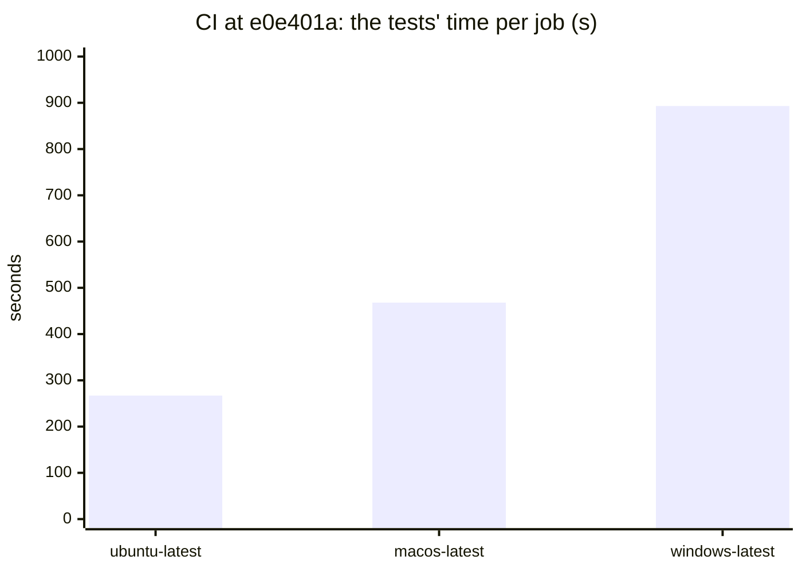
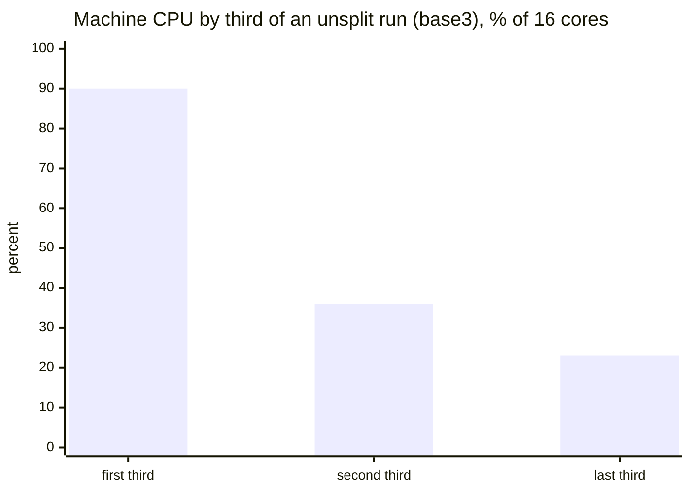
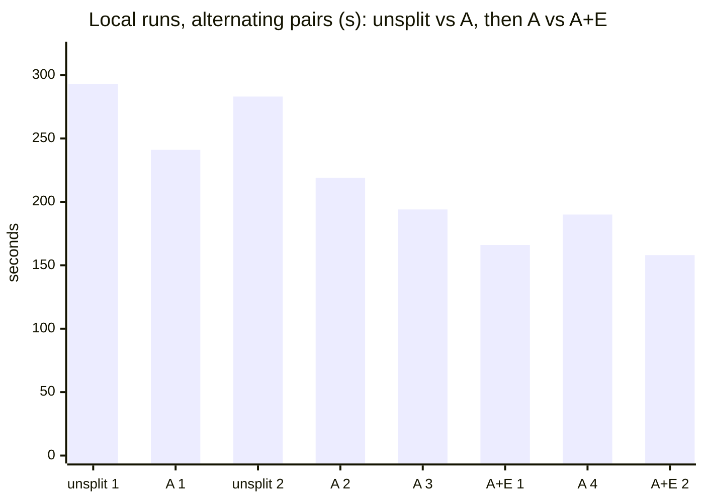

# Report: Test suite and CI time

This report was written on 2026-10-14 and 2026-10-15. Its data comes
from measurements of `npm test` at `e0e401a` on one Windows 11 machine
and from the logs of CI runs at the same commit. It follows the report
of 2026-10-10 (`2026-10-10-test-suite-wall-time.md`), whose levers are
in the repository. It starts from issue #49. That issue asks if
Microsoft Defender's scan of the engine's work files makes a Windows run
slow. The report records three things. The first is where the time of a
local run and of each CI job goes. The second is what each tried lever
saved. The third is what each untried lever needs. The author can then
decide which levers to take.

## Summary

- The suite has grown. It has 2,030 tests in 91 files. The last report
  had 1,640 tests in 79 files. A local run takes 283 to 378 s. The last
  report measured 144 s on fewer tests.
- The Windows job limits CI. It takes 15.9 minutes, of which the tests
  take 893 s. The tests take 267 s on Ubuntu and 468 s on macOS. The
  hosted runners have 4 cores (3 on macOS). Thus the test runner runs 3
  files at the same time (2 on macOS). The time of a job is the sum of
  the times of its files, divided by approximately 2.3. It is not the
  time of the slowest file.
- On Windows, each file costs approximately 3.2 times its cost on
  Ubuntu. Defender is not the cause. A step in the Windows job showed
  the state of the image: real-time protection is already off there.
  The ratio is the same for small suites and for end-to-end suites. It
  is 1.3 for the one suite that only computes. A benchmark of each
  operation on each runner shows the costs. On the Windows runner, a git
  start costs 19 times the Ubuntu cost. A git commit costs 11 to 20
  times. A Node start costs 2 times. The suite puts each sandbox in the
  OS temporary directory. That directory is on a disk 9 to 13 times
  slower at fsync and SQLite than the workspace disk next to it. A
  four-line change to
  the workflow points `TEMP` at the workspace disk (lever I). The
  measured decrease of the Windows tests is 13% and 36% on the two kinds
  of machine that the pool gives.
- A local run has two parts. In its first third, the machine is at 90%
  CPU. In the last two thirds, the machine is at 23 to 36% CPU, and
  `test/review/fix-pass.test.ts` runs alone. Its two top-level describes
  run one after the other. Its 59 tests at concurrency 4 take 300 to
  366 s of a 283 to 378 s run.
- During a run, the process tree of the suite uses 1,455 s of CPU in
  50,980 processes. More than half of that time is kernel time.
  Defender's engine uses 1.6 cores on average and 2.8 cores at the peak.
  On Windows, each child that the suite starts is two processes, because
  each child gets its own console host.
- Lever A splits fix-pass into three files by its describes. The local
  run decreased from 293 and 283 s to 241 and 219 s. The runs
  alternated, and each test passed. The lever changes the test files
  only, and it is the first lever to take. It also makes the Windows CI
  job possible to shard. With the split and three shards, the estimated
  test time of the job is 5 to 6 minutes instead of 15.
- Lever E starts git without a console host. It is a one-line change at
  five call sites. The split suite decreased from 194 and 190 s to 166
  and 158 s. The runs alternated. Each run had 16,000 fewer processes.
  With levers A and E, a local run took approximately 160 s in the
  session that measured E. That session had a lighter load than the
  sessions that measured 283 to 378 s without the split. The measured
  gains of the two levers are 20% and then 16%. Correction of
  2026-10-15: these runs started from Git Bash, where `git` is the real
  binary. Where `git` is Git for Windows' launcher, as from PowerShell
  and on the CI runner, detaching it saves nothing and costs time; the
  change proposal starts the real binary instead (lever E).
- A Dev Drive is the subject of issue #49. With the checkout and the
  temporary directory of the sandboxes on a Dev Drive, a local run
  decreases by 7 to 13% (272 and 255 s against 290 and 294 s). The file
  writes do not wait for their scan. The CPU of Defender does not
  decrease, because the scans still occur. They occur beside the run,
  not in its way. The gain is approximately half of the gain of lever A
  or of lever E.
- A recording of Defender's scans during one run shows what the scans
  are. The recording holds 54,500 real-time scans with 92 s of wait in
  all. Each scan is a file that the suite wrote. No scan is a process
  start. The checkpoint artifacts that the reviews in the tests write
  take 58% of that wait. The roles that each sandbox copies take 9%. The
  scratch files of the workers take 3%. The scratch-root option that
  issue #49 asks for moves those 3%, which is less than 1% of a run.
  Thus it is not worth a change proposal. An exclusion of the temporary
  directory of the sandboxes gives at most the gain of the Dev Drive.
- A bystander process measured what other programs feel during the
  first third of a run. A thread still wakes in less than 0.2 ms. The
  disk is idle. But a process start takes 3 times as long, and up to 10
  times at the 95th percentile. A small write takes two times as long.
  The causes are two. The kernel is busy with the process creation of
  the suite. The scan of a write waits for a core. Lever H
  runs the suite below normal priority with a few lines in
  `test/setup.ts`. It costs 2 to 3% of wall time. It returns the write
  and the wake-up to idle levels, and it halves the delay of a process
  start. The other half is kernel work that only fewer processes can
  remove.

## Terms

| Term | Meaning | Where |
|---|---|---|
| end-to-end test | A test that runs a review or a fix pass through a `ReviewSandbox` from start to end: a temporary repository, the real engine, fake model CLIs, stand-in checks. | `test/helpers/review-sandbox.ts` |
| worker, probe, preflight | As in the last report: one model CLI run per role and unit; the `--version` and `--help` commands run before every worker. In the tests each is a fake Node process. | `src/runtime/launcher.ts`, `src/runtime/preflight.ts` |
| files at once | How many test files `node --test` runs in parallel: the machine's logical cores minus one. 15 on the machine measured, 3 on a hosted Ubuntu or Windows runner, 2 on macOS. | the test runner |
| concurrency | How many tests of one file run at once, 4 in the end-to-end files (`sandboxConcurrency`). Top-level describes of one file still run one after another. | `test/helpers/review-sandbox.ts` |
| shard | `--test-shard=i/n`: the runner sorts the files by path and runs those whose index modulo n is i-1, so each shard is a fixed subset of the files. | the test runner |
| process tree | Every process a run starts, directly or through a child: the test files, the fakes, git, `cmd.exe` for the stand-in checks, and the console host each of them gets. | a Windows job object (appendix) |
| MsMpEng | Defender's engine process, which scans files as they are written, and an executable it has not seen before as it starts. | Windows |
| scan wait | How long a scan took from its start to its end. On NTFS the writing process waits for it, so the sum of the waits is time taken from the run. On a Dev Drive the scan runs beside the writer, and its duration is queue time that holds nothing up. | `Get-MpPerformanceReport` |

## Data and method

The local measurements ran on one machine. The machine has Windows 11
Pro 26300, 8 cores with 16 threads and 62 GB. It has Node 26.10.0, git
on NTFS, and Defender real-time protection on. The machine had no Dev
Drive. Lever D made one
as a VHDX for its measurement. An other session on the machine used 7
to 22% of the CPU before each run started. That figure is recorded with
each run. The CI figures come from the `check` workflow run of
2026-10-13 at `e0e401a` (run 38409515315).

The report uses eight methods. The appendix holds the script of each.

1. **Time per file and per test.** The reporter of the last report
   writes the file, name, nesting, duration and result of each test to
   JSON. The time of a file is the sum of the durations of its top-level
   tests.
2. **CI per file.** The job log shows each top-level suite with its
   duration. The local reporter output matches the name of a suite to
   its file. This gives a time per file for each CI job.
3. **The CPU of the process tree.** The run starts in a Windows job
   object. The job object sums the user and kernel CPU of each process
   that was in it, and it counts them. This includes the processes that
   stopped. A preload sums Node's `process.cpuUsage`. This gives the
   part of the Node processes.
4. **Defender and the machine.** A sampler reads three performance
   counters each 2 s: the total CPU of the machine, and the CPU of the
   `MsMpEng` and `System` processes. The counters do not need elevation.
   Windows hides the CPU time of the Defender process from a reader
   without elevation. A wildcard over all processes was the first try.
   It failed in most samples, because a process stops in the middle of
   a sample under the load of the suite.
5. **Before and after.** Two sides alternate (after, before, after,
   before). Each side has its own worktree and two runs. With the load
   of this machine, runs of the same code at different times differ by
   up to 20% (309 to 378 s for the suite without changes). Thus the
   report compares only runs that alternated.
6. **Defender's scans.** The trace is the one that Defender's own
   `New-MpPerformanceRecording` takes. `wpr.exe` starts it around one
   full run, so that no key press is necessary. `Get-MpPerformanceReport`
   reads it. The report lists each scan with its kind, its file and its
   duration. A script sums the scans by what the suite did when it
   wrote the file. Two runs were recorded in an elevated shell, one on
   NTFS and one on the Dev Drive. The elevated shell is where these two
   runs differ from the other measurements. The path of that shell put
   Node 24.21.0 first. Thus both recorded runs used Node 24.21.0 instead
   of 26.10.0. Each test passed. Their wall times are compared only with
   each other. Node's compile cache had no entries for that version.
   Thus the cache was cold in both runs. A scheduled Defender scan also
   ran during the NTFS recording. The trace marks its scans as
   on-demand, and the report counts them apart. A third recording on
   2026-10-15 ran on NTFS under Node 26 with a warm cache. It answers
   the compile-cache question of lever D and gives the scan wait of a
   warm run. Its first attempt had its temporary directory on the Dev
   Drive by accident, and it was run again. Lever D says how.
7. **A bystander.** A Node process outside the job object of the suite
   measures what an other program feels. It runs at normal priority,
   one measurement each second. It measures three times. The first is
   the time a thread of its own waits for a core after a wake-up. The
   main thread notifies a worker thread 20 times, so that no timer tick
   enters into it. The second is the time `cmd /c exit` takes to start
   and end. The third is the time of a 4 KB write with fsync, a read and
   a delete under `TEMP`. Beside it, a sampler reads four more values
   each 2 s, with the counters of method 4. These are the run queue of
   the scheduler, the context switches per second, the disk queue and
   the time per transfer. Both run 15 s before the suite starts and 15 s
   after it ends.
8. **Each operation on each runner.** A script measures the operations
   that a test does most, one at a time and over N runs after a warm-up.
   The operations are:
   - a Node start and a git start,
   - a git repository with one commit,
   - a 4 KB write with fsync,
   - a SQLite transaction,
   - a loop of computation, which calibrates the core.

   The file operations run in
   each directory that a run can use: the OS temporary directory, the
   temporary directory of the runner, and the workspace. The script ran
   as a workflow step before `npm ci` on each of the three runners, in a
   draft pull request made for it. It ran two times. The hosted pools
   gave different hardware each time: two AMD EPYC generations, then an
   M1 with 3 cores and an M2 Pro with 5 cores. This is itself a finding
   about the spread of CI.

## How a run spends its time

### 1. CI: the sum of the files, divided by approximately 2.3

- **Where.** The `check` job of `.github/workflows/check.yml`. Each OS
  has one job. Each job runs `npm run check` (lint, typecheck, test)
  and `npm run verify`.
- **What occurs.** Lint takes 12 to 16 s and typecheck 7 to 8 s on each
  OS. The rest is the tests:

| Job | Tests | Whole job | Sum of the files' times | Slowest file | Sum divided by the tests' time |
|---|---|---|---|---|---|
| ubuntu-latest | 267 s | 5 m 07 s | 660 s | 161 s | 2.5 |
| macos-latest | 468 s | 8 m 33 s | 855 s | 268 s | 1.8 |
| windows-latest | 893 s | 15 m 57 s | 2,087 s | 590 s | 2.3 |



Figure 1. The `npm test` step of each job of the CI run at `e0e401a`.

- **Problem.** On a 4-core runner, the test runner starts 3 files at the
  same time (2 on the 3-core macOS runner). Each end-to-end test starts
  many processes. Thus the time of a job is the sum of the times of its
  files, divided by a little less than the files-at-once count. The
  slowest file is important only when it is longer than that quotient.
  It is not longer yet. Windows costs 3.2 times Ubuntu per file.
  Defender is not the cause: the hosted Windows image has real-time
  protection off (lever C). The ratio is the same for each size of
  suite. Thus Windows pays it on what each test does, not only on the
  process trees of the end-to-end tests:

| Suites by their Ubuntu time | Suites | Ubuntu | Windows | Ratio | macOS | Ratio |
|---|---|---|---|---|---|---|
| under 1 s | 230 | 19 s | 68 s | 3.6 | 24 s | 1.3 |
| 1 to 10 s | 20 | 88 s | 266 s | 3.0 | 108 s | 1.2 |
| 10 to 60 s | 12 | 324 s | 983 s | 3.0 | 363 s | 1.1 |
| over 60 s | 2 | 206 s | 709 s | 3.4 | 329 s | 1.6 |

  The one suite that only computes, the suite of the compile cache,
  costs 1.3 times on Windows. Thus the cores of the runner are not 3
  times slower. The suites that pay most are the suites that start
  processes and use files and git (`locateCheckpoint`: 0.1 s against
  14 s).
- **Each operation alone.** A benchmark step ran before `npm ci` on each
  runner (method 8). It measured the operations of a test one at a
  time. The table shows the second of its two runs, as the mean of N
  runs after a warm-up:

| Operation | windows-latest, OS temp (C:) | windows-latest, workspace disk (D:) | ubuntu-latest | macos-latest |
|---|---|---|---|---|
| `node -e 0` start | 45 ms | | 21 ms | 31 ms |
| `git --version` start | 28 ms | | 1.5 ms | 5.8 ms |
| `git init`, add, commit one file | 226 ms | 120 ms | 11 ms (45 in `/tmp`) | 30 to 35 ms |
| 4 KB write with fsync, read, delete | 5.9 ms | 0.66 ms | 0.5 to 0.8 ms | 0.8 to 0.9 ms |
| SQLite insert in its own transaction | 18 ms | 1.4 ms | 0.8 to 2 ms | 0.35 ms |
| 2e6 square roots (computation) | 5.3 ms | | 4.8 ms | 1.9 ms |

  The first run was on other hardware of the same pools. It gave the
  same picture. Windows: node 42, git 27, commit 260, fsync 6.9, SQLite
  28, computation 6.2 ms. Ubuntu: 24, 1.8, 12, 0.5, 0.9, 5.3 ms. The
  GitHub reference lists the standard runners as 4 cores for Ubuntu and
  Windows and 3 M1 cores for macOS (reference 1). The benchmark step
  saw an M2 Pro with 5 cores on one macOS run. Thus the pool can give
  more than the table says. These runners are on Azure. On Azure, the
  `D:` drive of a Windows VM is the local temporary disk, not a managed
  disk (reference 4). The workspace and `runner.temp` are on that disk.
  The results are as follows. The core is approximately 1.1 times
  slower. A Node start costs 2 times. A git start costs 19 times. A git
  commit costs 11 to 20 times. The OS temporary directory of the
  Windows runner is `C:\Users\RUNNER~1\AppData\Local\Temp`. On that
  disk, an fsync costs 9 times and a SQLite transaction 13 times the
  cost on the workspace disk D:. The workspace disk is on a par with
  Ubuntu. The suite puts the sandbox of each review under
  `os.tmpdir()`, which reads `TEMP`. Thus each artifact, each ledger
  write and each sandbox repository of the Windows job lands on that
  slow disk. Lever I moves them.
- **Lever.** B (shards), I (the temporary directory on the fast disk),
  and each lever that decreases the sum: A, E, F.

### 2. Local: a CPU-bound first third, then fix-pass alone

- **Where.** `test/review/fix-pass.test.ts`: 59 tests in two top-level
  describes. "the fix pass" has 41 tests, with a nested "claims" describe
  of 10. "the continuation of a finished read-only run" has 18 tests.
- **What occurs.** The top-level describes of a file run one after the
  other, each at concurrency 4. The file took 300 to 366 s of each 283
  to 378 s run. The next file, `controller.test.ts`, took 152 to 191 s.
- **Evidence.** The CPU of the machine by thirds of a run (base3, 309
  s). The other runs without the split show the same:

| Third of the run | Machine CPU | MsMpEng | Node processes alive |
|---|---|---|---|
| first | 90% of 16 cores | 2.8 cores | 14 to 44 |
| second | 36% | 1.2 cores | 4 to 9 |
| third | 23% | 0.7 cores | 2 |

  One fix-pass test takes 7.1 s when it runs alone. In the suite, the
  median test of the file takes 25.8 s, because its first third runs
  beside each other file (Figure 2).
- **Lever.** A.



Figure 2. The CPU of the machine over one run of 309 s without the
split. The value is the mean of each third, from the counter sampled
each 2 s.

### 3. The process tree, its kernel time, and Defender

- **Where.** The machine, not one place in the code.
- **Evidence.** One run without the split (base3, 309 s). The job object
  measured the process tree of the suite. The counter measured
  Defender:

| What | Processes | CPU |
|---|---|---|
| the whole tree | 50,980 | 1,455 s (686 s user, 769 s kernel) |
| of which Node (test files, fakes, CLI, stand-in checks) | 10,476 | 849 s |
| of which the rest (git, `cmd.exe`, console hosts) | about 40,500 | about 600 s |
| MsMpEng, beside the tree | 1 | about 490 s (1.6 cores on average over the run) |
| System process, beside the tree | 1 | about 80 s |

  The machine as a whole averaged 49% of 16 cores over the run. That is
  approximately 2,420 core-seconds. The tree is 60% of that. Defender
  is 20%. The System process is 3%. The rest is other programs and the
  sampler. More than half of the CPU of the tree is kernel time. That
  time is the creation and the end of processes. It is also the work of
  Defender's filter driver in the context of the process that writes a
  file or starts. The scan recording of lever D adds a fact. The scans
  are all of files that the suite writes. Defender compares a start of
  `node.exe` or `git.exe` with what it already knows, and it does not
  scan the file again. Thus the process starts cost kernel time, not
  scan time.
- **Problem.** Node's own work, the 849 s, is a third of what the run
  costs the machine. The rest is the price of approximately 25,000
  process starts on Windows and of the files that they write.
  Defender's part of the CPU of the tree is approximately 9%. That is
  the part that the Dev Drive pair of lever D removed. The 490 s of
  Defender's engine run beside the tree.
- **Lever.** D (Defender, locally only: the CI runner has it off, lever
  C), E and F (fewer processes).

### 4. Each child is two processes

- **Where.** Each spawn in the engine and the test helpers passes
  `windowsHide: true`. On Windows, it leaves `detached` off. The sites
  are `src/scope/git.ts`, `src/review/commit.ts`,
  `src/checkpoint/locate.ts`, `src/runtime/process.ts`,
  `src/runtime/preflight.ts` and `test/helpers/git.ts`.
- **What occurs.** A console process with a hidden console still gets
  its own console host (`conhost.exe`). Node's `windowsHide` becomes the
  `CREATE_NO_WINDOW` creation flag: "a console application that is
  being run without a console window". Node's `detached` becomes
  `DETACHED_PROCESS`: "the new process does not inherit its parent's
  console". Thus a detached process has no console (references 7 and
  8). Windows attaches a console host to each console process that has
  a console (reference 9). The job object counted 23 processes for a
  script that started 10 `git --version` or 10 `node -e 0`. These are
  the shell, the script, and two per child. One fix-pass test starts
  171 children: 62 fakes, 99 git, 8 `cmd.exe` for the checks, and 2 CLI
  runs. Its tree holds 326 processes.
- **Evidence.** Forty starts of each kind on the idle machine. The two
  kinds alternated three times:

| Start | With a console | Without (`detached`) |
|---|---|---|
| `node -e 0` | 37 to 39 ms | 28 to 30 ms |
| `git --version` | 24 to 28 ms | 15 to 17 ms |

- **Why it is so.** `src/runtime/process.ts` keeps the workers attached
  on Windows on purpose. Ctrl-C reaches each process of the console.
  Thus the engine needs no signal listener there. A detached worker
  continues after an interrupted engine stops. That reason is valid for
  workers and probes, which run for minutes. It is not valid for a
  synchronous git call, which ends in milliseconds in both cases.
- **Lever.** E (git), F (workers and probes).

### 5. What grew since the last report

The last report measured 1,640 tests at `eec946a`. The suite now has
2,030 tests. fix-pass went from 30 tests and 136 s to 59 tests and 300
to 366 s. Three changes added end-to-end tests: the fix pass
continuation (`docs/changes/2026-10-10-fix-pass-continuation`), the
answers element (#46, #47), and the commit series integrity tests. Most
of the new tests went to fix-pass and to new files (`continuation`,
`answer`, `answer-pass-guard`). Each end-to-end test costs what finding
3 describes. Thus the cost of the suite grows with each one.

### 6. What an other program feels during a run

- **Where.** The machine during the first third of a local run, when
  the processes of the suite saturate it (finding 2). The author sees
  other programs and the mouse slow down at that time.
- **Evidence.** A bystander process (method 7) ran outside the process
  tree of the suite at normal priority. Each second it measured three
  times. The first is the wait of a thread of its own for a core after
  a wake-up. The second is the time of a `cmd /c exit` start with its
  console host. The third is the time of a 4 KB write, fsync, read and
  delete under `TEMP`. Four runs
  alternated the suite at its normal priority class and at
  `BelowNormal` (lever H). Each run had 15 s of the probe on the idle
  machine before and after it. The table shows the mean, the 95th
  percentile and the worst of the measurement of each second, in the
  first third of the run:

| Window | Thread wake-up, ms | Process start, ms | Small file write, ms | CPU | Run queue | MsMpEng |
|---|---|---|---|---|---|---|
| idle, before each run | 0.04 / 0.5 / 0.5 | 15 / 19 / 19 | 4.3 / 6 / 6 | 4 to 13% | 0 | 0.1 cores |
| suite at Normal, first third (run 1) | 0.015 / 0.06 / 0.22 | 47 / 91 / 138 | 8.3 / 22 / 110 | 92% | 26 | 2.7 cores |
| suite at Normal, first third (run 3) | 0.017 / 0.07 / 0.12 | 46 / 129 / 147 | 6.5 / 13 / 42 | 91% | 24 | 2.8 cores |
| suite at BelowNormal, first third (run 2) | 0.004 / 0.008 / 0.010 | 26 / 65 / 72 | 4.2 / 7 / 33 | 92% | 14 | 2.9 cores |
| suite at BelowNormal, first third (run 4) | 0.004 / 0.006 / 0.011 | 24 / 62 / 71 | 5.4 / 6 / 93 | 92% | 15 | 2.9 cores |
| any run, rest of the run (fix-pass alone) | 0.006 / 0.01 / 0.09 | 14 / 19 / 68 | 3.1 / 4.5 / 41 | 31% | 0.3 | 1.0 cores |

  The disk queue stayed below 1. A transfer took 0.2 ms at all times.
  The context switches went from 25,000 to 160,000 per second at Normal
  and to 210,000 at BelowNormal. The run queue is the number of threads
  that waited for a core, in addition to the 16 that ran.

  Four more runs alternated in the same way. They added a fourth
  measure to the probe: a loop of approximately 10 ms of CPU, five
  times a second. This is what a thread that computes for some time
  gets, such as the thread that renders a frame. They added two
  processes to the sampler: `csrss.exe`, which makes each console host
  and serves the desktop, and `dwm.exe`, the desktop compositor. The
  table shows the first third of the run again:

| Window | 10 ms of CPU work, ms | Process start, ms | Small file write, ms | csrss | dwm |
|---|---|---|---|---|---|
| idle, before each run | 9.9 / 10.3 / 10.6 | 14 / 18 / 18 | 4.5 / 6 / 8 | 0 to 1% of a core | 1 to 4% |
| suite at Normal (runs 5, 7) | 11.1 / 13.6 / 20.5 and 11.2 / 13.3 / 27.7 | 48 / 116 / 174 and 52 / 126 / 203 | 6.1 / 18 / 32 and 5.6 / 18 / 29 | 12% | 2% |
| suite at BelowNormal (runs 6, 8) | 9.9 / 10.2 / 10.4 and 10.0 / 10.4 / 10.6 | 37 / 96 / 136 and 25 / 55 / 125 | 4.4 / 5 / 99 and 4.3 / 6 / 72 | 10 to 12% | 2 to 3% |

  During run 6, a benchmark of this report ran on the machine for
  approximately 15 s of its first third. Its process-start column and
  its wall time (320 s) show that. Run 8 is the clean pair of run 7.

  A ninth run, at Normal, added the counters of the kernel for
  interrupts and deferred procedure calls (DPCs). This work runs above
  each thread. It is what moves the pointer when the pointer stutters:

| Window | DPC time, all cores | Busiest core's DPC time, mean / worst 2 s | Interrupt time | DPCs per s | Interrupts per s |
|---|---|---|---|---|---|
| idle, before the run | 0.10% | 1.2% / 3.1% | 0.20% | 612 | 7,900 |
| first third | 0.17% | 1.2% / 3.8% | 1.19% | 3,964 | 66,500 |
| rest of the run | 0.11% | 1.1% / 3.1% | 0.39% | 2,397 | 47,000 |

  The interrupts increase eight times with the process load. But the
  time that they and the DPCs take stays below 4% of the busiest core
  in each 2 s sample. Thus no DPC storm occurs. A 2 s mean cannot
  show one rare DPC of some ms. Only an ETW trace shows that. At these
  mean values, such a DPC is an exception. It is not what the author
  sees through the full first third.
- **Problem.** The report had three possible explanations. The first
  is that the scheduler starves the threads of other programs. The
  second is that the kernel is busy with the process creation of the
  suite. The third is that the disk and the Defender queue are full.
  The probe sorts them:
  1. A thread that wakes up gets a core in less than 0.2 ms, with 26
     threads in the queue. The explanation of this report is the
     priority boost that Windows gives a thread "when the wait
     conditions for a blocked thread are satisfied". That boost then
     decays "by one level each time the thread completes a time slice"
     (reference 12). The report did not measure this. Thus the latency
     of the scheduler is not what an other program feels, for work that
     events drive. A thread that computes for 10 ms gets 11% less of a
     core on average at Normal. At worst, it gets a third to a half of
     a core (20 to 28 ms for its 10 ms). At BelowNormal, it gets the
     full core, as if the machine were idle. The console server
     `csrss.exe` and the compositor `dwm.exe` stay at 12% and 2% of a
     core. The suite starves neither of them. Thus the path of the
     desktop is not what slows down.
  2. A process start takes 3 times as long on average, and up to 10
     times at the 95th percentile. Half of that stays when the suite
     runs below normal priority. That half is kernel work that priority
     does not order. It is process and handle creation, the console
     host that each start goes through, and the callbacks of Defender
     on each start. This is the largest effect. A lower priority only halves
     it.
  3. The disk is not the queue: less than one request waits, and a
     transfer takes 0.2 ms. A small write takes two times as long on
     average, and 3 to 5 times at the 95th percentile. That delay is
     gone at below normal priority. Thus the delay is the synchronous
     scan of the write. The scan waits for the thread of MsMpEng to get
     a core among the threads of the suite. It is not the disk.
  All three go back to idle in the rest of the run, when fix-pass runs
  alone at 31% CPU.
- **Lever.** H (the suite below normal priority) for the two parts that
  priority removes. E and F (fewer processes) for the kernel work that
  priority does not remove.

## Levers

### A. Split fix-pass by its describes

- **Change.** `test/review/fix-pass.test.ts` keeps "the fix pass" (31
  tests). Its nested "claims (commit series integrity)" describe becomes
  `test/review/fix-pass-claims.test.ts` (10 tests). "the continuation
  of a finished read-only run" becomes
  `test/review/fix-continuation.test.ts` (18 tests). The 59 tests are
  the same. Only their files change. For the measurement, the header of
  the file (imports, `reviewScript`, `fixedA`, `fixedB`) was copied into
  each new file. The real change moves the shared script and the
  constants into a helper that the three files import. It also removes
  the imports that each file no longer uses. Lint flags those imports
  (31 unused-import errors on the copied headers).
- **Measured.** The full suite, in alternation. Each test passed in
  each run (2,030 tests):

| Run | Unsplit | Split |
|---|---|---|
| 1 | 293 s | 241 s |
| 2 | 283 s | 219 s |

  The machine stays busy longer (76 to 86% of the CPU in the second
  third, against 36%). That is the point: the serial tail is gone. The
  run is now bound by `fix-pass.test.ts` (199 to 223 s),
  `controller.test.ts` (173 to 191 s) and `fix-continuation.test.ts`
  (156 to 173 s), which overlap. In CI, a job is already CPU-bound.
  There, the split changes nothing by itself. It makes the shards of
  lever B even.
- **Risk.** None found in two runs. The sandboxes of the tests are
  already per test.
- **Takes.** Tests only.
- **Floor after A.** A local run cannot go below what its CPU needs.
  The 1,580 s of the tree plus the approximately 480 s of Defender,
  over 16 logical cores, is approximately 130 s if nothing else runs.
  The floor is higher if the 16 logical cores are 8 cores with two
  threads each. Two threads of one core do not give two times the
  work. The next 90 s come only from less work (D to F).

### B. Shard the CI job

- **Change.** A `shard` dimension in the matrix of `check.yml`. Each job
  runs `npm test -- --test-shard=<i>/<n>`. Lint, typecheck and `verify`
  run one time, on one job, because they do not depend on the shard.
- **Estimated.** The estimate uses the per-file times of the Windows job
  (method 2), the sorted file order of the test runner and the modulo
  rule. The time of a shard is the larger of its slowest file and its
  sum divided by 3. The estimate gives 696 s for the full job. The real
  job took 893 s. Thus the sums below are approximately 22% optimistic.
  The slowest-file bounds are measured values.

| Shards | Slowest shard, unsplit | Slowest shard, with lever A (as estimated / corrected by 22%) |
|---|---|---|
| 1 | 696 s (measured: 893 s) | 695 s / 892 s |
| 2 | 434 to 590 s (fix-pass's own time) | 357 s / 457 s |
| 3 | 434 to 590 s | 288 s / 370 s |
| 4 | 434 to 590 s | 251 s / 322 s |

  Without the split, the own time of fix-pass on the Windows runner
  bounds each number of shards. That time is 434 to 590 s. The range
  depends on how the log tells its two top-level suites apart from the
  suites of `continuation.test.ts`. Thus no number of shards gets the
  tests below approximately 7 to 10 minutes. With lever A, the file is
  three files of 100 to 200 s each. Three shards then bring the tests to
  approximately 5 to 6 minutes and the full job to approximately 6 to
  7. The estimate with A uses the local times of the split files,
  scaled by 1.18. That factor is the sum of the Windows job over the
  local sum, because the split has not run in CI.
- **Risk.** Three Windows runners instead of one. The `windows-latest`
  job already bounds the workflow. Thus the wall time decreases and the
  runner minutes increase. Shards for Ubuntu and macOS are optional.
  With three shards, the estimated Ubuntu tests decrease from 267 s to
  161 s, its fix-pass. The estimated macOS tests decrease from 468 s to
  approximately 270 s. Two runs of the same suite on `windows-latest` one day apart
  took 893 and 969 s (lever C). Thus the measurement needs several runs
  per side, not one.
- **Takes.** `check.yml`. The sentence "`npm run check`, what CI runs"
  in `AGENTS.md` stays true for the one job that runs it in full.

### C. Defender on the Windows runner

- **Change.** A step before `npm test` on `windows-latest`. The step
  has two possible forms. One excludes the workspace and the temporary
  directory of the runner from real-time scans (`Add-MpPreference
  -ExclusionPath`). The other turns real-time monitoring off for the
  job (`Set-MpPreference -DisableRealtimeMonitoring $true`). The hosted
  runner runs as an administrator, and the machine is discarded after
  the job.
- **Estimated first.** Finding 3 puts Defender at 20% of the CPU of the
  machine during a local run. Defender also has a part of the kernel
  time of the tree. On a 4-core runner, the job is CPU-bound. Thus the removal of
  that work is at least 20% of the test time, approximately 3 minutes
  of the Windows job.
- **Measured: nothing to remove.** A draft pull request added a step
  before `npm ci` on the Windows runner. The step shows
  `Get-MpComputerStatus`. It was the baseline for an alternated
  comparison with a second commit that turns monitoring off. The
  baseline run (2026-10-14, `windows-latest`, Windows Server 2025 image
  of 2026-09-01) showed:

| RealTimeProtectionEnabled | AntivirusEnabled | AMServiceEnabled | IsTamperProtected |
|---|---|---|---|
| False | True | True | False |

  The image comes with the Defender service on and real-time protection
  already off. Thus the runner has no scan to turn off, and the second
  commit did not run. The build script of the image says why. It
  sets `DisableRealtimeMonitoring`, excludes `C:\` and `D:\` in full,
  and puts Defender in passive mode. It cites the runner-images issue
  that asked for it (reference 3). The estimate above is withdrawn. The
  same run put the Windows tests at 969 s. The run at `e0e401a` one day
  before put them at 893 s, with no change in the suite. That is the
  spread of one CI run. Thus the measurement of lever B also needs more
  than one run per side.
- **What it means.** The 3.2 times of the Windows job per file is not
  the scans. The table of finding 1 puts it on what each suite does on
  Windows: process starts and file and git operations. The cores
  themselves are at approximately 1.3 times. The levers that reach it
  are the levers that start fewer processes (E, F) and the shards (B).
  The Dev Drive of issue #49 also gives nothing to a hosted runner, for
  the same reason.
- **Takes.** Nothing. Not a lever.

### D. Defender locally: what issue #49 asks

- **Change.** The checkout, its `node_modules` (the compile cache among
  them) and the temporary directory of the sandboxes on a Dev Drive.
  The Dev Drive is a 60 GB VHDX on the same SSD as C:, with the ReFS
  format of a Dev Drive (trusted, Defender in performance mode). The
  repository is cloned onto it with `npm ci`. `TEMP` points at a
  directory on it for the test run only. The code of the engine does
  not change. `ReviewSandbox` makes its directories under `os.tmpdir()`,
  which reads `TEMP`.
- **Measured.** The suite without the split, in alternation against the
  same commit on NTFS (C:) with `TEMP` on C:. Two pairs on 2026-10-14.
  Each test passed in each run:

| Run | NTFS: wall | NTFS: tree CPU (kernel) | NTFS: MsMpEng | Dev Drive: wall | Dev Drive: tree CPU (kernel) | Dev Drive: MsMpEng |
|---|---|---|---|---|---|---|
| 1 | 290 s | 1,427 s (739 s) | 1.46 cores | 272 s | 1,306 s (671 s) | 1.65 cores |
| 2 | 294 s | 1,417 s (737 s) | 1.44 cores | 255 s | 1,275 s (645 s) | 1.68 cores |

  An earlier pair against the main checkout of the author gave the same
  picture (277 and 275 s against 244 and 243 s). But three small files
  did not load there, because the `node_modules` of that checkout is
  older than the esbuild dependency. The pairs above ran against a
  checkout with current dependencies.
- **What it means.** A Dev Drive takes 7 to 13% off the wall time and
  9% off the CPU of the tree. Most of that is kernel time: the file
  writes no longer wait for their scan. The CPU of Defender does not
  decrease. It increases by 15%, because the scans still occur, in
  asynchronous mode, beside the run. The recording below confirms this.
  The Dev Drive run has the same number of scans. Each scan takes
  longer, because it waits in a queue instead of in front of the
  writer. Thus the Dev Drive is worth approximately half of lever A or
  E. It is a change that each developer makes on their own machine one
  time. It does not add to an exclusion of the same directories.
- **What the recording shows.** One run was recorded on each side
  (method 6): 279 s on NTFS, 236 s on the Dev Drive. Both ran under
  Node 24.21.0, and they are compared only with each other. On NTFS,
  the trace holds 54,538 real-time scans with 92.2 s of scan wait. It
  also holds 697 scans and 22 s from a scheduled scan that ran at the
  same time. The table below leaves them out. No real-time scan is a
  process start. `node.exe`, `git.exe` and `cmd.exe` start
  approximately 25,000 times in a run, and Defender skips each start as
  a known file. Each scan is a file that the suite wrote. The wait goes
  to:

| What the suite wrote | Where | Scans | Scan wait, NTFS | Share |
|---|---|---|---|---|
| checkpoint artifacts and worker records | `<sandbox>/repo/.git/deep-review-checkpoint/` | 19,341 | 53.8 s | 58% |
| Node's compile cache, cold in this run (method 6) | `node_modules/.cache/node-compile-cache/` | 2,872 | 13.1 s | 14% |
| the roles each sandbox copies, its script and checks | `<sandbox>/roles/` and the sandbox root | 13,348 | 8.5 s | 9% |
| the launcher and build tests' temporary directories | `%TEMP%/deep-review-launcher-*`, `deep-review-build-*` | 3,608 | 6.2 s | 7% |
| the workers' scratch files | `<sandbox>/scratch/` | 1,352 | 3.0 s | 3% |
| `node_modules` the test processes load | `node_modules/` | 320 | 2.4 s | 3% |
| replay checkpoints, the sandbox repository's working tree and `.git`, the bundle tests' directories, the sources, the engine's default scratch root | | 2,401 | 4.1 s | 4% |
| not the suite: the measurement's own files, other programs | | 11,296 | 1.1 s | 1% |

  The artifacts are the files of the evidence store. The store writes
  each one as `<uuid>.pending` and renames it to its hash
  (`src/evidence/store.ts`). The trace shows approximately as many
  scans of `.pending` files (7,117, 20 s) as of the renamed files
  (7,865, 32 s). Thus Defender scans each artifact two times. The roles
  are the 11,720 scans of `.md` files, one copy of `roles/` per sandbox.
  `ReviewSandbox` copies it to give each run its own policy. On the Dev
  Drive, the same classes have the same counts (19,265 artifact scans,
  1,352 scratch scans). Each scan has three to seven times the
  duration, because a scan there waits in a queue behind the writer,
  not in front of it. That is 324 s of scan time that held nothing up.
- **What follows.** An exclusion of the temporary directory of the
  sandboxes removes approximately 80% of the scan wait, the sandbox
  rows of the table. The exclusion is `Add-MpPreference -ExclusionPath`
  on `C:\Users\<user>\AppData\Local\Temp\deep-review-*`. It is a
  per-machine step like the Dev Drive, and it needs elevation. The path
  must be written in full. Defender expands `%TEMP%` in an exclusion to
  `C:\Windows\TEMP` of the system account, not to the directory of the
  user (reference 14). The exclusion gives at most what the Dev Drive
  gave, because the Dev Drive already takes each scan out of the way of
  the writer. The report did not measure the exclusion. Unlike the Dev
  Drive, the exclusion stops the scans instead of a delay of them. That
  is a protection that the developer gives up for that directory. Both
  options are optional and local. The repository does not change. The
  14% of the compile cache is an effect of the cold cache in the
  recorded run. A third recording on NTFS, under Node 26 with a warm
  cache and no scheduled scan, holds 23 scans of it (0.1 s) against
  2,872. That recording holds 51,197 real-time scans with 82.1 s of
  scan wait in all (274 s run, each test passed). The checkpoint
  artifacts are 57.7 s (70%). The roles and the sandbox root are 8.5 s
  (10%). The directories of the launcher and build tests are 6.3 s
  (8%). The scratch of the workers is 3.2 s (4%). The rest is less than
  2 s each. The shares above are valid with the cache row removed. A
  first attempt at this recording had its sandboxes on the Dev Drive.
  The elevated window still had the `TEMP` that an earlier recording
  had set. The script now sets and restores `TEMP` itself, and the
  attempt ran again.
- **The scratch root.** The third item of issue #49 asks for a way to
  name the scratch root of the engine. The `TEMP` of the account then
  stays where it is. The option moves the scratch files of the workers
  only: 3% of the scan wait, less than 1% of a run. That is not worth a change proposal.
  The tests do not need it. `ReviewSandbox` already puts the scratch of
  each run under the sandbox directory, which `TEMP` places. The
  default scratch root of the engine under `TEMP` itself had 31 scans
  in the run.

### E. git without a console

- **Change.** The five synchronous git call sites (finding 4) pass
  `detached: true` on Windows. Thus git runs without a console host. A
  synchronous call cannot continue after the engine stops. Thus the
  Ctrl-C reason that keeps the workers attached does not apply.
- **Measured.** The tree of one fix-pass test decreased from 326 to 227
  processes. The full suite ran in alternation against lever A. Each
  test passed:

| Run | A: wall | A: tree | A and E: wall | A and E: tree |
|---|---|---|---|---|
| 1 | 194 s | 50,983 processes, 1,527 s CPU | 166 s | 34,824 processes, 1,379 s CPU |
| 2 | 190 s | 50,983 processes, 1,519 s CPU | 158 s | 34,824 processes, 1,375 s CPU |

  The 16,159 processes that disappear are the console hosts of the git
  calls of the run. The CPU of the tree decreases by 10% and the wall
  time by 16%. These two pairs ran under a lighter load than the own
  pairs of lever A (6 to 12% before each run, against 15 to 22%). That
  is why the runs of A here are faster than the runs of A above. In a
  pair, the comparison is valid (Figure 3).
- **Correction (2026-10-15).** The runs above started from Git Bash,
  where `git` on PATH is the real binary, `mingw64ingit.exe`. From
  PowerShell or cmd, and on the hosted runner (`C:Program
  FilesGitingit.exe` in the checkout log), `git` is Git for
  Windows' launcher: a 47 KB program that starts the real binary and
  waits for it, so each call is three processes. Detaching the launcher
  does not help: ten `git --version` in a job object were 33 processes
  either way (23 and 13 for the real binary), and one fix-pass test
  stayed at 425. It costs time: 39 to 40 ms a call attached, 45 to 53
  ms detached, because the launcher, left without a console, starts git
  in a console of its own; the real binary took 25 ms attached and 16
  detached. The change proposal of 2026-10-15 (D6) therefore starts the
  real binary, which `git --exec-path` locates, detached. One fix-pass
  test then ran 230 processes from PowerShell (425 before) and 229
  from Git Bash (326 before), in alternating pairs.



Figure 3. Each full run that alternated, in the order of the runs. The
first two pairs compare lever A with the suite without the split. The
next two pairs compare lever E with A.

- **Risk.** Node documents `detached` for `spawn` only. The option lists
  of `execFileSync` and `spawnSync` do not have it, and the TypeScript
  type of `execFileSync` rejects it (reference 6). In the
  implementation, the three functions share one option normalizer. The
  normalizer reads `detached` and `windowsHide` for all of them and
  gives them to the same libuv spawn (reference 7). That is why the
  measurement works, and why it has worked across Node versions. A
  change that keeps the calls synchronous therefore depends on that
  pass-through. It needs three things. The first is a comment at each
  site that says so. The second is a type cast or a small wrapper
  around `spawnSync`. The third is a test that asserts the effect. The
  test can assert that a child started this way has no console. Either
  `GetConsoleWindow` is null, or the job object counts one process per
  start instead of two. The alternative that stays in
  the documented API makes the git calls asynchronous `spawn`s. That is
  a larger change. A detached child is also the root of a new process
  group, for which Windows disables Ctrl-C (reference 8). That is safe
  for a call that returns in milliseconds. It is also the reason that
  the workers stay attached. One case is not safe: a git that waits on
  a lock or a remote continues after the user interrupts the engine,
  because the Ctrl-C does not reach it. The five sites set no
  `timeout` today. The change must set one, because the timeout of
  `spawnSync` ends the child with `TerminateProcess`, with or without
  a console. The change proposal of 2026-10-15 makes that a
  requirement. The environment, the current directory and the pipes
  of a detached child are the same as before. The four runs that
  measured this lever read git's output at each of the five sites, and
  each test passed.
- **Takes.** The four engine files and the test helper. The change has
  no observable behavior change for a synchronous call. Each site gets
  a comment that says why git is detached and the workers are not.

### F. Workers and probes without a console

- **Not measured.** The 7,966 fake Claude starts, the 1,478 fake Codex
  starts and their console hosts are the largest group of processes in
  a run. From the 9 ms per start of finding 4, detached starts take
  approximately 90 s off the summed time of the tree per run. That is
  approximately 6% of its CPU. It is a behavior change: an interrupted
  engine on Windows leaves its workers in operation.
  `src/runtime/process.ts` names that as the reason that they are
  attached. The change needs the engine to stop the tree itself on
  Ctrl-C on Windows, as it does on POSIX through the signal listeners.
  It also needs a change proposal.

### G. Lint and typecheck before the tests

- **What occurs.** `npm run check` runs lint and typecheck before the
  tests, one after the other. On this machine, `eslint .` takes 15.8 s
  the first time after a boot and 6.0 s after that. `tsc --noEmit`
  takes 3.8 s. In CI, they take 12 to 16 s and 7 to 8 s.
- **Lever.** `eslint --cache` keeps the result of each file in
  `.eslintcache`, which git must ignore. It takes 6.0 s on its first
  run and 1.2 s on the next two. That is 5 s of a local `npm run check`,
  and nothing in CI, where the cache is cold. Lint and typecheck beside
  the tests save their 10 to 20 s, but they load the CPU that the tests
  need. Low priority.

### H. The suite below normal priority

- **Change.** `test/setup.ts` is the file that the test runner process
  imports. It lowers its own priority class to below normal with
  `os.setPriority`. Its `PRIORITY_BELOW_NORMAL` is
  `BELOW_NORMAL_PRIORITY_CLASS` on Windows and nice 10 on other systems
  (reference 10). Each process that the test runner starts inherits
  it: "If the calling process is IDLE_PRIORITY_CLASS or
  BELOW_NORMAL_PRIORITY_CLASS, the new process will inherit this class"
  (reference 11). Unix children inherit the nice value. Nothing in the
  engine changes. The other programs of a developer run ahead of the
  tree of the suite.
- **Measured.** The eight runs of finding 6, in alternation. Each test
  passed. At Normal: 293, 288, 284 and 287 s. At BelowNormal: 299, 297
  and 291 s. The fourth BelowNormal run, 320 s, had an other
  measurement on the machine for a part of its first third. The report
  leaves it out. Thus the suite is 1 to 3% longer. The CPU of the
  tree is 1,397 to 1,433 s against 1,457 to 1,473 s. The thread
  wake-up, the small write and the 10 ms of CPU work of the probe went
  back to idle levels. A process start went from 47 to 25 ms (idle 15
  ms). The measurement set the class on the root process of the tree
  from outside. A check showed that the setting from `test/setup.ts`
  reaches a child in the same way.
- **Risk.** A developer who waits for the suite with nothing else in
  operation pays the 2 to 3%. On a CI runner, the job is alone. Thus the
  change does nothing there, in either direction.
- **Takes.** Tests only: a few lines in `test/setup.ts`.

### I. The temporary directory of the Windows job on the workspace disk

- **Change.** The `npm run check` step of `check.yml` sets `TEMP` and
  `TMP` to `runner.temp` (`D:\a\_temp` on `windows-latest`). Thus the
  sandboxes that `os.tmpdir()` places land on the workspace disk
  instead of the OS disk. With them, each artifact, each ledger write
  and each sandbox repository of a test run lands there. On Ubuntu and
  macOS, the two directories are on the same file system, and nothing
  changes. The code of the repository does not change.
- **Why it helps.** The benchmark of finding 1 shows this. On the OS
  disk of the Windows runner, an fsync costs 5.9 ms and a SQLite
  transaction costs 18 ms. On the workspace disk, they cost 0.66 and
  1.4 ms. The local scan recording counted 54,500 file writes in a run
  (lever D). The ledger commits each event in its own transaction, and
  the evidence store does an fsync for each artifact.
- **Measured.** The pull request that ran the benchmark has the change
  as its last commit. Its Windows job ran two times, in alternation
  with runs of the job before the change. Each test passed each time.
  The hosted pool gave two kinds of machine, which the benchmark step
  names. Thus the pairs are read by machine:

| Windows machine | `TEMP` on the OS disk | `TEMP` on the workspace disk | Change |
|---|---|---|---|
| AMD EPYC 9V74 | 924 s | 595 s | -36% |
| AMD EPYC 7763 | 927 and 938 s (893 and 969 s in the two runs before, machine not recorded) | 809 s | -13% |

  In each run, the gain is the same for each suite. It is 0.66 of the
  baseline for each size class on the first machine, and 0.91 to 0.95
  on the second. That is the pattern of a disk speed. Thus the two figures are
  the disks of the two machines, not noise in the suite. The Ubuntu and
  macOS jobs, where nothing changes, took 266 and 339 s. The size of the
  gain therefore depends on the machine that the pool gives. Its
  direction did not change in two pairs.
- **Risk.** None for the repository. `runner.temp` "is emptied at the
  beginning and end of each job" (reference 2). The setting must be on
  the step, not on the job. The `runner` context is available to the
  `env` of a step and not to the `env` of a job (same reference). That
  is why the first attempt did not start.
- **Takes.** `check.yml`, four lines.

## Not a lever here

- **Fewer workers per review in the tests.** A review starts the ten
  angles that the vocabulary of the engine fixes (`angles` in
  `src/review/vocabulary.ts`). The sandbox copies the own roles of the
  repository. A lighter manifest is an engine option that exists for
  the tests alone.
- **The probes of the preflight at the same time** (lever C of the last
  report). Decided against on 2026-10-10. Nothing here changes the
  trade-off.
- **A preflight before each worker.** By design
  (`docs/changes/2026-09-27-read-only-review.design.md`).
- **The start of Node.** A fake start is 60 to 70 ms of CPU with the
  compile cache on, against 30 ms for an empty Node. The remainder is
  module load that the cache already serves.

## Open questions

This section lists what the report still infers but does not measure.
Each item has the measurement that settles it. Four earlier questions
were settled on 2026-10-15. They moved into findings 1 and 6 and lever
D. They were:

- where the time of the Windows runner goes,
- what a CPU-bound bystander and the desktop processes see,
- if DPCs storm,
- the scans of the compile cache on a warm run.

1. **Lever E in CI.** Its -16% is local, and was measured from Git
   Bash (see the correction under lever E). The Windows runner starts git
   19 times slower than Ubuntu (finding 1). Thus the console host that
   the lever saves can be more important there, or less important,
   because the start itself dominates. The pull request that takes E is
   the measurement. It needs several runs per side, with the machine
   recorded (the spread of lever I).
2. **How much of the Windows job is git itself.** After levers I and
   E, the ratio to Ubuntu that remains is the part of git. A start costs
   19 times and a commit costs 11 times, also on the fast disk,
   multiplied by the calls that a test makes (99 in one fix-pass test).
   No lever here reaches it, except fewer git calls per test.
3. **A third kind of Windows machine.** The gain of lever I was -36% on
   one CPU generation and -13% on the other. A machine of a kind not
   seen in these runs can give an other figure. The pull request that
   takes I records the machine that the benchmark step shows.
4. **Rare long DPCs.** The counters of finding 6 exclude a DPC storm.
   One DPC of some ms can be so rare that a 2 s mean hides it. Only an
   ETW trace shows it (`wpr -start CPU`, elevated, the first third of a
   run). It can explain an occasional stutter. It cannot explain the
   slowness that the author sees through the full first third.
5. **Why the context switches increase at below normal priority.**
   160,000 per second at Normal, 210,000 at BelowNormal, not explained.
   It did not change the wall time of the suite beyond the 1 to 3%.

## Conclusion

The question of issue #49 has a measured answer. Defender's scans are
not the main cost of a test run, on the machine or in CI. On the
machine, the scans wait for the files that the tests write, mostly the
checkpoint artifacts. That wait is 7 to 13% of a run. A Dev Drive or an
exclusion removes it. The scratch root of the engine is 3% of that wait.
Thus the scratch-root option of issue #49 is not worth a change
proposal. In CI, the hosted Windows image has real-time protection off.
Defender is not a cost there at all.

The main local cost is the process tree. A run starts approximately
25,000 processes, and each one gets a console host. More than half of
the CPU of the run is kernel time. Other programs feel that during the
first third of a run. A process start takes 3 times as long, and a
small write waits for its scan. The serial tail of
fix-pass.test.ts then keeps the machine at a quarter of its capacity for
two thirds of the run.

The main CI cost is the Windows runner. It pays 3 times the Ubuntu cost
on what each test does. A git start costs 19 times and a git commit 11
to 20 times. On the OS temporary disk, an fsync is 9 times and a SQLite
transaction 13 times slower than on the workspace disk next to it. The
suite puts each sandbox on that slow disk.

Four levers are measured, cost nothing in behavior, and are ready to
take. Lever A splits fix-pass by its describes (-20% locally). Lever E
starts git without a console host (-16% on top of A). Lever H runs the
suite below normal priority (+1 to 3% wall time, and other programs
feel the run no more). Lever I puts the temporary directory of the
Windows job on the workspace disk (-13% to -36% of the Windows tests,
by machine). With A and E, a local run goes from 283 to 378 s to
approximately 160 s. With I and the shards of lever B, the estimated
Windows job goes from 15 minutes to approximately 5. The shards are an
estimate until the pull request measures them.

Two levers are not worth their cost now. Lever C has nothing to turn
off. Lever F changes the Ctrl-C behavior of the engine on Windows for
approximately 6%. The Dev Drive of lever D is a local option for a
developer, not a change to the repository.

## Decisions for the author

1. **Lever A** (split fix-pass): tests only, measured at -20% locally,
   and the condition for B. Proposal: take it, as a commit that moves
   the tests and adds a helper for the shared script.
2. **Lever B** (shards): `check.yml` only. The estimate says
   approximately 6 to 7 minutes for the Windows job with A. Proposal:
   take it for Windows at least, with three shards. Measure it in the
   pull request with several runs per side, because one run spreads by
   8%.
3. **Lever C** (Defender on the runner): measured as nothing to do. The
   hosted Windows image has real-time protection off already. Proposal:
   drop it. Read the cost of the Windows job as the price of processes,
   which E and B address.
4. **Lever D** (Dev Drive, issue #49): measured at 7 to 13% locally. It
   is a per-machine setup with no change to the repository. The
   recording puts the scan wait on the checkpoint artifacts that the
   tests write (58%) and 3% on the scratch files of the workers.
   Proposal: document the Dev Drive as optional in the Windows
   environment notes, after A and E. Document the exclusion of the
   temporary directory of the sandboxes as the lighter alternative.
   Close the scratch-root item of #49 with the 3%, with no change
   proposal.
5. **Lever E** (git without a console): engine and test helper, no
   observable behavior change, measured at -16% on top of A. Proposal:
   take it. Keep the calls synchronous on the option pass-through that
   the implementation of Node gives all three spawn functions (the risk
   of lever E). Add a comment at each site, a wrapper or a cast for the
   type, and a test that asserts that the child has no console. The
   commit message says that the behavior does not change. The
   alternative makes the git calls asynchronous. It stays in the
   documented API at the cost of a larger change. That is a choice for
   the author.
6. **Lever F** (workers without a console): a behavior change on
   Windows. Proposal: not now. Open an issue if the 6% of F is wanted
   later.
7. **Lever H** (the suite below normal priority): tests only, measured
   at 2 to 3% longer locally and nothing in CI. It returns the other
   programs of the developer to idle latencies for the two causes of
   the three in finding 6 that priority reaches. Proposal: take it, in
   the same commit as A or on its own.
8. **Lever I** (the temporary directory of the Windows job on the
   workspace disk): `check.yml` only, four lines. Measured at -13% and
   -36% of the Windows tests on the two machines that the pool gives.
   Each test passed. Proposal: take it first among the CI levers,
   because it costs nothing and adds to B. The pull request that takes
   it must watch for a Windows job that does not decrease. That is a
   third kind of machine.

## References

The documentation and the source that the claims of this report rest
on. They were checked on 2026-10-15. Each entry says what it supports
here.

1. GitHub Docs, [GitHub-hosted runners reference](https://docs.github.com/en/actions/reference/runners/github-hosted-runners):
   the hardware of the standard runners (4 cores for `ubuntu-latest` and
   `windows-latest`, 3 M1 cores for `macos-latest`), that each job is a
   new virtual machine, and that Windows runners run as administrators
   with UAC off. Finding 1, lever C.
2. GitHub Docs, [Contexts](https://docs.github.com/en/actions/reference/workflows-and-actions/contexts):
   `runner.temp` "is emptied at the beginning and end of each job", and
   the context availability table, where `runner` is listed for the
   `env` of a step and not for the `env` of a job. Lever I.
3. actions/runner-images, [`Configure-WindowsDefender.ps1`](https://github.com/actions/runner-images/blob/main/images/windows/scripts/build/Configure-WindowsDefender.ps1):
   the build step of the Windows image that sets
   `DisableRealtimeMonitoring`, excludes `C:\` and `D:\`, and sets
   Defender to passive mode, with
   [issue #4277](https://github.com/actions/runner-images/issues/4277)
   as the reason. Lever C.
4. Microsoft Learn, [Overview of Azure Disk Storage, Temporary disk](https://learn.microsoft.com/en-us/azure/virtual-machines/managed-disks-overview#temporary-disk):
   "On Windows VMs, the temporary disk is drive D by default" and it
   "isn't a managed disk". Finding 1, lever I.
5. Node.js, [Command-line API](https://nodejs.org/api/cli.html):
   `--test-concurrency` "defaults to `os.availableParallelism() - 1`",
   `--test-shard` "will divide all tests files into `total` equal
   parts", `--test-isolation` (a child process per file), `--import`.
   Terms, finding 1, lever B.
6. Node.js, [Child process](https://nodejs.org/api/child_process.html):
   `detached` is listed for `spawn` and described under
   `options.detached`. The option lists of `execFileSync` and
   `spawnSync` omit it. `windowsHide` hides "the subprocess console
   window that would normally be created on Windows". Finding 4, lever
   E.
7. Node.js source, [`lib/child_process.js`](https://github.com/nodejs/node/blob/main/lib/child_process.js)
   and libuv source, [`src/win/process.c`](https://github.com/libuv/libuv/blob/v1.x/src/win/process.c):
   `spawn`, `spawnSync` and `execFileSync` share `normalizeSpawnArguments`,
   which reads `detached` and `windowsHide`. libuv maps `windowsHide` to
   `CREATE_NO_WINDOW` and `detached` to `DETACHED_PROCESS` with
   `CREATE_NEW_PROCESS_GROUP`. Finding 4, lever E.
8. Microsoft Learn, [Process Creation Flags](https://learn.microsoft.com/en-us/windows/win32/procthread/process-creation-flags):
   `CREATE_NO_WINDOW` ("a console application that is being run without
   a console window"), `DETACHED_PROCESS` ("does not inherit its
   parent's console"), `CREATE_NEW_PROCESS_GROUP` ("CTRL+C signals will
   be disabled for all processes within the new process group").
   Finding 4, lever E.
9. Microsoft Learn, [Creation of a Console](https://learn.microsoft.com/en-us/windows/console/creation-of-a-console)
   and the Windows Command Line blog, [Inside the Windows Console](https://devblogs.microsoft.com/commandline/windows-command-line-inside-the-windows-console/):
   a console process inherits the console of its parent if it is not
   detached, and Windows "mandates that ConHost.exe is the Console app
   which is connected to Command-Line apps". Finding 4.
10. Node.js, [OS](https://nodejs.org/api/os.html): `os.setPriority`
    and `os.constants.priority`, where `PRIORITY_BELOW_NORMAL` "corresponds
    to `BELOW_NORMAL_PRIORITY_CLASS` on Windows, and a nice value of
    `10` on all other platforms". Lever H.
11. Microsoft Learn, [Scheduling Priorities](https://learn.microsoft.com/en-us/windows/win32/procthread/scheduling-priorities):
    "If the calling process is IDLE_PRIORITY_CLASS or
    BELOW_NORMAL_PRIORITY_CLASS, the new process will inherit this
    class", and the base priority table (normal class 8, below normal
    6). Lever H, finding 6.
12. Microsoft Learn, [Priority Boosts](https://learn.microsoft.com/en-us/windows/win32/procthread/priority-boosts):
    the boost "when the wait conditions for a blocked thread are
    satisfied", its decay "by one level each time the thread completes
    a time slice", and the foreground and input boosts. Finding 6.
13. Microsoft Learn, [JOBOBJECT_BASIC_ACCOUNTING_INFORMATION](https://learn.microsoft.com/en-us/windows/win32/api/winnt/ns-winnt-jobobject_basic_accounting_information):
    `TotalUserTime` and `TotalKernelTime` cover "all active processes
    associated with the job, as well as all terminated processes no
    longer associated with the job", and `TotalProcesses` counts those
    "during its lifetime, including those that have terminated". Method
    3.
14. Microsoft Learn, [Exclusions in Microsoft Defender Antivirus](https://learn.microsoft.com/en-us/defender-endpoint/microsoft-defender-antivirus-exclusions-overview)
    and [Set-MpPreference](https://learn.microsoft.com/en-us/powershell/module/defender/set-mppreference):
    folder exclusions and their wildcards (`*` is one folder in a path,
    any characters in a name), and that an environment variable in an
    exclusion resolves in the LocalSystem account, where `%TEMP%` is
    `C:\Windows\TEMP`. Also `-DisableRealtimeMonitoring` and
    `-ExclusionPath`. Levers C and D.
15. Microsoft Learn, [Performance analyzer for Microsoft Defender Antivirus](https://learn.microsoft.com/en-us/defender-endpoint/tune-performance-defender-antivirus):
    `New-MpPerformanceRecording` and `Get-MpPerformanceReport`, run in
    an administrator PowerShell. The scan counts, durations, paths,
    processes and `SkipReason` of the report. The note on `wpr -cancel
    -instancename MSFT_MpPerformanceRecording`, which names the recorder
    that the cmdlet drives. Method 6.
16. Microsoft Learn, [Set up a Dev Drive](https://learn.microsoft.com/en-us/windows/dev-drive/)
    and [Protect Dev Drive using performance mode](https://learn.microsoft.com/en-us/defender-endpoint/microsoft-defender-endpoint-antivirus-performance-mode):
    a Dev Drive is ReFS, at least 50 GB, can be a VHDX, is trusted by
    default, and is meant for repositories, package caches, build output
    and temp folders. On it, real-time protection runs "in a special
    asynchronous performance mode", "deferring security scans until
    after the open file operation has completed" ("open now, scan
    later"). NTFS volumes keep the synchronous scan. Lever D.
17. Node.js, [Modules: compile cache](https://nodejs.org/api/module.html#module-compile-cache):
    the on-disk V8 code cache, `NODE_COMPILE_CACHE` and
    `NODE_DISABLE_COMPILE_CACHE`, and that "cache generated by different
    versions of Node.js will be stored separately". That is why the
    recording under Node 24 wrote a cold cache. Method 6, lever D.
18. Node.js, [SQLite](https://nodejs.org/api/sqlite.html) and SQLite,
    [PRAGMA synchronous](https://www.sqlite.org/pragma.html#pragma_synchronous):
    `node:sqlite` is a release candidate whose APIs "execute
    synchronously". With `synchronous=FULL`, the default for a rollback
    journal, SQLite syncs "to ensure that all content is safely written
    to the disk surface" before a commit returns. That is the fsync that
    the transaction of the benchmark pays. Finding 1.
19. Microsoft Learn (archived), [Processor Object](https://learn.microsoft.com/en-us/previous-versions/windows/it-pro/windows-server-2003/cc786359(v=ws.10)):
    `% DPC Time` and `% Interrupt Time`, the part of the sample time
    that a processor spends in deferred procedure calls and in hardware
    interrupts. Both are counted in privileged time. Finding 6.

## Appendix: measurement scripts

Run the commands from the root of the repository. `<tools>` is the
directory that holds these scripts. On Windows, write a path for
`--test-reporter` or `--import` as a `file:///` URL. `reporter.mjs`,
`per-file.mjs`, `cpu-total.mjs` and `trace.mjs` are in the appendix of
the last report. They are not repeated here.

### The CPU of the process tree

`run-in-job.ps1` runs a command line in a Windows job object. It shows
the user and kernel CPU of each process that was in the job object, and
the number of those processes.

```powershell
# run-in-job.ps1 -Command "<command line for cmd /c>" -Out <file>
param([string]$Command, [string]$Out)
Add-Type -TypeDefinition @"
using System;
using System.Runtime.InteropServices;
public static class JobApi {
  [DllImport("kernel32.dll", CharSet = CharSet.Unicode, SetLastError = true)]
  public static extern IntPtr CreateJobObject(IntPtr attributes, string name);
  [DllImport("kernel32.dll", SetLastError = true)]
  public static extern bool AssignProcessToJobObject(IntPtr job, IntPtr process);
  [DllImport("kernel32.dll", SetLastError = true)]
  public static extern bool QueryInformationJobObject(IntPtr job, int infoClass, out Accounting info, int length, IntPtr returned);
  [StructLayout(LayoutKind.Sequential)]
  public struct Accounting {
    public long TotalUserTime; public long TotalKernelTime;
    public long ThisPeriodTotalUserTime; public long ThisPeriodTotalKernelTime;
    public uint TotalPageFaultCount; public uint TotalProcesses; public uint ActiveProcesses; public uint TotalTerminatedProcesses;
  }
}
"@
$job = [JobApi]::CreateJobObject([IntPtr]::Zero, $null)
# The command waits a second before it starts anything, so the assignment lands before the first child exists.
$process = Start-Process -FilePath 'cmd.exe' -ArgumentList "/d /c ping -n 2 127.0.0.1 >nul & $Command" -PassThru -NoNewWindow
[void][JobApi]::AssignProcessToJobObject($job, $process.Handle)
$process.WaitForExit()
$info = New-Object JobApi+Accounting
[void][JobApi]::QueryInformationJobObject($job, 1, [ref]$info, [Runtime.InteropServices.Marshal]::SizeOf([type][JobApi+Accounting]), [IntPtr]::Zero)
"exit={0} processes={1} user_s={2:N0} kernel_s={3:N0}" -f $process.ExitCode, $info.TotalProcesses, ($info.TotalUserTime / 1e7), ($info.TotalKernelTime / 1e7) | Tee-Object -FilePath $Out
exit $process.ExitCode
```

```sh
TIMINGS_OUT=timings.json CPU_TOTAL_OUT=cpu.txt NODE_OPTIONS="--import=file:///<tools>/cpu-total.mjs" \
  powershell -File <tools>/run-in-job.ps1 -Out job.txt -Command "node --import ./test/setup.ts --test --test-reporter=file:///<tools>/reporter.mjs test/**/*.test.ts > run.log 2>&1"
```

### Defender and the machine

`defender-sample.ps1` samples three counters each 2 s until the stop
file exists.

```powershell
# defender-sample.ps1 -Out <file> -Stop <stop file>
param([string]$Out, [string]$Stop)
"time total_pct msmpeng_pct system_pct node git" | Set-Content -Path $Out
while (-not (Test-Path $Stop)) {
  try {
    $c = Get-Counter -Counter '\Processor(_Total)\% Processor Time','\Process(MsMpEng)\% Processor Time','\Process(System)\% Processor Time' -SampleInterval 2 -MaxSamples 1 -ErrorAction Stop
    $s = $c.CounterSamples
    Add-Content -Path $Out -Value ("{0:HH:mm:ss} {1:N0} {2:N0} {3:N0} {4} {5}" -f $c.Timestamp, $s[0].CookedValue, $s[1].CookedValue, $s[2].CookedValue, @(Get-Process node -ErrorAction SilentlyContinue).Count, @(Get-Process git -ErrorAction SilentlyContinue).Count)
  } catch { Start-Sleep -Seconds 2 }
}
```

### Defender's scans

`defender-record.ps1` needs elevation. It starts the trace that
`New-MpPerformanceRecording` starts, in file mode, so that no key press
ends it. It runs one full suite in the given worktree. Then it stops
the trace and writes the tables of the cmdlet. The run goes through the
job-object script above. Thus the same run also has its tree CPU and
its counter samples.

```powershell
# defender-record.ps1 -Worktree <checkout> -Out <folder>   (elevated PowerShell 7)
param([string]$Worktree, [string]$Out)
$wprp = "$env:SystemRoot\system32\WindowsPowerShell\v1.0\Modules\DefenderPerformance\MSFT_MpPerformanceRecording.wprp"
$etl = Join-Path $Out 'record.etl'
& wpr.exe -start "$wprp!Scans.Light" -filemode -instancename MSFT_MpPerformanceRecording
if ($LASTEXITCODE -ne 0) { throw "wpr -start failed with $LASTEXITCODE" }
try {
  Push-Location $Worktree
  node --import ./test/setup.ts --test "test/**/*.test.ts"
} finally {
  Pop-Location
  & wpr.exe -stop $etl -instancename MSFT_MpPerformanceRecording
}
(Get-MpPerformanceReport -Path $etl -Overview).Overview | Format-List
(Get-MpPerformanceReport -Path $etl -TopExtensions 20).TopExtensions | Format-Table -AutoSize
(Get-MpPerformanceReport -Path $etl -TopPaths 30 -TopPathsDepth 6).TopPaths | Format-Table -AutoSize
```

`defender-classify.ps1` reads each scan of the trace. It sums the
durations by what the suite wrote. A scan whose kind is not
`RealTimeScan` belongs to a scheduled or on-demand scan that ran at the
same time. The script counts it apart.

```powershell
# defender-classify.ps1 -Etl <trace>
param([string]$Etl)
$scans = (Get-MpPerformanceReport -Path $Etl -TopScans 1000000).TopScans
function Classify([string]$type, [string]$path) {
  if ($type -ne 'RealTimeScan') { return "not real-time: $type" }
  if ($path.StartsWith('pid:') -or $path.StartsWith('\\.\proc\')) { return 'process start' }
  if ($path -match '[\\/]deep-review-review-[^\\/]+[\\/]repo[\\/]\.git[\\/]deep-review-checkpoint[\\/]') { return 'sandbox: checkpoint' }
  if ($path -match '[\\/]deep-review-review-[^\\/]+[\\/]scratch[\\/]') { return 'sandbox: worker scratch' }
  if ($path -match '[\\/]deep-review-review-[^\\/]+[\\/]repo[\\/]') { return 'sandbox: repository' }
  if ($path -match '[\\/]deep-review-review-[^\\/]+[\\/]replay-') { return 'sandbox: replay checkpoints' }
  if ($path -match '[\\/]deep-review-review-[^\\/]+[\\/]') { return 'sandbox: roles, script, checks' }
  if ($path -match '[\\/]deep-review-(launcher|build|bundle)-') { return 'other test directories' }
  if ($path -match '[\\/]deep-review-scratch[\\/]') { return 'scratch root under TEMP' }
  if ($path -match '[\\/]node-compile-cache[\\/]') { return 'compile cache' }
  if ($path -match '[\\/]node_modules[\\/]') { return 'node_modules' }
  return 'other'
}
$scans | ForEach-Object { [pscustomobject]@{ Class = Classify ([string]$_.ScanType) ([string]$_.Path); Ms = $_.Duration.TotalMilliseconds } } |
  Group-Object Class | ForEach-Object { [pscustomobject]@{ Scans = $_.Count; Seconds = [math]::Round(($_.Group | Measure-Object Ms -Sum).Sum / 1000, 1); Class = $_.Name } } |
  Sort-Object Seconds -Descending | Format-Table -AutoSize
```

### What a bystander feels

`probe.mjs` runs beside the suite, outside its job object. It adds one
line each second. The wake-up measure uses a worker thread, so that the
timer resolution does not enter into it. The main thread records the
time and notifies the worker. The worker records the time when it runs.

```js
// node probe.mjs <out file> <stop file>
import { spawnSync } from 'node:child_process';
import { appendFileSync, closeSync, existsSync, fsyncSync, mkdirSync, openSync, readFileSync, unlinkSync, writeFileSync, writeSync } from 'node:fs';
import { tmpdir } from 'node:os';
import { join } from 'node:path';
import { Worker, isMainThread, workerData } from 'node:worker_threads';
const now = () => Number(process.hrtime.bigint()) / 1e6;
if (!isMainThread) {
  const cells = new Int32Array(workerData.buffer), stamps = new Float64Array(workerData.buffer, 8);
  for (let generation = 0; ; ) {
    Atomics.wait(cells, 0, generation);
    generation = Atomics.load(cells, 0);
    if (generation < 0) break;
    stamps[1] = now();
    Atomics.store(cells, 1, generation);
    Atomics.notify(cells, 1);
  }
} else {
  const [, , out, stop] = process.argv;
  const buffer = new SharedArrayBuffer(24), cells = new Int32Array(buffer), stamps = new Float64Array(buffer, 8);
  new Worker(new URL(import.meta.url), { workerData: { buffer } }).unref();
  const directory = join(tmpdir(), 'bystander-probe');
  mkdirSync(directory, { recursive: true });
  const bytes = Buffer.alloc(4096, 97);
  let generation = 0;
  const wakeMs = () => { stamps[0] = now(); Atomics.store(cells, 0, ++generation); Atomics.notify(cells, 0); Atomics.wait(cells, 1, generation - 1, 5000); return stamps[1] - stamps[0]; };
  const spawnMs = () => { const start = now(); spawnSync('cmd.exe', ['/d', '/c', 'exit'], { stdio: 'ignore' }); return now() - start; };
  const fileMs = () => {
    const path = join(directory, `${process.pid}-${Date.now()}.txt`), start = now();
    const fd = openSync(path, 'w'); writeSync(fd, bytes); fsyncSync(fd); closeSync(fd); readFileSync(path); unlinkSync(path);
    return now() - start;
  };
  writeFileSync(out, 'time wake_mean_ms wake_max_ms spawn_ms file_ms\n');
  (function tick() {
    if (existsSync(stop)) { Atomics.store(cells, 0, -1); Atomics.notify(cells, 0); return; }
    const wakes = Array.from({ length: 20 }, wakeMs);
    const mean = wakes.reduce((a, b) => a + b, 0) / wakes.length;
    appendFileSync(out, `${new Date().toTimeString().slice(0, 8)} ${mean.toFixed(3)} ${Math.max(...wakes).toFixed(3)} ${spawnMs().toFixed(1)} ${fileMs().toFixed(2)}\n`);
    setTimeout(tick, 1000);
  })();
}
```

The sampler beside it is `defender-sample.ps1` above with four more
counters: `\System\Processor Queue Length`, `\System\Context Switches/sec`,
`\PhysicalDisk(_Total)\Current Disk Queue Length` and
`\PhysicalDisk(_Total)\Avg. Disk sec/Transfer`. The priority class of
the suite is set on the `cmd.exe` root that `run-in-job.ps1` starts,
before its wait of one second ends. Thus each child inherits it:

```powershell
if ($Priority -ne '') { $process.PriorityClass = $Priority }
```

### Each operation on each runner

`os-ops-bench.mjs` ran as a workflow step before `npm ci` on each runner
of a draft pull request. The pull request was not merged. The script
uses Node and git only. The SQLite part uses `node:sqlite`.

```js
// node scripts/os-ops-bench.mjs
import { execFileSync, spawnSync } from 'node:child_process';
import { closeSync, fsyncSync, mkdtempSync, openSync, readFileSync, rmSync, unlinkSync, writeFileSync, writeSync } from 'node:fs';
import { tmpdir, cpus, platform, release } from 'node:os';
import { join } from 'node:path';
import { DatabaseSync } from 'node:sqlite';
const now = () => Number(process.hrtime.bigint()) / 1e6;
const results = [];
function measure(name, runs, body, warmup = 2) {
  for (let i = 0; i < warmup; i++) body(i);
  const times = [];
  for (let i = 0; i < runs; i++) { const start = now(); body(i); times.push(now() - start); }
  times.sort((a, b) => a - b);
  results.push({ name, runs, mean: times.reduce((a, b) => a + b, 0) / times.length, median: times[Math.floor(times.length / 2)], max: times.at(-1) });
}
measure('node -e 0 (process start)', 30, () => spawnSync(process.execPath, ['-e', '0'], { stdio: 'ignore' }));
measure('git --version (process start)', 30, () => spawnSync('git', ['--version'], { stdio: 'ignore' }));
const candidates = [['os.tmpdir()', tmpdir()], ['RUNNER_TEMP', process.env.RUNNER_TEMP], ['cwd (workspace)', process.cwd()]].filter(([, dir]) => dir);
for (const [label, base] of candidates) {
  const root = mkdtempSync(join(base, 'os-ops-bench-'));
  const at = (name) => `${name} [${label}: ${base}]`;
  const env = { ...process.env, GIT_AUTHOR_NAME: 'b', GIT_AUTHOR_EMAIL: 'b@b', GIT_COMMITTER_NAME: 'b', GIT_COMMITTER_EMAIL: 'b@b' };
  measure(at('git init + add + commit of one file'), 15, (i) => {
    const repo = join(root, `repo-${i}-${Date.now()}`);
    execFileSync('git', ['init', '-q', repo], { stdio: 'ignore' });
    writeFileSync(join(repo, 'a.txt'), 'hello\n');
    execFileSync('git', ['-C', repo, 'add', 'a.txt'], { stdio: 'ignore', env });
    execFileSync('git', ['-C', repo, 'commit', '-q', '-m', 'one'], { stdio: 'ignore', env });
  });
  const bytes = Buffer.alloc(4096, 97);
  measure(at('4 KB write + fsync + read + delete'), 100, (i) => {
    const path = join(root, `f-${i}.txt`);
    const fd = openSync(path, 'w'); writeSync(fd, bytes); fsyncSync(fd); closeSync(fd); readFileSync(path); unlinkSync(path);
  });
  const db = new DatabaseSync(join(root, 'bench.sqlite'));
  db.exec('CREATE TABLE t (id INTEGER PRIMARY KEY, v TEXT)');
  const insert = db.prepare('INSERT INTO t (v) VALUES (?)');
  measure(at('SQLite insert in its own transaction (synchronous)'), 100, (i) => { db.exec('BEGIN'); insert.run(`v${i}`); db.exec('COMMIT'); });
  db.close();
  rmSync(root, { recursive: true, force: true });
}
measure('sqrt loop, 2e6 iterations (computation)', 20, () => { let t = 0; for (let i = 0; i < 2e6; i++) t += Math.sqrt(i); return t; });
console.log(`os-ops-bench on ${platform()} ${release()}, ${cpus().length} logical cores (${cpus()[0]?.model.trim()}), node ${process.version}`);
for (const r of results) console.log(`${r.name} | ${r.runs} | ${r.mean.toFixed(2)} | ${r.median.toFixed(2)} | ${r.max.toFixed(2)}`);
```

The lint, typecheck and test times of a job come from its log. The
marker lines `> deep-review@0.0.0 lint`, `typecheck` and `test` have
timestamps. The test runner shows `ℹ duration_ms` for the tests.

### CI per file and the shard estimate

The commands below get the top-level suites of a job and their
durations from its log:

```sh
gh run view --job <job id> --log | sed -E 's/^[^\t]*\t[^\t]*\t[^ ]+ //' \
  | grep -E '^(✔|✖|﹣) .*\([0-9.]+ms\)$' | sed -E 's/^[^ ]+ (.*) \(([0-9.]+)ms\)$/\2\t\1/' > windows-suites.tsv
node <tools>/shard-estimate.mjs timings.json windows-suites.tsv 3
```

`shard-estimate.mjs` matches the name of each local top-level suite to a
CI duration. A name that two files share goes to the file with the
larger local duration. The script sorts the files by path and deals
them to shards by index modulo n, as the test runner does. It estimates
each shard as the larger of its slowest file and its sum divided by the
files-at-once count. A run with `--test-shard=2/45` checked the modulo
rule. It ran the files at indexes 1 and 46.

```js
import { readFileSync } from 'node:fs';
import { relative } from 'node:path';
const [localPath, ciPath, atOnceArg] = process.argv.slice(2);
const atOnce = Number(atOnceArg ?? 3);
const { rows } = JSON.parse(readFileSync(localPath, 'utf8'));
const root = rows[0].file.replace(/[\\/]test[\\/].*$/, '');
const key = (file) => relative(root, file).replaceAll('\\', '/');
const suites = rows.filter((row) => row.nesting === 0).map((row) => ({ file: key(row.file), name: row.name, ms: row.ms }));
const perFile = new Map();
if (ciPath === undefined || ciPath === '') {
  for (const suite of suites) perFile.set(suite.file, (perFile.get(suite.file) ?? 0) + suite.ms);
} else {
  const byName = new Map();
  for (const line of readFileSync(ciPath, 'utf8').trim().split('\n')) { const [ms, name] = line.split('\t'); (byName.get(name) ?? byName.set(name, []).get(name)).push(Number(ms)); }
  for (const list of byName.values()) list.sort((a, b) => b - a);
  const localByName = new Map();
  for (const suite of suites) (localByName.get(suite.name) ?? localByName.set(suite.name, []).get(suite.name)).push(suite);
  for (const [name, list] of localByName) {
    list.sort((a, b) => b.ms - a.ms);
    list.forEach((suite, index) => { const ms = byName.get(name)?.[index]; if (ms !== undefined) perFile.set(suite.file, (perFile.get(suite.file) ?? 0) + ms); });
  }
}
const files = [...perFile.keys()].sort();
const s = (ms) => `${(ms / 1000).toFixed(0)} s`;
for (const n of [1, 2, 3, 4]) {
  const shards = Array.from({ length: n }, () => ({ sum: 0, max: 0 }));
  files.forEach((file, index) => { const shard = shards[index % n]; shard.sum += perFile.get(file); shard.max = Math.max(shard.max, perFile.get(file)); });
  console.log(`${n} shards: slowest ${s(Math.max(...shards.map((shard) => Math.max(shard.max, shard.sum / atOnce))))}`);
}
```

### Process starts with and without a console

```js
// Mean wall time of 40 starts of each kind, alternating: node and git, with a hidden console and detached.
const { spawnSync } = require('node:child_process');
const mean = (file, args, options, count) => { const start = performance.now(); for (let i = 0; i < count; i++) spawnSync(file, args, { stdio: 'ignore', windowsHide: true, ...options }); return ((performance.now() - start) / count).toFixed(1); };
for (let round = 0; round < 3; round++) console.log(`node ${mean(process.execPath, ['-e', '0'], {}, 40)} / ${mean(process.execPath, ['-e', '0'], { detached: true }, 40)} ms, git ${mean('git', ['--version'], {}, 20)} / ${mean('git', ['--version'], { detached: true }, 20)} ms`);
```

### Before and after

Each side has its own worktree and two runs. The runs alternate.
`run-suite.sh` starts the sampler. It runs the command of "The CPU of
the process tree" in the given worktree. It stops the sampler. It adds
one line per run (wall time, Node CPU, tree CPU, Defender mean) to a
summary file:

```sh
for n in 1 2; do
  for side in after before; do
    sh <tools>/run-suite.sh "$side-$n" "<worktree of $side>"
  done
done
```
