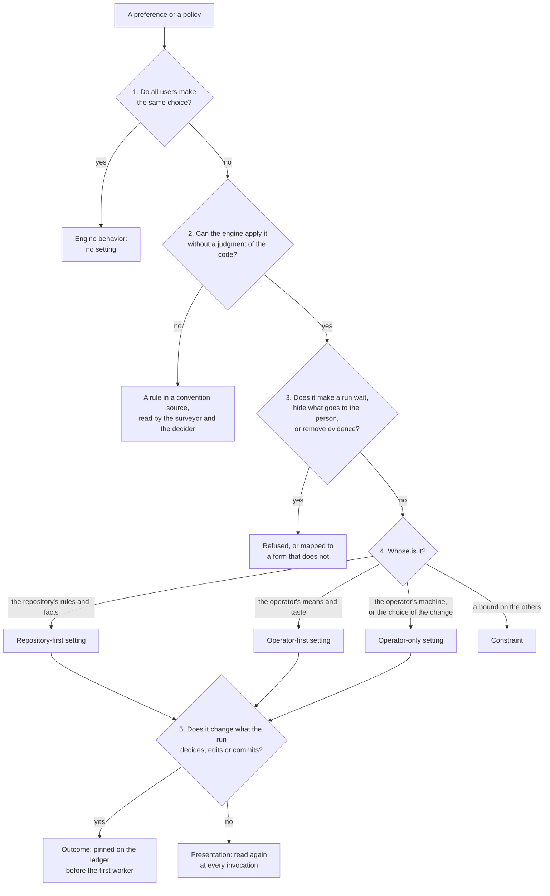

# Report: Preferences and policies that can configure deep-review

This report was written on 2026-10-16, at `dac2ccd`. It imagines who runs deep-review, and what each of these persons wants to set. Where it can, it connects each preference to the records of real runs. For each preference, it finds the correct home: a setting, a rule in a convention source, engine behavior, or no home.

The configuration proposal, [`2026-10-16-configuration.requirements.md`](../changes/2026-10-16-configuration.requirements.md) and its [technical design](../changes/2026-10-16-configuration.design.md), starts from this report. A row with the mark **Observed** gives the run or the issue that showed the need. A row with the mark **Invented** is imagined, because no user outside this repository ran the engine until now.

## Summary

- The catalog holds 90 preferences and policies in eight areas, and 14 kinds of user hold them. 31 rows are observed: a recorded run or an issue showed the need, or the engine has the setting now. The other 59 rows are invented.
- Five questions give each row its home (Figure 1). A setting exists only where users make different choices. The engine must apply it without a judgment of the code. And it must not make a run wait, or hide what goes to the person.
- The homes:

  | Home | Rows | Of them observed |
  |---|---|---|
  | A setting the repository owns first (repository-first) | 19 | 6 |
  | A setting the operator owns first (operator-first) | 16 | 6 |
  | A setting only the operator may make (operator-only) | 11 | 7 |
  | A constraint, a bound on the settings | 4 | 0 |
  | A rule in a convention source | 7 | 3 |
  | Engine behavior, no setting | 13 | 6 |
  | A profile, another element, an existing flag, the host or git | 12 | 3 |
  | Refused, with the principle it would break | 8 | 0 |

  A row with two homes, a setting and a constraint on it, counts one time, under the setting. Three rows (C8, C9, E2) are such pairs.
- Four needs cost the author hand work on the gates. On each recorded gate of this repository, the author typed what to review, which checks to run, and how much a run can spend. To leave out the built paths, the author listed all the other paths. On the gates of click and prek, the author also prepared `PATH` before the engine started. The engine applies each of these needs before or around its workers, and none of them is a judgment about the code. Thus the cost today is repetition, and the errors that repetition causes.
- The invented needs are about what goes to the person and who starts a run, such as an author agent or a CI job. Others are about the limits that an organization sets. They give the shape of the framework: who can set what, in which file, and how the run records it. They do not ask for many settings now. All eight refused rows are invented.
- One invented need changes the trust model. An agent writes the change (persona A), and it can edit the settings of the repository in the same change. Then a setting from the change itself lets the change make its own review weaker. The risk is larger when the same agent starts the review (G2). Thus the repository's settings must come from the base of the change.

## Data and method

### Sources

All the sources are in this repository or its issues:

- The Verification sections of the decision step (`2026-10-08-decision-step.design.md`), of fix pass continuation (`2026-10-10-fix-pass-continuation.design.md`), of answers (`2026-10-11-answers.design.md`) and of the edits field (`2026-10-16-fixer-edits.md`). They give the command lines of the gate runs, the paths that the gates left out and the checks that they named. They also show what the author prepared by hand.
- The Problem section of the repository survey (`2026-10-03-repository-survey.requirements.md`), for the click gate.
- Issues #40, #48 and #49, with the report `2026-10-14-test-and-ci-time.md`. In #40, a usage limit stopped a run. In #48, a fix run that its budget stopped cannot continue. Issue #49 asks where the files of the engine go on Windows.
- The role policy `roles/policy.json` and `src/review/policy.ts`, which hold the settings that the engine has today, and the command line in `src/cli.ts`.
- The two skills under `skill/`. The documentation of Claude Code and Codex, and the source of Codex at `rust-v0.160.0`, show what a host lets a skill do.

### Method

The personas below are invented. They show the range of persons who run a review: who pays, who owns the rules, if a person is present, and which machine the run uses. For each persona, the report lists what that person wants to set. Then it merges the items that two or more personas share. Each row then gets its home from the five questions.

The counts are of rows, not of users. Thus a row that one persona holds counts the same as a row that all personas hold.

### Limits

The invented rows are imagined, and the only check on them is the vision note. They are not research with users. The observed rows come from approximately ten gate runs on four repositories by one operator, the author. Thus they show the needs of one person who runs the engine often on its own repository.

## Who runs a review

All personas are invented.

| Code | Who | What they want from a run |
|---|---|---|
| M | The maintainer of an agent-heavy repository: the vision note's person | Read only the questions and departures; fixes by default; the same gate on every pull request |
| C | A contributor to someone else's repository | The maintainer's rules, not their own; a cheap first look; their own reading language |
| S | An individual who pays per token | A low ceiling on spend; a cheaper depth; no surprise |
| U | A user on a subscription with usage windows | Pacing under usage limits; a limit in time rather than dollars |
| E | A developer in an organization with an AI policy | Approved models and providers only; bounds they cannot raise; an audit trail |
| X | The maintainer of a security-sensitive repository | No command the policy does not name; no network; paths no fixer may edit |
| P | A monorepo team | Checks and exclusions per package; reviews scoped to a package |
| I | A CI job | No person and no host; output a machine reads; a time box; an exit code that means something |
| A | An author agent in its own loop | A review it may start before it says done; a compact result; no way to weaken its own gate |
| R | A careful human reviewer | Read-only by default; every finding and every refuted candidate; full evidence |
| T | A team lead who owns the standards | One committed policy; required angles and checks; a minimum engine |
| L | A reader in another language | The part a person reads in their language, identifiers in English |
| W | A Windows or polyglot developer | Checks that find the project's toolchain; the right sandbox |
| D | deep-review's own developer | Everything kept; a pinned engine copy; runs that can be replayed |

## Five questions

Figure 1. Five questions find the home of a preference. The first two questions keep the number of settings small. The third keeps the settings inside the vision. The last two decide who can set a value, and when the run records it.

### 1. Do all users make the same choice?

If all users make the same choice, the preference is engine behavior and not a setting. Two examples are a report path that a person can read, and the spend that the progress shows against the budget. A setting that nobody changes is a cost to each person who reads the settings.

### 2. Can the engine apply it without a judgment of the code?

The engine can apply "leave out `dist/`" with a match of the path. It cannot apply "ask before a change to a public interface", because what is public is a judgment. A rule that needs a judgment stays in a convention source, such as `AGENTS.md`. The surveyor and the decider read it there, as they read each rule today. This keeps the line that the repository survey drew: the model reads the repository, and no list of names decides for it.

### 3. Does it make a run wait, hide what goes to the person, or remove evidence?

Principles 7, 5 and 1 of the vision note forbid each of these. This report refuses such a preference, or it changes the preference to a form that keeps the principle. For example, "approve each fix" becomes a read-only run that continues into the fix pass.

### 4. Whose is it?

The rules and facts of the repository apply to each person who reviews it. Examples are the paths to leave out, the commands that check the code, and whose rules count. Thus the value of the repository comes before the general preference of the operator.

The means and taste of the operator belong to the operator. Examples are the budget, the models and the form of the report. Thus the value of the operator comes before a value that the repository only suggests.

Some values are facts of the operator's machine: the executables, the directories of tools, the sandbox, and the number of workers that the machine can carry. A repository cannot set these values at all. Without this rule, a repository that a person clones can choose which programs run on the machine of the operator.

The values that choose the change belong with them: the base branch and the default scope. The reason is that the engine reads the settings of the repository at the base of the change, and these values decide that base. A constraint sets a limit on the other settings. An organization or a team sets this limit, and no value of the operator can go past it.

### 5. Does it change what the run decides, edits or commits?

If it does, it is an outcome. The engine records an outcome on the ledger before the first worker. Thus a resumed run and a later reader see the values that the run used. If it changes only how the engine shows or delivers the record, it is presentation. The engine reads a presentation value again at each invocation, and it can show a finished run in a different form.

## The catalog

The columns are these. **Who** gives the persona codes from the table above. **Evidence** says Observed, with its source, or Invented. **Home** gives the result of the five questions, with the proposed name of the setting. **Effect** gives the answer to question 5.

In that column, "invocation default" is a value that chooses a flag that the operator did not give. "Limit" is a value that each invocation can change, as the budget and the concurrency are today.

### A. What is reviewed

| ID | Preference or policy | Who | Evidence | Home | Effect |
|---|---|---|---|---|---|
| A1 | Review my branch against its base without typing the range | M, A, T, I | Observed: the gates of 2026-10-08 and 2026-10-11 typed the branch range with `--merge-base` (their Verification) | Operator-only `scope.default` and `review.base`; a `--branch` flag | Invocation default |
| A2 | Leave out build output, generated files, vendored code, golden fixtures | M, T, P | Observed: the gates of 2026-10-08, 2026-10-11 and 2026-10-16 listed every changed path outside `dist/` and the golden fixtures | Repository-first `scope.exclude` | Outcome |
| A3 | Leave out one more path for this run | R, C | Invented | The flag layer (`--set scope.exclude=...`) | Outcome |
| A4 | Review one package of a monorepo | P | Exists: `--path` | Flag | Outcome |
| A5 | Review more changed paths than the capture accepts | P | Invented | Engine behavior: the cap stays, the budget bounds the cost; revisit when a run meets the cap | - |
| A6 | Review the uncommitted work and the branch in one run | M, A | Invented | A new scope mode, not a setting | - |
| A7 | Review only what changed since the last run | A, I, M | Invented; the vision note's "Where this leads" asks for it | Another element; later an operator-first setting | - |

### B. Depth, cost and time

| ID | Preference or policy | Who | Evidence | Home | Effect |
|---|---|---|---|---|---|
| B1 | A run budget in dollars | S, M | Observed: gates passed 100 and 120 USD; #48 stopped at the 60 USD default | Operator-first `budget.usd`, which the repository may suggest | Limit |
| B2 | A ceiling on any run's spend | T, E | Invented | Constraint `limits.budget_usd` | Outcome bound |
| B3 | A wall-clock limit | I, U | Invented | Operator-first `budget.minutes` | Limit |
| B4 | Pace a subscription's usage window | U | Observed: #40, a session limit voided a run | Engine behavior (#40), with operator-only `run.concurrency` | - |
| B5 | The model behind each tier | S, E, D | Exists: `--strong-model`, `--fast-model`, the role policy | Operator-first `runtimes.<name>.strong` and `.fast` | Outcome |
| B6 | Only approved models or providers | E | Invented | Constraint `limits.models` | Outcome bound |
| B7 | A model or an effort for one role | D, S | Invented | Refused as a setting (principle 10): a role's tier and effort are part of its rubric, measured on the replay corpus; reachable only through a measured profile | - |
| B8 | A named depth: quick, standard, thorough | S, M, I | Invented; the fixer cost report lists the levers such a depth would pull | Profiles (`--profile`); built-in ones only after a replay measures them | Outcome |
| B9 | Skip verification to save money | S | Invented | Refused (principle 1): a verdict without evidence is not a verdict | - |
| B10 | Always run an angle, such as efficiency | X, T | Invented | Repository-first `angles.require` | Outcome |
| B11 | Never run an angle | T, S | Invented | Repository-first `angles.skip`, reported as not run | Outcome |
| B12 | The repository's own angle: security, API compatibility, migrations | X, T, P | Invented | Repository-first `angles.custom`, prompt files read at the base | Outcome |
| B13 | How many workers run at once | W, U, S | Exists: `--concurrency`, the role policy | Operator-only `run.concurrency` | Limit |
| B14 | Run below normal priority | W, D | Observed for the test suite (PR #53); invented for runs | Operator-only `run.priority` | - |
| B15 | Warn before the budget runs out | S | Invented | Engine behavior: progress shows spend against the budget | - |
| B16 | Stop and wait for more budget instead of finishing without the rest of the fixes | M | Observed: #48 | Engine behavior: #48 makes such a run continuable; a setting would hide the defect | - |

### C. What the engine can run and touch

| ID | Preference or policy | Who | Evidence | Home | Effect |
|---|---|---|---|---|---|
| C1 | The repository's check commands | T, M, W | Observed: the same gates named every kind by `--check`; the flags count only for the invocation that plans the checks | Repository-first `checks.<kind>` | Outcome |
| C2 | Leave a check kind out | S, W | Exists: `--no-check`; observed: the build check dropped on 2026-10-08 | Repository-first `checks.<kind> = false` | Outcome |
| C3 | `PATH` entries the checks and the fixers need | W, P | Observed: `.venv\Scripts` for click, a `python3` ahead of the Store alias for prek, both by hand | Operator-only `tools.path`, usually in the clone's file | Outcome |
| C4 | How long one check may run | P, W | Exists: the role policy, 20 minutes | Repository-first `checks.timeout_minutes` | Outcome |
| C5 | Checks that already fail before the change | W | Observed: mypy at click's base | Engine behavior: the baseline comparison exists | - |
| C6 | Run no check the survey chose, only named ones | X, E | Invented; the survey proposal accepted the risk of an unapproved command | Constraint `limits.checks_from` | Outcome bound |
| C7 | The shell a check runs in | W | Invented | Repository-first `checks.shell` | Outcome |
| C8 | The Codex sandbox on Windows | W, X | Exists: `--codex-windows-sandbox`, the role policy | Operator-only `runtimes.codex.windows_sandbox`; constraint `limits.codex_windows_sandbox` | Outcome |
| C9 | No network for workers | X, E | Invented | Operator-only `run.network` with a constraint; each runtime confines differently | Outcome |
| C10 | Paths no fixer may edit: tests as the specification, migrations, CI files | X, T, A | Invented | Repository-first `fix.protected`, enforced through claims | Outcome |
| C11 | Paths no worker may read, such as secrets | X, E | Invented | Constraint `limits.unreadable`; needs a control both runtimes give alike | Outcome bound |
| C12 | Run the formatter over the fixers' edits | T, W | Observed: fixers left LF endings in a CRLF checkout of click | Repository-first `fix.format` | Outcome |
| C13 | Rebuild generated files after the fixes | M | Observed and solved: the build check's revision rebuilds `dist/` | Engine behavior | - |
| C14 | The runtime's executable and its arguments | E, D | Exists: `--executable`, `--executable-arg` | Operator-only `runtimes.<name>.executable` and `.args` | Outcome |

### D. Which rules apply

| ID | Preference or policy | Who | Evidence | Home | Effect |
|---|---|---|---|---|---|
| D1 | The files that hold the repository's rules | T | Observed: click's `docs/contributing.md`, which the surveyor now finds | Convention: a list of names is a discovery rule the survey rejected | - |
| D2 | Whether the reviewer's own rules count | C, M | Exists: the role policy's `userRules`; observed on click | Repository-first `conventions.user_rules` | Outcome |
| D3 | Fix only findings at or above a severity | S, R | Invented; the severity floor was deferred on 2026-10-02 | Repository-first `fix.min_severity`, reported as left by the setting | Outcome |
| D4 | Fix only CONFIRMED findings | R | Invented | Repository-first `fix.verdicts` | Outcome |
| D5 | Always ask before changing a public interface | T, M | Invented; principle 8 names it as a reason to look | Convention: what is public is a judgment | - |
| D6 | At most N questions in a run | M | Invented | Refused (principle 4): asks never block, so a cap would only make the engine decide a question of direction alone | - |
| D7 | Never bother me with questions | M | Invented | Already true: an ask applies its default and never blocks; where asks are delivered is F15 | - |
| D8 | The commit message style | T | Invented | Convention | - |
| D9 | Writing rules: no em dash, line length | T | Observed: this repository's `AGENTS.md` | Convention | - |
| D10 | Every fix comes with a test | T, M | Observed: the reviewer's own rules | Convention | - |
| D11 | A rule that admits no exception | T, X | Invented | Convention; a departure stays reported (principle 3) | - |

### E. What the engine can change, and how it lands

| ID | Preference or policy | Who | Evidence | Home | Effect |
|---|---|---|---|---|---|
| E1 | Fix by default | M, A | Invented | Operator-first `fix.default` | Invocation default |
| E2 | Never edit the working tree | R, C, I | Invented | Operator-first `fix.default = false`; constraint `limits.fix` | Invocation default, bound |
| E3 | Fix in a separate worktree, not mine | M, R, D | Observed: every gate made its own worktree by hand | Operator-first `fix.worktree` | Outcome |
| E4 | Commit after a fix run without being asked | A, M | Invented | Operator-first `commit.after_fix` | - |
| E5 | One commit per finding, per cluster, or one for the run | T | Invented | Repository-first `commit.granularity` | Outcome |
| E6 | Sign-off and trailers, such as a DCO | T, E | Invented | Repository-first `commit.signoff` and `commit.trailers` | Outcome |
| E7 | Signed commits | E | Exists: `commit-tree` signs as git is configured | Git configuration | - |
| E8 | Commits on a new branch for a stacked pull request | M, D | Observed: every gate's fixes went to a stacked branch by hand | Operator-first `commit.branch` | Outcome |
| E9 | Push the commits | A | Invented | Refused: outward-facing, and outside the engine, which edits the operator's tree and nothing beyond it | - |
| E10 | Commit messages in another language | L, T | Invented | Convention | - |

### F. What reaches the person

| ID | Preference or policy | Who | Evidence | Home | Effect |
|---|---|---|---|---|---|
| F1 | Leave out the questions, the departures or what was not examined | S | Invented | Refused (principle 5) | - |
| F2 | Brief or full evidence | R, S | Invented | Operator-first `report.evidence` | Presentation |
| F3 | Show or hide the refuted candidates | R, D | Exists: always shown | Operator-first `report.refuted` | Presentation |
| F4 | The part a person reads in my language | L | Observed: the repository keeps a Korean edition of its vision note | Operator-first `language`; an outcome where a model writes the text | Outcome |
| F5 | Posted text in the repository's language | T, L | Invented; it arises once a person answers on the pull request, as principle 7 of the vision note has it | Repository-first `answers.language`, with answers on the pull request | - |
| F6 | A report file I can find and open | all | Invented; the path is a content hash under `.git` today | Engine behavior: a readable copy, with the report order that principle 5 asks for; operator-only `report.directory` | Presentation |
| F7 | Open the report in my editor | R | Invented | Operator-only `report.open` | Presentation |
| F8 | JSON or SARIF output | I, A | Invented | Operator-first `report.formats` | Presentation |
| F9 | The top layer printed at the end, not only the path | M, R | Invented; depends on the report order that principle 5 asks for | Operator-first `relay` | Presentation |
| F10 | Quieter or more detailed progress, or JSON lines | I, R | Invented | Operator-first `progress` | Presentation |
| F11 | Progress in the host's status line | M | Invented | Host integration: a Claude Code plugin cannot set the status line, and a plugin monitor sends progress lines to the model in interactive sessions only | Presentation |
| F12 | A notification when the run ends | M, U | Invented | Operator-only `notify.command`, or the host's own notification | Presentation |
| F13 | The notice before a fix run once, not every time | M | Invented | Operator-first `notices.fix` | Presentation |
| F14 | The host's model explains the findings | R | Invented | Refused inside the skill (principle 1); the person may ask their agent outside it | - |
| F15 | Answer from the pull request, a tracker or chat | M, T | Invented; principle 7 of the vision note names the pull request as the surface a person answers on | Repository-first `answers.surface`, with answers on the pull request | - |
| F16 | No color, no hyperlinks, plain text | R | Invented | Engine behavior: the engine prints plain text | - |
| F17 | A run that outlives the host's wait still finishes | A, I, M | Invented; Claude Code stops an unattended session's background command after 30 minutes by default, and `codex exec` stops one when its turn ends | Engine behavior: a stopped run resumes from its ledger when the same command runs again, as both skills say | - |

### G. Who starts a run, and where

| ID | Preference or policy | Who | Evidence | Home | Effect |
|---|---|---|---|---|---|
| G1 | Only a person starts a run | R, S | Exists: both skills forbid the model to invoke them | The host, through which skill is installed | - |
| G2 | My coding agent reviews before it says it is done | A, M | Invented; the vision's first place for a review | Repository-first `invocation.agent`, a skill the model may invoke, and the rule of when in a convention source | - |
| G3 | A required check in CI | I, T | Invented; the vision's second place | The command line with a `--config` file; packaging is another element | - |
| G4 | A worker never starts a review | all | Invented; needed once G2 exists | Engine behavior | - |
| G5 | Review with another runtime than the host's | D, M | Invented | Operator-first `runtime`, the host's by default | Outcome |
| G6 | A runtime per role | D | Invented | Refused for now (principle 10): nothing measures it | - |
| G7 | A minimum engine version | T, I | Invented | Repository-first `engine.minimum` | - |
| G8 | No permission prompt for the engine's own command | M, R | Invented | The host: a Claude Code skill's `allowed-tools` can approve the engine's command for the invoking turn; Codex has no counterpart | - |

### H. Records and the machine

| ID | Preference or policy | Who | Evidence | Home | Effect |
|---|---|---|---|---|---|
| H1 | The checkpoint on another disk | W, D | Observed: #49; its report found the move saves 3% | Operator-only `storage.root`, not worth building today | - |
| H2 | Prune old runs | W, E | Invented | Operator-only `storage.retention`, with a prune command | - |
| H3 | Keep no worker transcripts | E, X | Invented | Refused (principles 1 and 10): the evidence is the record | - |
| H4 | Export answers as labels for the rubrics | D | Invented; principle 10 of the vision note | Another element | - |
| H5 | Run on a pinned engine copy | D | Observed: gates copied `dist/` out, since the build check rewrites it | Engine behavior and packaging, not a setting | - |
| H6 | A Git identity in a fresh clone | D | Observed: observation 3 of the answers gate | Engine behavior: a defect, the commit crashes | - |
| H7 | Install and update the skill with one command on each host | all | Invented; the Codex skill is a copied directory with no update path, and Codex reads this repository's `.claude-plugin` manifests as a plugin marketplace, untried | Another element: packaging | - |

## What the catalog shows

### The observed needs are the first settings

19 observed rows are settings. The proposal takes 12 of them. Six cost the author hand work on the gates: A1, A2, B1, C1, C2 and C3. One is the reviewer's rules (D2), which a repository has a reason to settle for each person who reviews it. Five are values that the engine has today as a flag or a field of the role policy: B5, B13, C4, C8 and C14. These five move into the same surface.

The proposal leaves seven. B14 and H1 were measured for the test suite, and the measurements found them small or not worth the work. C12 occurred one time, on 2026-10-03, and not after that. Only the gates of deep-review needed E3 and E8, to keep the copy of the engine out of the tree under review.

Nobody asked to hide the refuted candidates of F3. F4 changes the prompts of the models that write what a person reads, so it needs a replay measurement of its own. The proposal builds each other row only when a run or a user shows its need, as principle 11 asks of recovery.

### The invented rows are mostly not settings

Of the 59 invented rows, 27 are settings, 4 are constraints and 8 are refused. The other 20 are conventions, engine behavior, a profile, the host or another element. Of the 27 settings, 7 are presentation: they change how the engine shows a record, but never what a run decides. Five of the 13 repository-first settings are about what a fixer can do and how its work lands (C10, D3, D4, E5, E6). Three are about which angles run (B10 to B12).

These rows show that the framework must have a place for each kind of setting: a presentation class that the engine reads at each invocation, and constraints above all layers. They do not show that the engine must build each setting before somebody asks for it.

### The holders disagree in a pattern

A repository and its operator want different things from the same setting in three ways. Each way needs its own order.

For the rules and facts of the repository, the value of the repository must come before the general preference of the operator. An operator who likes `npm test` for all repositories must not replace the `pnpm vitest run` of a repository.

For the means and taste of the operator, the value of the operator must come before the suggestion of the repository. A repository that suggests a budget of 120 USD must not spend the money of a contributor above the 30 USD that the contributor set.

For the operator's machine, the repository must have no say. A repository that a person clones must not choose the executable that runs with the credentials of the operator.

One order for all settings, as in git and most editors, fails one of the three. Thus the proposal gives each setting one of three owners. The values that choose the change go into the third owner, with the machine of the operator.

### A judgment never became a setting

Seven rows (D1, D5, D8 to D11, E10) and the "when" of G2 are rules that a model must apply with a judgment. Each of them has a home already, in the convention sources that the surveyor finds and the decider reads. A setting for such a rule is a second and weaker place to state it.

### The trust model moves with the author agent

With persona A, an agent writes the change. It can also edit the settings of the repository in the same change. If a setting comes from the tree of the change, the change can make its own review smaller. It can leave out its own files, skip an angle, or replace a check with a check that always passes. The risk is larger when the same agent starts the review (G2).

The engine reads the settings of the repository at the base of the change, and this stops it for a change under review. The files of the operator stay the files of the operator, and the report names each value that they set.

## Refused, and why

| Row | Refused | Principle |
|---|---|---|
| B7 | A model or an effort for one role, as a setting | 10: a rubric is measured against the corpus, so its tier and effort change only through a measured profile |
| B9 | Skip verification | 1: a verdict without evidence is not a verdict |
| D6 | A cap on questions | 4 and 7: asks never block, so a cap only removes the person from a question of direction |
| E9 | Push the commits | Outward-facing; the engine edits the operator's tree and nothing beyond it |
| F1 | Leave out the questions, departures or coverage | 5: the top of the report is not optional |
| F14 | The host summarizes the findings under the skill's name | 1: a summary that replaces its evidence |
| G6 | A runtime per role | 10: nothing measures it |
| H3 | No worker transcripts | 1 and 10: the evidence and the corpus are the record |
| (not a row) | Approve each fix before it is made | 7: a review never waits; the form that keeps the principle is a read-only run continued into the fix pass |

## Open questions

### Does the engine let the author agent start a review now?

The vision note puts a review in the loop of the author agent first, and the catalog lists it as G2. It needs a skill that the model can start, and both skills forbid this today on purpose. This is a question about who starts a run, and not about configuration. Thus the configuration proposal leaves it out.

### Is the reader's language a setting, and when?

Models write the text that a person reads first, which is the catalog's F4. Thus a language setting changes their prompts and their role hashes, and a replay must measure the change. The proposal does not decide this question.

### Must the default scope look at the branch?

Today, on a clean tree, a run reviews the last commit, on any branch. The evidence of A1 shows that the author reviews the branch. The proposal keeps the rule of today for `auto`, and it gives `branch` as a value of `scope.default` (its PD9).

## Related

- [`docs/2026-10-11-vision.md`](../2026-10-11-vision.md), the principles the five questions cite.
- [`2026-10-16-configuration.requirements.md`](../changes/2026-10-16-configuration.requirements.md) and [`2026-10-16-configuration.design.md`](../changes/2026-10-16-configuration.design.md), the proposal built from this catalog.
- [`2026-10-03-fixer-time-and-cost.md`](2026-10-03-fixer-time-and-cost.md), the levers that a quick depth can pull.
