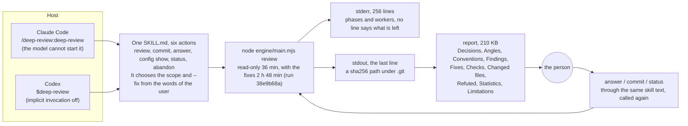

# Report: The surface that a user of deep-review meets

This report was written on 2026-10-18, at `ec7e9e4`. It reads deep-review as a user meets it: the install, the skill, the run, the report, the answer, and the settings. For each kind of user, it names what gets in the way, and it reviews the ways to remove it. The findings come from three sources: the two skills, the command line, and the records of two gate runs of the configuration change.

The report does not decide. Each finding ends with a remedy and a class: a change to make now, a decision for the author, or no change. The section "Ways to improve" groups the remedies into packages, with a cost and the principle of the vision note that each one serves.

## Summary

- A user starts a run with one command and gets back one line: the path of the report, a content hash under `.git`. The report of the gate run of this repository has 1095 lines and 210 KB. The questions for the person are 3, and the departures are 2. The report puts the questions first, as principle 5 asks, but 35 fixes follow them at once. The core of the change is not in the report, and what the run did not examine is at the end. This is the largest gap, and the work that turns the report over (principle 5) closes it.
- The gate run took 2 hours and 48 minutes and 56.11 USD. The read-only part took 36 minutes and 27.99 USD. The user saw 256 lines on stderr, one per worker start or end. No line said which of the 16 phases the run was in, or how much of the budget the run spent. The host stops an unattended run after 30 minutes (F17), and a run that stops during a check does not run that check again (#25). The user meets this trap first.
- One skill text of 102 lines holds six actions: review, commit, answer, config show, status and abandon. The model cannot start it, so the user types its name, also to answer a question of yesterday's run. The skill chooses the scope and `--fix` from the words of the user and starts at once. The description of the skill names the phases of the engine, not what the user gets.
- The report prints `deep-review answer ...` as the command for an answer, but no such executable exists. The skill translates it. A user at a terminal cannot paste it.
- Sixteen findings, F1 to F16, sort into five packages. Package A changes the skill text only, and package B changes a few lines of the output of the engine. Package C is the turned report. Package D is about entry points and who starts a run. Package E is recovery. The order that this report recommends: packages A and B as one proposal, then #25 and #48, then package C, then the answers on the pull request, then package D.

## Data and method

### Sources

The sources are in this repository, in its issues, or in the records that the engine keeps of its runs:

- The two skills, `skill/claude/skills/deep-review/SKILL.md` and `skill/codex/SKILL.md`, with `skill/codex/agents/openai.yaml`, `skill/claude/.claude-plugin/plugin.json` and `.claude-plugin/marketplace.json`. They are the text that a host shows and the text that a model follows.
- The usage text of `src/cli.ts`, which lists each command and flag, and the `Installing` and `Configuration` sections of `README.md`.
- The report, the stderr and the stdout of run `38e9b68a`, the gate of the configuration change on this repository. The run reviewed PR #57, 80 files, with `--branch --fix` on Claude Code. The Verification of [`2026-10-16-configuration.design.md`](../changes/2026-10-16-configuration.design.md) records it.
- The report and the logs of run `fa49b70a`, the gate of the same change on prek #2844, on Codex. The same Verification records it.
- The catalog [`2026-10-16-preferences-and-policies.md`](2026-10-16-preferences-and-policies.md), for the fourteen personas and the rows that it already gave a home.
- The vision note [`2026-10-11-vision.md`](../2026-10-11-vision.md), principles 4 to 8, which say what reaches the person.
- Issues #25, #34, #40, #44 and #48, which record the ways in which a run stops and does not continue.

### Method

The surface is each thing that a user sees or types. The report walks it in the order of use: install, call, run, result, answer and commit, settings. At each step, it reads what the source says and what the two runs showed. Then it compares them with the principle that applies. Each finding names its location, its problem, its evidence and its remedy, and gives the remedy a class.

The classes are three. "Now" is a change that the author can make without a decision, such as words of the skill. "Decide" is a change with a cost, a risk or a conflict between two goods, which the author decides. "No change" is a part of the surface that the report examined and found correct.

The report does not propose. Some remedies belong to work that the vision note already names: the turned report of principle 5, or the answers on the pull request of principle 7. Such a finding points there and proposes nothing.

### Limits

Two runs on two repositories by one operator are the evidence. Both runs used `--fix`, so the report says less about a user who only reads. The personas are the invented ones of the catalog, and no user outside this repository ran the engine until now. The measurements are of one machine and one day, so a reader must read them as an order of size, not as a benchmark.

## The surface today



Figure 1. The surface today. Two hosts call the engine through one skill text. The person gets one path and opens the report. The times and sizes are measured on run `38e9b68a`.

| Surface | Claude Code | Codex |
|---|---|---|
| Install | `/plugin marketplace add josephjang/deep-review`, then `/plugin install deep-review@deep-review`; the plugin has no version and follows the last commit | A copy of `dist/codex/**` to `~/.agents/skills/deep-review/` by hand; no update procedure |
| Call | `/deep-review:deep-review`, with `disable-model-invocation: true` | `$deep-review`, with `allow_implicit_invocation: false` |
| Skill text | One text of 102 lines for review, commit, answer, config show, status and abandon | The same text, with the Windows sandbox notice and the instruction to poll the command when the turn ends |
| During the run | Phase and worker lines on stderr; a permission prompt at each call | The same; `codex exec` stops a command when the turn ends |
| Result | The last line of stdout, `.git\deep-review-checkpoint\artifacts\<sha256>` | The same |
| Cost | `--budget-usd`, 60 USD by default, 120 in the file of this repository | No cost is reported, so no budget applies |
| Settings | The files of the repository, the operator and the clone, with `--config` and `--set`; `config show`, `explain`, `validate` and `init` | The same |

## Findings

| ID | Step | Problem | Class | Package |
|---|---|---|---|---|
| F1 | Install | The Codex install is a copy by hand with no update path | Decide | D |
| F2 | Install | The description of the skill names the phases of the engine | Now | A |
| F3 | Call | One entry point holds six actions, and only the user can open it | Decide | D |
| F4 | Call | The skill chooses the scope and `--fix` from words and starts at once | Decide | A |
| F5 | Call | A permission prompt at each call | Decide | A |
| F6 | Run | No line says which phase the run is in or what it spent | Decide | B |
| F7 | Run | The host stops the run after 30 minutes, and a stopped check does not run again | Decide, #25 first | E |
| F8 | Run | The action of the `check-unavailable` blocker does not name the clone's file | Decide | B |
| F9 | Result | The report is at a content hash under `.git` | Decide, the turned report | C |
| F10 | Result | The report lacks a top layer that a person can read alone | Decide, the turned report | C |
| F11 | Result | "Default" and "Recommended" point at different options | Decide | C |
| F12 | Result | The run ends with one path and no words | Decide, the turned report | C |
| F13 | Answer | The report names an executable that does not exist | Decide | B |
| F14 | Settings | The skill does not know `config init` | Now | A |
| F15 | Codex | What is specific to Codex | No change | - |
| F16 | Answer | The flow of answer and commit | No change, two words | B |

### F1: The Codex install is a copy by hand with no update path

The location is the `Installing` section of `README.md`, under Codex, and `dist/codex`.

The problem is that the install ends with "copy the directory". The user has no way to know which engine the copy holds, or that a newer one exists. The `Engine:` line of the report and of stderr gives the digest of the bundle, which does not lead to a commit.

The evidence is the one line of the README, `dist/codex/** -> ~/.agents/skills/deep-review/`. The author of this repository also copied the directory by hand after each merge.

The remedy is one of two. The first is a paragraph in the README that says how to compare the installed `engine.json` with the one under `dist/codex`. The second is a file `dist/codex/install.mjs` that the build writes, so that `node dist/codex/install.mjs` copies and updates in one command. The second keeps the rule that the toolchain has no shell script, and it adds one built file. The decision is if the second is worth the file.

### F2: The description of the skill names the phases of the engine

The location is the `description` of both skills, the descriptions in `marketplace.json` and `plugin.json`, and the `short_description` of `openai.yaml`.

The problem is that these sentences list the phases of the engine: `SCAN triage, nine more finder angles, deduplication, verification, a gap sweep, a merge-and-rank pass and a decision pass`. A new user (personas C, S and T) reads this sentence in the plugin list or in the skill list of Codex. It does not say what the user gets. Principles 5 and 6 say that the person gets questions, departures and what the run did not examine. The description has none of these words.

The evidence is line 3 of each `SKILL.md` and the description in `marketplace.json`: `ten finder angles, verification, a sweep, a decision on every finding and a ranked Markdown report`.

The remedy is one sentence that names the result, with the trigger sentence kept. An invented example:

```
Reviews one change with evidence: decides each finding itself, asks only
the questions that a person must answer, says what it did not examine,
and on request applies the fixes through its own workers and runs the
checks of the project, and commits nothing. Use only when the user asks
for deep-review by name.
```

A change of the skill text goes in its own commit, with a rebuild of `dist/`.

### F3: One entry point holds six actions, and only the user can open it

The location is the whole `SKILL.md`: review in steps 1 to 4, commit in step 5, answer in step 6, and config show, status and abandon in the last two paragraphs.

The problem is that the Claude Code skill has `disable-model-invocation: true`, so the text enters a session only when the user types `/deep-review:deep-review`. A user who answers today a question of yesterday's run calls a skill with the name "review" and asks it to answer. A model in a new session does not know `deep-review answer` without that text. The `$deep-review` of Codex is the same.

The evidence is line 4 of `SKILL.md`, lines 60 to 80 and lines 100 to 102, and the one directory `skills/deep-review` in the plugin.

The remedy is one of two. The first adds the skills `deep-review:answer` and `deep-review:status` to the Claude plugin, and the directories `deep-review-answer` and `deep-review-status` beside the Codex skill. Commit stays in the review and answer texts, because it follows them. The test that keeps the two skill texts equal (TD11 of the configuration design) then checks each pair. A session that answers does not read the 100 lines of the review procedure, and the name matches the intent.

The second keeps one skill, adds an `argument-hint` to the Claude frontmatter, and names answer and status in the description. The second costs nothing. The first is better, but the answers on the pull request (principle 7) move the answer surface away from the terminal. Thus the author decides the first together with that work.

### F4: The skill chooses the scope and `--fix` from words and starts at once

The location is steps 1 and 2 of `SKILL.md`.

The problem is that the model chooses the scope flag and the `--fix` flag from the words of the user. Then it starts the run. A wrong choice, for example `--worktree` for "look at my branch", spends tens of minutes and tens of dollars on another change. The `scope.default` setting makes a call without a flag safe, but a scope given in words can still be misread.

The evidence is step 1, "Decide the scope from what the user asked for", and the Statistics of the gate run: the read-only part took 36 minutes and 27.99 USD, and the whole run took 2 hours 48 minutes and 56.11 USD.

The remedy is a `config show` with the same flags before the run. The skill shows three things as printed: the `Scope:` line (the mode, the base, and if the change is empty), the budget from the `Settings:` lines, and the `--fix` choice. Then it starts the run. The `config show` command takes seconds and creates no run.

The skill does not wait for an answer, so principle 7 holds, and an author agent (G2) can use the same step. A user who sees a wrong scope stops the command. The decision is between "show and go" and "show and wait". This report recommends "show and go".

### F5: A permission prompt at each call

The location is the frontmatter of the Claude `SKILL.md`.

The problem is that the skill has no `allowed-tools`. So the host asks the user to approve the command of the engine at each review, commit, answer and config show. The catalog recorded this as G8.

The evidence is the frontmatter, which has only `name`, `description` and `disable-model-invocation`.

The remedy is an `allowed-tools` line in the Claude `SKILL.md` that approves the `node .../engine/main.mjs` command and nothing else. The exact pattern comes from the Claude Code documentation. Codex has no counterpart (G8). The author decides, because the line changes what runs without a prompt. The test TD11 must accept the difference in the frontmatter.

### F6: No line says which phase the run is in or what it spent

The location is the stderr lines `phase X: started` and `worker ...: completed in N s, M USD`.

The problem is that the user sees 256 lines, one per worker start or end. No line says which of the 16 phases the run is in, or how much of the budget it spent. For 2 hours and 48 minutes, the user cannot tell if the run is near its end.

The evidence is the stderr of run `38e9b68a`, 256 lines. The Statistics table of its report has the wall seconds and the cost of each phase, so the data is on the ledger already. The catalog's B15 asked for this as engine behavior.

The remedy is an index and the spend on each phase line. An invented example: `phase finders (3 of 16): started; spent 2.86 of 120.00 USD`. The fix pass knows its batches before it starts, so `batch 7 of 19` is possible too. The output of the engine changes, so a proposal is necessary, but the change is small. Package B holds it.

### F7: The host stops the run after 30 minutes, and a stopped check does not run again

The location is step 3 of `SKILL.md` and the catalog's F17.

The problem is the limit of the hosts. Claude Code stops the background command of an unattended session after 30 minutes, and Codex stops a command when the turn ends. The run took 2 hours and 48 minutes. The skill says "run the same command again, it continues". But when the stop falls during a check, the engine records the check as failed and does not run it again (#25). The user meets this trap before any other.

The evidence is lines 43 to 45 of `SKILL.md`, issue #25 and its draft PR #33.

The remedy is a resume that is safe at each point, because the engine cannot change the host. Issue #25 comes first (principle 11). With the phase lines of F6, the user then sees where a run continues after a restart. A notification at the end (F12 of the catalog) is a function of the host.

### F8: The action of the `check-unavailable` blocker does not name the clone's file

The location is the action line of the `check-unavailable` blocker.

The problem has three parts. The action gives three choices in one line. The user must type `--check lint=<a long command>`. And each resume before the checks are planned asks for the same flags again. The configuration gives a way out, `checks.lint` in the clone's file, and the action does not name it.

The evidence is the last two lines of the stderr of run `fa49b70a`, and the third line of its resume: `give again every one an earlier resume gave`.

The remedy is a fourth way in the action. An invented example:

```
or put checks.<kind> = "<command>" in the clone's file, which
deep-review config init --clone writes, so that no resume needs the flag
```

The words change and nothing else. Package B holds it.

### F9: The report is at a content hash under `.git`

The location is the last line of stdout.

The problem is that `.git\deep-review-checkpoint\artifacts\<sha256>` is hard to find and to open, and the reports of two runs cannot be told apart by name. The catalog gave this row (F6) to engine behavior, and the configuration proposal left it to the turned report.

The evidence is the stdout of both runs, one path each.

The remedy belongs to the turned report (principle 5): a readable copy at a stable path. An invented example is `.deep-review/reports/2026-10-17-38e9b68a.md`, which git ignores, or a command `deep-review report [--run <id>] --open`. The contract that the last line of stdout is the path of the report stays.

### F10: The report lacks a top layer that a person can read alone

The location is the whole report of run `38e9b68a`.

The problem is that the file has 1095 lines and 210 KB, and no line separates what a person must read from the evidence. Decisions come first, as principle 5 asks. But the three questions (lines 22 to 52) are followed at once by the 35 fixes. The first item of principle 5, the core of the change, is not in the report. What the run did not examine is in Limitations, at line 998, the last section. The two departures sit inside the list of fixes, each as a "Departs from:" line, and a reader must search for them.

The evidence is the line of each section: Decisions 16, Angles 121, Conventions 136, Findings 154, Fixes 519, Checks 825, Changed files 836, Refuted 939, Statistics 976, Limitations 998.

The remedy is the turned report (principle 5). One screen at the top holds four things. The first is the core of the change: what it does and why. The angle that reads the change against its request, which the vision note names, can write it. The second is the questions, and the third is the departures.

The fourth is what the run did not examine: the angles that did not run, the paths left out, the checks that did not run, and the four conditions of principle 8. The evidence follows. The "Looked in" and "Grounds" lines of each question move one level down.

### F11: "Default" and "Recommended" point at different options

The location is the "Default:" and "Recommended:" lines of each question.

The problem is that the two lines point at different options. In SWEEP-4, the default is option 1 and the recommended option is 2, and ALTITUDE-6 is the same. As principle 4 says, the engine applied the default, the option that is the easiest to reverse. But the word "Recommended" beside it makes the user ask why the engine did not apply its own recommendation. The design is correct, and the label confuses.

The evidence is lines 22 to 52 of the report.

The remedy is a change of the labels. An invented example: "Applied: option 1 (the easiest to reverse)" and "The decider leans to: option 2". A design in which the recommendation becomes the default changes the "easiest to reverse" of principle 4. That is a revision of the vision note. This report recommends the labels only, as part of the turned report.

### F12: The run ends with one path and no words

The location is step 4 of `SKILL.md`: "Do not summarize, quote or interpret the findings".

The problem is that the user gets one path at the end of a run. The rule has a reason: principle 1 (evidence, not trust) and the catalog's F14, which refuses a summary by the model of the host. The reason is correct. But the top layer is the count and the titles of the questions and the departures. When the engine prints it and the skill shows the lines as printed, that is not a summary. The catalog recorded this as F9, the relay.

The evidence is the stdout of run `38e9b68a`, one line.

The remedy belongs to the turned report. The engine prints the top layer on stdout before the last line, which stays the path. Step 4 of the skill becomes "show those lines as printed, then the path". The same holds under `codex exec`.

### F13: The report names an executable that does not exist

The location is the "Answer with:" line of the report and the usage text.

The problem is that no `deep-review` command is installed anywhere. The `package.json` has no `bin`, and the plugin gives none. The skill translates the line to `node <plugin root>/engine/main.mjs`, but a user who reads the report at a terminal (personas R and D) cannot paste it.

The evidence is `package.json` and line 66 of `SKILL.md`.

The remedy is one of three. The first prints the real command in the report, because the engine knows the path of its own `main.mjs`. The path differs between installs, but the report is the record of one run, so the path of that run is correct. The second keeps the logical name and adds one line: "through the skill, tell your agent to answer SWEEP-4 with option 2". The third does both. This report recommends the third.

### F14: The skill does not know `config init`

The location is the last two paragraphs of `SKILL.md`.

The problem is that the skill knows `config show` and "name the file that config show lists", but not `config init --repository`, `--operator` or `--clone`. When a user asks for a policy file, the model can write TOML by hand. Then the user loses the file that `init` writes, with each setting commented at its default.

The evidence is lines 90 to 96 of `SKILL.md` and the `config init` line of the usage.

The remedy is one sentence in the skill. An invented example:

```
To create a file, run config init --repository, --operator or --clone in
place of review. It writes each setting commented at its default.
```

This is a change of the skill text.

### F15: What is specific to Codex

The report header and one line of Limitations say that Codex reports no cost, and step 2 of the skill gives the Windows sandbox notice. These stay as they are. Without `--budget-usd`, only the timeouts and the number of workers bound a Codex run. This meets the wall-clock limit of persona U, the catalog's B3, and the report leaves it with that row.

### F16: The flow of answer and commit

The two lines that `answer` prints, `answer recorded: ...` and `recorded only; the next ... applies it`, are clear, and so is the `--change-message` that `commit` asks for. Two words are absent. After `--record-only`, the line `the next deep-review answer on this run without --record-only applies it` means that the next answer applies all the recorded answers, and the line does not say so. Package B adds the words.

### The personas

| Persona | Where the surface stops them today | Where it is settled |
|---|---|---|
| M, the maintainer | Opens the report to find the questions, and cannot answer on the pull request | The turned report, then answers on the pull request |
| A, the author agent | Cannot start the skill, on purpose, and meets the 30 minute limit | The proposal for G2, and #25 |
| I, a CI job | No executable, no `--json` report (F8 of the catalog); the exit codes exist | A later element, an install for CI |
| S and U, who pay and who wait | A budget exists, and no time box and no progress | F6, and B3 of the catalog |
| C, a contributor | The description is internal, and no step shows the scope before the run | F2 and F4 |
| R and D, at a terminal | The answer command cannot be pasted | F13 |
| T, who owns the standards | The policy file exists, and no minimum engine version (G7) | Later |
| W, on Windows | `tools.path` and the sandbox notice exist | Done |

## Ways to improve

### Package A: The skill text only, with no change of the engine

Package A holds F2 (the description), F14 (the `config init` sentence), the `argument-hint` of F3, the `allowed-tools` of F5 and the `config show` of F4. Its cost is the commits of the skill text, a rebuild of `dist/`, and a change of the TD11 test. It takes half a day. It serves principles 1 and 7.

The skill then does more than before: a command before the run, and a command without a prompt. So a commit message is not enough, and one Unified proposal is correct. Packages A and B fit in one proposal.

### Package B: Small changes of the output of the engine

Package B holds F6 (the phase line), F8 (the blocker action), F13 (the answer command) and F16 (two words). Each is tens of lines and a test. The stderr lines are presentation and not on the ledger, so no fixture changes. The first remedy of F13 changes the text of the report, so the author checks if a golden fixture holds a report artifact. One gate on Claude Code is enough.

### Package C: The turned report

Package C holds F9 (the readable copy), F10 (the top layer), F11 (the labels) and F12 (the relay). The structure of the report, the contract of stdout and the place of the readable copy depend on each other. So the Split form is correct. It comes before the answers on the pull request, because that work posts the same top layer. It is the largest lever: it applies principles 5, 6 and 8 as written.

### Package D: Entry points and who starts a run

Package D holds three things. The first is the split of the skills, the first remedy of F3. The second is the review that the author agent starts (G2). It needs a proposal of its own, and the configuration design records the facts of the hosts that it needs. The third is an install for CI, persona I: an executable and a `report --json`. The third waits for the second place of a review in the vision note, the check on a pull request.

### Package E: Recovery

Package E holds four issues in the order in which a user meets them. They are #25 (a stopped check), #48 (a run that the budget stopped cannot continue), #40 (a usage limit) and #34 (a preflight timeout). The first two come before the gate of package C, because a long gate run meets both.

### The order that this report recommends

1. Packages A and B as one Unified proposal, now. One small pull request and one gate on Claude Code.
2. Issues #25 and #48 of package E.
3. Package C, the turned report, in the Split form.
4. The answers on the pull request, then package D.

## Open questions

### Does the step before the run wait for the person?

F4 shows the scope before the run. If the skill waits for a "yes", a wrong scope never starts. But an author agent (G2) cannot use the step, and the person must be present. If the skill shows and goes, the person can stop the command, and nothing waits (principle 7). This report recommends "show and go", and the author decides.

### One skill, or three?

F3 gives the choice. Three skills match the intent of the user, but the answers on the pull request move most answers off the terminal. The value of a separate answer skill then depends on how many answers come from a terminal. The decision waits for that work.

### Which name does the report give the answer command?

F13 gives three forms. The real path is correct for the run and differs between installs. The logical name needs the skill. The author decides if the report prints one, the other, or both.

## Related

- [`docs/2026-10-11-vision.md`](../2026-10-11-vision.md), principles 4 to 8 and "Where this leads".
- [`2026-10-16-preferences-and-policies.md`](2026-10-16-preferences-and-policies.md), the personas and the rows B3, B15, F6, F9, F11, F12, F14, F17, G2, G7 and G8.
- [`2026-10-16-configuration.requirements.md`](../changes/2026-10-16-configuration.requirements.md) and [`2026-10-16-configuration.design.md`](../changes/2026-10-16-configuration.design.md), whose Verification records the two runs, and whose TD11 keeps the two skill texts equal.
- Issues #25, #34, #40, #44 and #48.
