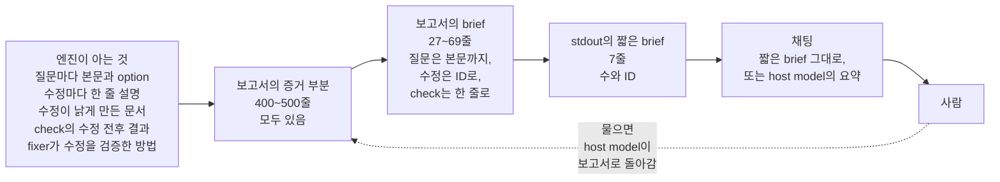

# 보고서: deep-review run에서 사람이 받는 것

이 문서는 `2026-10-23-skill-ux.md`를 한국어로 옮긴 것입니다. 두 문서가 다를 때는 영어 문서가 기준입니다.

이 보고서는 2026-10-23에 `92dce5c` 시점에서 썼습니다. Claude Code나 Codex로 deep-review를 쓰는 사람의 자리에서 deep-review를 읽습니다. 질문은 두 가지입니다. 사람에게 필요한 정보가 사람에게 닿습니까? 최종 보고서는 사람이 기대하는 것을 줍니까?

이 보고서는 결정하지 않습니다. 각 finding은 처방과 분류로 끝납니다. 분류는 지금 고칠 변경([지금 수정]), 저자가 정할 결정([저자와 결정]), 바꿀 필요가 없는 부분([변경 불필요]) 셋입니다. "개선 방향" 절은 처방들의 순서를 제안합니다.

## 요약

- 채팅에는 사람이 할 일의 수와 ID만 오고, 내용은 오지 않습니다. 예를 들어 `Questions: 1, with its default in place: REMOVALS-3`는 질문이 무엇인지 말하지 않습니다. 질문, 수정, 봐야 할 이유는 `.git` 아래에 있는 400~500줄짜리 영어 보고서에만 있습니다. 사람이 물으면 host model이 보고서를 읽어 설명합니다. 사람에게 가장 큰 가치를 준 것이 그 설명이었습니다. 그런데 skill은 그 설명을 금하고 있고, 설명의 품질은 host마다 다릅니다.
- 최종 보고서의 첫 줄이 사람을 잘못 이끌 수 있습니다. Claude Code의 fix run 세 개 모두에서 fixer가 "내 수정 때문에 이 문서가 낡았다"고 적었습니다. 그 문서를 고친 단계는 없었고, run은 그대로 커밋했습니다. brief는 이것을 세지 않고 "Nothing needs you"라고 말했습니다. 한 run에서는 그 문서가 사람이 고른 답과 반대로 설명했고, 문서의 예제는 실패했습니다.
- 보고서는 "이거 머지해도 돼?"에 답하지 못합니다. 수정 뒤의 동작을 설명하지 않고, 수정은 ID로만 나열합니다. 또 check를 base와 비교하지 않고 수정 전후로만 비교하므로, typecheck 실패가 이 변경 탓인지 말할 수 없습니다.
- "이거 머지해도 돼?"에 답하려고 Claude model은 권한 창 9번과 함께 1분 39초 동안 직접 확인했습니다. Codex model은 보고서만 보고 17초 만에 답했지만, `main`에도 있는 typecheck 실패를 기다려야 할 이유로 셌습니다.
- 사람이 run 하나를 abandon하면, 그 전 보고서로 돌아가는 길이 막힙니다. `report`는 abandon된 run을 고르고, run 목록을 보여 주는 명령은 없습니다.
- 잘 되는 것도 있습니다. 도움 요청에는 분명한 답이 오고, 한국어로 한 답은 맞는 명령으로 이어지며, commit 메시지와 증거의 품질이 좋습니다.

## 자료와 방법

### 출처

출처는 공개 pull request 하나에서 진행한 실제 세션, 그 run들의 보고서 6개, 그리고 이 저장소의 파일입니다.

- pallets/click의 pull request #3878, "Print `\x04` and `\x1a` input bytes as `^D` and `^Z` in `CliRunner`". commit 1개, 파일 4개이고, 2026-10-22에 열려 있었습니다.
- 엔진은 `92dce5c`의 build이고, Claude Code plugin과 Codex skill로 설치했습니다. host는 Claude Code 2.1.308(Opus 5.5)과 Codex 0.160.0(GPT-6-Astra)이고, Windows 11에서 돌렸습니다. 사람은 한국어로 썼습니다.
- 아래 표의 run들입니다. host마다 한 run에는 사람이 단계마다 지시했고, 다른 run에는 리뷰, 수정, 커밋을 메시지 하나로 지시했습니다.
- run이 끝난 뒤 같은 clone에서 연 새 세션입니다. 사람이 run 뒤에 묻는 질문을 했고, 목록은 "방법"에 있습니다.
- skill 텍스트 `skill/claude/skills/deep-review/SKILL.md`와 `skill/codex/SKILL.md`, 그리고 `src/command.ts`의 `report` 명령입니다.
- vision note [`2026-10-11-vision.ko.md`](../2026-10-11-vision.ko.md)의 원칙 1, 5, 6, 7, 8입니다.

| Run | Host | 사람이 지시한 것 |
|---|---|---|
| `a1b8920a` | Claude Code | 단계마다: 리뷰, 질문에 답하기, 수정, 커밋, departure 받아들이기 |
| `144eea7b` | Codex | 단계마다: 리뷰, 결과 다시 보기, 질문 설명, 답하기, 수정, 커밋 |
| `b8f3df7d` | Claude Code | 메시지 하나: 리뷰하고 고친 다음 커밋까지 |
| `71698738` | Codex | 메시지 하나: 리뷰하고 고친 다음 커밋까지 |
| `69dfd23d`, `f0f21bba` | Claude Code, Codex | 같은 메시지, 채팅에 사람 없이 |
| `171fd810` | Claude Code | 잘못된 범위의 리뷰. 멈추고 abandon함. `a1b8920a`와 같은 clone |

### 방법

잣대는 사람이 이 skill에 기대하는 것입니다. vision note의 원칙 5, 6, 8과, run 뒤에 사람이 실제로 던진 질문에서 나왔습니다.

1. run 전에 무엇을 리뷰하는지 확인할 수 있습니다.
2. run 뒤에 한 화면에서 세 가지를 압니다. 내가 할 일이 있는지, 무엇이 문제였고 무엇을 고쳤는지, 지금 머지해도 되는지입니다.
3. 각 질문에는 코드를 읽지 않고 그 자리에서 답할 수 있습니다.
4. 나중에 결과를 다시 찾을 수 있습니다.
5. 보고서는 이 판단들의 근거를 줍니다.

run 뒤에 사람이 한 질문은 다음과 같습니다.

- "이거 어떻게 쓰는 거야?" (Claude Code)
- "지난번 리뷰 결과 다시 보여줘" (Claude Code, Codex)
- "run id는 몰라. 끝까지 돌았던 마지막 리뷰 결과를 보여줘" (Claude Code)
- "내가 직접 봐야 할 게 뭐야? 그리고 고친 것들은 뭐뭐야?" (Claude Code, Codex)
- "FOOTGUNS-1 질문이 뭔지 쉽게 설명해주고, 어떤 걸 고르면 좋을지 알려줘" (Codex)
- "이 PR 지금 상태로 머지해도 돼?" (Claude Code, Codex)

각 finding은 위치, 문제, 증거, 처방의 순서로 적고, 처방에 분류를 붙입니다. [지금 수정]은 저자가 결정 없이 할 수 있는 변경입니다. [저자와 결정]은 비용이나 충돌이 있어 저자가 정할 변경입니다. [변경 불필요]는 잘 동작하는 부분입니다.

### 한계

근거는 변경 하나, 기기 하나, 하루입니다. 한 사람이 한국어로 사람 역할을 했고, host마다 model 하나를 썼습니다. 다른 사람은 다른 질문을 합니다. run 6개의 finding이 서로 다르므로, 이 보고서의 숫자는 비율이 아니라 예입니다.

## 사람에게 닿는 것



그림 1. 엔진의 정보가 사람에게 가는 길. 단계마다 줄어들고, 사람이 물으면 host model이 보고서로 돌아갑니다.

보고서의 증거 부분에는 엔진이 아는 것이 모두 있습니다. brief에는 질문이 본문까지 있지만, 수정은 ID로만 있습니다. 짧은 brief에는 수와 ID만 있습니다. 채팅에는 짧은 brief가 그대로 오거나, host model이 쓴 요약이 옵니다.

## Finding

| ID | 단계 | 문제 | 분류 |
|---|---|---|---|
| U1 | 결과 | 채팅에는 사람이 할 일의 수와 ID만 오고, 내용은 오지 않는다 | [지금 수정] |
| U2 | 결과 | "Nothing needs you"인데, 엔진이 아는 결함이 커밋되었다 | [지금 수정], 결정 하나 |
| U3 | 결과 | 보고서는 "이거 머지해도 돼?"에 답하지 못한다 | [저자와 결정] |
| U4 | 질문 | 사람이 물으면 host model이 해석하고, 그 품질은 host에 달려 있다 | [저자와 결정] |
| U5 | 다음 날 | abandon된 run 하나가 보고서로 돌아가는 길을 막는다 | [지금 수정] |
| U6 | run 전 | 사람이 run 전에 범위를 확인할 수 없다 | [지금 수정] |
| U7 | 보고서 | 최종 보고서는 두 독자를 한 번에 겨냥한다 | [저자와 결정] |
| U8 | 보고서 | 같은 변경인데, run마다 사람이 받는 할 일이 다르다 | [저자와 결정] |
| U9 | 전체 | 잘 되는 것 | [변경 불필요] |

### U1: 채팅에는 사람이 할 일의 수와 ID만 온다

위치는 짧은 brief(stdout의 마지막 7줄)와 두 skill의 step 4입니다.

문제는 채팅에 사람이 할 일의 수와 ID만 오고, 내용은 오지 않는다는 것입니다.

- `Questions: 1, with its default in place: REMOVALS-3`는 질문이 무엇인지 말하지 않습니다.
- `Against a written rule: 1 fix: REMOVALS-5`와 `Look at: 1 departure, ...`는 한 가지를 두 이름으로 부릅니다. "departure"는 사람이 모르는 엔진 용어입니다.
- `Changed: 5 fixes, not committed`는 무엇을 고쳤는지 말하지 않습니다.
- `The change:` 줄은 문장 중간에서 잘립니다(`... as ^D or...`).
- 모든 줄이 영어입니다. 사람은 한국어로 썼고, host model은 그 줄들의 위아래만 한국어로 썼습니다.
- 내용은 `.git\deep-review-checkpoint\reports\` 아래의 파일에 있습니다. Windows 탐색기와 VS Code의 탐색기는 기본 설정에서 `.git`을 보여 주지 않습니다.

그래서 사람은 다음 행동을 하려고 파일을 열거나 host model에게 다시 물었습니다. 사람이 Codex에게 질문을 설명해 달라고 하자, model은 보고서를 읽어 한국어로 설명했습니다. 결함을 보여 주는 예, option 비교표, 추천까지 있는 좋은 설명이었습니다. 다만 그 설명은 엔진이 아니라 host에게서 나왔습니다.

증거는 run `a1b8920a`와 `144eea7b`의 채팅, 그리고 run `71698738` 뒤의 세션입니다.

처방은 짧은 brief가 사람이 할 일을 말하게 하는 것입니다.

- 질문마다 한 줄. 제목과 지금 적용된 option을 적습니다.
- 수정마다 한 줄. 커밋 제목이나 fixer의 note를 씁니다. 보고서의 Fixes 절에 이미 이런 줄이 있습니다(예: `Skip chunks of only control bytes in EchoingStdin.read1`).
- "departure"와 "written rule" 대신 사람의 말을 씁니다.
- `The change:` 줄은 문장 끝에서 자릅니다.

departure 줄의 가상의 예:

```
1 fix goes against what the change itself promises (CHANGES.md): REMOVALS-5
```

그러면 짧은 brief의 줄이 너무 많아질 수 있습니다. 그때는 이 줄들을 출력하는 명령을 따로 둡니다(가상의 예: `report --brief`). skill은 결과와 함께 그 출력을 보입니다. 분류는 [지금 수정]입니다.

### U2: "Nothing needs you"인데, 엔진이 아는 결함이 커밋되었다

위치는 brief의 첫 줄, "Where to look" 절, 그리고 Fixes 절 끝의 목록 `Documentation the fixers say their edits made stale, which nothing in this run updated`입니다.

문제는 fixer가 낡았다고 적은 문서를 brief가 세지 않는다는 것입니다. 이 목록은 Claude Code의 fix run 세 개 모두에 있었습니다. `a1b8920a`에 2개, `69dfd23d`에 1개, `b8f3df7d`에 2개입니다. Codex의 fix run 세 개에는 없었습니다. Claude Code의 세 run은 모두 그 문서를 그대로 커밋했습니다.

run `a1b8920a`에서는 그 문서가 실제로 틀렸습니다. 커밋된 tree의 `docs/testing.md`는 echo가 `removes them from the input the command reads`라고 말합니다. 그런데 사람은 REMOVALS-3에 option 2로 답했습니다. command가 바이트를 바꾸지 않고 읽는 option입니다. run은 그 답을 커밋했습니다. 같은 파일의 예제 `test_shout`는 이제 `'hello\n^D\nHELLO\n\x04'`를 내고, 문서가 보이는 출력과 다릅니다.

사람이 departure를 받아들인 뒤, 이 run의 brief는 "Nothing needs you"였습니다. 421줄짜리 보고서의 272행까지 읽지 않은 사람은 틀린 문서를 그대로 머지합니다. run `b8f3df7d`의 brief도 "Nothing needs you"였는데, 그 보고서의 255행은 `docs/testing.md`와 `CHANGES.md`가 낡았다고 적고 있습니다.

이 결함을 사람에게 알린 것은 엔진이 아니었습니다. 사람이 무엇을 봐야 하느냐고 묻자 Claude model이 알렸습니다. model은 보고서에서 그 목록을 찾고, tree의 파일을 확인하고, 예제를 직접 돌려 보았습니다.

증거는 run `a1b8920a`의 커밋된 tree와 보고서, run `b8f3df7d`의 보고서, 그리고 run `a1b8920a` 뒤의 세션입니다.

처방은 두 부분입니다.

- brief의 첫 줄과 "Where to look"이 수정이 낡게 만든 문서를 셉니다. 짧은 brief에도 한 줄을 둡니다. 분류는 [지금 수정]입니다.
- fixer가 옛 동작에 맞춰 문서를 고친 뒤에, 답 하나가 동작을 바꿀 수 있습니다. 그래서 문서를 수정과 맞추는 단계(#29)는 answer pass 뒤에도 돌아야 합니다. 분류는 [저자와 결정]입니다.

첫 줄의 가상의 예:

```
1 thing needs you: 2 documents that the fixes left out of date.
```

### U3: 보고서는 "이거 머지해도 돼?"에 답하지 못한다

위치는 보고서의 brief입니다.

문제는 brief가 머지를 결정할 사실을 주지 않는다는 것입니다.

- "The change"는 pull request가 만든 그대로의 변경을 설명합니다. deep-review의 수정이 커밋 5~9개로 동작을 바꿨는데, 보고서는 그 결과를 설명하지 않습니다. 제목도 pull request의 제목이라서, 답과 수정 뒤에는 tree와 맞지 않습니다.
- brief는 수정을 ID로만 나열합니다(예: `applied 8 fixes ([REMOVALS-1](...), ...)`). 사람이 읽을 수 있는 줄은 Fixes 절, 190행 뒤에 있습니다.
- 보고서는 각 check를 수정 전과 후로 비교합니다. "수정 전"은 pull request의 head이지 base가 아닙니다. 그래서 이 변경이 실패를 불렀는지 말할 수 없습니다.
- brief는 fixer가 수정을 얼마나 단단히 검증했는지 말하지 않습니다. fixer는 새 test를 수정 전 코드로 돌렸고, 수정을 바꿔 test가 실패하는지 보았습니다. 이것은 맨 끝의 "Notes of the run"에만 있습니다.

사람이 지금 머지해도 되느냐고 묻자, 두 host가 다르게 움직였습니다.

- Claude Code는 1분 39초와 권한 창 9번을 썼습니다. 권한 창은 엔진 명령이 아니라 model이 직접 확인하려고 실행한 `gh`, `git worktree`, `tox`에 대한 것이었습니다. model은 `main`의 임시 worktree를 만들고, 거기서 typecheck를 돌려 오류를 비교했습니다. 그다음 test를 돌리고 worktree를 지웠습니다.
- Claude Code의 답은 "아직은 안 돼요"였습니다. 문서 두 곳이 머지를 막습니다. typecheck 실패는 `main`에도 있는 같은 오류 7개라서 이 변경 탓이 아닙니다. 그리고 동작을 뒤집은 커밋 `e114910`은 직접 읽어 봐야 합니다. 사람에게 필요한 답이었지만, 보고서가 할 일을 host가 했습니다.
- Codex는 보고서만 읽고 17초 만에 "지금 상태로는 머지를 권하지 않습니다"라고 답했습니다. 이유는 열린 질문 FOOTGUNS-1과 typecheck 실패였습니다. 보고서는 `main`에도 같은 실패가 있다는 것을 말하지 않으므로, model은 그 실패를 기다려야 할 이유로 셌습니다.

증거는 run `a1b8920a`와 `71698738` 뒤의 세션입니다.

처방은 brief에 "머지하기 전에" 묶음을 두는 것입니다. 이 묶음은 머지를 결정하지 않습니다. 엔진이 아는 사실 가운데 사람이 머지 전에 알아야 할 것을 나열합니다.

- 수정 뒤의 동작을 한 문단으로 적습니다. fixer의 note와 답에서 만들 수 있습니다.
- 수정마다 한 줄(U1과 같음).
- 실패한 check마다 base에서도 실패하는지 적습니다. 이를 위해 base에서 check를 한 번 돌리는 비용이 듭니다. 그 run 없이는, 수정이 실패를 부르지 않았다는 것과 이 변경 자체는 확인하지 않았다는 것을 적습니다.
- 검증을 한 줄로 적습니다.
- 남은 것. U2의 문서와 열린 질문입니다.

검증 줄의 가상의 예:

```
Each code fix has a test that fails on the code before the fix, and a
mutation of the fix makes the test fail.
```

저자가 정할 것은 엔진이 base에서 check를 돌릴지입니다. 분류는 [저자와 결정]입니다.

### U4: 사람이 물으면 host model이 해석한다

위치는 두 skill step 4의 `Do not summarize, quote or interpret the findings beyond those lines`입니다.

문제는 이 rule이 실제 사용과 맞지 않는다는 것입니다. 사람이 결과를 물으면, 두 host 모두 보고서를 읽어 요약하고 해석했습니다. 그 답들이 사람에게 가장 큰 가치를 주었습니다. 커밋 hash와 한국어 한 줄이 붙은 수정 목록, 질문의 쉬운 설명, 머지에 대한 답이 그렇습니다. rule이 해석을 금하므로, 어디까지가 보고서의 말이고 어디부터가 model의 말인지 표시하는 rule이 없습니다. 몇몇 해석은 틀렸습니다.

- Codex는 `main`에도 있는 typecheck 실패를 머지하지 말아야 할 이유로 셌습니다(U3).
- Claude Code는 abandon된 run을 "중간에 끊긴 run일 수 있다"고 설명했습니다(U5).
- skill 사용법을 묻는 질문에, Claude Code는 budget에 대해 틀린 조언을 했습니다. 기본값이 60 USD이니 작은 변경에는 budget을 낮추라는 것이었습니다. budget은 상한이라서, 낮춰도 비용은 줄지 않습니다.

증거는 run `a1b8920a`와 `71698738` 뒤의 세션입니다.

처방은 옛 rule을 새 rule로 바꾸는 것입니다. 가상의 예:

```
When the user asks about the result, answer from the report: quote the
lines you rely on, and say when the report does not say it.
```

사람이 자주 해석을 필요로 하는 곳에서는 엔진이 사람을 위한 글을 출력합니다. 질문, 수정, 머지 전에 알 것입니다(U1, U3). 그러면 host는 그 글 위에 답을 세웁니다. 보고서를 인용하는 답은 원칙 1(evidence, not trust)을 지킵니다. 분류는 [저자와 결정]입니다.

### U5: abandon된 run 하나가 보고서로 돌아가는 길을 막는다

위치는 `report`가 run을 고르는 방식, abandon된 run을 거부하는 문구, 그리고 run 목록이 없다는 점입니다.

문제는 이렇습니다. clone에는 끝까지 돈 run(`a1b8920a`)과, 그 뒤에 잘못된 범위로 시작해 사람이 멈추고 abandon한 run(`171fd810`)이 있었습니다. 사람이 지난번 리뷰 결과를 보여 달라고 하자, `report`는 가장 최근 run인 abandon된 run을 고르고 이렇게 거부했습니다.

```
refused: run 171fd810-... has no current report: its review is not done, or an answer pass, a continuation or a reopened fix pass runs; deep-review status --run 171fd810-... shows where it is
```

이 문구는 run이 abandon되었다는 것을 말하지 않습니다. model은 지난번 run의 ID를 물었습니다. 하지만 사람은 그것을 알 수 없고, run 목록을 보여 주는 명령도 없습니다. `status`는 active run만 보여 줍니다.

사람이 run ID를 모른다고 하자, model은 엔진 번들과 `.git\deep-review-checkpoint\runs` 폴더를 뒤졌습니다. 권한 창 2번과 1분 6초가 들었습니다. 그 뒤에야 `report --run`으로 결과를 보였습니다. 그러면서 abandon된 run을 "중간에 끊긴 run일 수 있다"고 사람에게 말했습니다.

증거는 run `a1b8920a` 뒤의 세션입니다.

처방은 세 부분입니다.

- `--run` 없는 `report`는 보고서가 있는 가장 최근 run을 고릅니다.
- abandon된 run에 대한 문구는 abandon되었다는 사실과 이유를 말합니다. 가상의 예: `run 171fd810 was abandoned at triage (wrong scope)`.
- run을 나열하는 명령을 둡니다(가상의 예: `status --all`). 날짜, scope, 상태, 보고서 사본 경로를 보입니다.

분류는 [지금 수정]입니다.

### U6: 사람이 run 전에 범위를 확인할 수 없다

위치는 skill의 step 3 `write the user a message before your next tool call`과, `config show`의 `Scope:` 줄(`src/config/command.ts:53`)입니다.

문제는 두 부분입니다.

- Claude Code에서 model은 범위 안내를 메시지가 아니라 `thinking`에 넣었습니다. run이 시작된 네 번 모두 그랬고, transcript에는 같은 내용의 text 메시지가 없습니다. 터미널이 `thinking`을 보여 주었기 때문에 사람이 그 문장을 보았습니다. `thinking`을 숨기는 host에서는 아무것도 보이지 않습니다. 같은 model이 turn의 끝에서는 매번 text 메시지를 썼습니다.
- Codex는 메시지를 보이지만, 그 내용이 `Scope: range, the change from 2247b35ea1c4... to the working tree`입니다. 사람은 이 줄로 판단할 수 없습니다. 사람은 "branch"라고 했는데 줄에는 `range`라고 나옵니다. base가 `origin/main`이라는 것도, 변경이 commit 1개와 파일 4개라는 것도 없습니다.

skill 사용법을 묻는 질문에, Claude Code는 run 전에 `Scope:` 줄과 budget을 보여 주겠다고 약속했습니다. 실제로는 그렇게 하지 않았습니다.

증거는 run `a1b8920a`, `b8f3df7d`, `171fd810`의 transcript, run `144eea7b`의 채팅, 그리고 run `a1b8920a` 뒤의 세션입니다.

처방은 두 부분입니다. Claude skill은 review를 먼저 background로 시작하고, 그 turn의 마지막 메시지에 범위를 넣습니다. `Scope:` 줄은 사람이 확인할 수 있는 사실을 적습니다. 가상의 예:

```
Scope: branch, 1 commit and 4 files from origin/main (2247b35) to the working tree
```

분류는 [지금 수정]입니다.

### U7: 최종 보고서는 두 독자를 한 번에 겨냥한다

위치는 보고서 전체의 형태입니다.

문제는 이렇습니다. 보고서는 400~506줄(50~57 KB)이고, 그중 brief가 27~69줄(358~970단어)입니다. brief 뒤의 증거는 좋은 증거입니다. 하지만 보고서는 두 독자를 한 번에 겨냥합니다. 결정하는 사람과, 엔진의 저자나 감사자입니다.

- 엔진 용어를 씁니다. angle 이름, SCAN과 triage, decision step, verifier, CONFIRMED와 PLAUSIBLE, `Cluster: c1, batch c1-1`, `Held by`, `Correction:`, `First blocked on: ...`, `Lead from SCAN`, `Roles digest`, `Worktree checks: 18`입니다.
- 사람에게 쓸모가 적은 절이 있습니다. Statistics는 단계마다 token 수를 약 20줄 보입니다. patch를 적용하는 방법을 말하는 note는 커밋 뒤에는 쓸모가 없습니다(`applies in order to a tree at the scope with git am --keep-cr`).
- 모두 영어입니다. 한국어로 쓰는 사람은 host에게 번역을 부탁했습니다. configuration의 요구 사항은 독자의 언어를 범위 밖으로 두었습니다. 사람이 결과를 이해하려 할 때마다 언어가 걸림돌이었습니다.
- 사본은 `.git` 아래에 있고, 이름의 날짜는 UTC입니다. 한국 시간으로 2026-10-23 새벽에 끝난 run의 사본 이름은 `2026-10-22-<run>.md`였습니다.

사람에게 가장 쓸모 있는 증거는 맨 끝에 있습니다. "Notes of the run"이 수정 전 코드로 돌린 test와 mutation을 기록합니다.

증거는 보고서 6개입니다.

처방은 둘 중 하나입니다.

- (a) 보고서를 나눕니다. 사람을 위한 부분에는 brief와 "머지하기 전에"(U3)를 두고, 그 뒤에 증거를 둡니다. 마지막 절 "For the engine"에는 엔진을 위한 절을 모읍니다. Statistics, angle의 lead, cluster와 batch, roles digest입니다.
- (b) 독자의 언어를 다시 생각합니다. 최소한 brief는 사람의 언어로 씁니다.

(a)는 저자가 지금 할 수 있고, (b)는 저자가 정합니다. 분류는 [저자와 결정]입니다.

### U8: 같은 변경인데, run마다 사람이 받는 할 일이 다르다

위치는 decider의 결과입니다. 사람은 brief의 첫 줄에서 그것을 봅니다.

같은 pull request의 run 6개가 한 판단을 질문으로, departure로, 또는 표시 없는 수정으로 나누었습니다. 멀티바이트 charset의 문자 안에 있는 0x04와 0x1a의 문제는 Codex의 세 run에서 질문이었습니다. Claude Code의 두 run에서는 departure였고, run `b8f3df7d`에서는 표시 없는 수정이었습니다.

사람에게는 다음 경우가 더 무겁습니다. run `a1b8920a`는 `echo_stdin`이 command가 읽는 바이트를 바꿔도 되는지 사람에게 물었습니다(REMOVALS-3). run `b8f3df7d`는 같은 방향 문제를 스스로 정했습니다. REMOVALS-1의 결정은 pull request의 changelog가 `settles both that the flag may change what the command reads`라고 말합니다.

그 run의 brief는 "Nothing needs you"였습니다. vision note는 `decides a question of direction inside deep-review and does not record an ask or a departure`인 proposal을 vision에 어긋나는 것으로 적습니다. 이 run의 결정은 그 경우에 가깝습니다.

증거는 run `a1b8920a`의 질문, run `b8f3df7d` 보고서의 47행, 그리고 다른 run들의 질문과 departure입니다.

처방은 surface가 아니라 decider와 측정에 있습니다. decider rubric이 `CHANGES.md` 같은 변경 자신의 문서로 방향 문제를 닫을 수 있는지 정합니다. replay로 한 변경을 반복해 돌렸을 때 결과가 얼마나 일치하는지 잽니다. 분류는 [저자와 결정]입니다.

### U9: 잘 되는 것

- 도움 요청. 사람이 한국어로 skill 사용법을 묻자, Claude Code는 run을 시작하지 않았습니다. 27초 만에 범위를 말하는 법과 그 밖에 물을 수 있는 것을 한국어 표로 설명했습니다.
- 답하기. 사람이 한국어로 REMOVALS-3에 option 2를 고르고 이유를 말하자, model은 맞는 명령을 실행하고 그 이유를 `--note`에 영어로 남겼습니다.
- 질문의 설명. Codex는 결함을 보여 주는 예, option 비교, 추천을 곁들여 질문을 쉬운 한국어로 설명했습니다.
- commit 메시지. 모두 "왜"를 말하는 본문, `Deep-review:` trailer, 저장소 스타일의 제목을 갖췄습니다. `commit`이 출력하는 제목 목록은 그 자체로 좋은 수정 요약입니다.
- 증거. 수정마다 수정 전 코드로 실패하는 test와 mutation 확인이 있습니다.
- brief의 첫 줄. `2 things need you ... Nothing waits for you`는 사람이 처음 읽기에 좋은 문장입니다. 다만 U2에서 보듯, 세어야 할 것을 다 세지는 않습니다.

분류는 [변경 불필요]입니다.

## 최종 보고서: 사람이 기대하는 것과 보고서가 주는 것

| 사람이 기대하는 것 | 보고서에서 찾을 수 있는 곳 | 결과 |
|---|---|---|
| 내가 할 일이 있는가? | 첫 줄 "N things need you" | 부분적. 질문과 departure만 세고, 수정이 낡게 만든 문서는 세지 않는다(U2) |
| 무엇이 문제였나? | 증거 부분의 Findings | 있다. 다만 길고, 영어이고, 엔진 용어가 많다(U7) |
| run이 무엇을 고쳤나? | brief의 ID 목록, Fixes 절의 한 줄 설명 | 부분적(U1, U3) |
| 수정 뒤 변경은 무엇을 하나? | 없음. "The change"는 pull request를 설명한다 | 없다(U3) |
| 수정을 믿을 수 있나? | "Notes of the run"의 수정 전 코드 test와 mutation | 있다. 다만 맨 끝에 있다(U3, U7) |
| check 실패가 이 변경 탓인가? | 수정 전후 비교만 있다 | 없다(U3) |
| 지금 머지해도 되나? | 없음 | 없다. host model이 직접 확인했다(U3) |
| 질문에 어떻게 답하나? | brief의 질문 블록: option, cost, rule, 명령 | 있다. Claude Code의 질문은 읽기 쉽고, Codex의 질문은 줄 번호가 많다 |
| run이 보지 않은 것은? | "What the review did not cover" | 부분적. 리뷰의 범위만 말하고, tree에 남은 결함은 말하지 않는다 |
| 결과를 다시 찾을 수 있나? | `report`, `report --run` | abandon된 run이 있으면 막힌다(U5) |

## 개선 방향

사람이 run마다 보는 것의 순서를 따릅니다.

1. 결과의 앞부분을 사람이 바로 쓸 수 있게 합니다. U1은 질문과 수정마다 사람의 말로 쓴 한 줄이고, U2는 수정이 남긴 불일치를 세는 것입니다. 이 줄들은 사람이 run마다 가장 먼저 읽습니다. [지금 수정]
2. 보고서로 돌아가는 길을 엽니다. U5입니다. `report`의 기본 선택, abandon된 run의 문구, run 목록입니다. [지금 수정]
3. 사람이 run 전에 범위를 확인하게 합니다. U6입니다. [지금 수정]
4. "머지하기 전에" 묶음을 정합니다. U3입니다. 엔진이 base에서 check를 돌릴지, 수정 뒤 동작 문단을 어떻게 쓸지를 저자가 정합니다. [저자와 결정]
5. host의 해석 rule을 바꿉니다. U4입니다. 4와 함께 하면, host는 엔진의 "머지하기 전에" 묶음을 인용해 답합니다. [저자와 결정]
6. 보고서의 형태를 정합니다. U7입니다. 사람을 위한 부분과 엔진을 위한 부분, 그리고 독자의 언어입니다. [저자와 결정]
7. decider의 일관성은 surface와 따로 잽니다. U8입니다. [저자와 결정]

1~3은 엔진의 출력과 skill의 텍스트를 바꾸므로 proposal 하나에 담을 수 있습니다. 4~6은 결정이 필요하고, 1이 끝난 뒤에 범위가 더 분명해집니다.

## 관련 문서

- [`docs/2026-10-11-vision.ko.md`](../2026-10-11-vision.ko.md)의 원칙 1, 5, 6, 7, 8과, vision에 어긋나는 것의 목록.
- [`2026-10-18-skill-surface.md`](2026-10-18-skill-surface.md), 사용자가 만나는 surface에 대한 앞선 보고서.
- [`2026-10-20-run-brief.requirements.md`](../changes/2026-10-20-run-brief.requirements.md)와 [`2026-10-20-run-brief.design.md`](../changes/2026-10-20-run-brief.design.md), brief와 짧은 brief와 `report` 명령을 정의하는 문서.
- [`2026-10-16-configuration.requirements.md`](../changes/2026-10-16-configuration.requirements.md), 독자의 언어를 범위 밖으로 둔 문서.
- issue #29, 수정이 낡게 만든 문서.
