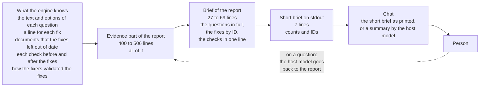

# Report: What a person gets from a run of deep-review

This report was written on 2026-10-23, at `92dce5c`. It reads deep-review from the place of a person who uses it through Claude Code or Codex. It asks two questions. Does the information that the person needs reach the person? Does the final report give what the person expects?

The report does not decide. Each finding ends with a remedy and a class: a change to make now, a decision for the author, or no change. The section "Ways to improve" puts the remedies in an order.

## Summary

- The chat gets the counts and the IDs of what the person must do, not the content. For example, `Questions: 1, with its default in place: REMOVALS-3` does not say what the question is. The questions, the fixes and the reasons to look are in a report of 400 to 506 lines in English, under `.git`. When the person asks, the host model reads the report and explains it. That explanation gave the person the most value. But the skill forbids it, and its quality depends on the host.
- The first line of the final report can mislead the person. In each of the three fix runs on Claude Code, the fixers wrote that their edits made a document out of date. No step updated the document, and the run committed it. The brief did not count it and said "Nothing needs you". In one run, the document said the opposite of the answer of the person, and its example failed.
- The report does not answer "Can I merge this?". It does not describe the behavior after the fixes, and it names the fixes only by ID. It compares each check before and after the fixes, not with the base, so it cannot say if the change caused a failure of typecheck.
- To answer "Can I merge this?", the Claude model did its own checks for 1 minute 39 seconds, with 9 permission prompts. The Codex model answered from the report in 17 seconds, but it counted a typecheck failure that `main` also has as a reason to wait.
- After the person abandons a run, the way back to an earlier report is blocked. `report` picks the abandoned run, and no command lists the runs.
- Some parts work well. A request for help gets a clear answer, an answer in Korean reaches the correct command, and the commit messages and the evidence are good.

## Data and method

### Sources

The sources are live sessions on one public pull request, the six reports of its runs, and the files of this repository:

- Pull request #3878 of pallets/click, "Print `\x04` and `\x1a` input bytes as `^D` and `^Z` in `CliRunner`". It has 1 commit and 4 files, and it was open on 2026-10-22.
- The engine was the build of `92dce5c`, installed as the Claude Code plugin and as the Codex skill. The hosts were Claude Code 2.1.308 with Opus 5.5 and Codex 0.160.0 with GPT-6-Astra, on Windows 11. The person wrote in Korean.
- The runs in the table below. On each host, the person told one run what to do step by step. The person told another run to review, fix and commit in one message.
- After the runs, new sessions on the same clones, with the questions that a person asks after a run. The list is in "Method".
- The skill texts `skill/claude/skills/deep-review/SKILL.md` and `skill/codex/SKILL.md`, and the `report` command in `src/command.ts`.
- The vision note [`2026-10-11-vision.md`](../2026-10-11-vision.md), principles 1, 5, 6, 7 and 8.

| Run | Host | What the person told it |
|---|---|---|
| `a1b8920a` | Claude Code | Step by step: review, answer a question, fix, commit, accept a departure |
| `144eea7b` | Codex | Step by step: review, show the result again, explain the questions, answer, fix, commit |
| `b8f3df7d` | Claude Code | One message: review, fix and commit |
| `71698738` | Codex | One message: review, fix and commit |
| `69dfd23d`, `f0f21bba` | Claude Code, Codex | The same message, with no person in the chat |
| `171fd810` | Claude Code | A review of a wrong scope, stopped and abandoned, in the clone of `a1b8920a` |

### Method

The yardstick is what a person expects from the skill. It comes from principles 5, 6 and 8 of the vision note, and from the questions that the person asked after the runs:

1. Before the run, the person can check what the run reviews.
2. After the run, one screen tells the person three things: if a task waits for the person, what was wrong and what the run fixed, and if the change can merge now.
3. The person can answer each question in place, without a read of the code.
4. The person can find the result again later.
5. The report gives the evidence for each of these decisions.

The questions after the runs were these, in Korean:

- How do I use this skill? (Claude Code)
- Show me the result of the last review again. (Claude Code and Codex)
- I do not know the run ID. Show me the last review that finished. (Claude Code)
- What must I look at myself, and what did the run fix? (Claude Code and Codex)
- Explain the question FOOTGUNS-1, and tell me which option to take. (Codex)
- Can this pull request merge now? (Claude Code and Codex)

Each finding names its location, its problem, its evidence and its remedy, and gives the remedy a class. "Now" is a change that the author can make without a decision. "Decide" is a change with a cost or a conflict, which the author decides. "No change" is a part that works.

### Limits

The evidence is one change, one machine and one day. One operator acted as the person, in Korean, and each host used one model. Other persons ask other questions. The six runs differ in their findings, so the counts in this report are examples, not rates.

## What reaches the person



Figure 1. The path of the information from the engine to the person. Each step keeps less. When the person asks, the host model goes back to the report.

The evidence part of the report holds all that the engine knows. The brief holds the questions in full, but it names the fixes only by ID. The short brief holds counts and IDs. The chat holds the short brief, or a summary that the host model writes.

## Findings

| ID | Step | Problem | Class |
|---|---|---|---|
| U1 | Result | The chat gets the counts and IDs of what the person must do, not the content | Now |
| U2 | Result | "Nothing needs you", and the run committed a fault that the engine knew | Now, and one decision |
| U3 | Result | The report does not answer "Can I merge this?" | Decide |
| U4 | Questions | The host model interprets when the person asks, and the quality depends on the host | Decide |
| U5 | Next day | An abandoned run blocks the way back to a report | Now |
| U6 | Before the run | The person cannot check the scope before the run | Now |
| U7 | Report | The final report serves two readers at once | Decide |
| U8 | Report | The same change gives different tasks to the person in different runs | Decide |
| U9 | All | What works | No change |

### U1: The chat gets the counts and IDs of what the person must do

The location is the short brief, the last seven lines of stdout, and step 4 of both skills.

The problem is that the chat gets the number and the IDs of the tasks of the person, not their content:

- `Questions: 1, with its default in place: REMOVALS-3` does not say what the question is.
- `Against a written rule: 1 fix: REMOVALS-5` and `Look at: 1 departure, ...` give two names to one thing. "Departure" is a term of the engine that a person does not know.
- `Changed: 5 fixes, not committed` does not say what the fixes do.
- The line `The change:` stops in the middle of a sentence: `... as ^D or...`.
- All lines are in English. The person wrote in Korean, and the host model wrote Korean only around the lines.
- The content is in a file under `.git\deep-review-checkpoint\reports\`. The file explorer of Windows and the explorer of VS Code do not show `.git` by default.

Thus, for the next step, the person opened the file or asked the host model again. The person asked Codex to explain a question. The model read the report and explained it in Korean, with an example that shows the fault, a table of the options and a recommendation. It was a good explanation, but it came from the host, not from the engine.

The evidence is the chat of runs `a1b8920a` and `144eea7b`, and the session after run `71698738`.

The remedy is a short brief that tells the person what to do:

- One line for each question, with its title and the option in place.
- One line for each fix, from its commit subject or from the note of the fixer. The Fixes section of the report already has these lines, for example `Skip chunks of only control bytes in EchoingStdin.read1`.
- The words of a person in place of "departure" and "written rule".
- A cut at the end of a sentence in the line `The change:`.

An invented example of a line for a departure:

```
1 fix goes against what the change itself promises (CHANGES.md): REMOVALS-5
```

If the short brief then has too many lines, a separate command prints these lines, for example `report --brief`. The skill then shows its output with the result. The class is Now.

### U2: "Nothing needs you", and the run committed a fault that the engine knew

The location is the first line of the brief, the section "Where to look", and the list at the end of the Fixes section: `Documentation the fixers say their edits made stale, which nothing in this run updated`.

The problem is that the brief does not count the documents that the fixers named as out of date. Each of the three fix runs on Claude Code had this list: 2 documents in `a1b8920a`, 1 in `69dfd23d` and 2 in `b8f3df7d`. The three fix runs on Codex did not have it. Each of the three runs on Claude Code committed the documents as they were.

In run `a1b8920a`, the document was wrong. In the committed tree, `docs/testing.md` says that the echo `removes them from the input the command reads`. But the person answered REMOVALS-3 with option 2: the command reads the bytes unchanged. The run committed that answer. The example `test_shout` in the same file now gives `'hello\n^D\nHELLO\n\x04'`, not the output that the document shows.

After the person accepted the departure, the brief of this run said "Nothing needs you". A person who does not read to line 272 of a report of 421 lines merges the wrong document. The brief of run `b8f3df7d` also said "Nothing needs you", and line 255 of its report names `docs/testing.md` and `CHANGES.md` as out of date.

The engine did not tell the person about this fault. The Claude model did, when the person asked what to look at. The model found the list in the report, checked the files in the tree, and ran the example.

The evidence is the committed tree and the report of run `a1b8920a`, the report of run `b8f3df7d`, and the session after run `a1b8920a`.

The remedy has two parts:

- The first line of the brief and "Where to look" count the documents that the fixes left out of date. The short brief gets one line for them too. The class is Now.
- An answer can change the behavior after a fixer edited a document for the old behavior. Thus the step that brings the documents into line with the fixes (#29) must also run after an answer pass. The class is Decide.

An invented example of the first line:

```
1 thing needs you: 2 documents that the fixes left out of date.
```

### U3: The report does not answer "Can I merge this?"

The location is the brief of the report.

The problem is that the brief does not give the person the facts for a decision to merge:

- "The change" describes the change as the pull request made it. The fixes of deep-review changed the behavior in 5 to 9 commits, and the report does not describe the result. The title is also the title of the pull request. After the answer and the fixes, it does not match the tree.
- The brief names the fixes only by ID, for example `applied 8 fixes ([REMOVALS-1](...), ...)`. The lines that a person can read are in the Fixes section, after line 190.
- The report compares each check before and after the fixes. "Before" is the head of the pull request, not the base. Thus the report cannot say if the change caused a failure.
- The brief does not say how strongly the fixers validated the fixes. They ran each new test against the code before the fix, and they changed the fix to see the test fail. Only "Notes of the run", at the end, records this.

The person asked if the pull request can merge now, and the two hosts did different things:

- Claude Code took 1 minute 39 seconds and 9 permission prompts. The prompts were for the commands of its own checks, `gh`, `git worktree` and `tox`, not for the engine. The model made a temporary worktree of `main`, ran typecheck there and compared the errors. Then it ran the tests and removed the worktree.
- The answer of Claude Code was "not yet". Two documents block the merge. The typecheck failure is the same 7 errors that `main` has, so the change did not cause it. And the person must read commit `e114910`, which reverses the behavior. The person needs this answer, but the host did the work of the report.
- Codex took 17 seconds and read only the report. Its answer was "not now". The reasons were the open question FOOTGUNS-1 and the typecheck failure. The report does not say that `main` has the same failure, so the model counted it as a reason to wait.

The evidence is the sessions after runs `a1b8920a` and `71698738`.

The remedy is a block "Before you merge" in the brief. The block does not decide the merge. It lists the facts that the engine knows and that the person must know before a merge:

- The behavior after the fixes, in one paragraph, from the notes of the fixers and the answers.
- The fixes, one line each, as in U1.
- For each check that fails: if it also fails on the base. This costs one run of the check on the base. Without that run, the block says that the fixes did not cause the failure, and that the run did not check the change itself.
- The validation, in one line.
- What is left: the documents of U2 and the open questions.

An invented example of the line for the validation:

```
Each code fix has a test that fails on the code before the fix, and a
mutation of the fix makes the test fail.
```

The decision for the author is if the engine runs the checks on the base. The class is Decide.

### U4: The host model interprets when the person asks

The location is step 4 of both skills: `Do not summarize, quote or interpret the findings beyond those lines`.

The problem is that this rule does not match the use. When the person asked about the result, both hosts read the report, summarized it and interpreted it. These answers gave the person the most value: the fixes with a commit hash and a Korean line each, an easy explanation of a question, and an answer about the merge. The rule forbids interpretation, so no rule says how to mark the words of the report and the words of the model. Some interpretations were wrong:

- Codex counted a typecheck failure that `main` also has as a reason not to merge (U3).
- Claude Code said that the abandoned run was possibly a run that stopped in the middle (U5).
- In its answer about the use of the skill, Claude Code gave wrong advice about the budget. It said: set a lower budget for a small change, because the default is 60 USD. The budget is an upper limit, so a lower budget does not lower the cost.

The evidence is the sessions after runs `a1b8920a` and `71698738`.

The remedy is a new rule in place of the old one. An invented example:

```
When the user asks about the result, answer from the report: quote the
lines you rely on, and say when the report does not say it.
```

For the places where the person often needs an interpretation, the engine prints text for the person: the questions, the fixes, and what to know before a merge (U1, U3). The host then builds its answer on that text. An answer that quotes the report keeps principle 1, evidence and not trust. The class is Decide.

### U5: An abandoned run blocks the way back to a report

The location is the choice of a run by `report`, the text that refuses an abandoned run, and the absence of a list of runs.

The problem is this. The clone held a run that finished (`a1b8920a`) and a later run with a wrong scope, which the person stopped and abandoned (`171fd810`). The person asked for the result of the review of yesterday. `report` picked the latest run, the abandoned one, and refused it:

```
refused: run 171fd810-... has no current report: its review is not done, or an answer pass, a continuation or a reopened fix pass runs; deep-review status --run 171fd810-... shows where it is
```

The text does not say that the run was abandoned. The model asked for the ID of the run of yesterday. But the person cannot know it, and no command lists the runs: `status` shows only an active run.

The person said that they did not know the run ID. Then the model searched the bundle of the engine and the folder `.git\deep-review-checkpoint\runs`, with 2 permission prompts, for 1 minute 6 seconds. After that, it showed the result with `report --run`. It also told the person that the abandoned run was possibly a run that stopped in the middle.

The evidence is the session after run `a1b8920a`.

The remedy has three parts:

- `report` without `--run` picks the latest run that has a report.
- For an abandoned run, the text says that the run was abandoned, and why. An invented example: `run 171fd810 was abandoned at triage (wrong scope)`.
- A command lists the runs with the date, the scope, the state and the path of the report copy, for example `status --all`.

The class is Now.

### U6: The person cannot check the scope before the run

The location is step 3 of the skill, `write the user a message before your next tool call`, and the `Scope:` line of `config show` (`src/config/command.ts:53`).

The problem has two parts:

- On Claude Code, the model put the message about the scope in its `thinking`, not in a message. This occurred each of the four times that a run started. The transcript has no text message with this content. The terminal showed the `thinking`, so the person saw the words. A host that hides the `thinking` shows nothing. The same model wrote a text message each time at the end of its turn.
- Codex shows the message, but the content is `Scope: range, the change from 2247b35ea1c4... to the working tree`. A person cannot judge it. The person said "branch", and the line says `range`. The line does not say that the base is `origin/main`, or that the change has 1 commit and 4 files.

In its answer about the use of the skill, Claude Code promised to show the `Scope:` line and the budget before the run. It did not do so.

The evidence is the transcripts of runs `a1b8920a`, `b8f3df7d` and `171fd810`, the chat of run `144eea7b`, and the session after run `a1b8920a`.

The remedy has two parts. The Claude skill starts the review in the background first, and it puts the scope in the last message of that turn. The `Scope:` line gives facts that a person can check. An invented example:

```
Scope: branch, 1 commit and 4 files from origin/main (2247b35) to the working tree
```

The class is Now.

### U7: The final report serves two readers at once

The location is the shape of the whole report.

The problem is this. The report has 400 to 506 lines (50 to 57 KB), and its brief has 27 to 69 lines (358 to 970 words). The evidence after the brief is good evidence. But the report serves two readers at once: the person who decides, and the author or the auditor of the engine.

- It uses terms of the engine: the names of the angles, SCAN and triage, decision step, verifier, CONFIRMED and PLAUSIBLE, `Cluster: c1, batch c1-1`, `Held by`, `Correction:`, `First blocked on: ...`, `Lead from SCAN`, `Roles digest` and `Worktree checks: 18`.
- Some sections are of small use to the person. Statistics gives approximately 20 lines of tokens per phase. A note says how to apply the patches, with no use after the commit: `applies in order to a tree at the scope with git am --keep-cr`.
- All of it is in English. A person who writes in Korean asked the host to translate. The configuration requirements put the language of the reader out of scope. Each time the person wanted to understand the result, the language was an obstacle.
- The copy is under `.git`, and the date in its name is in UTC. The copy of a run that ended early on 2026-10-23 in Korea had the name `2026-10-22-<run>.md`.

The evidence that is most useful to the person is at the end. "Notes of the run" records the tests against the code before the fix and the mutations.

The evidence is the six reports.

The remedy is one of two:

- (a) Split the report. The part for the person holds the brief and "Before you merge" (U3), and the evidence follows. A last section "For the engine" holds the sections for the engine: Statistics, the leads of the angles, the clusters and batches, and the roles digest.
- (b) Think again about the language of the reader, and write at least the brief in the language of the person.

The author can do (a) now and decides (b). The class is Decide.

### U8: The same change gives different tasks to the person in different runs

The location is the result of the decider. The person sees it in the first line of the brief.

Six runs on the same pull request gave one judgment as a question, as a departure, or as a fix with no mark. The problem of the bytes 0x04 and 0x1a inside a character of a multi-byte charset was a question in the three runs on Codex. It was a departure in two runs on Claude Code, and a fix with no mark in run `b8f3df7d`.

For the person, one more case is heavier. Run `a1b8920a` asked the person if `echo_stdin` can change the bytes that the command reads (REMOVALS-3). Run `b8f3df7d` decided the same question of direction itself. Its decision on REMOVALS-1 says that the changelog of the pull request `settles both that the flag may change what the command reads`.

The brief of that run said "Nothing needs you". The vision note names this as against the vision: a proposal that `decides a question of direction inside deep-review and does not record an ask or a departure`. The decision of this run is close to that case.

The evidence is the question of run `a1b8920a`, line 47 of the report of run `b8f3df7d`, and the questions and departures of the other runs.

The remedy is not in the surface. It is in the decider and in a measurement. The decider rubric says if the documents of the change itself, such as `CHANGES.md`, can close a question of direction. A replay measures how often repeated runs of one change agree. The class is Decide.

### U9: What works

- A request for help. The person asked in Korean how to use the skill. Claude Code did not start a run. In 27 seconds, it explained in a Korean table how to name a scope and what else the person can ask.
- Answers. The person chose option 2 for REMOVALS-3 in Korean, with a reason. The model ran the correct command and wrote the reason of the person into `--note` in English.
- The explanation of a question. Codex explained the question in easy Korean, with an example that shows the fault, a comparison of the options and a recommendation.
- Commit messages. Each has a body that says why, a `Deep-review:` trailer, and a subject in the style of the repository. The list of subjects that `commit` prints is a good summary of the fixes.
- The evidence. Each fix has a test that fails on the code before the fix, and a check with a mutation of the fix.
- The first line of the brief. `2 things need you ... Nothing waits for you` is a good first sentence for a person. But, as U2 shows, it does not count all that it must count.

The class is No change.

## The final report: what a person expects and what it gives

| What the person expects | Where the report gives it | Result |
|---|---|---|
| Does a task wait for me? | The first line, "N things need you" | Partly. It counts questions and departures, not the documents that the fixes left out of date (U2) |
| What was wrong? | Findings, in the evidence | Yes, but long, in English, with terms of the engine (U7) |
| What did the run fix? | IDs in the brief, one line each in the Fixes section | Partly (U1, U3) |
| What does the change do after the fixes? | Nowhere: "The change" describes the pull request | No (U3) |
| Can I trust the fixes? | The tests against the old code and the mutations in "Notes of the run" | Yes, but at the end (U3, U7) |
| Did the change cause a failed check? | Only a comparison before and after the fixes | No (U3) |
| Can I merge now? | Nowhere | No. The host model did the checks itself (U3) |
| How do I answer a question? | The question block of the brief: options, costs, rules, the command | Yes. The questions of Claude Code are easy to read. The questions of Codex hold many line numbers |
| What did the run not examine? | "What the review did not cover" | Partly. It names the coverage of the review, not the faults left in the tree |
| Can I find the result again? | `report`, `report --run` | Not after an abandoned run (U5) |

## Ways to improve

The order follows what the person sees after each run:

1. Make the start of the result useful to the person at once. This is U1, a line for each question and each fix in the words of a person. It is also U2, a count of what the fixes left inconsistent. These lines are the first that the person reads after each run. The class is Now.
2. Open the way back to a report. This is U5: the default of `report`, the text for an abandoned run, and a list of runs. The class is Now.
3. Let the person check the scope before the run. This is U6. The class is Now.
4. Decide the block "Before you merge". This is U3. The author decides if the engine runs the checks on the base, and how it writes the paragraph about the behavior after the fixes. The class is Decide.
5. Change the rule for the interpretation by the host. This is U4. With item 4, the host quotes the block "Before you merge" of the engine. The class is Decide.
6. Decide the shape of the report. This is U7: a part for the person, a part for the engine, and the language of the reader. The class is Decide.
7. Measure the consistency of the decider apart from the surface. This is U8. The class is Decide.

Items 1 to 3 change the output of the engine and the text of the skills, so one proposal can hold them. Items 4 to 6 need decisions, and their scope is clearer after item 1.

## Related

- [`docs/2026-10-11-vision.md`](../2026-10-11-vision.md), principles 1, 5, 6, 7 and 8, and its list of what goes against the vision.
- [`2026-10-18-skill-surface.md`](2026-10-18-skill-surface.md), the earlier report on the surface that a user meets.
- [`2026-10-20-run-brief.requirements.md`](../changes/2026-10-20-run-brief.requirements.md) and [`2026-10-20-run-brief.design.md`](../changes/2026-10-20-run-brief.design.md), which define the brief, the short brief and the `report` command.
- [`2026-10-16-configuration.requirements.md`](../changes/2026-10-16-configuration.requirements.md), which puts the language of the reader out of scope.
- Issue #29, the documents that the fixes leave out of date.
