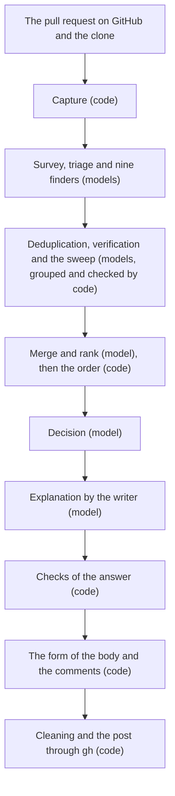
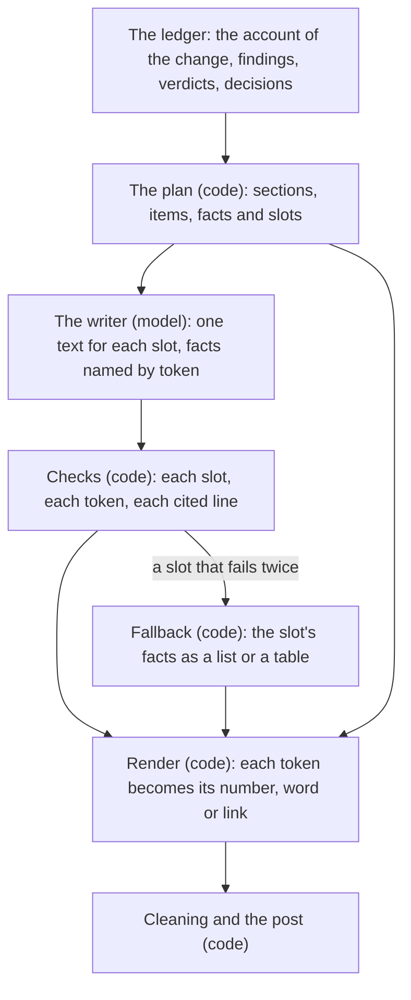

# Report: How the review on a pull request is written and read

This report was written on 2026-11-05, at `ddf8d62`. It looks at the review that `deep-review publish` posts on a pull request and asks three questions. Which components write it, and what does each read and give? Can a reader with little context understand, from the review, what the change does and what deep-review found? Is the work split well between models, which are good with language, and code, which is exact, deterministic and cheap, and what structure would split it better? It rests on a read of the code, the role prompts, the two proposals of the review on the pull request, and issues #101 to #115. It ran no new review.

## Summary

- Eleven components write the review. Two are code alone, seven are model workers, and two pair a model's judgment with code that groups or orders. One of the model workers, the writer, exists only to explain the review for the pull request. The engine renders every fact from the ledger and checks what it can count. The writer adds titles, problems, cases, areas and one line of how each finding was checked. Figure 1 and the table in "The components that write the review" give the inputs and outputs of each.
- A reader with little context can understand deep-review's result well: what needs a person comes first and can be decided from the item alone, each major finding says what goes wrong and cites its lines, and each verdict says how far to trust it. The same reader cannot learn from the review what the change does. The triage writes an account of the change, and the report on the machine opens with it, but the post leaves it out, since the proposal of the review that reads as a report decided that the pull request's own description says what the change does ([PD3](../changes/2026-11-04-review-that-reads-as-a-report.requirements.md#pd3-the-review-leaves-out-the-core-of-the-change)). It also leaves out the two conditions under which principle 8 of the vision note asks a person to look: a change to a public interface and a change that reaches many files. Six gaps, G1 to G6, are listed.
- The principle of the split is right: a model judges, and the engine states facts and checks what it can count. Its application is off in nine places, W1 to W9. Most faults of form in #101 to #115 came from sentences the engine assembles by template, and from judgments the engine makes while it renders.
- The report proposes a structure, S1 to S6, in which the line is drawn by kind of work instead of by part of the page. Every judgment is made and recorded before the form. The engine builds the plan of the review as data, with its facts and the slots for text. The writer fills every slot a person reads, naming facts by token. The engine checks each slot, renders each token, and falls back to labels and tables. Code keeps every fact and every check. A model writes every sentence.
- Eight changes follow, in the order of section "Ways to improve". The first four are small and independent. The last four change what the review posts or what the writer answers, and need a proposal.

## Data and method

### Sources

All the sources are in this repository or its issues:

- `src/github/pull-request.ts`, which reads the pull request, and the scope capture, which records it.
- `src/review/schemas.ts`, which holds the output schema of each worker, `src/review/phases.ts` and `src/review/tasks.ts`, which build each worker's task, and `src/review/controller.ts`, which gives each worker the scope block.
- `src/review/explanation.ts`, which plans the writer's task, checks its answer part by part and merges the answers of a retry.
- `src/review/brief.ts`, which builds the brief of a run, including its account of the change.
- `src/review/pull-request-form.ts`, which renders the body and the comments, `src/review/pull-request-words.ts`, which holds the engine's words in English and Korean, `src/review/public-text.ts`, which cleans the text the engine did not write, and `src/review/publish.ts`, which posts.
- The role prompts under `roles/fragments/`: `phase1-finders.md`, `phase4-list.md`, `rubrics.md`, `writer-brief.md` and `writer-explanation.md`.
- The proposals [the review on the pull request](../changes/2026-11-01-review-on-the-pull-request.requirements.md) of 2026-11-01 and [the review that reads as a report](../changes/2026-11-04-review-that-reads-as-a-report.requirements.md) of 2026-11-04, each a requirements and a design file, and the vision note `docs/2026-10-11-vision.md`.
- Issues #101 to #113, the faults of form of the first post on #96; #114, the pull request that answered them; and #115, what the gate of #114 found and its fix pass did not address. The gate is the real run of deep-review that a change must pass before it merges: for the review on the pull request, [R17](../changes/2026-11-01-review-on-the-pull-request.requirements.md#r17-the-gate) of its proposal has it review and post on real pull requests and read each explanation against its evidence.

The report names the items of these proposals by their IDs, as the proposals do: R is a requirement, PD a product decision and TD a technical decision, and each proposal numbers its own from 1, so R9 of one proposal is not R9 of the other. The report therefore names the proposal beside an ID, links the ID to the item, and says in plain words what the item decides. An ID with no proposal beside it, as in a sentence that repeats one, belongs to the review that reads as a report. E, G, W and S are the report's own items, defined where each section lists them.

### Method

Each part of the posted body and of a line comment was traced to the function that renders it and to the source of its words: the writer, the engine's table of words, the ledger, or another worker's text. Each worker's task and schema were read for what it is given and what it returns. Each check of the writer's answer was read for what it holds and what a failure does. Each issue was read for where its fault began. The reader of section "What a reader with little context gets" is the one the vision note's premise names: a person on GitHub who did not read the diff and does not know deep-review. Where the code departs from what the design intends, the report says what the design intends first.

### Limits

The report reads one commit and runs nothing. Where an issue's fault began is a reading of the issue and of the code, not a measurement. What a reader with little context understands is judged from the form of the post and from the issues, not from a study of readers. The report does not count how often a case fails to follow from the lines it cites, since no run records it. The two figures pass the engine's own check of a diagram, `diagramFailures`, and were not drawn in a browser.

## The components that write the review

A review of a pull request is two commands. `deep-review review --pr <number>` captures the change, runs the workers and records every answer on the ledger, and posts nothing. `deep-review publish` reads the run and the pull request again, renders the review and posts it. Figure 1 shows the path from the pull request to the post.

Figure 1. The components that write the review, in the order a run reaches them.

The table gives what each component reads and what it gives. Every model worker also receives the scope block, which holds the patch and the conventions the survey named, and, after the triage, the triage's account of the change, marked as unverified. Every answer of a model passes its schema and a structural check before the ledger records it; a second failure degrades as each phase defines.

| Component | Done by | Reads | Gives | Recorded as |
|---|---|---|---|---|
| Capture | Code | The pull request through `gh api`, the clone through git | The change from the merge base to the head, its files before and after, the pull request's number, base, title and body (frozen, and read by no worker) | `scope.captured` |
| Survey | Model, the surveyor | The repository's files | The files that state the conventions | `survey.recorded` |
| Triage | Model, the `SCAN` angle | The scope block, the commit messages | Up to 12 candidates, one lead for each other angle, and the account of the change: a title, what it does, why in its own words with the sources, and whether it changes a public interface or reaches many files | `candidates.recorded` |
| Finders | Nine models, one per angle | The scope block and the triage's lead | Candidates, each with a summary, a detail and a place | `candidates.recorded` |
| Deduplication | Model | The candidates | Groups of the same defect and the member to keep | `deduplication.recorded` |
| Verification | Code groups up to 8 candidates of one file, a model judges each group | The candidates and the code, with a read-only shell | A verdict, its evidence and basis, the runs it cites, why a `PLAUSIBLE` verdict is not `CONFIRMED`, and the choice it leaves to the author | `verdicts.recorded` |
| Sweep | Model, then its own deduplication and verification | What was found, refuted and not run | More candidates | as above |
| Merge and rank | Model, then code orders | The verified candidates | Findings that merge one root cause, each with a severity, a summary and a reason | `ranking.recorded` |
| Decision | Model, the decider | The ranked findings with their evidence | For each finding: fix, leave or ask, with the grounds, the fix's approach and the options it rejected, a departure from a written rule, or a question with two to four options, the cost of each and the option applied | `decisions.recorded` |
| Explanation | Model, the writer | The brief, the findings with their decisions, evidence and runs, the refuted candidates, the scope block, and the code at the head and the merge base | Areas, a title, problem, cases, diagram and check line for each finding to explain, a sentence for each action, one line for each refuted candidate, and the findings it could not explain | `explanation.recorded` |
| Form and post | Code | The run's state, the writer's answer, the pull request's files and patches | The body, a comment on its line for each fix and question on the diff, and the record of where each finding went | `publish.prepared`, `publish.posted` |

In plain words: code captures what to review; models find, check, merge, rank and decide; one more model explains the result; and code puts the result on the page and posts it. A model never writes a number, a verdict, a severity, a status or a link into the post, and code never writes a judgment of the change. Code does write the sentences around those facts, and section "Where the split is off" returns to that.

The next table gives the source of each part of the body, in the order the body posts them.

| Part | Writer | Engine | Other workers |
|---|---|---|---|
| Heading and reviewed line | | Words, commits, file count | |
| Summary | One paragraph naming the areas | Counts, what happens next | |
| What needs a person | | Frame of each item, the answer command | The decider's question, options and rule; the verifier's choice for the author |
| How the review worked | | All of it, with a fixed diagram | |
| Areas | Title, introduction, diagram, finding titles, fix sentence | Numbers, verdicts, order, the line of a question | The decider's recommended option |
| Findings in full | Title, problem, cases, diagram, check line | Grade line, labels, links | The decider's fix, question or grounds; the verifier's reason for `PLAUSIBLE` |
| Minor findings | Title, `kind` | Lead, counts, table | |
| Left as is | | Reason labels | The decider's grounds |
| Not examined | One line per refuted candidate | Settings, patterns | The brief's gaps, in English |
| How far to trust | | All of it | |

When the writer's part is missing or fails its check twice, the engine puts other text in its place. A title becomes the first sentence of merge-rank's summary, and a problem becomes the primary candidate's `detail`, which is the finder's text. Both are posted under a mark that calls them deep-review's own words. No part of the body comes from the triage's account of the change.

## What a reader with little context gets

The vision note's premise is a person who did not read the diff and decides from the review. On a pull request this is a reviewer or the author, often someone who has not touched this code for a long time. The reader needs two things: what the change does, and what deep-review found and how far to trust it. The review serves the second well and the first not at all.

### E1: What needs a person comes first, and each item can be decided alone

The body opens with a summary of counts and then one list of what needs a person: each question with its options, the cost of each, the option deep-review recommends and the one that stands until someone answers; each fix against a written rule, with the rule; and each finding left for the author. The list ends with the command that answers. This is the form principles 4 and 6 of the vision note ask for, and a reader does not have to open the code to decide.

### E2: Each major finding says what goes wrong, for whom, and where

The writer's title names the problem, not the code. The problem says who meets what. Each case cites the lines that show it, and the engine refuses a line that its commit does not hold. A diagram follows where the flow takes long to say. Each link is a permalink at the reviewed commit, so it does not move after a push. The major findings are grouped into areas with a sentence or two each, so a reader sees related defects together.

### E3: Each statement says how far to trust it

Each finding carries its verdict with plain words beside it, why a `PLAUSIBLE` verdict was not confirmed, and one line of how the verifier checked it. "How the review worked" gives the counts of the run, from candidates to findings, with a fixed diagram of the steps. "How far to trust the review" counts the verdicts and the bases and says that a model wrote the explanations and that only the evidence was verified. A reader can weigh each statement without knowing deep-review.

### E4: The review says what it did not examine, and folds the rest

The body says that no check ran, which paths the settings left out, which angles did not run and which candidates were refuted and why. The minor findings, the findings left as is and the refuted candidates are folded, so the first screen holds what a person must act on.

### G1: The review does not say what the change does

The triage writes an account of the change for "a person who did not read it": what it does, why in the change's own words with the sources, and whether it changes a public interface or reaches many files (`phase1-finders.md`, step 3). The brief records it, the report on the machine opens with it (`accountPart` in `src/review/brief.ts`), and every later worker, the writer included, reads it. The post leaves it out. [PD3](../changes/2026-11-04-review-that-reads-as-a-report.requirements.md#pd3-the-review-leaves-out-the-core-of-the-change) of the review that reads as a report, the decision that the review leaves out the core of the change, decided so, because "the pull request's own description says what it does", and the proposal names this as its departure from principle 5 of the vision note.

PD3 holds when the description is right and complete. The vision note's premise is that agents write most changes and no person reads the diff, so the description is the author agent's claim and the one text of the pull request that nothing checks: no worker reads it ([PD8](../changes/2026-11-01-review-on-the-pull-request.requirements.md#pd8-the-request-is-frozen-and-no-worker-reads-it-yet) of the review on the pull request records the description once and gives it to no worker yet), and the angle that reads a change against its request is later work. A reader with little context then meets the findings with no account of the change they belong to, except the description that the review did not examine. deep-review holds an independent account, written from the code and the commit messages and marked as unverified. Posting it, short, would let the reader compare the two, which is the first thing principle 5 puts before the person.

### G2: The conditions under which a person must look are not posted

Principle 8 of the vision note names four conditions under which a person must look even when no finding asks: a departure from a rule, a fix whose verdict is only `PLAUSIBLE`, a change to a public interface, and a change that reaches many files. The post gives the first in what needs a person. The triage judges the last two with the files they rest on, and the report on the machine states them, but they belong to the account of G1 and are not posted. A fix whose verdict is `PLAUSIBLE` shows its verdict and why in its own comment, but it is not listed as a reason to look. A reader can therefore read "nothing needs a person" on a change that alters a public interface.

### G3: A finding is explained, but the code around it is not

The first form of the writer's answer held an account of the change with a short list of terms and their meanings. [TD2](../changes/2026-11-04-review-that-reads-as-a-report.design.md#td2-the-writer-stops-writing-the-account) of the review that reads as a report, the technical decision that the writer stops writing the account, removed it, since it was folded and cost budget, and the terms went with it. The writer is told to use plain words, and each area has a sentence or two, but a reader who meets a name of the code's own domain in a title has no place where the review defines it. How much this costs a reader is a judgment, not a measurement.

### G4: The evidence is one step away only on the runner's machine

Principle 6 asks that the evidence for each statement be one step away. On the pull request each finding has one line of how it was checked, since [PD4](../changes/2026-11-04-review-that-reads-as-a-report.requirements.md#pd4-the-evidence-on-the-pull-request-is-one-line) of the review that reads as a report leaves the full evidence to the report of the run, and the evidence, the runs it cites and the report stay in the checkpoint on the machine of the person who ran the review. The README says that a review a workflow posts loses its checkpoint when the job ends. A reader who doubts a verdict can only ask the person who ran the review, and in a workflow there is no one to ask.

### G5: The text a person most needs is the text least shaped for the person

The findings left for the author are in what needs a person and given in full, in the finder's words (W6). Internal ids reach the post (W3). In a review in Korean, the decider's questions and options, the verifiers' reasons and the brief's gaps stay in English (#111), since only the writer is told the language. Each of these lands in the part a reader with little context reads first.

### G6: The person who must answer a question cannot answer it on the pull request

A question ends with who answers: the person who ran the review, on the machine that holds the run, with `deep-review answer`. A reply on the pull request is not read (#103). For the author of the pull request, a question they can read but not answer is a question with no channel. The design accepts this for now.

## Where the split is off

### W1: Severity decides the form, and no prompt defines it

Merge-rank gives each finding `critical`, `major` or `minor`. `phase4-list.md` and the task in `src/review/tasks.ts` name the three values and say that a `CONVENTIONS` violation takes the severity of its rule. Neither says what makes a finding major. The design of the review that reads as a report records the same gap: "as no prompt defines major and minor".

The engine treats the value as a key of the form. It decides whether a finding goes in an area or in the folded minor table, whether the writer must cite lines for it, and whether the body says it "matters before the merge". A choice that no rubric governs therefore decides what a reader sees first. This is the largest judgment in the review that has no stated rule, and the rest of the form inherits it.

### W2: The engine writes most of the connecting sentences, and most faults of form came from them

`PullRequestWords` has 97 entries, and 45 of them are functions that build a sentence from counts, numbers and other words. Each entry exists in English and in Korean. The English functions branch by hand for singular and plural, and the Korean ones attach a fixed particle after an interpolated number. Korean chooses the particle by how the number is read, so `needsAuthor` writes "지적 사항 15은" and `minorNeeds` has the same fault. The test of the tables checks that the two languages have the same keys and the same types, which cannot catch a sentence that reads wrongly.

Most faults of form in #101 to #115 began here or in the layout around these sentences: the count of #102, the wording of a question's options in #104, who makes a fix in #108, the repetition of #109, the drifting links of #112, and the sentences of #115 that read wrongly. The writer's own text accounts for fewer: the titles of #113 and the ids of W3. The facts in these sentences belong to the engine, but the sentences that carry them do not need to be templates. The more of the body the engine writes as sentences, the more grammar each new language must hand-code.

### W3: Finding ids reach the post because a prompt asks for them

[R14](../changes/2026-11-04-review-that-reads-as-a-report.requirements.md#r14-links-and-names) of the review that reads as a report, its requirement on links and names, keeps finding ids to the trace line of a comment: the small line at the end of a comment that ties it to the run. The writer's prompt says the opposite: "Name a finding by its id, as `RIPPLE-2`", in `writer-explanation.md`. The decider's task in `src/review/tasks.ts` says the same. The form posts both texts as written, so ids reached the posted review in #106 and again in the Korean gate run of #115.

The engine knows each finding's number before the writer runs, in `brief.numbers`, and the report on the machine already adds "(finding N)" beside an id. A model is asked to follow a rule of form that code can apply. Changing the prompt again would leave the rule in text. The smaller step is for the form to apply `quoted` from `src/review/markdown.ts`, which finds ids in text and adds their numbers. The larger one is for the writer to name a finding by a token that the engine replaces with its number and link, with a check that refuses a token that names no finding, so that no code has to find ids in prose.

### W4: The renderer settles a disagreement between the decider and a verifier

[R9](../changes/2026-11-04-review-that-reads-as-a-report.requirements.md#r9-a-finding-left-as-is-that-its-verifier-sends-to-the-author) of the review that reads as a report is the requirement for a finding that the decider leaves as is while its verifier named a choice for the author: the finding goes into what needs a person, with why it was left and the choice the verifier named. `forAuthor` in `src/review/pull-request-form.ts` applies this at render time. The decider sees the verifier's note only inside the free text of the evidence, and the structured `authorChoice` field never reaches its task, since `taskCandidate` in `src/review/phases.ts` passes the evidence text alone.

R9 intends this, and #107 showed why the post needs it. But the result is that two model judgments disagree, and the engine resolves the disagreement while it renders, after the decision is recorded. Principles 2 and 4 of the vision note place each decision with its grounds on the ledger before anything acts on it. #115 shows the cost: eight of nine English `PLAUSIBLE` verdicts said a choice remains, and 20 of 32 Korean findings carried "Needs the author". Each one bypasses the decider and reaches the first screen.

### W5: A fix that makes no edit is counted as a fix

The decider's schema gives each option of a question an `edits` flag but gives a fix none. In #115, three English findings were decided `fix` with the approach "Make no edit, and keep ...". The engine takes a finding's status from the kind of its decision alone, so it posted them as "deep-review would fix this" and counted them among the fixes. The schema can represent a state that the domain does not allow, and every consumer of the status inherits it.

### W6: The findings a person must read first are the ones the writer does not write

`findingsToExplain` gives the writer only the findings decided `fix` or `ask`. The findings that R9 sends to what needs a person, left as is with a choice for the author, are listed in what needs a person and given in full, but in the finder's words under the engine's mark. R9 accepts this, and #115 measured it: five such findings took 9,664 characters, about a quarter of the English body, and kept the finder's titles, which name code instead of the problem (#113). These are exactly the findings that principles 5 and 6 of the vision note ask to be the easiest to read. #115 leaves open the option of having the writer explain them.

### W7: The writer is held to a sentence the review does not post

The conclusion's `actions` must hold one sentence for each finding the writer explains, questions included, and `checkConclusion` checks each for a verdict word. The form never posts the sentence of a question: the line of a question in an area, and its comment, use the decider's recommended option in the engine's words. A verdict word in a sentence no reader sees therefore drops the whole conclusion, including the summary paragraph that is posted.

The design stopped checking the conclusion's diagram and each finding's `decision` for this reason: neither is posted, so neither should drop a part whose posted words passed. The action sentence of a question is the same case and is still checked.

### W8: A retry can join the summary of one answer to the areas of another

`mergeAnswers` keeps, for each part, the first answer that passed it. The conclusion's paragraph names the areas, but it is one part and the areas are another. When the first answer's conclusion passes and its areas fail, the body posts the first answer's paragraph above the second answer's areas. The form leaves the paragraph out only when no answer's areas passed.

### W9: The trust section can contradict itself

`trustSection` always ends its count line with `modelLine`, "A model wrote the explanations from the verifiers' evidence". For a run that recorded no explanation, it also posts `noExplanation`, which says the review is in deep-review's own words. Such a run states both. #115 says the fix pass of #114 removed a false sentence of the trust section. This is a second one, and it is present at this commit.

## What works

The engine places each finding, builds every link, counts, cuts the body to size and cleans the text of the workers. Each of these is mechanical and pure, and none needs a model. Two decisions of the review that reads as a report are right. [PD5](../changes/2026-11-04-review-that-reads-as-a-report.requirements.md#pd5-the-reasons-are-facts-of-the-verifier-not-text-the-engine-reads): the verifier gives its two reasons, why a verdict is only `PLAUSIBLE` and what the author must decide, as fields, and the engine never parses evidence. [PD6](../changes/2026-11-04-review-that-reads-as-a-report.requirements.md#pd6-the-writer-groups-the-engine-checks): grouping findings into areas is a judgment no recorded fact gives, and the engine checks only that each major finding that acts is in exactly one area.

The engine does not check whether a case follows from the lines it cites, and [PD11](../changes/2026-11-01-review-on-the-pull-request.requirements.md#pd11-the-explanation-cites-the-code-that-it-rests-on) of the review on the pull request, the decision that each explanation cites the code it rests on, leaves that to the gate, whose run reads each explanation against its evidence. The report agrees. A second model that checks the first is a recovery for a failure no run has measured, which principle 11 of the vision note does not permit yet.

## A structure for the split

Today the line runs through the page: the writer owns some parts of the body, the engine owns the others, and inside a part the engine's sentences hold the writer's text and the other workers' text. W2, W4, W7 and W9 come from that line, and G1 and G2 come from parts that no one owns. The structure below draws the line by kind of work instead. A model does two kinds of work: it judges, and it writes sentences. Code does three: it records, it computes facts and checks, and it lays out the page. Each kind has one owner wherever it appears on the page.

The structure adds no worker and no model call. The writer already runs once per read-only run of a pull request, on the strong tier with a budget of 8 USD, and it already reads every fact the structure gives it. What changes is what it is asked to write, and what the engine writes around it. Figure 2 shows the flow.

Figure 2. The proposed flow: code plans and checks, the writer writes, code renders.

### S1: Every judgment is made and recorded before the form

The form decides nothing. Each judgment that the form makes today moves to the worker that owns it, and reaches the ledger as part of that worker's answer. Merge-rank gets a rubric of the three severities (W1). The decider gets the verifier's choice for the author as a field, and decides whether it becomes a question (W4). A fix records whether it edits, as an option already does, and a fix that edits nothing is refused (W5). This is principle 2 of the vision note applied to the post: what a person reads follows from what was decided, and nothing decides while it renders.

### S2: The engine builds the plan of the review as data

A pure function of the run's state builds the plan: the sections in their order, the items of each section, and for each item its facts and its slots. A fact is typed: a count, a finding's number and link, a verdict, a severity, a decision, an option with its cost, a command, a place. A slot is a text that a person reads, with its purpose, its length limit, the facts it may name, and whether the post can do without it. The plan holds everything the body and the comments need. The form today computes most of it while it renders. The change is that it becomes one value before any text is written, which a test can read without rendering.

The plan adds the parts that no one owns today. The account of the change is a slot at the top of the body, fed by the triage's account and marked as deep-review's reading of the change, which no verifier examined (G1). The conditions of principle 8 are facts of the plan: a change to a public interface and a change that reaches many files, from the triage's judgment with the files it names, and each fix whose verdict is `PLAUSIBLE`. Each condition that holds is an item of what needs a person, as a reason to look (G2).

### S3: The writer fills every slot, and names facts only by token

The writer receives the plan and returns one text for each slot. Wherever a text names a fact, it writes a token instead, such as `{finding:RIPPLE-2}`, `{count:major}` or `{option:RIPPLE-2:1}`, and the task tells it how each token renders, so that the sentence around it reads right in its language, a Korean particle included. The writer writes the summary, the introduction of each area, the line of each item of what needs a person, each finding's title, problem, cases and check line, the account of the change, and the lines of the refuted candidates. It writes no number, verdict, severity or link of its own. The decider's question and options stay the decider's words, since they are what the answer chooses between, and the writer frames them.

Because every sentence a person reads comes from the writer, the language of the review is the writer's language throughout, and the findings left for the author are in its words (W6, G5). Because a finding is named by token, an id cannot reach the post (W3), and no code has to find ids in prose.

### S4: The engine checks each slot and renders each token

The checks are the ones the engine runs today, applied per slot: not blank, within its length, no verdict word, each cited line at its side, each diagram drawn. Two are new: each token names a fact the slot may name, and the text writes no number that a token of the slot gives. A slot that fails is asked again once, with its failures, and a slot that fails twice drops alone. Slots that depend on each other, such as the summary and the areas it names, are taken from the same answer (W8). A slot that is not posted is not asked for, so it cannot drop one that is (W7).

### S5: The engine's own words are labels, not sentences

What the engine writes shrinks to headings, the names of table columns, the grade of a finding, the labels of its parts and a few fixed lines that take no parameter. A slot that dropped is replaced by its facts as a list or a table under its label, which reads plainly but correctly in any language. A table of the engine's words then holds nouns and short phrases, and a new language costs a translation of labels, not of sentence grammar (W2). The trust section's notes become facts of the plan, so it cannot state that a model wrote what no model wrote (W9).

### S6: What stays the same

The ledger, the events of the run before the explanation, the placement of each finding, the links, the counts, the cleaning, the cuts to size and the record of the publication stay as they are. The report on the machine is not touched. The verifiers' evidence is not posted in full, so G4 stays a matter of keeping the checkpoint, which the README leaves to a later change. Answering on the pull request (G6) is a separate change.

The table compares the two structures on what a reader and a maintainer notice.

| Property | Today | S1 to S6 |
|---|---|---|
| Who writes a sentence a person reads | The engine's 45 sentence functions in two languages, the writer, and the other workers' text | The writer, around facts the engine gives |
| Who states a fact | The engine | The engine, by token |
| Who decides what needs a person | The decider, and the form for the findings of R9 (W4) | The decider and the plan, before the form |
| What the change does | Not posted | One slot, marked as unverified |
| When a writer's part fails | The finder's words under a mark | The slot's facts in a list or a table |
| An internal id in the post | Possible, by prompt | Not representable |
| The cost of a new language | Every sentence function, with its grammar | The labels |
| Model calls per run | One writer | One writer |
| What a change of it costs | Nothing | A new version of `explanation.recorded` and of the writer's schema, a golden fixture, the plan as a new pure module, and a proposal |

The structure has costs that the table does not show. The writer's answer grows, so its budget and its timeout must be measured again on a real run, as principle 12 asks. A run whose writer fails entirely posts a page of labels and tables, plainer than today's engine sentences. And a newer engine must still render the two older forms of the writer's answer for a run that is posted after an upgrade, so the form keeps a path for each until no such run is unposted.

## Ways to improve

The changes below are in the order the report recommends. The first four are each the size of one pull request and change no event. The last four change what the review posts or what the writer answers, and each needs a proposal under `docs/changes/`.

1. Define the three severities in `phase4-list.md` and in merge-rank's task, with one example each (W1, S1). This changes a role prompt, which changes merge-rank's hash.
2. Give the decider the verifier's `authorChoice` as a field of its task, so that the decider asks or leaves with the choice in view and its decision records the outcome (W4). In the same change, refuse a `fix` that edits nothing, or record a fix's `edits` as an option already records it (W5). Whether the form then still applies R9 itself, as a safety net, or stops is a choice for the proposal.
3. Give the writer the findings that R9 sends to what needs a person, so that what needs a person is in the writer's words with its evidence (W6). The writer's task and its check change; the event does not.
4. Stop checking the action sentence of a question, as the design stopped checking the diagram and the `decision` (W7). Take the conclusion and the areas from the same answer (W8). Leave `modelLine` out when no explanation was recorded (W9). Apply `quoted` to the text the form posts, so that an id carries its number until step 7 removes ids from the writer's text (W3).
5. Post the account of the change, short and marked as deep-review's reading of the change that no verifier examined, and list the conditions of principle 8 in what needs a person as reasons to look (G1, G2). This reverses [PD3](../changes/2026-11-04-review-that-reads-as-a-report.requirements.md#pd3-the-review-leaves-out-the-core-of-the-change) of the review that reads as a report, the decision to leave the core of the change out, and its proposal says why: the description that PD3 relies on is the one text of the pull request that no worker reads. Since this report was written, the author settled the direction in the vision note of 2026-11-05 (#119): principles 5 and 6 hold for the review on a pull request, and the text is written for the reader with the least context, such as an engineer who joined the team last week. Under that note PD3 is against the vision, so the proposal of this step brings the core back rather than argues for it. It can post the triage's account in the engine's form first, before step 7 gives it a slot.
6. Pass the language of the review to every worker whose text is posted, the decider and the verifiers among them, for the fields the post shows (G5, #111).
7. Build the plan of the review as data and have the writer fill its slots, naming facts by token (S2, S3, S4). This is the change that removes W2 and W3 at their cause.
8. Reduce the engine's words to labels, and replace a dropped slot with its facts (S5). This can land with step 7 or after it.

## Related

- [The review on the pull request](../changes/2026-11-01-review-on-the-pull-request.requirements.md) and its [technical design](../changes/2026-11-01-review-on-the-pull-request.design.md).
- [The review that reads as a report](../changes/2026-11-04-review-that-reads-as-a-report.requirements.md) and its [technical design](../changes/2026-11-04-review-that-reads-as-a-report.design.md).
- [The brief of a run](../changes/2026-10-20-run-brief.requirements.md), which defines the account of the change.
- [The vision note](../2026-10-11-vision.md), principles 1, 2, 4, 5, 6, 8, 11 and 12.
- [The vision note of 2026-11-05](../2026-11-05-vision.md) (#119), which replaces it and holds principles 5 and 6 for the review on a pull request.
- Issues #101 to #113, pull request #114 and issue #115.
